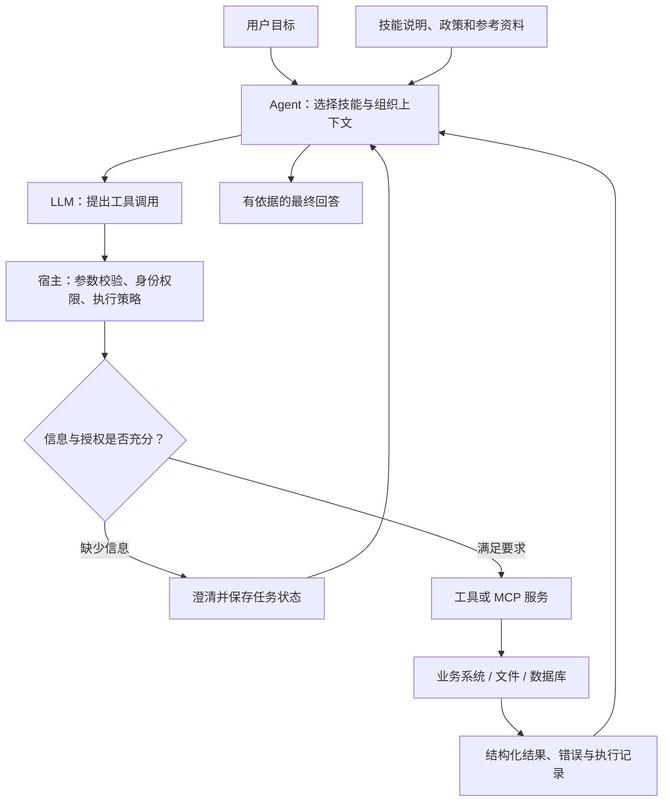

# A4-Skill：Agent Skill 设计与工程化落地

> 课程：SE3353（CHP-fa26）。本笔记以本目录 36 页 PPT 为主线，结合 40 页 HTML 课件、两份补充 PDF、`skill_sample/` 和 `largeskill/` 示例整理。PPT 与 HTML 是两套不同编排的材料，下文分别标注页码。代码解读来自静态检查，未启动 Ollama、天气服务或 Streamlit。课件中的性能倍数、成功率和产品排名不作为通用结论。

## 1. 本讲主线与知识地图

本讲回答：**如何把业务能力封装成 Agent 能选对、能调用、能检查结果，并能在失败后安全处理的技能？**

| 前后联系 | 解决的问题 |
| --- | --- |
| A1：Prompt | 怎样表达目标、约束和上下文？ |
| A2：MCP | 怎样统一发现和接入外部能力？ |
| A3：RAG | 怎样检索当前任务需要的知识与证据？ |
| A4：Skill | 怎样复用业务流程，并控制工具执行、状态变化与错误恢复？ |

| 模块 | 主 PPT 页码 | 学习重点 |
| --- | --- | --- |
| 概念与定位 | 2～7 | API、Agent、Skill 的关系 |
| 技能契约 | 8～15 | 描述、参数、执行约束与示例 |
| 六种设计模式 | 16～26 | 单一职责、幂等、槽位填充、HITL、上下文、组合 |
| 工程质量 | 27～29 | 参数校验、异常反馈与延迟控制 |
| 实训与大型 Skill | 30～34 | 修复路由、实现保护机制、按需检索与编排 |
| 总结 | 35～36 | 用软件架构约束执行过程 |

HTML 课件进一步展开：1～10 页讲 Function Calling，11～20 页讲工具契约，21～30 页讲执行环境，31～40 页讲纠错、评测与案例。

学习路径：**描述能力 → 选择技能 → 补齐参数 → 校验与授权 → 执行工具 → 读取结果 → 继续、澄清或结束。**

## 2. 先区分 Skill、Tool、Function Calling 与 MCP

### 2.1 本目录中 Skill 的两个层次

材料中存在两种相关用法，阅读时需要辨别：

1. **工具能力层**：HTML 课件常用 Skill 指有明确输入、输出和副作用边界的原子能力，如查库存、创建退款提案。
2. **技能包层**：补充 PDF 与 `skills/` 仓库用 Agent Skills 指可按需加载的指令、脚本和资源目录。它可以指导 Agent 完成包含多个工具的工作流程。

例如，“创建退款提案”可以是一个 Tool；“处理退款申请”可以是一个 Skill，规定先核对政策、补齐信息、检查订单，再调用提案工具。

Agent Skills 的文件形式与渐进加载机制可参见 [Agent Skills 规范](https://agentskills.io/specification)和 [Anthropic 工程说明](https://www.anthropic.com/engineering/equipping-agents-for-the-real-world-with-agent-skills)。技能包提供流程知识，执行权限仍由宿主与底层服务控制。

### 2.2 各组件的分工

| 概念 | 职责 | 退款场景中的例子 |
| --- | --- | --- |
| API / 普通函数 | 实现具体业务操作 | 查询订单、创建申请单 |
| Tool | 给模型使用的调用接口，包含名称、说明和参数结构 | `create_refund_proposal` |
| Function Calling | 模型输出工具调用意图及结构化参数 | 提出对某订单创建 100 元退款申请 |
| Skill | 封装任务知识、操作步骤和资源 | 退款办理流程与政策说明 |
| MCP | 标准化宿主与外部能力的交互 | 将订单工具暴露给多个 AI 应用 |
| Agent 控制器 | 管理消息、调度、状态、预算与停止条件 | 根据结果决定追问、重试或结束 |

普通 API 也可以维护状态、组合流程和返回结构化错误。课件中的 API / Skill 对比，重点是增加了**面向模型的描述、意图选择和反馈闭环**。

### 2.3 模型与宿主的执行边界



模型生成调用意图后，宿主才执行真实操作。“已生成退款参数”“提案已创建”“已批准”“资金已退回”是不同状态，回答必须对应实际发生的阶段。

## 3. 技能文档与渐进加载

### 3.1 技能包的基本结构

```text
refund-assistant/
├── SKILL.md             # 技能元数据与流程说明
├── scripts/             # 可执行脚本
├── references/          # 政策、接口说明等参考资料
└── assets/              # 模板与静态资源
```

规范入口是 `SKILL.md`，文件头使用 YAML 声明 `name`、`description`，正文写任务步骤。`scripts/`、`references/`、`assets/` 是可选组织方式。主 PPT 的 `Skill.md` 和简单示例的 `info.md` 应结合各自加载器理解，不能假定任意宿主都会识别。[规范说明](https://agentskills.io/specification)

课程所强调的四部分可以组织成下面的教学模板：

```markdown
---
name: refund-assistant
description: 处理订单退款申请；核对政策与订单信息，创建待审批提案。
---

# 退款申请处理

## 输入信息
- 订单编号。
- 退款金额、币种与退款原因。
- 当前身份由宿主提供，并由服务端核验订单归属。

## 执行步骤与约束
1. 缺少必要信息时，先询问用户。
2. 读取适用政策并核对订单的可退款状态。
3. 提交前由服务端验证金额、身份和权限。
4. 创建待审批提案，返回提案编号与状态。
5. 只有收到最终执行结果，才能说明退款已完成。

## 示例
- 用户仅说“我要退款”：询问订单及退款需求。
- 信息齐全且符合政策：创建提案并说明后续审批状态。
- 超出政策范围：说明限制并给出人工处理路径。
```

这是笔记中的结构示意，未在本仓库新增可安装技能。

### 3.2 三层渐进加载

| 层级 | 内容 | 使用时机 |
| --- | --- | --- |
| 元数据 | 名称与描述 | 判断技能是否与任务有关 |
| 主说明 | 操作步骤、输入要求、检查点 | 激活技能后读取 |
| 资源 | 参考文档、模板、数据与脚本 | 当前步骤需要时使用 |

这种组织方式减少了每次对话携带的无关内容，也方便维护长流程。脚本可以直接执行并返回结果，不必把整个实现放进模型上下文。[渐进加载说明](https://www.anthropic.com/engineering/equipping-agents-for-the-real-world-with-agent-skills)

两份补充 PDF 的共同重点是：把反复使用的业务经验保存为文件，按需读取，再结合数据和代码完成任务。它们展示的具体 IDE 路径、安装命令、模型选择和效果截图具有环境依赖，复习时重点掌握组织方式。

## 4. 技能契约：描述、参数、约束与示例

### 4.1 名称与描述影响工具选择

名称应体现业务对象与动作，例如 `query_stock`、`create_refund_proposal`。工具较多时，可增加领域前缀，避免不同系统中的同名操作混淆。

描述需要回答：

- **做什么**：查询天气，还是修改订单？
- **何时使用**：用户提出什么需求时适用？
- **边界是什么**：覆盖哪些数据、时间范围和操作？
- **需要什么信息**：缺少城市、订单号或金额时如何处理？

例如天气能力可以描述为：“查询指定城市的实时天气或接口支持范围内的预报；城市不明确时先澄清；历史气候统计使用其他数据源。”描述中的预报范围应与实际接口能力一致。

主 PPT 第 10 页展示了天气描述的边界设计；第 31 页用“计算币面面积”和“兑换货币”说明：关键词相近，业务意图仍可能完全不同。

### 4.2 参数结构与运行时验证

参数契约至少包含类型、必填项、取值范围与单位。以教学天气接口为例：

```json
{
  "type": "object",
  "properties": {
    "location": {"type": "string", "minLength": 1},
    "days": {"type": "integer", "minimum": 1, "maximum": 7},
    "data_type": {"type": "string", "enum": ["realtime", "forecast"]}
  },
  "required": ["location", "data_type"],
  "additionalProperties": false
}
```

`required` 控制字段是否必须出现，`enum` 控制合法取值，`additionalProperties` 控制额外字段。**字段缺省与显式传入 `null` 不同**；未声明必填项并不会自动补成 `null`。[JSON Schema 对象说明](https://json-schema.org/understanding-json-schema/reference/object)

宿主还需完成实际校验。下面是 Pydantic v2 写法：

```python
from typing import Literal
from pydantic import BaseModel, ConfigDict, Field, field_validator

class WeatherInput(BaseModel):
    model_config = ConfigDict(strict=True, extra="forbid")

    location: str = Field(min_length=1, description="明确的城市名称")
    days: int = Field(default=1, ge=1, le=7)
    data_type: Literal["realtime", "forecast"]

    @field_validator("location")
    @classmethod
    def nonempty_city(cls, value: str) -> str:
        value = value.strip()
        if not value:
            raise ValueError("城市名称不能为空")
        return value

args = WeatherInput.model_validate(
    {"location": "上海", "data_type": "realtime"}
)
schema = WeatherInput.model_json_schema()
```

默认 Pydantic 可能做类型转换；`strict=True` 可以收紧验证，具体行为还与类型及输入方式有关。类型注解也需要被校验框架实际执行，普通 Python 函数上的注解本身不会拦截入参。[Pydantic 严格模式](https://docs.pydantic.dev/latest/concepts/strict_mode/)

### 4.3 四层正确性

| 层次 | 检查内容 | 例子 |
| --- | --- | --- |
| 语法 | 能否解析 | JSON 引号、逗号和括号合法 |
| 结构 | 是否满足契约 | 金额是数值，必填字段齐全 |
| 业务 | 是否符合当前业务状态 | 金额不超过可退款余额 |
| 权限 | 当前主体是否有权执行 | 用户只能操作其有权限的订单 |

约束解码可以限制生成格式，但格式正确仍可能选错订单或金额。HTML 第 3、6 页的“100% 格式无误”需要限定在具体引擎、支持的文法和完整生成条件下，不能推广为执行一定成功。

### 4.4 执行约束必须落实到代码

文档写“金额不得超过 500 元”，可以帮助模型选参数；服务端仍需检查额度。文档写“只读查询”，也需要数据库权限和执行器保证只读。

Few-shot 示例应覆盖正常调用、缺少信息、越界请求与执行失败。保留“输入 → 简要判断依据 → 调用 → 结果”即可；可审计性主要依靠真实工具事件和业务状态，不依赖展示模型内部推理。

## 5. 六种设计模式

### 5.1 单一职责：让能力边界清楚

主 PPT 第 17～18 页将库存管理拆成查库存、锁库存、更新库存等操作。

拆分的收益是方便描述、校验、授权和测试。粒度也要服务业务：过度拆分会增加模型轮次，并暴露底层细节。适合一起完成且必须保证一致性的操作，可以封装成一个有明确边界的业务工具。

“无状态”指服务不依赖未声明的会话内存；它仍可以访问数据库。相同查询在库存变化后返回不同结果是正常行为。无状态、无副作用、幂等是三个不同概念。

### 5.2 幂等与状态安全：重试不重复产生业务效果

网络超时可能发生在操作成功之后、结果返回之前。支付工具没有收到响应时，不能据此断言“未扣款”。

```text
客户端发出请求 → 服务端完成操作 → 返回途中超时
客户端重试     → 服务端识别同一业务请求 → 返回原结果
```

幂等设计要点：

1. 为一次业务操作分配稳定的幂等键，由应用生成并保存。
2. 重试沿用原键，新业务请求使用新键。
3. 保存键、请求内容摘要、执行状态和最终结果。
4. 同一键携带不同金额或对象时，应拒绝冲突。
5. 通过数据库唯一约束、事务或原子操作处理并发请求。
6. 对执行结果不明的请求，查询业务状态并对账后再决定下一步。

内存字典适合课堂演示，但进程重启会丢失记录，多个进程也不共享状态。只做“查询是否存在 → 执行 → 保存”的分离步骤，还可能发生并发重复执行。

### 5.3 槽位填充与澄清：补齐必要输入

槽位是任务需要的字段，例如会议主题、时间、参加者。对“我老家明天会下雨吗”，城市尚不明确，系统可以返回：

```json
{
  "status": "NEEDS_INPUT",
  "error_code": "MISSING_PARAMETERS",
  "missing_fields": ["location"],
  "message": "请提供要查询的城市。"
}
```

Agent 保存已知字段，只询问影响执行的缺失信息。用户补充后合并状态、重新校验并继续。“明天下午两点”还需要结合当前日期与时区转换；涉及身份、金额和收款对象时不能随意猜测。

### 5.4 HITL：提案、审批与执行分离

HITL（Human-in-the-Loop）让人在指定步骤审批或修正操作。主 PPT 第 23～24 页的退款流程可表示为：

```text
创建提案 → PENDING_APPROVAL → APPROVED → 执行退款 → SUCCEEDED
                          ↘ REJECTED
                          ↘ EXPIRED
```

审批应展示具体对象、金额及影响范围，并绑定提案版本。审批后参数发生变化，需要重新检查授权；拒绝和超时也要有明确的处理路径。

课件称其为“两阶段提交”，这里主要是业务上的**先提案、后批准执行**，不能直接等同于分布式事务的 2PC 协议。需要审批的范围应由业务风险、既有授权和系统策略确定。

### 5.5 动态上下文感知：用可信上下文减少重复询问

宿主可以提供已认证用户、租户、时区和当前任务信息。上下文应记录来源与有效期，并按任务需要提供。

权限判断必须基于服务端可信身份。即使模型能填写 `user_id`，服务端也要核对其是否有权操作该用户的数据。定位只是业务信号，位置不一致本身不能证明欺诈。

### 5.6 组合模式：把原子能力组织成流程

```text
核对订单与政策 → 补齐退款信息 → 校验金额 → 创建提案 → 等待审批
```

组合流程需要定义每个节点的输入、输出、依赖、失败分支和恢复方式。相互独立的查询可以并行；依赖前一步结果的操作必须按顺序执行。

MCP 可以为这些工具提供统一接口，业务顺序与恢复逻辑由 Agent 控制器或工作流系统负责。一个 Skill 可以组合多个工具，多个工具也可以由同一个服务提供。

## 6. Function Calling 的消息闭环

HTML 第 4、7、10 页展示了以下过程：

1. 宿主将用户消息与可用工具定义发送给模型。
2. 模型返回工具名、参数与调用标识。
3. 宿主保留模型消息，校验参数并执行已注册工具。
4. 宿主把执行结果与调用标识对应起来，加入上下文。
5. 模型根据结果生成回答或提出后续调用。

课件采用的 Chat Completions 风格消息示意：

```json
[
  {
    "role": "assistant",
    "tool_calls": [{
      "id": "call_001",
      "type": "function",
      "function": {
        "name": "query_stock",
        "arguments": "{\"sku_id\":\"SKU-A\"}"
      }
    }]
  },
  {
    "role": "tool",
    "tool_call_id": "call_001",
    "content": "{\"in_stock\":true,\"quantity\":42}"
  }
]
```

调用 ID 用来关联请求与结果，不能替代业务幂等键、数据库锁或事务。一次返回多个调用时，要为每个调用保存对应结果，并遵守目标 API 的消息要求。

不同 API 的字段并不完全一致。例如 Claude 使用 `input_schema` 描述参数，以 `tool_use` 和 `tool_result` 内容块组织工具交互。适配层应处理消息与参数形式的差异。[Claude 工具使用文档](https://platform.claude.com/docs/en/agents-and-tools/tool-use/overview)

控制循环还应设置最大轮次、总耗时与重试预算。通过注册表查找允许的工具，避免用模型返回的名字直接执行任意代码。HTML 第 10 页的递归调用只是机制示意，实际实现还需要补齐这些边界。

## 7. 执行环境、副作用与恢复

### 7.1 读写分类与权限控制

| 工具类型 | 主要关注点 |
| --- | --- |
| 只读查询 | 数据访问权限、结果大小、限流与超时 |
| 文件或数据库修改 | 影响范围、并发修改、事务或恢复策略 |
| 对外业务操作 | 身份、授权、幂等、状态核验与审计 |
| 任意代码执行 | 隔离环境、网络、文件挂载、资源配额与清理 |

只读工具仍可能泄露数据或造成资源压力。`requires_approval`、`supports_undo` 等元数据只有被执行器落实后才产生作用。

### 7.2 沙箱与超时

进程、容器和微虚拟机提供不同的隔离边界，需要根据执行内容配置。普通 `subprocess` 本身不构成充分的安全沙箱；容器也要检查权限、挂载、网络和资源限制。

超时管理包括停止等待、终止或取消工作、回收资源、记录状态。`asyncio.wait_for()` 或取消线程等待，并不自动终止远端操作或后台线程。同步 `time.sleep()` 放在异步路径中还会阻塞事件循环。

### 7.3 预演、事务与补偿

`dry_run` 用于展示预期影响。数据库事务能在其边界内回滚；已发送消息、已完成的外部支付等通常需要补偿流程。

需要分清：

- `EXPLAIN` 通常提供执行计划，不能保证业务修改结果；`EXPLAIN ANALYZE` 可能实际执行语句。
- `git diff --check` 检查部分补丁格式问题，不能证明代码正确。
- 让模型生成 `rollback_sql`，不能保证旧数据可恢复。
- 自动撤销代码修改时，需要保留用户原有工作，避免恢复范围过大。

### 7.4 工具结果与间接提示注入

网页、邮件、文件及工具结果中的文字应按其来源作为数据处理。XML 标签和转义有助于标明数据边界，但无法单独消除自然语言形式的恶意指令。

执行器应持续检查工具调用是否符合用户任务、权限及允许的数据流。凭证保存在受控服务端，返回结果按需裁剪与脱敏；技能文档中的文字本身不能授予访问权限。

## 8. 错误反馈、重试与可观测性

### 8.1 让错误能指导下一步

| 错误类型 | 示例 | 后续处理 |
| --- | --- | --- |
| 参数错误 | 缺订单号、金额类型不符 | 补充或修正参数 |
| 业务限制 | 库存不足、金额超限 | 调整方案或说明限制 |
| 权限错误 | 无权访问订单 | 停止操作，走授权路径 |
| 临时故障 | 限流、服务暂时不可用 | 按策略退避重试 |
| 结果不明 | 写请求超时 | 核验状态，避免重复执行 |
| 程序缺陷 | 未处理异常、数据结构错误 | 记录诊断信息并修复或升级处理 |

查询结果为空是否属于错误，要由业务语义决定。结构化错误可包含 `error_code`、`message`、`retryable`、`operation_id` 和当前状态，避免通过搜索字符串 `Exception` 来决定重试。

### 8.2 自我纠错需要保留历史并限制次数

错误反馈给模型后，模型可以修正参数或提出新方案。宿主应保留失败调用及其结果，同时检查：是否重复同一错误、是否缺少用户信息、重试是否安全、预算是否耗尽。

HTML 第 33 页示意代码中，重新递归调用会重新创建消息列表，可能丢失已有上下文；它也只取第一个工具调用。理解纠错机制时，应以“持续维护状态、处理全部调用、明确停止条件”为准。

### 8.3 日志与执行轨迹

模型通常只需要错误类型、关键位置、摘要与必要上下文。完整日志可以单独保存，返回日志位置或任务编号，并说明截断范围。

执行轨迹应记录真实事件：工具名称、参数摘要、起止时间、结果状态、调用关联 ID 和重试次数。固定写出的“已重试”“已澄清”文本无法替代实际事件记录。

## 9. 大型 Skill：拆分、检索与性能

主 PPT 第 29、33～34 页与两份 PDF 都讨论了按需加载。

可以分三步组织大型技能：

1. 主文档保留任务入口、流程、必须遵守的规则和子资源索引。
2. 按业务主题拆分政策、接口说明、示例和模板。
3. 通过显式路径、规则路由或检索选择当前任务需要的内容。

工具检索（RAG-over-Tools）检索的是工具说明及 Schema；知识 RAG 检索的是回答依据。前者需要评估正确工具是否被选入候选集，后者需要评估事实证据是否相关且充分。

**关键权限和执行约束必须在执行路径中强制校验。** 它们不能只作为可能被 Top-K 检索漏掉的片段。

并行执行独立工具时，可以用以下近似理解延迟：

$$
T_{串行} \approx T_{模型} + \sum_i T_i,
\qquad
T_{并行} \approx T_{模型} + \max_i T_i + T_{调度}
$$

实际还受模型轮次、限流、连接数、结果汇总和资源竞争影响。`async` 关键字本身不意味着工具已经并行执行，也不能保证固定倍数的加速。

## 10. 代码阅读：`skill_sample/`

### 10.1 文件与调用链

| 文件 | 实际职责 |
| --- | --- |
| `antigravity.py` | 查找 `.agent/skills`，动态导入工具模块并调用 `execute(parameters)` |
| `main.py` | 显式调用天气、首次支付和同流水号重复支付 |
| `agent_chat.py` | 手工定义工具 Schema，通过 Ollama 获取调用意图并回传结果 |
| `.agent/skills/weather_forecast/` | 天气说明与天气工具 |
| `.agent/skills/safe_payment/` | 支付说明与内存幂等演示 |

这里的 `antigravity` 是仓库中的本地 Python 模块。`init()` 从当前工作目录向父目录寻找 `.agent/skills`；加载器选取技能目录中找到的第一个 `.py` 文件，缓存模块后调用 `execute()`。

**加载器没有读取 `info.md`，也没有自动从文档生成 Schema。** `agent_chat.py` 中的工具定义是手写的；两份 `info.md` 还有重复、矛盾或无关示例，不能直接当作经过验证的模板。

### 10.2 天气工具

天气工具校验 `location` 字段存在、`days` 为 1～7 的整数、`data_type` 为指定枚举，然后访问 `wttr.in`，请求超时为 5 秒。

阅读时注意：

- 城市只检查字段存在，没有充分检查空值或语义歧义。
- 预报代码只截取接口实际返回的日期，参数允许 7 天不等于数据源一定返回 7 天。
- 网络失败后生成随机 Mock 数据，仍返回 `Executed_Success`，但在文本中标记 `[Mocked]`。
- Mock 预报日期写死为 2026 年 6 月，不能作为当前天气使用。

这个例子说明：**降级数据需要明确标记来源和适用范围**。最终回答应保留“模拟数据”事实，避免把执行成功状态误读成真实查询成功。

### 10.3 支付工具

工具检查必填字段，将金额转换成 `float`，要求金额大于 0 且不超过 500。成功后把结果写入模块内字典；相同 `request_id` 再次调用时返回 `Idempotent_Skip` 及原交易信息。

它演示了进程内重复调用的去重，但仍有这些限制：

- 没有持久化和并发原子性保证。
- 相同流水号改变用户或金额时，没有请求内容冲突检查。
- 金额使用浮点数，且没有显式拒绝 `NaN` 等非有限值。
- 代码没有真实支付，也没有实现文档提到的人工审批流程。
- 异常回复中的“并未扣款”只适用于这里的模拟假设，真实接口超时需要核对服务端状态。

### 10.4 Ollama 交互示例

`agent_chat.py` 优先读取 `OLLAMA_MODEL`，否则查询本地模型并按代码中的候选列表选择。一次初始调用后执行工具，再调用模型生成最终回复。

第二次请求没有继续提供工具集，因此它展示的是一次工具执行与结果总结，尚未实现完整的多轮纠错控制器。自动选中的模型也需要实际具备相应工具调用能力。

## 11. 代码阅读：`largeskill/` 退款编排

### 11.1 结构与流程

核心文件位于 `.agent/skills/commerce_refund_skill/`：

| 路径 | 职责 |
| --- | --- |
| `core/agent_orchestrator.py` | `FinancialAgentOrchestrator` 与异步事件生成器 |
| `tools/sub_tools.py` | 模拟定位、库存和退款提案接口 |
| `prompts/agent_templates.py` | 澄清问题与错误决策提示模板 |
| `policies/refund_policy_premium.md` | Premium 会员退款政策说明 |
| 外层 `app.py` | Streamlit 展示与交互参数 |

事件流程为：

```text
初始化 → 定位检查 → 必要时模拟澄清 → 库存检查 → 500 元额度检查
      → 创建提案 → 首次故障时判断是否重试 → 返回待审批状态
```

本地模型主要参与生成定位追问和解释异常。主体执行顺序由 Python 控制，`CORE_PLANNER_PROMPT` 在该编排器中未被调用。

### 11.2 展示意图与实际实现

| 展示或文档表述 | 当前代码行为 |
| --- | --- |
| RAG 检索并加载政策 | 事件文本模拟加载；额度直接写为 `500.0`，未读取政策文件或向量库 |
| 用户澄清后恢复 | 等待后使用写死的上海出差文本，没有真实用户输入与恢复接口 |
| 空间安全审计 | 根据字符串是否包含“上海”“盐城”判断特定不匹配情形 |
| 并行库存与风控 | 库存查询及额度判断依次执行 |
| 异步工具编排 | 事件生成器是异步的，但子工具含同步 `time.sleep(2.0)` |
| 幂等退款提案 | 集合只记录是否经历首次故障，后续每次成功调用都会生成新提案 ID |
| 进入人工审批队列 | 返回 `PENDING_APPROVAL` 字典，未实现持久化审批队列及批准后的执行 |
| DAG Trace | 部分节点与状态固定填写，可能与实际执行分支不一致 |

尤其要区分：`_RETRIED_REQUESTS` 是**故障注入状态**，不是已成功提案的结果库。同一个键在第二次、第三次成功调用时仍会得到不同的 `proposal_id`。

编排器的默认幂等键是固定字符串；界面会覆盖它。核心额度校验只判断 `refund_amount > 500`，界面滑块范围不能替代服务端完整参数验证。错误决策解析失败时默认重试，且第二次工具调用的异常没有在同一重试分支内再次处理。

因此，这组代码适合学习流程分支与事件展示；若继续工程化，需要补充真实状态存储、可信身份、提案幂等、人工输入恢复、审批执行及事件驱动的追踪记录。

## 12. 本地实验入口

以下命令是阅读代码后的运行入口说明，本笔记编写过程中未执行这些服务：

```bash
# 从仓库根目录进入简单示例
cd A4-Skill/skill_sample
python3 main.py

# 需要 Python ollama 包、本地 Ollama 服务及相应模型
python3 agent_chat.py
```

`main.py` 会尝试天气网络请求，支付部分是 Mock。若网络不可用，天气结果会降级为模拟数据。

退款编排从仓库根目录使用：

```bash
cd A4-Skill/largeskill

# CLI：模型调用使用标准库 HTTP 客户端
PYTHONPATH=.agent/skills python3 -m commerce_refund_skill.core.agent_orchestrator

# Web：额外需要 streamlit
PYTHONPATH=.agent/skills python3 -m streamlit run app.py
```

编排器固定请求本地 `http://localhost:11434/api/generate` 的 `qwen2.5:latest`。模型不可用时部分步骤会进入代码内的降级分支，因此演示完成也不能单独证明模型调用成功。

## 13. 实训与评测

### 13.1 主 PPT 的“故障沙箱”任务

第 30～32 页要求识别代码缺陷、功能异常和技能描述问题，重写路由边界，并选择幂等或 HITL 模式落地。课件中的 `sandbox_project/` 是任务结构示意，本目录现有练习材料主要是两组 Python 示例。

可以按以下顺序完成练习：

1. 写出工具的职责、输入、输出与副作用。
2. 准备正常请求、相近但不适用的请求及缺参数请求。
3. 修改描述后观察误调用是否减少。
4. 实现所选模式，并用重复提交或审批拒绝验证实际状态。
5. 保存失败样例、修复说明和执行证据。

### 13.2 评估选择、参数与最终效果

| 指标 | 衡量的问题 |
| --- | --- |
| 工具选择准确率 / Precision、Recall、F1 | 是否选对工具、误调用或漏调用？ |
| 参数合法率 | 是否满足 Schema 与业务校验？ |
| 参数语义正确率 | 是否选对对象、时间、金额和单位？ |
| 首次成功率 Pass@1 | 第一次尝试是否满足任务成功标准？ |
| 有限轮次内成功率 | 在给定预算内能否完成任务？ |
| 状态安全指标 | 是否出现重复写入、未授权执行或错误成功声明？ |
| 成本与时延 | 模型轮次、Token、工具耗时和端到端延迟如何？ |

$$
\mathrm{Precision}=\frac{TP}{TP+FP},\qquad
\mathrm{Recall}=\frac{TP}{TP+FN},\qquad
F_1=\frac{2TP}{2TP+FP+FN}
$$

评测前要说明样本单位、正确工具集合和多工具调用的计分方法。无须调用工具的请求也必须纳入评测，正确直答不能直接算作某个工具的真阳性。

HTML 第 36 页将参数精确匹配率称为 Pass@1；一般使用 Pass@1 时应先定义成功判据。JSON 字典完全相等也无法覆盖所有语义等价结果。

建议覆盖的关键样例：

- 同一业务请求重复提交，最终只有一次业务效果。
- 同一幂等键携带不同金额，被识别为冲突。
- 写请求成功但响应丢失，重试后仍返回原结果。
- 缺少城市或订单时准确追问，且保留已知字段。
- 退款金额为 0、负数、500、超过 500 或非有限值时按契约处理。
- 审批拒绝后没有执行；审批期间修改参数后重新校验。
- 数据源失败时明确说明降级，Mock 数据不冒充真实结果。

## 14. 易混点速查

| 常见误解 | 准确理解 |
| --- | --- |
| 写了技能说明就有执行保护 | 说明指导模型，宿主与业务服务落实约束 |
| Tool 与技能包一一对应 | 一个技能包可以指导多个工具与步骤 |
| JSON 合法代表任务正确 | 还需检查业务语义、权限和实际结果 |
| 无状态就等于幂等 | 幂等关注重复请求对业务状态的影响 |
| 超时表示操作没发生 | 操作结果可能未知，需要查询与对账 |
| 传入 RequestID 就实现了幂等 | 服务端必须原子地去重并保存结果 |
| 待审批代表业务已经完成 | 提案、审批与执行是不同状态 |
| RAG 召回政策就能强制执行 | 执行服务仍需应用完整政策与权限规则 |
| 异步函数天然不阻塞 | 内部同步 I/O 和睡眠仍可能阻塞 |
| 返回 SUCCESS 就能确认真实成功 | 要核对数据来源、业务状态及降级标记 |

## 15. 复习问题与材料索引

### 15.1 自测问题

1. 技能包、Function Calling 和 MCP 分别承担什么职责？
2. 为什么工具描述要写清触发条件与适用边界？
3. 槽位填充时，哪些信息来自用户，哪些应由可信宿主提供？
4. 如何处理“服务端执行成功，但客户端收到超时”？
5. 为什么同一键反复生成新退款提案不满足幂等要求？
6. Proposal / Approval / Execution 如何划分权限和状态？
7. 大型技能拆分后，如何避免遗漏必需的执行约束？
8. 为什么 `largeskill/` 的流程展示不能证明已实现真实 RAG 和审批系统？

### 15.2 本地材料

- [主 PPT：Agent Skill 设计与工程化落地](A4-Skill.pptx)：六种模式与实训主线。
- [HTML 课件入口](A4-Skill/1.html)：Function Calling、执行环境与评测扩展。
- [Agent Skills Engineering](Agent_Skills_Engineering.pdf)：技能复用、渐进加载及数据与代码资源。
- [Agent Skills: The New Programming Standard](Agent_Skills_The_New_Programming_Standard.pdf)：技能包组织与应用案例。
- [简单调用入口](skill_sample/main.py)、[Ollama 示例](skill_sample/agent_chat.py)：工具执行与结果回传。
- [退款编排器](largeskill/.agent/skills/commerce_refund_skill/core/agent_orchestrator.py)、[子工具](largeskill/.agent/skills/commerce_refund_skill/tools/sub_tools.py)：组合流程、故障注入与提案状态。
- [技能仓库说明](skills/README.md)、[技能模板](skills/template/SKILL.md)：本地技能包参考。

**本讲要点：把业务知识写成可复用技能，把真实执行交给有明确契约、权限、状态管理和结果验证的系统。**
