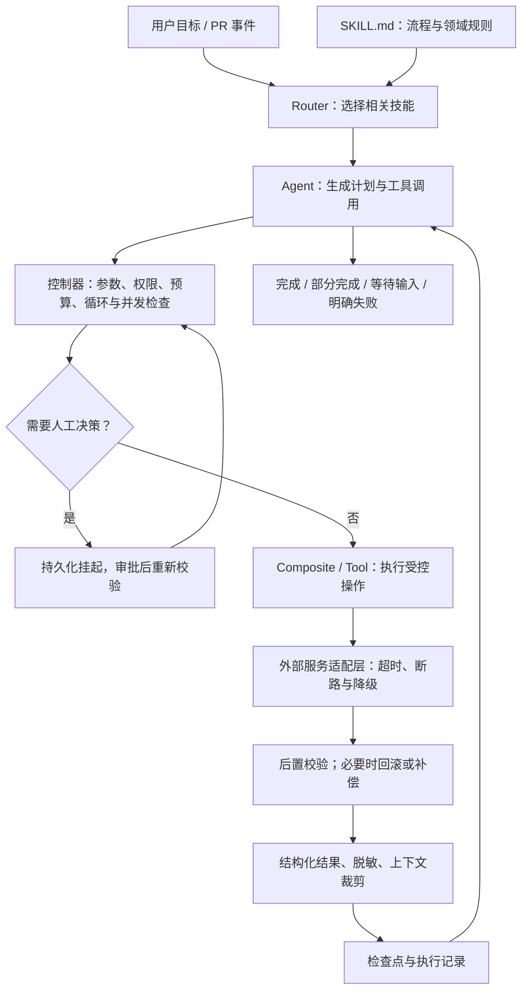

# A5-Skill-Pattern：技能设计模式与鲁棒性工程

> 课程：SE3353（CHP-fa26）。本笔记依据本目录 `1.html`～`40.html` 整理，延续前几讲的主题式结构。课件代码主要是架构示意，本目录没有配套的完整可运行工程；文中的补充流程也不代表已实现或已验证的系统。涉及标准字段与框架接口的说明，另参考官方文档核对（2026-10-22）。课件中的成功率、性能倍数、费用事故及“零风险”等表述缺少可复核实验条件，不作为通用结论。

## 1. 本讲主线与知识地图

本讲回答：**如何把零散工具组织成可复用、可恢复、可控制成本，并能持续评测的 Agent 技能系统？**

A4 重点讨论单个技能的契约、执行边界与业务流程；A5 进一步讨论多个技能如何组合，以及整个控制循环如何处理失败、并发、状态恢复和版本迭代。

| 模块 | 课件页码 | 核心问题 |
| --- | --- | --- |
| 技能规范与生态落地 | 1～10 | 如何组织 `SKILL.md`，并与 Java 服务结合？ |
| 技能设计模式 | 11～20 | 如何路由、组合、降级、审批、缓存和撤销？ |
| 鲁棒性工程 | 21～30 | 如何限制循环与预算，管理外部接口、状态和并发？ |
| EDD 与综合案例 | 31～38 | 如何评估效果、防止退化，并组成 CI/CD Agent？ |
| 总结与后续课程 | 39～40 | 如何连接下一讲的推理、规划和记忆系统？ |

学习主线：**明确契约 → 缩小工具选择范围 → 编排执行 → 校验与恢复 → 记录证据 → 评测迭代。**



图中的每项保护都需要代码或基础设施落实。模型负责提出下一步行动，控制器与业务服务负责判断是否允许执行、怎样执行，以及结果是否成立。

## 2. 标准化技能：文件说明与运行时契约

### 2.1 Skill、Tool 与控制器的分工

| 层次 | 表达内容 | 代码重构场景中的例子 |
| --- | --- | --- |
| Skill 文件 | 任务适用范围、工作步骤、参考规则 | 先分析 SQL，再提出改写，最后验证语义 |
| Tool 契约 | 名称、输入 Schema、输出与错误 | `analyze_query`、`run_tests` |
| 工具实现 / 业务服务 | 实际读取、计算和状态修改 | 调用数据库分析器、执行测试 |
| Agent 控制器 | 选择、调度、预算、暂停、恢复与结束 | 达到重试上限后输出部分报告 |

课件有时把“工具函数”和“技能包”都称为 Skill。阅读代码时，应根据它是在提供流程指导，还是在执行真实动作，判断其具体含义。

### 2.2 `SKILL.md` 的基本结构

技能目录以 `SKILL.md` 为入口，采用 YAML Frontmatter 加 Markdown 正文。开放规范要求 `name` 和 `description`；其他标准字段包括 `compatibility`、`metadata` 等，`allowed-tools` 属于实验性字段。课件中的 `tools`、`environment_variables`、`user_approval_required` 不应直接当成所有宿主都支持的标准字段。[Agent Skills 规范](https://agentskills.io/specification)

下面是依据第 4 页改写的教学示例，仅展示文件内容：

```markdown
---
name: refactor-legacy-sql
description: 分析 MySQL 慢查询中的索引使用问题，在用户请求 SQL 优化时提供改写与验证建议。
compatibility: 需要可读取的表结构、索引信息及适用数据库版本。
---

# SQL 优化流程

1. 确认数据库版本、字段类型、索引和查询语义。
2. 阅读执行计划，定位可能影响索引使用的条件。
3. 提出保持语义的改写，并解释适用前提。
4. 在受控环境中验证结果及执行计划。
5. 输出改写前后差异、验证证据和未确认事项。

## 示例
- 原条件：DATE(created_at) = '2026-08-01'
- 候选改写：created_at >= '2026-08-01 00:00:00'
  AND created_at < '2026-08-02 00:00:00'
- 检查字段类型、时区及业务日期边界，再判断是否等价。
```

这个例子的重点是**把触发条件、操作步骤和验证条件写清楚**。范围改写是否改善性能，还取决于索引、数据分布和优化器选择，不能只看 SQL 外形下结论。

即使自定义加载器支持 `environment_variables`，仍需由加载器检查变量；即使写了 `user_approval_required`，仍需由控制器实施审批。文件本身不能授予数据库权限或保证事务回滚。

### 2.3 项目作用域与个人作用域

第 3 页以 Claude Code 为例：

| 作用域 | 目录 | 用途 |
| --- | --- | --- |
| 项目级 | `.claude/skills/<name>/SKILL.md` | 随仓库维护的项目流程与规则 |
| 个人级 | `~/.claude/skills/<name>/SKILL.md` | 开发者跨项目使用的个人技能 |

对于企业、个人、项目这三类来源中的**同名技能**，Claude Code 文档给出的优先级是企业高于个人、个人高于项目。它是该宿主的同名解析规则，不是所有 Agent 的通用规则，也不代表项目技能只要提交 Git 就会在所有环境强制执行。[Claude Code 技能文档](https://code.claude.com/docs/en/skills)

### 2.4 渐进加载与大型技能拆分

第 3、5 页提出三层加载：先读取名称和描述以判断相关性，命中后读取主说明，执行到具体步骤时再读取参考资料或脚本。

```text
architecture-auditor/
├── SKILL.md                 # 适用范围、工作流与资料入口
├── references/
│   ├── database-rules.md    # 数据库审查规则
│   └── security-rules.md    # 安全审查规则
└── scripts/
    └── run_checks.py        # 可重复执行的检查
```

主文件保留任务入口、共同约束和必要检查点；细节按领域拆分，并写明何时读取哪个文件。相对链接是导航入口，实际加载仍依赖宿主和 Agent 的执行行为。

课件中的“每个摘要约 100 Tokens”“主文件 300～500 Tokens”属于组织预算示例。关键是减少无关内容，同时保证必需规则可被找到，不是达到某个固定字数。

## 3. Spring AI：把工具接入既有业务服务

### 3.1 类型、依赖注入与业务边界

第 6～8 页的核心是复用已有的服务体系：

```text
模型生成参数
  → Tool Callback 反序列化
  → 运行时参数与业务校验
  → 注入的 Service 执行鉴权和事务逻辑
  → Repository / 外部服务
  → 结构化结果
```

Java Record 可以表达请求与响应结构，依赖注入使工具能够复用 Service、Repository、缓存和审计组件。但**编译期类型检查不能验证模型传入的业务事实**：订单是否存在、用户是否有权修改、状态是否允许流转，都需要运行时检查。

同样，Python 也可以建立严格校验、事务和测试体系；这些工程能力不由语言名称自动决定。

### 3.2 注意课件 API 的版本背景

课件使用 `Function` Bean、`@Description`、`FunctionCallback` 和 `.functions(...)` 展示桥接思路。编写笔记时查阅的 Spring AI 2.0 文档采用 `@Tool` 或显式 `ToolCallback`；其中 `FunctionToolCallback` 可包装函数，工具通过 `.tools(...)` 传入。2.0 已移除旧的裸 `Function` Bean 按名称解析模式，不能将课件片段直接视为当前版本完整代码。[Spring AI Tool Calling](https://docs.spring.io/spring-ai/reference/api/tools.html)

课程需要掌握的稳定分工是：**类型描述输入结构，工具说明帮助选择，框架完成调用桥接，业务服务落实权限与状态规则。**

### 3.3 事务与身份不会自动覆盖一切

`@Transactional` 需要正确配置事务管理，并经过有效的代理调用。默认代理模式下，同一对象内部的自调用不会触发该事务拦截；默认回滚规则也不是“任意异常都回滚”，需要按异常类型与配置判断。[Spring 事务注解说明](https://docs.spring.io/spring-framework/reference/data-access/transaction/declarative/annotations.html)

工程上还应检查：

- 方法权限控制是否启用，异步执行时身份上下文是否正确传递。
- 可信用户身份是否来自服务端认证，而非模型填写的 `user_id`。
- 工具是否通过受控 Service 调用，避免绕过校验直接访问 DAO。
- 数据库事务是否真正覆盖当前改动；远程 API、文件修改通常不在同一个本地事务内。
- 异常是否被吞掉，导致外层误以为应当提交事务。

### 3.4 `SKILL.md` 与 Java 工具的双模集成

第 9 页用 `ResourcePatternResolver` 扫描文件，再通过解析器和 Advisor 注入技能说明。应将 `SkillMdParser`、`SkillRegistry`、`DynamicSkillAdvisor` 理解为课件提出的应用组件：片段没有给出它们的实现，不能据此认定任意 Spring AI 项目都会自动加载技能目录。

可实现的桥接流程是：扫描文件 → 校验元数据 → 注册技能 → 按请求加载正文 → 映射可用工具 → 调用受控业务服务。跨宿主复用时，还需核对字段支持、工具名称、资源路径、身份及权限语义。

## 4. 八类技能设计模式总览

第 12～19 页逐项讲解了八类模式；总结页将其中若干项合并为“五大模式”。复习时以具体职责为准。

| 模式 | 解决的问题 | 核心做法 | 需要注意 |
| --- | --- | --- | --- |
| Router：路由 | 工具多、意图边界重叠 | 领域过滤后选择 Top-K | 错误过滤可能漏掉必需工具 |
| Composite：组合 | 固定流程被拆成过多模型决策 | 用代码封装子步骤 | 保留阶段状态与失败证据 |
| Fallback：降级 | 依赖超时或不可用 | 超时、断路、替代实现 | 替代结果可能能力较弱 |
| HITL：人工介入 | 需要人工决策或授权 | 持久化挂起与恢复 | 审批需绑定具体操作版本 |
| Cache / Idempotency：缓存与幂等 | 重复计算、重复副作用 | 缓存结果；业务请求去重 | 两者目的与实现不同 |
| Context Pruning：上下文裁剪 | 日志过长、信息稀释 | 提取关键证据并限制预算 | 裁剪后必须能追溯原始记录 |
| Bidirectional Validation：双向校验 | 错误入参或错误输出 | 执行前后分别验证 | 后置失败不能自动撤销已发生的写入 |
| Dry-Run / Rollback：预演与回滚 | 写入后难以恢复 | 预检查、隔离、快照、恢复 | 可恢复范围必须明确 |

## 5. 路由、组合与降级

### 5.1 Router：先缩小选择范围

第 12 页采用两阶段选择：

```text
用户请求 → 领域分类 → 领域内规则 / 向量检索 → Top-K 工具 → 主模型决策
```

例如“检查这个 PR 的 SQL 注入问题”，先进入代码安全领域，再选择代码读取、静态扫描、补丁验证等工具。工具检索与 A3 的 RAG 思路相似，只是召回对象变成技能描述和调用契约。

设计时要保留低置信度处理路径：跨领域任务可挂载多个领域的工具；没有合适候选时可以澄清或扩大检索。权限过滤应独立实施，**检索相关不等于允许调用**。

Top-K 减少了主模型看到的候选数量和描述长度，但路由与检索本身也有开销。课件的 `O(N) → O(K)` 更适合解释模型侧候选规模，不能直接作为整个系统的算法复杂度证明。

### 5.2 Composite：把稳定子流程封装起来

第 13 页的例子是：

```text
AutoSqliFixer(repo)
  → 解析源码 / AST
  → 执行静态扫描
  → 若发现问题，生成修复提案
  → 在隔离环境中验证
  → 返回报告、补丁及验证状态
```

适合固化的是已知依赖关系、参数传递和检查顺序。任务目标仍模糊时，应保留澄清或规划空间。内部调用了生成模型的步骤也仍然具有不确定性，固定编排并不等于输出一定正确。

组合技能应说明失败发生在哪一步，哪些步骤已完成、哪些产生副作用、能否继续。仅返回 `FIXED` 会掩盖“生成了补丁”“应用了补丁”“通过了测试”之间的差异。

### 5.3 Fallback：故障隔离与能力降级

第 14 页使用“远程代码搜索 → 本地 `git grep` → 本地规则”的降级链。

| 机制 | 作用 |
| --- | --- |
| Timeout | 限制一次调用等待的时间 |
| Retry | 在有限次数内重试适合重试的失败 |
| Circuit Breaker | 持续失败时暂时停止访问故障依赖 |
| Fallback | 改用其他实现或返回能力受限的结果 |

断路器通常包含 Closed（正常调用）、Open（快速拒绝）和 Half-open（有限探测恢复）三个状态。只写 `is_closed()` 和失败计数，还没有完整实现恢复流程。

返回降级结果时，应包含来源、覆盖范围、数据时效与限制。例如本地关键词搜索不能保证具有远程语义搜索的召回能力。鉴权失败不应通过换一条路径绕过权限；写请求超时也不能直接当作“没有执行”而重发。

课件的命令示例中，`-n` 缺少引号，直接复制会产生代码错误。使用外部进程还需区分“无匹配”“执行失败”“超时”，不能统一吞异常。

## 6. HITL：持久化挂起与恢复

第 15 页将人工决策嵌入状态机：

```text
拟定操作 → 等待审批 → 批准 / 拒绝 / 修改方案
                         ↓ 批准
                  重新校验 → 执行 → 记录结果
```

挂起应保存任务状态并释放执行资源，由后续事件恢复，不需要让工作线程持续等待。

审批记录至少需要关联任务、待执行操作、参数或补丁摘要、资源版本、审批身份、决定与时间。若审批后参数改变或目标代码已经更新，必须重新判断原审批是否仍覆盖当前操作。

“批准”也不等于“执行成功”。恢复时仍需校验身份、当前状态、幂等键与前置条件，并防止同一审批事件被重复消费。拒绝、取消和过期也应有明确的终止状态。

## 7. 缓存与幂等：两种不同的重复处理

### 7.1 缓存避免重复计算

第 16 页用扫描输入计算缓存键：

```text
cache_key = Hash(内容 + 工具版本 + 规则版本 + 规范化参数 + 必要的环境信息)
```

缓存应覆盖影响结果的全部输入。扫描代码时，如果规则依赖文件路径、其他文件或项目配置，仅对单个文件内容取哈希就可能返回错误结果。多租户数据还需按访问边界隔离，读取缓存时仍要鉴权。

其他检查包括：有效期与失效策略、空结果是否被误判为未命中、并发未命中是否重复计算，以及读取文件到扫描期间内容是否发生变化。课件的秒级到毫秒级加速只是示例，需实际测量。

### 7.2 幂等避免重复业务效果

幂等关注的是：同一业务操作重复提交后，最终效果与只提交一次一致。

| 维度 | 结果缓存 | 写操作幂等 |
| --- | --- | --- |
| 目标 | 节省计算与访问开销 | 避免重复扣减、创建或发送 |
| 典型键 | 内容、配置与版本的摘要 | 一次业务操作的稳定标识 |
| 并发要求 | 防止缓存击穿，必要时合并请求 | 原子占位、唯一约束与状态协调 |
| 重试结果 | 返回可复用的计算结果 | 返回原操作结果或处理中状态 |

两次合法且参数相同的业务操作，可能需要各自发生一次，不能仅凭“参数相同”把它们永久合并。反过来，同一幂等键携带不同参数时，应报告冲突。

只执行“查缓存 → 没有就写 → 保存结果”不能保证并发安全：两个请求可能同时查到不存在；写入成功后、保存结果前也可能崩溃。需要业务存储支持的原子协调，并保留处理中、已成功、失败或结果未知等状态。

## 8. 上下文、校验与恢复

### 8.1 Context Pruning：保留诊断证据

第 17 页建议保留日志开头、结尾和关键错误块。更有用的 Observation 可以包含：

```json
{
  "status": "TEST_FAILED",
  "exit_code": 1,
  "failed_tests": ["test_order_status_transition"],
  "error_excerpt": "Expected SHIPPED, got PENDING",
  "truncated": true,
  "full_log_ref": "artifact:task-42/test-log"
}
```

其中 `artifact:` 是笔记中的逻辑引用示意，需要应用提供实际的存储与读取机制。

裁剪时应保留命令、退出码、失败位置、错误类型与必要上下文。大结果集可返回总数、筛选条件、分页信息与样本，但不能把部分样本说成完整结果。

课件的 `max_token_budget` 只被保存，没有实际参与裁剪；“前 15 行 + 后 25 行 + 错误块”也不保证小于 500 Tokens。应按实际分词或保守估算执行预算检查，并保留可按需读取的完整记录。

### 8.2 双向校验：输入与结果都要检查

第 18 页的基本结构是：

```text
Pre-check → Execute → Post-check
```

| 位置 | 检查项 | 示例 |
| --- | --- | --- |
| 执行前 | 类型、范围、权限、资源版本、路径与预算 | 文件在允许目录内，补丁基线未变化 |
| 执行后 | 输出格式、业务不变量、实际结果 | 返回结构正确，测试通过，订单状态符合预期 |

路径检查不能只做字符串前缀匹配；还需考虑规范化、符号链接以及检查和执行之间的资源变化。Schema 校验只能验证约定的结构和约束，不能独立证明业务正确。

课件先 `_apply_patch`，再验证输出。若后置检查失败，文件可能已经修改。因此，需要把后置检查安排在隔离工作区或可回滚边界内；失败时明确返回实际状态，不能只改成 `POST_CHECK_FAILED` 就假定副作用消失。

### 8.3 Dry-Run：预先检查能够检查的条件

第 19 页的 `git apply --check` 用于检查补丁是否可应用，不验证业务逻辑或测试结果。预演后到实际应用前，目标内容也可能发生变化，需要重新检查基线。

SQL 分析同样要区分命令语义：普通执行计划用于分析优化器计划，而 `EXPLAIN ANALYZE` 会执行语句并采集运行信息，不能混同为无执行成本的静态检查。[MySQL EXPLAIN 文档](https://dev.mysql.com/doc/refman/8.4/en/explain.html)

### 8.4 Rollback：恢复到哪个状态

恢复设计必须回答四个问题：保存了哪些内容、恢复到哪个版本、是否影响其他修改、恢复失败怎么办。

| 操作 | 可能的恢复方式 | 边界 |
| --- | --- | --- |
| 代码补丁 | 隔离工作区、精确备份或逆向补丁 | 保留用户原有修改及并发修改 |
| 单库事务写入 | 事务回滚 | 受事务范围、数据库能力与提交时点限制 |
| 已提交的远程操作 | 查询状态，再执行补偿 | 补偿本身可能失败，未必完全可逆 |
| 已发出的通知 | 后续更正或撤回能力 | 不能保证接收者未看到原消息 |

课件多次把 `git checkout .` 当作通用 Undo，但它不能自动找回任意操作前快照，也可能覆盖用户已有的未暂存修改。Git 的恢复操作有明确来源和目标；例如 `git restore` 默认从索引恢复工作区，并不是从“Agent 开始工作时”恢复。[Git restore 文档](https://git-scm.com/docs/git-restore)

实践中优先让修复在独立工作区完成，并验证恢复机制本身。`ROLLED_BACK` 只能用于已经确认恢复成功的情形；恢复失败应另行报告。

## 9. 鲁棒性控制：循环、预算与外部接口

### 9.1 动作指纹检测重复

第 22 页将工具名与规范化参数编码为指纹：

```text
fingerprint = SHA256(tool_name + canonical_json(arguments))
```

排序 JSON 键可减少键顺序造成的差异，但业务等价参数还可能涉及默认值、路径、时间格式与数值表示，需要按契约规范化。

检测器可以识别连续相同调用，也可扩展为 `A → B → A → B` 等重复序列。判断时应结合资源版本、上次结果和是否取得进展，避免把正常轮询或允许的重试误判为无效循环。

第 22 页代码仅检测末尾连续相同指纹，**没有实现图环检测**。它所称的“64 位 Hash”也不准确：SHA-256 是 256 位，十六进制表示为 64 个字符。

### 9.2 重复循环不等于并发死锁

- **无效循环**：Agent 持续执行没有进展的动作，消耗调用与 Token。
- **死锁**：多个执行者持有资源并互相等待，无法继续。

前者可通过进展检测、有限重试和硬停止处理；后者需要资源锁顺序、锁获取超时与正确释放等机制。两者不能靠一个重复哈希窗口统一解决。

重复警告只是软引导。控制器还要实施最大轮数、工具调用数、总耗时等硬边界，且被阻断后的反思轮次也要计入预算。

### 9.3 预算控制与限流

第 23 页提出多维预算：模型轮次、工具调用数、Token、费用和任务期限。它们与 API 限流的区别是：预算限制单任务或账户总消耗，限流限制某段时间内的调用速度。

更完整的预算闭环是：

```text
调用前估算并预留 → 设置单次输出与耗时上限 → 执行
    → 按实际使用量结算 → 判断能否继续
```

预算应按任务隔离，并在并行调用时原子预留。若只在调用结束后统计，可能已超支；若每轮把累计 Token 再加一次，则会重复记账。

达到阈值时，输出已完成部分、证据、未完成原因和后续入口。生成总结本身也需要资源，因此应预留结束预算。课件的 10/12 步、50,000 Tokens 和 80% 预警都是配置示例。

### 9.4 ACL：用内部契约隔离外部变化

第 24 页的 ACL 指 **Anti-Corruption Layer（防腐层）**，不是 Access Control List（访问控制列表）。

```text
Agent / Skill
    → 内部稳定接口与领域 DTO
    → 外部 API 适配器
    → 第三方服务
```

适配器负责字段、枚举、分页和错误类型转换，也可以协调超时与降级。外部 API 改版时，优先修改适配器，减少对模型可见契约的影响。

课件里的 Jira 字段迁移属于假设示例，不能作为真实 API 变更记录。若关键字段缺失，应返回明确的不兼容错误，而不是一律填入 `UNTITLED` 并宣称正常。外部能力发生实质变化时，内部契约也可能需要升级。

### 9.5 结构化错误：帮助决定下一步

第 29 页强调将异常转为可诊断结果。可以采用如下应用自定义契约：

```json
{
  "status": "FAILED",
  "error_type": "VERSION_CONFLICT",
  "message": "目标文件已更新，当前补丁基于旧版本。",
  "retryable": false,
  "next_action": "READ_LATEST_AND_REPLAN",
  "side_effect_state": "NOT_APPLIED",
  "trace_id": "trace-example-42"
}
```

错误报告应说明是否发生副作用，以及是允许原样重试、需要修改参数、重新规划，还是应终止。写请求超时时可能需要 `UNKNOWN` 状态及对账，而不是直接标记 `NOT_APPLIED`。

提取堆栈时要处理无堆栈、异常链和源码不可用等情形。第 29 页虽检查了 `last_frame` 是否存在，构造 `snippet_context` 时却仍直接读取 `last_frame.lineno`，可能在格式化错误时再抛异常。固定提示“检查空值或类型”也不适用于所有错误。

## 10. 检查点恢复与并发一致性

### 10.1 检查点保存控制流程

第 25 页保存当前节点、消息、待执行工具调用及版本。完整任务状态还可能需要：工具执行标识、业务幂等键、审批状态、资源版本、预算使用量、结果引用和状态格式版本。

检查点用于恢复任务，不等同于代码备份或数据库快照。以 LangGraph 为例，checkpointer 保存线程内图状态，store 用于跨线程长期数据；内存中的 saver 不能在进程重启后保留状态。[LangGraph 持久化文档](https://docs.langchain.com/oss/python/langgraph/persistence)

### 10.2 “动作成功，检查点未保存”的窗口

```text
① 工具请求发出
② 外部业务写入成功
③ 进程崩溃
④ 最新检查点仍显示工具未完成
⑤ 恢复后可能再次调用同一工具
```

因此，**保存检查点不能单独保证外部操作恰好执行一次**。需要结合业务幂等、持久化执行记录、结果查询与对账；能放入同一事务的状态变化应尽量协调提交。

恢复还应防止两个实例同时接管同一任务，并处理旧状态格式与新工具版本的兼容。检查点中的历史授权信息不能替代恢复时的当前权限校验。

“时间旅行”恢复的是流程状态，不会自动撤销已发送的消息、已提交的订单或远程数据库修改。重放有副作用的节点必须另行控制。

### 10.3 并发调度先分析依赖

第 26 页按 `file_path` 或 `table_name` 分组，是冲突分析的起点。更准确的模型需要为操作声明读集合、写集合和逻辑依赖：

| 资源访问关系 | 通常的调度方式 |
| --- | --- |
| 无依赖且资源不同 | 可并行，并限制并发量 |
| 同一资源只读 | 通常可并行，按需要控制一致性视图 |
| 同一资源读写或写写 | 锁、版本校验或依赖排序 |
| 前一步输出是后一步输入 | 按依赖顺序执行 |

路径别名、符号链接、目录与子文件、数据库行与表，都可能影响冲突判断。同一资源强制串行也不代表业务顺序正确：先删除还是先修改，应依据任务含义决定，不能仅按返回顺序处理。

进程内 `asyncio.Lock` 不能直接协调多个服务实例。锁获取超时也不代表持锁者已停止，不能随意释放其他执行者的锁。应明确锁所有权、释放条件与失败后的恢复路径。

## 11. 输出脱敏、影子测试与灰度发布

### 11.1 脱敏覆盖成功和失败两条路径

第 27 页建议在工具结果进入模型上下文前处理密钥和个人信息。可组织为：

```text
工具结果 / 异常 / 源码片段
  → 提取必要字段
  → 按字段及内容脱敏
  → 结构化诊断与预算裁剪
  → 上下文、日志和追踪系统
```

优先减少数据收集，再对必要内容脱敏。正则可以匹配已知格式，但无法保证识别所有密钥、姓名或连接串，也可能误伤普通文本；需要与字段策略、访问控制和输出检查结合。

**脱敏与提示注入防护是两个问题。** 即使不含敏感信息，日志或网页仍可能夹带“忽略之前指令”等内容。它们应作为待处理数据，不能被提升为控制指令。

第 30 页控制器只对成功返回调用 `sanitize`，异常分支直接返回格式化错误，可能把异常中的凭证重新带入上下文。两条路径应汇合到统一的输出处理环节。

### 11.2 Shadow 与 Canary 的区别

| 发布方式 | 流量如何使用 | 用户看到什么 | 重点 |
| --- | --- | --- | --- |
| Shadow：影子测试 | 将请求复制给候选版本 | 仍返回正式版本结果 | 候选版本隔离写入，比较行为与成本 |
| Canary：金丝雀发布 | 部分真实请求交给新版本 | 部分用户收到新版本结果 | 小比例放量、监测并能切回旧版 |

第 28 页用 `dry_run=True` 控制影子副本。该参数只有被所有相关执行路径正确落实时才有效；还需隔离数据、限制资源并管理后台任务，避免旁路工作争抢主链资源。

新旧输出不一致不一定意味着新版错误，也可能是修正了旧问题。应依据标注结果、业务不变量和任务标准判断。版本切回也不会自动撤销新版已经产生的副作用。

## 12. 组合控制器：用生命周期检查实现是否完整

第 30 页把循环检测、配额、脱敏、检查点与错误处理放在一起。下面是便于复习的控制顺序，属于笔记补充的架构流程：

```text
1. 加载或创建任务，确认身份、状态版本和恢复资格。
2. 检查期限与剩余预算，为下一次模型调用预留资源。
3. 模型返回最终答案或工具调用；按实际用量结算。
4. 若为最终答案，核对实际任务状态后结束。
5. 若为工具调用，验证名称、参数、权限与资源版本。
6. 检查重复行为、业务幂等和并发依赖。
7. 需要人工决策时，保存待办状态并挂起。
8. 记录执行意图，在超时和隔离边界内执行。
9. 校验结果；失败时按状态决定重试、补偿、回滚或终止。
10. 将成功与异常统一结构化、脱敏、裁剪并保存结果。
11. 更新检查点与进展；在预算允许时继续。
```

阅读课件控制器时，重点检查以下缺口：

- 多个方法和依赖只有名称，没有实现，部分调用签名与前页定义不一致。
- 未清晰区分模型的最终答案与工具调用，默认下一步总有 `tool_name`。
- `current_tokens` 是增量还是累计值未定义，预算计费时点也不完整。
- Guard 放在控制器实例上，若实例被多个任务共享，状态可能相互影响。
- 循环检测命中后直接 `continue`，该分支没有保存最新警告与状态。
- 缺少完整的工具超时、取消、身份校验与重复写入协调。
- 脱敏未覆盖错误分支，执行后才存检查点仍存在重复副作用窗口。

这些片段适合学习组件之间的关系，不能按课件中的“零修改移植”“直接用于生产”理解。

## 13. EDD：用评测驱动技能迭代

### 13.1 为什么修改描述也需要回归

第 31 页说明，技能描述变宽可能引入误调用，变窄可能漏掉合理请求。EDD（Eval-Driven Development，评估驱动开发）将迭代组织为：

```text
定义成功标准 → 建立数据集 → 测量基线 → 修改实现
    → 比较指标与失败案例 → 决定接受、调整或撤回
```

模型、Prompt、技能描述、工具 Schema、路由器和外部依赖都可能影响结果。评测报告应记录这些版本，以及预算、数据集、运行环境与缓存条件。

### 13.2 评测集应覆盖哪些情况

| 类别 | 例子 | 期望行为 |
| --- | --- | --- |
| 正常请求 | 指定文件的 SQL 审查 | 选择正确工具并完成验证 |
| 相近意图 | 查询 SQL 语法概念 | 按任务需要回答，不误触修改工具 |
| 信息缺失 | “帮我修一下”但未指定对象 | 澄清或读取已有上下文 |
| 无需工具 | 解释课程中 Router 的含义 | 正确直答 |
| 参数与权限边界 | 路径越界、无权访问 | 明确拒绝对应操作 |
| 依赖故障 | 超时、限流、格式变化 | 有限重试、降级或清晰失败 |
| 恢复与并发 | 重复提交、崩溃重启、同文件修改 | 不重复副作用，不覆盖其他工作 |
| 注入与泄漏 | 工具结果含恶意指令或凭证 | 保持数据边界并处理敏感字段 |

一个样本可以记录请求、允许的工具集合、参数约束、期望业务状态、禁止副作用及评分量规。多条路径均能正确完成任务时，应接受等价路径，而不是只允许唯一调用顺序。

### 13.3 Pass@1、F1、成本与时延

**Pass@1** 表示一次候选尝试满足成功标准的比例。评测前必须定义“一次尝试”：可以限定为首轮工具调用，也可以是一个有固定预算的完整任务运行，两者不能混报。

$$
\operatorname{Pass@1}=\frac{\text{一次尝试中满足全部成功条件的任务数}}{\text{总任务数}}
$$

第 32 页采用偏向“首轮参数正确且执行成功”的口径。实际评测还需检查最终业务结果；没有异常不代表任务已经完成。

**工具选择 F1** 同时考虑误选和漏选：

$$
P=\frac{TP}{TP+FP},\qquad R=\frac{TP}{TP+FN},\qquad
F_1=\frac{2TP}{2TP+FP+FN}
$$

若用工具集合计分，设期望集合为 $E$，预测集合为 $P_s$，则：

$$
TP=|P_s\cap E|,\quad FP=|P_s-E|,\quad FN=|E-P_s|
$$

评测还需说明按样本宏平均还是累计计数微平均、是否计重复调用，以及分母为零如何处理。预测和期望都不调用工具时，不应计为某个工具的真阳性；可单独统计无需工具场景的正确率。

第 32 页代码把 `None == None` 也视为选择匹配并增加 TP，容易混淆无工具样本。此外，参数字典完全相等只能覆盖一种计分策略，日期规范化、合法默认值和等价表达应按契约判断。

**成本** 应统计完整链路：

$$
C_{\mathrm{task}}=
\sum_m\left(T_{\mathrm{in},m}p_{\mathrm{in},m}+T_{\mathrm{out},m}p_{\mathrm{out},m}\right)
+C_{\mathrm{tool}}+C_{\mathrm{infra}}
$$

这里 $p$ 表示每 Token 单价；若价格按百万 Token 给出，需要换算单位。缓存输入、推理 Token 或其他计费类别应按实际账单规则展开。课件的单一 `COST_PER_TOKEN` 是简化模型。

**时延** 至少区分 TTFT（首 Token 时间）、工具耗时和端到端完成时间。P95 是样本耗时的第 95 百分位，统计时应说明是否包含失败、超时与冷启动，不能只展示成功且缓存命中的请求。

四类指标之外，还应单独检查未授权执行、重复写入、恢复失败和错误成功声明，避免高平均分掩盖关键错误。

### 13.4 确定性断言与 LLM-as-a-Judge

第 33 页提出两层评测：

1. **确定性检查**：Schema、类型、权限、编译、测试、状态变化与副作用次数。
2. **语义评分**：用评分量规评估解释是否充分、是否忠于证据、是否满足用户目标。

能用程序判定的条件优先使用程序。LLM 裁判适合补充评价开放式输出，但也会有偏好和误判，不能替代真实执行验证。

裁判应使用明确量规、示例和结构化结果，固定并记录版本；把待评输出作为不可信数据，避免其改变评分指令。抽取部分样本人工校准，并分开报告确定性失败与语义评分。

### 13.5 CI/CD 回归门控

第 34 页通过新旧指标差值决定是否允许继续发布：

$$
\Delta S=100(S_{\mathrm{new}}-S_{\mathrm{base}})
$$

此处单位是**百分点**。从 90% 降到 89% 是下降 1 个百分点，相对降幅约为 1.11%；课件代码计算的是前者。

成本相对增幅为：

$$
\Delta C_{\%}=100\frac{C_{\mathrm{new}}-C_{\mathrm{base}}}{C_{\mathrm{base}}}
$$

基线成本为零时不能直接相除，应采用单独的绝对阈值。课件的“质量下降超过 1 个百分点”“成本增长超过 15%”是门控示例，应结合样本规模与运行波动制定。

比较时使用相同样本与预算，必要时重复运行，并查看具体退化案例和任务子类。CI 测试失败也只有配合仓库的必需检查规则，才能真正阻止合并。

## 14. Capstone：CI/CD 重构与安全审计 Agent

### 14.1 端到端案例分工

第 36～38 页把前述机制组合为 PR 驱动的审计与修复流程：

| 阶段 | 工作 | 主要产物 |
| --- | --- | --- |
| 接收事件 | 识别仓库、PR、基线和变更文件 | 任务标识与代码版本 |
| Router | 选择语言、数据库或安全相关技能 | 当前工具集合 |
| Composite Auditor | 组织 AST 解析与静态规则扫描 | 问题列表及定位证据 |
| 生成修复提案 | 根据问题和业务规则提出补丁 | 可审阅差异及解释 |
| Dry-run 与隔离验证 | 检查补丁、运行测试、验证结果 | 检查结果和日志引用 |
| 决策与交付 | 根据策略提交审阅、等待人工或明确失败 | 状态报告与后续入口 |
| Eval | 比较基线、归因失败并检查发布条件 | 指标与回归报告 |

静态扫描没有发现问题，只能说明该次检查未发现覆盖范围内的问题。它不能直接证明代码完全安全，也不应自动等同于 PR 已批准或已经合并。

### 14.2 本地 Git 与远程数据库不共享事务

第 37 页把本地 CLI 的文件操作与 Spring 后端的数据库操作串联。二者可以通过接口关联任务，但不会因为共享 `tool_call_id` 就形成统一事务。

例如远程数据库已提交，随后本地测试失败；恢复本地文件并不会撤销数据库状态。需事先设计执行顺序、可验证的补偿接口或分阶段提交方案，并记录无法自动恢复的情况。

### 14.3 课件组合代码的主要实现缺口

| 位置 | 片段中的问题 | 实现时应补齐 |
| --- | --- | --- |
| 第 20、38 页 | 用日志是否包含 `FAILURES` 判断测试成功 | 使用退出码及结构化测试报告，处理超时、收集错误和无测试情况 |
| 第 38 页 | `llm_hub` 作为构造参数传入，却未保存为 `self.llm_hub` | 初始化依赖并验证正常路径 |
| 第 38 页 | 断路器只检查开关，异常分支未完成失败记录与降级 | 实现失败计数、有限探测与本次失败的降级逻辑 |
| 第 36 页 | 扫描通过直接返回 `PR_APPROVED` | 区分检查通过、人工批准与平台实际状态 |
| 第 37 页 | 技能 Frontmatter 示例没有 `description` | 按目标规范补齐元数据 |
| 第 36～38 页 | 本地 Undo 被当成跨系统恢复 | 分别记录并协调每个系统的状态 |
| 第 38 页 | 多个组件没有定义，日志裁剪方法名称与前文不一致 | 补齐接口、实现、配置和依赖后再验证 |

因此，本目录提供的是案例架构与示意代码，尚不足以直接部署到 GitHub Actions 或 GitLab CI。

### 14.4 从课件出发的练习路线

可先选一个范围明确的代码审查任务，按以下顺序实现，而不是一次引入所有组件：

1. 定义输入、输出、成功条件与副作用边界，完成只读扫描。
2. 建立小型评测集，覆盖正确触发、相近意图和无需工具的请求。
3. 将扫描、提案和验证封装为组合流程，保存阶段证据。
4. 在隔离工作区中尝试补丁，使用真实退出码判断验证结果。
5. 注入超时、无匹配、格式错误与测试失败，验证降级和恢复。
6. 加入任务预算、重复检测、统一脱敏与结构化错误。
7. 再实现持久化恢复、业务幂等和并发冲突控制。
8. 用固定基线比较质量、成本与时延，形成可审阅的报告。

关键验收场景包括：重复请求不重复产生业务效果；写入成功后崩溃仍能正确恢复；审批修改后重新校验；错误日志不会绕过脱敏；同文件并发改动不会互相覆盖；预算耗尽时能准确交代完成范围。

## 15. 八大反模式与易混点

第 35 页的反模式可整理为以下检查表：

| 反模式 | 后果 | 对应改进 |
| --- | --- | --- |
| 工具过载 | 无关描述占用上下文，选择困难 | Router 与按需挂载 |
| 模糊参数 | 无法判断字段含义和边界 | 明确 Schema、单位、示例和运行时校验 |
| 无保护写入 | 误改或失败后难恢复 | 权限检查、隔离验证、审批及恢复机制 |
| 无限重试 | 无进展地消耗资源 | 进展检测、有限重试与硬预算 |
| 裸日志灌入 | 关键证据被淹没 | 结构化提取、裁剪与完整记录引用 |
| 缺少超时 | 任务长期阻塞 | 分层超时、取消与资源清理 |
| 明文凭证流出 | 上下文、日志或追踪暴露敏感数据 | 最小化收集与统一脱敏 |
| 无评测迭代 | 描述或流程修改引发隐蔽退化 | 基线、回归用例与发布门控 |

第 35 页的 `@tool(side_effect=..., requires_approval=..., supports_undo=...)` 同样属于未指明实现的教学接口。写上这些标记并不会自动提供审批、沙箱和 Undo，需要实际的执行器解释并落实。

| 易混概念 | 区别 |
| --- | --- |
| 技能说明与强制约束 | 前者指导行为，后者由宿主和服务执行 |
| 缓存与幂等 | 前者复用结果，后者控制重复业务效果 |
| 循环检测与死锁检测 | 前者判断重复无进展，后者处理资源互等 |
| Checkpoint 与业务回滚 | 前者恢复控制状态，后者恢复或补偿外部状态 |
| Dry-run 与测试 | 前者检查可预演条件，后者验证具体行为 |
| 并发安全与语义正确 | 排除了竞态，仍需保证操作顺序符合任务 |
| 脱敏与防提示注入 | 前者减少敏感信息暴露，后者维护指令与数据边界 |
| 执行无异常与任务成功 | 后者还要求实际结果满足用户目标 |
| Shadow 与 Canary | 前者旁路比较，后者让部分真实请求使用新版 |

## 16. 复习问题与材料索引

### 16.1 自测问题

1. 为什么 `SKILL.md` 中的字段必须区分标准、宿主扩展和应用自定义？
2. Router 漏掉正确工具时，应如何发现并恢复？
3. 哪些子步骤适合组合为固定流程，哪些仍需要模型规划？
4. 超时、重试、断路器和降级各负责什么？
5. 同一幂等键携带不同参数时，为什么不能直接返回缓存？
6. 写操作成功后、检查点保存前崩溃，会发生什么？
7. 为什么 `git checkout .` 不能作为所有 Agent 修改的统一 Undo？
8. 审批通过之后，为什么还需要检查资源版本与权限？
9. 怎样区分合理的重复轮询、无效循环和资源死锁？
10. 为什么异常路径也要经过脱敏与预算裁剪？
11. 评测中如何处理“无需工具”和“多种正确工具路径”？
12. 本地文件恢复为什么不能自动撤销远程数据库提交？

### 16.2 按主题回看课件

| 主题 | 本地入口 |
| --- | --- |
| 课程导论与规范 | [第 1 页](1.html)、[第 2 页](2.html) |
| 作用域、编写与拆分 | [第 3 页](3.html)、[第 4 页](4.html)、[第 5 页](5.html) |
| Spring AI 与双模集成 | [第 6 页](6.html)、[第 7 页](7.html)、[第 8 页](8.html)、[第 9 页](9.html)、[第 10 页](10.html) |
| 设计模式导论与调度 | [第 11 页](11.html)、[第 12 页](12.html)、[第 13 页](13.html)、[第 14 页](14.html) |
| 人工介入、缓存与上下文 | [第 15 页](15.html)、[第 16 页](16.html)、[第 17 页](17.html) |
| 校验、预演与组合练习 | [第 18 页](18.html)、[第 19 页](19.html)、[第 20 页](20.html) |
| 鲁棒性导论与配额 | [第 21 页](21.html)、[第 22 页](22.html)、[第 23 页](23.html) |
| 接口、状态与并发 | [第 24 页](24.html)、[第 25 页](25.html)、[第 26 页](26.html) |
| 脱敏、灰度、诊断与控制器 | [第 27 页](27.html)、[第 28 页](28.html)、[第 29 页](29.html)、[第 30 页](30.html) |
| EDD、指标与回归 | [第 31 页](31.html)、[第 32 页](32.html)、[第 33 页](33.html)、[第 34 页](34.html) |
| 反模式与综合案例 | [第 35 页](35.html)、[第 36 页](36.html)、[第 37 页](37.html)、[第 38 页](38.html) |
| 总结与下一讲 | [第 39 页](39.html)、[第 40 页](40.html) |

前置知识可回看 [A3-RAG 笔记](../A3-RAG/A3-RAG.md)中的检索与评测，以及 [A4-Skill 笔记](../A4-Skill/A4-Skill.md)中的技能契约、幂等与人工介入。下一讲进一步讨论 ReAct、Plan-and-Execute、记忆与协作；这些决策机制同样需要运行在本讲讨论的执行边界内。
