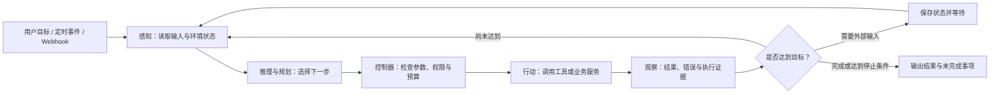
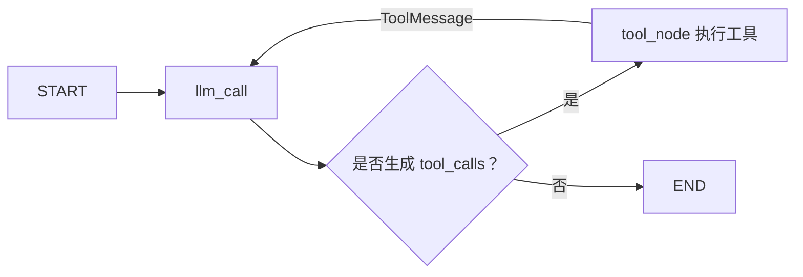
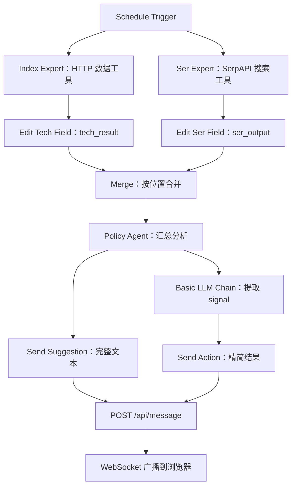
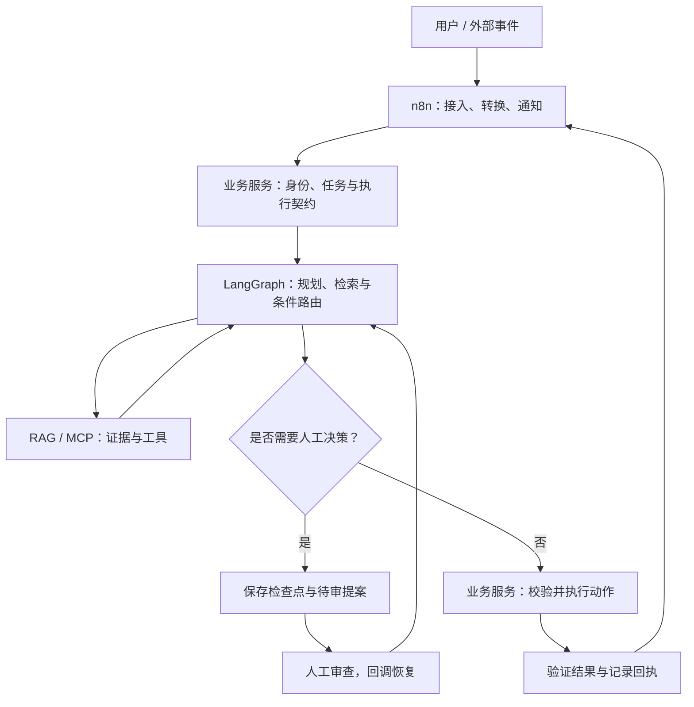

# A6-Agent：智能体架构、状态图与自主决策

> 课程：SE3353（CHP-fa26）。本笔记以本目录 40 页 HTML 课件为主线，结合 3 份 LangGraph Notebook、2 份 n8n 工作流、MCP 书店代码、WebSocket 示例及 11 页《Session 3 - Agent 指导手册》整理。Notebook 文件名保留原材料中的 `A10` 编号。示例解读来自静态检查，未启动模型、导入工作流或执行购买、发送等操作；框架语义另参考官方文档核对（2026-10-22）。

## 1. 本讲主线与知识地图

本讲回答：**如何让模型围绕目标选择行动、读取结果、调整计划，并把这个过程组织成可检查、可暂停、可恢复的系统？**

| 前后联系 | 主要问题 |
| --- | --- |
| A1：Prompt | 如何表达目标、约束与上下文？ |
| A2：MCP | 如何标准化接入外部能力？ |
| A3：RAG | 如何取得任务需要的知识与证据？ |
| A4：Skill | 如何封装任务流程和工具能力？ |
| A5：Skill Pattern | 如何组合能力、处理失败并控制执行？ |
| A6：Agent | 如何根据目标与反馈持续决定下一步？ |

| 模块 | HTML 页码 | 学习重点 |
| --- | --- | --- |
| Agent 基础 | 1～10 | 感知、推理、行动，ReAct、规划、反思、记忆与人工介入 |
| LangGraph | 11～20 | 节点、状态、条件边、错误处理、检查点及 HTTP 服务 |
| n8n | 21～30 | 触发器、Agent 插槽、MCP/RAG、服务集成与部署问题 |
| Spring AI 与综合案例 | 31～38 | Advisor、业务工具、事务、权限与跨服务审批 |
| 总结与后续 | 39～40 | 控制流、状态恢复、多智能体及 Harness 评测 |

学习路径：**明确目标 → 获取信息 → 选择行动 → 受控执行 → 检查结果 → 继续、调整、等待或结束。**

## 2. Agent 的基本结构：决策与执行

### 2.1 Brain 与 Body 是职责划分

课件将 Agent 拆成 Brain 与 Body，便于理解模型和外部系统的关系。

| 部分 | 职责 | 工单场景中的例子 |
| --- | --- | --- |
| Brain：推理与规划 | 理解任务、制定计划、选择工具、根据反馈调整 | 判断需要先查日志，再查历史工单 |
| Body：工具与环境接口 | 检索信息、执行计算、访问业务系统、产生结果 | 查询 CRM、读取知识库、创建工单 |
| 控制器 / 运行时 | 保存状态、调度节点、实施预算与权限、处理中断 | 阻止重复退款，等待审批后恢复 |

这个划分是教学模型，不要求部署成两个进程。一个 Agent 也不必同时具备 MCP、RAG 和复杂技能库；它们是可组合的能力来源。

**模型提出工具调用，宿主和业务服务执行真实操作。** 模型写出“已创建工单”，不能证明工单已经存在；需要工具回执、工单编号或后续查询作为证据。

### 2.2 感知—推理—行动—观察



- **Perception**：接收请求、告警、检索结果和工具反馈。
- **Reasoning / Planning**：决定当前缺什么信息、下一步做什么。
- **Action**：执行查询、计算或业务修改；行动不一定产生写入。
- **Observation**：读取实际返回的数据，决定是否继续或改变策略。

传统工作流也能有分支、循环与重试。Agent 的特点在于让模型参与行动选择，并根据观察调整路径；不能简单用“有循环”区分 Agent 和普通程序。

## 3. 三类推理与执行范式

### 3.1 ReAct：交替决策与行动

第 4 页的主线是：**决定下一步 → 调用工具 → 读取结果 → 再决定下一步。**

例如排查接口 504：

```text
目标：定位接口超时原因
  → 查询请求日志与服务指标
  → 观察到数据库连接等待时间异常
  → 检查连接池占用及慢查询
  → 比较证据，形成候选原因
  → 执行获准的修复或提出修复方案
  → 重新检查请求成功率与延迟
```

课件中的 Thought / Action / Observation 是过程表达方式。工程记录应重点保留计划摘要、工具参数、返回结果和验证证据，无需把冗长推理文本当作正确性证明。

ReAct 适合下一步依赖刚获得的信息的任务。主要困难是重复调用、目标漂移和上下文增长，因此需要步数、时间、成本及无进展检查。一次 `ping` 失败或连接池占满，也不足以单独证明全部根因。

### 3.2 Plan-and-Execute：先规划，再执行与重规划

第 5 页把长任务拆为三种职责：

| 角色 | 输入 | 输出 |
| --- | --- | --- |
| Planner | 目标、约束、已知环境 | 子任务及依赖关系、完成标准 |
| Executor | 当前子任务、所需上下文 | 产物、执行证据、错误或阻塞 |
| Replanner | 已完成步骤、新发现与失败原因 | 更新后的剩余计划 |

计划可以是列表，也可以是 DAG。整体系统包含重规划循环时，不能把整个执行过程都称为 DAG；**DAG 本身没有有向环**。

示例：升级 Java 服务时，先盘点依赖与接口，再修改兼容点，最后运行测试；如果发现第三方库不兼容，应调整依赖或迁移方案，而不是反复执行同一条修改命令。

Plan-and-Solve 与 Plan-and-Execute 有共同的“先分解再完成”思想，但前者原论文主要讨论提示策略；后者在工程中通常包含执行器、工具与重规划控制。二者不能直接视为同一个框架。[Plan-and-Solve 原论文](https://arxiv.org/abs/2305.04091)

是否需要分层规划取决于依赖关系、持续时间和反馈复杂度，没有通用的“超过 5 步就必须采用某范式”的阈值。

### 3.3 Reflexion：把失败反馈变成下一次尝试的依据

第 6 页采用 Actor、Evaluator、Self-Reflection 三部分：

```text
Actor 生成方案或执行动作
  → Evaluator 检查结果
  → 失败时总结可验证的原因与修正方向
  → 写入反思记忆
  → 下一次尝试使用这份反馈
```

例如，测试发现解析器访问了空对象，就记录失败输入、异常位置和缺失的校验条件，再生成修正并重跑测试。真正的改进依据是测试或环境反馈，不能只由模型宣称“已经反思”。

Reflexion 通过语言反馈与情景记忆影响后续尝试，不要求更新模型权重。它与训练时修改参数的学习机制不同；一次任务中的提升也不自动推广到其他任务。[Reflexion 原论文](https://arxiv.org/abs/2303.11366)

### 3.4 如何组合三种范式

| 范式 | 主要解决什么 | 常见组合 |
| --- | --- | --- |
| ReAct | 在不确定环境中逐步选择行动 | 作为单个子任务的执行循环 |
| Plan-and-Execute | 维护长任务的全局目标和依赖 | Planner 调度多个 ReAct 子任务 |
| Reflexion | 根据失败反馈修改后续尝试 | 在执行失败或验证不通过后触发 |

三者可以共存，但增加模型调用和控制层也会增加成本。稳定、规则明确的步骤可以直接用普通代码完成。

## 4. 记忆、RAG、MCP 与 Skill 的关系

### 4.1 区分上下文、任务状态与长期记忆

| 概念 | 保存什么 | 作用范围 |
| --- | --- | --- |
| 模型上下文 | 本次推理实际输入的消息、说明和证据 | 单次模型调用，受窗口限制 |
| 工作状态 State | 当前目标、分类、草稿、工具结果和计数 | 一个任务或会话的执行过程 |
| Checkpoint | 状态与执行位置等恢复信息 | 按 `thread_id` 关联的执行历史 |
| 长期记忆 Store | 用户偏好、已确认事实、历史任务经验 | 可跨任务、跨会话读取 |
| RAG 知识库 | 可检索的文档、代码、业务资料 | 为当前问题提供外部证据 |

短期记忆描述的是使用范围，不等于只能放在内存；会话状态也可以持久化到数据库。长期记忆也不限定使用向量库，结构化表或键值存储同样可以承担部分职责。LangGraph 区分保存线程状态的 Checkpointer 与保存跨线程数据的 Store。[持久化文档](https://docs.langchain.com/oss/python/langgraph/persistence)

反思记录应保留适用条件、证据来源和时间。例如“某次扩容连接池有效”不能直接成为所有 504 的修复规则。写入长期记忆前也要区分已验证事实与模型推测。

### 4.2 三类基础能力的分工

| 能力 | 回答的问题 | 需要额外落实的内容 |
| --- | --- | --- |
| MCP | 如何发现并调用外部工具？ | 鉴权、参数校验、工具选择范围 |
| RAG | 当前任务可以参考哪些资料？ | 资料质量、访问权限、时效与引用 |
| Skill | 某类任务应遵循什么流程？ | 宿主执行机制、业务约束、验证步骤 |
| Agent | 现在应该使用哪种能力？ | 状态、预算、退出条件与错误恢复 |

MCP 是协议，RAG 是检索增强方法，Skill 可以承载流程知识和工具组合；它们不是互斥选项。RAG 检索可以通过 MCP 工具提供，一个 Skill 也可以指导 Agent 同时调用多个工具。

## 5. LangGraph：用状态图表达控制流

### 5.1 State、Node、Edge、Reducer

第 11～14 页的核心是把行为拆成显式步骤。

| 概念 | 含义 |
| --- | --- |
| `State` | 跨节点传递的共享数据结构 |
| `Node` | 读取状态、执行工作并返回状态更新的函数 |
| `Edge` | 下一步执行哪个节点的固定或条件规则 |
| `Reducer` | 新更新如何与已有字段值合并 |
| `START` / `END` | 入口和终点标记 |
| `compile()` | 将图定义编译为可调用对象 |

节点可以调用模型，也可以只是查询、校验或普通计算。调用模型或外部系统的节点并非严格意义上的纯函数；“接收状态、返回更新”描述的是接口形式。

课件把节点分为四类：

- **LLM 节点**：意图分类、草稿生成、计划制定。
- **Data 节点**：读取文档、CRM、数据库或 MCP 查询结果。
- **Action 节点**：创建工单、发送邮件、修改业务状态。
- **User 节点**：等待补充信息或审批。

### 5.2 State 保留事实与结果，Prompt 按需组装

适合保存：原始请求、分类结果、检索片段及来源、草稿、执行回执、失败原因、重试次数。

不必重复保存：随时可推导的长度、仅供某一次调用使用的格式化字符串，以及与任务无关的完整日志。

“保留原始数据”强调减少对 Prompt 模板的耦合，并不是禁止字符串。原文、草稿和消息内容本来就可能是字符串；必要的审计日志也可以单独记录实际发送给模型的内容。

下面是状态设计示意，省略具体节点实现：

```python
from typing import Annotated, Literal, TypedDict
from langchain_core.messages import AnyMessage
from langgraph.graph.message import add_messages

class SupportState(TypedDict, total=False):
    request: str
    intent: Literal["question", "bug", "billing", "complex"]
    evidence: list[dict]
    draft: str
    messages: Annotated[list[AnyMessage], add_messages]
    attempts: int
    status: Literal["running", "waiting", "done", "failed"]
```

`TypedDict` 提供类型描述，不会自动完成运行时业务校验。外部输入、模型分类及工具返回仍需检查。

### 5.3 局部更新与消息合并

节点通常只返回自己修改的字段，例如 `{"draft": response.content}`。未配置 Reducer 的字段通常由新值覆盖；消息列表可以配置合并策略。QuickStart 使用 `operator.add` 追加列表，而 `add_messages` 还支持依据消息 ID 更新已有消息。[Graph API](https://docs.langchain.com/oss/python/langgraph/graph-api)

由此可得两个实现注意点：

1. 若字段使用追加语义，节点应返回新增消息；返回完整历史再追加可能导致重复。
2. 多个分支写同一个字段时，需要明确合并规则；框架不会自动理解哪份业务结果更正确。

### 5.4 条件边与 `Command`

两种常见写法：

```python
# 方式一：节点更新数据，路由函数决定下一步
builder.add_conditional_edges(
    "classify",
    lambda state: state["intent"],
    {"question": "search", "bug": "track", "billing": "review"},
)

# 方式二：节点同时返回状态更新与下一步
from langgraph.types import Command
return_value = Command(update={"draft": "待审草稿"}, goto="review")
```

代码为片段，依赖已定义的 `builder` 和节点。使用前需要保证分类值合法、所有目标节点已注册，并为未知分类设计处理路径。给同一节点同时配置固定后继和动态跳转时，应检查是否会意外启动多条路径。

### 5.5 结束条件与预算

`END` 表示当前图运行结束，不代表业务成功。拒绝、失败、等待人工接管也可能结束当前运行，因此需要单独记录任务状态。

`recursion_limit` 限制单次执行的 **super-step 数量**，不是 Python 调用栈深度，也不严格等于工具调用数；超限会触发 `GraphRecursionError`。配置位置是 `config` 顶层。[递归限制说明](https://docs.langchain.com/oss/python/langgraph/graph-api#recursion-limit)

```python
config = {
    "configurable": {"thread_id": "ticket-123"},
    "recursion_limit": 20,
}
```

工程上还需要任务级重试上限、超时和成本预算。单个外部请求一直不返回时，仅设置图步数不能解决问题。

## 6. 错误处理、检查点与人工介入

### 6.1 四类错误对应四种处理方式

第 15 页的分类可以直接用于设计节点：

| 错误类型 | 例子 | 处理方式 |
| --- | --- | --- |
| 瞬时错误 | 暂时限流、短暂网络故障 | 有上限的退避重试 |
| 模型可修正错误 | 参数格式错误、选择了不适用的查询 | 返回结构化错误，让模型修改方案 |
| 用户可补充错误 | 缺少订单号、目标不明确 | 暂停并请求必要信息 |
| 非预期错误 | 程序缺陷、状态损坏 | 向上报告，保留诊断信息 |

重试前要判断是否可能重复产生副作用。远程服务已完成写入但响应超时，与服务根本没有收到请求，是不同情况；可通过幂等键和结果查询区分处理。

### 6.2 Checkpointer 能恢复什么

检查点保存图状态及恢复所需的信息。`thread_id` 用于关联同一个任务的多次调用；服务端仍需校验调用者是否有权读取或恢复该任务。

`MemorySaver` / `InMemorySaver` 把检查点保存在进程内存，重启后会丢失。跨进程恢复需要持久化后端，并正确配置连接、存储与相应同步或异步接口。[持久化文档](https://docs.langchain.com/oss/python/langgraph/persistence)

**恢复检查点不等于撤销外部操作。** 已经发送的邮件、扣减的库存或远程创建的工单不会因为图回到旧状态就自动消失。恢复与重放必须配合幂等、去重或业务补偿。

### 6.3 静态断点与动态 `interrupt()`

课件混用了两套机制，阅读时应分清：

| 机制 | 暂停方式 | 常见恢复方式 |
| --- | --- | --- |
| 静态断点 | 编译时设置 `interrupt_before` / `interrupt_after` | 同一配置下调用 `invoke(None, config)` |
| 动态中断 | 节点内部调用 `interrupt(payload)` | 同一配置下调用 `invoke(Command(resume=...), config)` |

动态中断恢复后，传入值成为 `interrupt()` 的返回值；节点从头重跑，中断前代码可能再次执行。因此应把不可重复的写操作移到审批之后，或落实幂等处理。官方文档建议人工介入使用动态中断，静态断点主要用于调试。[Interrupts 文档](https://docs.langchain.com/oss/python/langgraph/interrupts)

以下片段表达审批语义，`app` 需事先编译并配置 Checkpointer：

```python
from langgraph.types import Command, interrupt

def review(state):
    decision = interrupt({
        "action": "review_reply",
        "draft": state["draft"],
    })
    return {
        "approved": decision["approved"],
        "draft": decision.get("edited_draft", state["draft"]),
    }

# 真实审批回调应先完成身份与权限校验，再使用同一任务配置恢复
app.invoke(
    Command(resume={"approved": True, "edited_draft": "审核后的回复"}),
    config,
)
```

`review` 返回后还需要条件路由：批准才进入发送节点，拒绝则转人工或结束。中断本身不会自动创建审批页面、认证审批人或验证业务参数。

## 7. 三份 LangGraph Notebook 的阅读重点

### 7.1 QuickStart：真正的工具调用循环

[`A10 langgraph_quickstart.ipynb`](<A10 langgraph_quickstart.ipynb>) 使用加法、乘法、除法工具演示同一个计算器 Agent 的两种实现。



理解代码时按以下顺序看：

1. `@tool` 描述能力，`bind_tools()` 将工具定义提供给模型。
2. 模型节点返回消息；它提出工具调用，不在这一行直接完成算术工具执行。
3. 工具节点按名称查找实现，执行模型给出的参数。
4. `ToolMessage.tool_call_id` 对应原调用 ID，使模型知道结果属于哪个请求。
5. 条件边检测是否继续调用工具；没有调用时结束。

Graph API 显式写节点和边；Functional API 用 `@entrypoint`、`@task` 和普通循环表达流程。该 Notebook 的 Graph API 工具节点使用 `for` 顺序执行；Functional API 先提交工具任务再读取结果，两者的调度表达不同。

这是最小教学实现，尚未完整处理除零、未知工具、参数错误和业务预算。`llm_calls` 是计数记录，当前代码并未用它强制停止；Functional API 中的 `while True` 也应自行增加合理的终止保护。

### 7.2 Thinking in LangGraph：客服邮件状态机

[`A10 langgraph_thinkinginlanggraph.ipynb`](<A10 langgraph_thinkinginlanggraph.ipynb>) 展示从需求到节点、状态和路由的设计过程，与第 12～15 页联系最紧密。

实际路由是：

```text
read_email → classify_intent
  ├─ billing 或 critical → human_review
  ├─ question / feature → search_documentation → draft_response
  ├─ bug → bug_tracking → draft_response
  └─ 其他 → draft_response

draft_response
  ├─ high / critical / complex → human_review
  └─ 其他 → send_reply → END

human_review
  ├─ 批准 → send_reply → END
  └─ 拒绝 → END
```

阅读时注意这些实现边界：

| 位置 | 实际情况与影响 |
| --- | --- |
| 文档检索 | 返回硬编码的密码规则，没有接入真实向量库 |
| Bug tracking | 使用固定 `BUG-12345`，没有调用工单服务 |
| `send_reply` | 只打印回复片段，没有发送真实邮件 |
| 紧急账单示例 | 可能直接进入审批，尚未执行 `draft_response`；随后直接索引并切片 `result['draft_response']` 可能失败 |
| `messages` | 类型标为 `list[str]`，实际写入 `HumanMessage`，注解与值不一致 |
| `current_step` | 节点返回该字段，但状态 Schema 中未声明，不能依赖它按预期持久化 |
| `SearchAPIError` | 异常类未定义，错误处理片段不完整 |
| 插图 | 引用的 `LangGraph.png` 与 `LangGraphStep2.png` 未随本目录提供 |

由此可以练习两个设计问题：审批到底发生在“任务分流”还是“草稿审阅”阶段；状态字段在每条进入路径上是否已经初始化。可选择先生成草稿再审批，或把前置分流审批与后置内容审批分成两个节点。

Notebook 的示例批准文本提到已启动退款，但代码并没有退款操作。最终回复内容必须与实际业务状态一致。

### 7.3 综合示例：辨别角色命名与实际能力

[`A10 langgraph.ipynb`](<A10 langgraph.ipynb>) 包含多种结构演示：

| 示例 | 实际体现的机制 | 不宜误读的地方 |
| --- | --- | --- |
| 纯 Python Planner / Worker / Critic | 消息队列与角色分工 | Critic 有随机判断；Worker 未处理 `retry`，Planner 未处理 `task_done` |
| Planner → Worker | 两阶段模型调用 | Worker 生成文本，没有接入真实任务执行工具 |
| Reasoner → Responder | 中间分析与回答分离 | 两次调用并不自动提高准确性 |
| Retriever → Reader | 检索结果进入生成上下文 | 按字符串包含关系筛选行，不是实际 TF-IDF 或向量检索；依赖的 `agent.txt` 未提供 |
| Planner → Coder → Tester | 生成代码后尝试执行 | 测试后直接到 `END`，没有失败返回 Coder 的修复边 |
| 任务分类路由 | 根据模型分类进入不同节点 | “研究”“执行”节点主要生成文本，没有真实检索或执行服务 |
| 狼人杀简化图 | 循环、状态更新与退出判断 | 缺少完整胜负规则及模型输出校验，不能视为完整游戏引擎 |

代码生成示例直接通过 `subprocess` 执行模型输出，没有超时、隔离环境或断言集合。“运行退出码为 0”不能替代功能测试。它适合分析流程结构，运行前应补齐执行边界与验证条件。

## 8. n8n：事件驱动的可视化编排

### 8.1 主链与 AI 子节点

第 23～24 页需要掌握两种连接：

- **主链连接**：传递数据项，表达触发、转换、条件分支及响应步骤。
- **AI 子节点连接**：为 Agent 提供模型、记忆或工具，实际调用由 Agent 节点管理。

| 节点 | 作用 |
| --- | --- |
| Schedule Trigger | 按配置的时间规则触发执行 |
| Webhook | 接收 HTTP 请求 |
| Chat Trigger | 接收对话输入与会话信息 |
| AI Agent | 组织模型调用、工具选择与反馈循环 |
| Chat Model | 提供模型推理能力 |
| Memory | 为会话提供历史上下文 |
| MCP / HTTP / 检索 Tool | 提供可被 Agent 调用的外部能力 |
| Edit Fields / Code | 重命名、提取、转换数据 |
| If / Switch / Merge | 分支、路由与结果合并 |
| Respond to Webhook | 形成 HTTP 响应 |

一个 HTTP Request 节点放在主链上，表示流程走到这里就执行；作为 Agent 工具连接，则表示模型可以选择调用它。两种控制语义不同。

### 8.2 MCP、RAG 与后端服务

第 25～27 页介绍三种扩展方式：

1. **MCP Client Tool**：把外部 MCP 工具接入 Agent，并选择允许暴露的工具集合。[n8n MCP Client Tool 文档](https://docs.n8n.io/integrations/builtin/cluster-nodes/sub-nodes/n8n-nodes-langchain.toolmcp/)
2. **RAG**：预先完成文档加载、切分、Embedding 与索引，再通过检索节点或工具把相关内容传入模型。
3. **HTTP 服务**：让 n8n 接收事件，再调用 LangGraph 或 Java 服务处理复杂逻辑。

```text
Webhook → HTTP Request 调用后端 → Code 转换响应 → Respond to Webhook
```

前置检索可以保证某一步必定发生；把检索挂为工具则允许模型按需选择。对必须执行的检查，应使用明确的控制流表达。

`$fromAI()` 用于由模型填写工具参数，`$json` 读取当前节点数据，`$json.body` 常用于 Webhook 请求体。它们不能代替服务端对参数含义和权限的校验。

## 9. 实例一：n8n + MCP 书店 Agent

### 9.1 工作流与请求契约

[`Demo_ My first AI Agent in n8n - BookStore.json`](<Demo_ My first AI Agent in n8n - BookStore.json>) 的主链是：

```text
Webhook（POST，path=booksearch）
  → Edit Fields
      body.Question → message
      body.sessionId → sessionId
  → Agent
      模型：Ollama qwen2.5:7b
      记忆：Simple Memory
      工具：MCP Client
  → Respond to Webhook
```

对应输入示意：

```json
{
  "Question": "有哪些 George Orwell 的书？",
  "sessionId": "bookstore-session-001"
}
```

字段名 `Question` 区分大小写。多轮会话需要稳定传递同一个 `sessionId`；工作流的缺省表达式尝试生成新 ID，不能据此保持此前对话。

响应节点使用 **Text** 模式拼接形似 JSON 的 `Answer` 字符串。若希望提供稳定 JSON 接口，应采用对象序列化和正确的响应类型；模型输出包含引号或换行时，直接插值可能破坏 JSON 格式。

### 9.2 工具与真实副作用

[`mcp-bookstore/src/bookstore_mcp/server.py`](mcp-bookstore/src/bookstore_mcp/server.py) 通过 FastMCP 注册 8 个工具：

| 类型 | 工具 |
| --- | --- |
| 列表与查询 | `get_all_books`、`get_book_by_id`、`get_books_in_stock` |
| 文本搜索 | `search_books_by_title`、`search_books_by_author` |
| 库存检查 | `check_availability` |
| 库存修改 | `buy_book`、`restock_book` |

查询来自本地 `data/books.json`，书名和作者搜索采用忽略大小写的子串匹配，没有向量检索。`buy_book` 校验正数数量和库存后扣减文件中的 `count`；它没有创建订单或调用支付系统。

实现适合演示工具闭环，但文件读改写没有事务、并发锁、幂等键或用户权限机制。`check_availability` 也没有像两个写工具一样拒绝非正数量。文件读取失败返回空列表，可能把存储故障表现成“没有图书”。

### 9.3 配置对齐

| 配置位置 | 当前值 |
| --- | --- |
| MCP README | HTTP 端口 `8000`，路径 `/mcp` |
| n8n 导出工作流 | `http://127.0.0.1:8001/mcp` |
| Python 项目要求 | `>=3.13` |
| FastMCP 依赖声明 | `fastmcp>=2.12.3`，另有 `uv.lock` |

实验时必须统一端口。按照 README 的启动方式，若选择配合工作流的 `8001`，命令为：

```bash
# 在 A6-Agent/mcp-bookstore/ 中执行
uv sync
uv run fastmcp run src/bookstore_mcp/server.py -t http --port 8001
```

这只是材料中的启动方式说明，本次整理未运行这些命令。若 n8n 在容器内，工作流的 `127.0.0.1` 仍需按实际网络调整。

## 10. 实例二：分级分析 Agent 与 WebSocket 展示

### 10.1 工作流结构

[`Quan Expert.json`](<Quan Expert.json>) 对应 [Session 3 指导手册](<Session 3 - Agent 指导手册.pdf>)，展示两个专家分支、汇总节点和结果推送。它用于学习角色分工与数据流，代码没有实际交易下单环节。



这是依赖关系图，分叉不代表运行时一定并行。

### 10.2 从配置中理解各节点

| 节点 | 实际配置与输出 |
| --- | --- |
| Index Expert | 使用 HTTP Tool 获取 `BTCUSDT` 的 24 小时行情统计并生成文本 |
| Ser Expert | 使用 SerpAPI 搜索新闻，提示词要求给出 -5～+5 情绪评分 |
| Edit Fields | 将两个默认 `output` 分别改名为 `tech_result`、`ser_output` |
| Merge | `combineByPosition`，按数据项位置合并两个分支 |
| Policy Agent | 读取两份文本并生成汇总意见 |
| Basic LLM Chain | 请求提取 `BUY`、`SELL`、`HOLD` 之一，输出形如 `{"signal":"HOLD"}` |
| 推送节点 | 向本地 `http://localhost:3000/api/message` 发起 HTTP POST |

工作流模型配置为 `qwen3.5:9b`；书店工作流则使用 `qwen2.5:7b`。这是文件中的选择，不代表任意模型均能替换而不影响工具调用和结构化输出。

### 10.3 指导手册与导出文件的差异

1. **调度频率不同**：PDF 举例每小时一次；JSON 的触发器使用 `field: "minutes"`，没有显式填写分钟间隔。导入后应检查界面中的实际配置。
2. **字段名称要一致**：PDF 一处使用 `tech_output`，实际工作流与汇总表达式使用 `tech_result`。
3. **Merge 不保证并行**：导出文件设置 `executionOrder: "v1"`；n8n 的 v1 执行顺序会按分支依次处理。Merge 负责汇合数据，不能因为连了它就推断两个模型调用同时执行。[n8n 执行顺序](https://docs.n8n.io/flow-logic/execution-order/)
4. **Prompt 不会自动持久化记忆**：Policy Agent 的说明要求反思与存储，但该工作流没有相应 Memory、数据库写入或显式反思循环。
5. **推送属于主链步骤**：导出 JSON 中两个推送节点经 `main` 连接，并非 Policy Agent 自主选择的工具调用。
6. **格式约束需要验证**：提示词要求 JSON 不等于已经完成 JSON 解析和枚举校验；空结果或两个分支项目数不一致也需要单独处理。

### 10.4 WebSocket 示例负责什么

[`websocket-app/server.js`](websocket-app/server.js) 使用 Express 接收 `POST /api/message`，将请求体序列化后广播给所有已连接的 WebSocket 客户端；`GET /` 返回展示页面。端口为 `3000`。

```bash
# 在 A6-Agent/websocket-app/ 中执行
npm ci
node server.js
```

`package.json` 没有 `start` 脚本，不能照搬 `npm start`。HTTP 接收成功只表示服务端处理了请求，当前实现没有浏览器送达确认、消息历史或断线补发。

前端把序列化后的消息插入 `innerHTML`；若接收外部文本，应改用文本渲染或适当转义。该例也没有用户认证和按用户分发，适合本地理解“HTTP 输入 → WebSocket 推送”的机制。

## 11. n8n 部署与联调中的关键区别

第 22、29 页的重点是网络可达性与工作流生命周期。

| 场景 | 地址含义与处理 |
| --- | --- |
| 多个进程运行在同一宿主机 | `localhost` 或 `127.0.0.1` 可指向宿主机服务 |
| n8n 运行在容器内 | 两者通常都指向 n8n 所在容器，互换写法不能解决跨容器问题 |
| Docker Desktop 容器访问宿主机 | 通常可用 `host.docker.internal`，仍需检查服务监听地址 |
| 同一容器网络中的服务 | 使用可解析的服务名与容器端口 |
| Webhook Test URL | 用于编辑器中的测试监听 |
| Webhook Production URL | 按安装版本完成发布 / 启用后接收正式请求 |

两个 JSON 导出文件均为 `active: false`，不能把“已有导出文件”视为“已部署运行”。跨代理暴露 Webhook 时，应检查生成的外部 URL、协议与转发配置。

课件中的 `N8N_BASIC_AUTH_ACTIVE` 属于旧配置，不应作为当前实例的有效登录保护方案照抄；n8n 1.0 起已移除旧的实例 Basic Auth / JWT 认证机制。[n8n 用户管理文档](https://docs.n8n.io/deploy/host-n8n/configure-n8n/user-management.md)

本地运行 Ollama 或 n8n，并不意味着整条链离线：本案例仍访问行情 API 和 SerpAPI。MCP 的标准传输能力与某个 n8n 节点的实际支持范围也要分开核对，不能把课件的 Stdio / SSE 描述直接套用到所有版本。

## 12. Spring AI：模型调用与业务服务的连接层

### 12.1 分清 Advisor、工具和业务状态机

第 31～35 页强调复用已有 Java 服务，而不是让模型直接管理数据库。

| 组件 | 主要职责 |
| --- | --- |
| `ChatClient` | 组织模型请求和响应 |
| Advisor | 在调用链中处理记忆、检索、日志及其他增强 |
| MCP 工具适配 | 将远程工具暴露给模型调用层 |
| 受管理的业务工具 | 把请求交给已有 Service 执行 |
| 业务状态机 / Guard | 表达状态转换、审批与执行条件 |
| Service / Repository | 实施身份、数据校验、事务及存储操作 |

Advisor 链不是完整业务状态机。Spring State Machine 是另一套可选择的编排机制，审批回调、状态持久化和业务幂等仍需应用实现。

### 12.2 课件 API 需要按版本核对

课件中出现 `.functions(...)`、`.defaultFunctions(...)`、`AroundAdvisor`、`ReActAdvisor` 和 `ReActAgentAdvisor`，且没有提供对应 Maven/Gradle 工程及全部类定义。这些片段主要说明架构，不宜直接当成可编译的 Spring AI 2.x 程序。

核对时的 Spring AI 2.0.1 文档使用 `@Tool`、`ToolCallback`、`.tools(...)` 等方式注册工具，并由 `ChatClient` 的 `ToolCallingAdvisor` 管理工具循环。[Spring AI Tool Calling](https://docs.spring.io/spring-ai/reference/api/tools.html)

Advisor 文档采用 `CallAdvisor` / `StreamAdvisor`，记忆和检索组件分别包括 `MessageChatMemoryAdvisor` 与 `QuestionAnswerAdvisor`。[Spring AI Advisors](https://docs.spring.io/spring-ai/reference/api/advisors.html)

复习重点是稳定的职责：**模型请求动作 → 工具适配 → 可信业务服务校验与执行 → 返回结果。**

### 12.3 事务与权限的边界

`@Transactional` 管理配置范围内的事务，不会把整个 Agent 多轮调用、邮件发送和远程 API 自动包成一个事务。默认代理模式下，自调用不会触发事务代理；默认回滚规则也需要结合异常类型判断。[Spring 事务说明](https://docs.spring.io/spring-framework/reference/data-access/transaction/declarative/annotations.html)

`@PreAuthorize` 也需要启用相应方法安全机制、正确传递认证身份并经过有效调用路径。模型提供的用户 ID、金额和“已经批准”字段，不能替代可信身份与审批记录。

## 13. 综合架构：把入口、推理与业务执行连接起来

第 36～38 页提出三层组合：



这是课件的架构方案，本目录没有实现这一完整的 Spring AI + FastAPI 综合工程。尤其需要注意：

- 第 16～18 页引用的部分节点、`vector_store` 与 MCP 会话对象未完整定义。
- 图中的条件路由目标、后继边和 State 字段需要逐一对齐。
- 第 18 页接口只返回 `draft_response`，第 20 页示例响应却额外包含 `status` 和 `classification`，两者需要统一契约。
- 第 37 页 Java 片段没有给出调用 Python 服务的实际 HTTP 客户端代码。
- 跨服务调用通过 HTTP/MCP 完成，Java 服务不能直接调用 Python 进程里的 `ainvoke()` 对象。

三种技术不必同时采用。可以先选择一个能够表达核心流程的运行时，再按现有业务边界增加集成层。

长时间人工审批适合采用异步任务契约：初次请求返回任务编号和 `waiting` 状态，审批回调完成验证后恢复任务，最后通过查询或通知交付结果。让一个 HTTP 请求持续等待几小时，会受到客户端和代理超时限制。

## 14. 容易混淆的结论

| 容易出现的理解 | 更准确的理解 |
| --- | --- |
| 有 Agent 角色名就有自主执行能力 | 看它是否拥有工具、状态与反馈循环 |
| 图就是 DAG | 状态图允许循环；DAG 不允许有向环 |
| `TypedDict` 保证输出正确 | 类型描述不能替代运行时校验和业务验证 |
| Checkpointer 就是长期记忆 | 前者保存线程执行状态，后者保存可跨任务使用的信息 |
| 从检查点恢复就是精确执行一次 | 外部副作用仍需去重、幂等或补偿 |
| `thread_id` 自动保证用户隔离 | 它是关联标识，访问权限仍需校验 |
| RAG 能保证零幻觉 | 它提供证据，证据质量和模型使用方式仍影响结果 |
| Merge 自动让分支并行 | 合并语义与执行调度是两个问题 |
| 写了“反思并存储”就获得长期记忆 | 需要明确存储与后续读取机制 |
| 本地模型意味着全链路离线 | 外部工具、搜索和云端组件仍可能访问网络 |
| HTTP 200 等于任务完成 | 需结合业务状态、回执和结果验证判断 |
| 自动化程度越高越好 | 关键是让模型自由度与任务的不确定性、风险相匹配 |

## 15. 复习问题与实践顺序

建议先读计算器 QuickStart，掌握最小工具循环；再读客服邮件 Notebook，理解共享状态、分支和中断；随后对照书店工作流学习 MCP 接入；最后阅读专家工作流与 Spring AI 课件，理解跨系统分工。

复习时可以尝试回答：

1. 模型生成工具调用、工具执行成功、业务目标完成，三者有什么区别？
2. 哪些步骤适合由模型选择，哪些步骤应通过固定控制流保证执行？
3. 节点返回完整消息历史与只返回新增消息，对追加型 Reducer 有什么影响？
4. 为什么重试一次“发送邮件”可能比重试一次“读取资料”更复杂？
5. 动态中断恢复时为什么可能重复执行节点前半段代码？
6. 审批分支未经过草稿节点时，后续如何保证状态字段可用？
7. 两个专家输出如何对应同一任务，为什么按位置合并不适合所有场景？
8. 如何证明代码确实修复了问题，而不只是模型生成了成功说明？

本讲需要掌握的工程能力是：**把目标、状态、行动和证据明确表达出来，让模型的决策始终处于可验证的执行流程中。**

## 16. 本目录资料索引

| 资料 | 用途 |
| --- | --- |
| [HTML 课件入口](A6-Agent/1.html) | 40 页课程主线，按页码继续阅读 |
| [LangGraph 综合示例](<A10 langgraph.ipynb>) | 规划、角色分工、RAG、代码执行、分类与游戏图 |
| [LangGraph QuickStart](<A10 langgraph_quickstart.ipynb>) | Graph API / Functional API 计算器 Agent |
| [Thinking in LangGraph](<A10 langgraph_thinkinginlanggraph.ipynb>) | 邮件 Agent 的状态与控制流设计 |
| [书店 n8n 工作流](<Demo_ My first AI Agent in n8n - BookStore.json>) | Webhook、记忆和 MCP 工具集成 |
| [书店 MCP README](mcp-bookstore/README.md) | 依赖、启动方式和工具说明 |
| [专家 n8n 工作流](<Quan Expert.json>) | 分支分析、结果合并与推送 |
| [Session 3 指导手册](<Session 3 - Agent 指导手册.pdf>) | 专家工作流搭建说明，阅读时结合第 10 节的差异 |
| [WebSocket 后端](websocket-app/server.js) / [展示页](websocket-app/index.html) | HTTP 接收与浏览器实时展示 |
