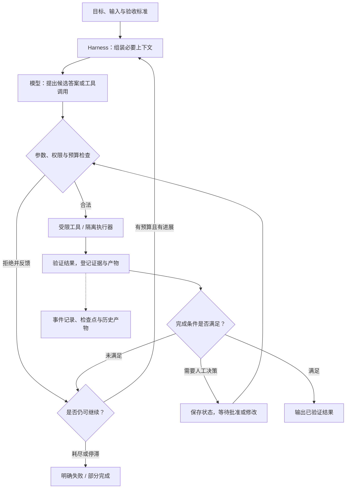
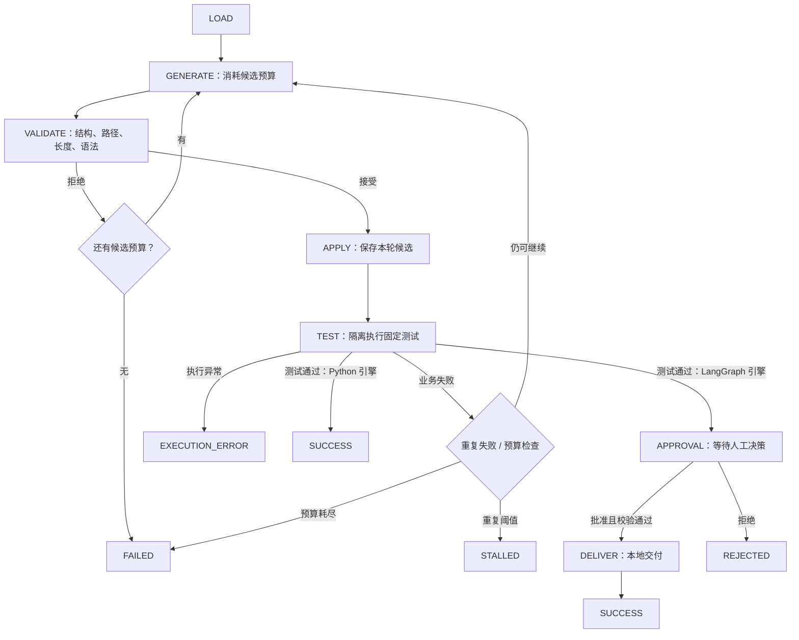

# A7-Harness, Loop & Graph Engineering：智能体驾驭、循环与状态图工程

> 课程：SE3353（CHP-fa26）。本笔记以本目录 40 页 HTML 课件为主线，结合 12 页《智能体驾驭工程》及 `bookstore-agent-harness`、`course-retrieval-agent` 两个示例工程整理。代码解读来自静态阅读，未启动模型、Docker 或示例服务；已有验收文档中的结果属于教师历史记录，不代表本次重新实测。涉及框架接口和容易混淆的技术语义，另参考官方资料核对（2026-10-23）。

## 1. 本讲主线与知识地图

本讲回答：**当模型会犯错、工具会失败、任务可能中断时，如何让 Agent 在明确的权限与预算内行动，并留下可验证、可恢复的执行记录？**

A6 关注 Agent 如何感知、规划和选择行动；A7 关注承载这些决策的工程系统。核心分工是：**模型提出候选，Harness 校验并执行，验证器检查结果，控制器决定继续、等待还是结束。**

| 概念 | 主要问题 | 典型机制 |
| --- | --- | --- |
| Harness Engineering | 模型如何接入工具、环境、状态和验证？ | 输入契约、工具注册、权限、隔离执行、记录与评测 |
| Loop Engineering | 下一轮是否值得继续，如何保证停止？ | 反馈、候选预算、截止时间、重复检测、终止状态 |
| Graph Engineering | 多个步骤与循环如何组织？ | State、Node、Edge、Reducer、子图、条件路由 |

三者是不同观察角度，可以在同一个系统中重叠。Harness 不等于某个框架，也不要求必须使用多 Agent、向量库或云沙箱。

| 模块 | HTML 页码 | 学习重点 |
| --- | --- | --- |
| 状态图与循环控制 | 1～10 | DAG 与有环图、节点职责、条件边、归约、重试、停止条件 |
| 持久化与人工介入 | 11～20 | Checkpoint、会话标识、中断、状态编辑、回溯、分支、审计 |
| 多 Agent 编排 | 21～30 | Supervisor、分层协作、Handoff、状态边界、消息与预算 |
| 沙箱与测试 Harness | 31～38 | 隔离、Mock、录制回放、Pass@k、代码重构案例 |
| 总结与后续 | 39～40 | 控制流原则，以及与全栈 Agent 系统的衔接 |



图中的“验证”应与任务匹配：代码任务可以运行固定测试；检索任务需要检查证据与引用；存在写入的任务还需要核对真实业务回执。

## 2. Harness 的范围：运行时与测试设施

### 2.1 广义 Harness 与 Test Harness

补充 PDF 用“Model + Harness”描述 Agent：模型提供理解与决策能力，Harness 承担上下文组织、行动执行、状态管理和错误处理。这个表达是职责模型，不是性能计算公式。

| 类型 | 服务对象 | 主要职责 |
| --- | --- | --- |
| 运行时 Harness | 一次真实 Agent 任务 | 组装输入、校验调用、管理预算、执行工具、验证并保存结果 |
| Test Harness | 对 Agent 或控制逻辑的测试 | 固定任务与环境、注入预设响应、替换副作用、计算指标、发现回归 |
| Sandbox | 需要隔离的执行步骤 | 限制文件、网络、权限及计算资源 |

Sandbox 是 Harness 可以使用的组件。课程检索项目不执行任意代码，仍然需要工具权限、预算和证据校验，因此同样具有 Harness。

### 2.2 PDF 中的 11 个模块如何理解

PDF 第 4～6 页从工程层次与生命周期补充了课件。

| 模块 | 应回答的问题 |
| --- | --- |
| 编排循环 | 一轮结束后，继续、交接还是终止？ |
| 工具系统 | 有哪些工具，参数是否合法，谁负责执行？ |
| 记忆系统 | 哪些已确认信息需要跨轮或跨任务保存？ |
| 上下文管理 | 本轮模型真正需要哪些内容，哪些可以压缩或按需读取？ |
| 提示词构建 | 如何组合系统约束、目标、事实和当前反馈？ |
| 输出结果解析 | 如何区分普通回答、结构化候选和工具调用？ |
| 状态管理 | 当前做到哪里，哪些动作和产物已经完成？ |
| 异常处理 | 错误是否可重试，需要修改输入还是停止？ |
| 安全防护 | 调用者、工具参数、资源范围和输出是否符合约束？ |
| 自我验证 | 什么证据足以说明任务完成？ |
| 子 Agent 编排 | 如何拆分任务、传递必要上下文并汇总结果？ |

这是一份职责清单，不要求拆成 11 个服务。小项目可以用少量模块实现，但职责应清楚。持久化状态也不应全部塞进 Prompt；模型只需读取当前决策相关的部分。

PDF 第 7～8 页的选型与搭建思路可归纳为：先明确项目规则和任务契约，再实现权限、执行、验证、熔断与可观测性；有明确协作收益时再增加子 Agent。资料中的固定工具数量阈值、性能提升百分比和框架排名缺少完整实验条件，不作为通用结论。

## 3. Graph Engineering：显式表达状态与转换

### 3.1 DAG 与有环图的真正差别

**DAG（Directed Acyclic Graph）没有有向环；允许回边的有向图可以直接表达反复修正。** 课件使用 DCG 表示有向有环图，学习时重点是理解“反馈边”。

```text
单次流水线：读取需求 → 生成代码 → 运行测试 → 输出报告

反馈循环： 生成代码 → 运行测试
              ↑         │
              └─ 失败反馈┘
                        └─ 通过 → 结束
```

课件第 2 页将 DAG 描述为“不支持重试”，需要区分图拓扑与运行机制：DAG 不能直接包含回边，但任务内部可以循环，调度器也可以重试失败任务；Airflow 就提供任务重试。是否采用显式有环图，取决于是否需要把反馈过程作为可见、可管理的状态转换。[Airflow 任务文档](https://airflow.apache.org/docs/apache-airflow/stable/concepts/tasks.html)

### 3.2 四个基本概念

| 概念 | 含义 | 代码修复任务中的例子 |
| --- | --- | --- |
| State | 节点之间共享的任务数据 | 候选代码引用、测试状态、剩余预算 |
| Node | 执行一项工作并返回状态更新 | 生成候选、检查格式、运行测试 |
| Edge | 决定后续执行位置 | 测试失败回到生成，通过进入审批 |
| Reducer | 决定同一字段如何合并更新 | 覆盖当前候选、追加新事件、按 ID 合并结果 |

节点通常采用“读取状态、返回更新”的接口，但调用模型、数据库或外部工具的节点并不是数学意义上的纯函数。条件路由可以设计为纯函数，使相同状态得到相同路由；这不意味着整次运行的模型输出也确定。[LangGraph Graph API](https://docs.langchain.com/oss/python/langgraph/graph-api)

### 3.3 四类节点的职责边界

| 类型 | 职责 | 应与什么分开 |
| --- | --- | --- |
| LLM Node | 生成、分类、规划、提出工具调用 | 直接执行模型提出的业务修改 |
| Data Node | 查询文档、数据库或代码结构 | 写入业务数据、修改权限 |
| Guard Node | 检查 Schema、权限、预算和审批状态 | 模型自由生成的“已允许”声明 |
| Action Node | 执行写入、测试、提交等动作 | 未校验的输入与任意命令执行 |

“只读”通常指业务数据层面。模型调用仍可能产生网络访问、计费和日志；Data Node 也可能触发缓存更新。工程上应把副作用边界说清楚，而非笼统宣称节点没有任何副作用。

### 3.4 State 与 Reducer：覆盖、追加和合并

下面是教学用状态契约，不是两个项目的完整状态定义：

```python
from operator import add
from typing import Annotated, Literal, TypedDict

class RepairState(TypedDict):
    task_id: str
    candidate_ref: str | None
    test_status: Literal["pending", "passed", "failed", "error"]
    remaining_candidates: int
    feedback: dict | None
    events: Annotated[list[dict], add]
```

`TypedDict` 用于类型描述，不会自行执行运行时输入校验。模型输出仍需经过 JSON 解析、字段约束和业务检查。

对上面的 `events`，节点应返回新增项：

```python
return {"events": [{"type": "test_finished", "passed": False}]}
```

如果返回“完整旧历史 + 新事件”，再经过追加 Reducer，会重复历史。没有自定义 Reducer 的普通字段通常采用覆盖语义；并行节点在同一步写入不支持多值的同一字段时，LangGraph 会报并发更新错误，不能概括为“后写者静默覆盖前写者”。[并发更新错误说明](https://docs.langchain.com/oss/python/langgraph/errors/INVALID_CONCURRENT_GRAPH_UPDATE)

Reducer 不等于数据库锁或分布式事务。应根据业务定义去重键、冲突规则及结果顺序；对重放敏感的数据，尤其要考虑重复合并。

### 3.5 条件边需要完整路由与明确失败

可采用以下判定顺序；示例假设测试执行器只会返回列出的状态：

```python
def route_after_test(state):
    status = state["test_status"]
    if status == "error":
        return "execution_error"
    if status == "passed":
        return "approval"
    if status != "failed":
        return "invalid_state"
    if state["remaining_candidates"] <= 0:
        return "budget_exhausted"
    return "generate"
```

成功、业务失败、基础设施错误与预算耗尽应分开表示。未知状态可以进入明确的错误终态；不能因为需要“收敛到 END”，就把未知错误包装成成功。LangGraph 中应使用导入的 `START`、`END` 常量，或显式提供路由键映射，避免把普通字符串误当作终止标记。

## 4. Loop Engineering：有反馈、有预算、有退出

### 4.1 不要混淆几种“重试”

| 情况 | 含义 | 处理方式 |
| --- | --- | --- |
| 网络瞬时失败 | 请求可能没完成，或结果没有送达 | 有上限的传输重试，必要时退避 |
| 参数或格式错误 | 模型提出的调用不符合契约 | 返回结构化错误，让模型修改提议 |
| 业务测试失败 | 候选已执行，但未满足任务要求 | 将失败反馈用于下一候选 |
| 重复无进展 | 重复同样的动作和失败，没有新信息 | 停止或转人工处理 |
| 执行基础设施错误 | Docker 不可用、测试超时、输出超限 | 明确执行失败，不伪装成普通测试失败 |
| 授权不足 | 操作超出当前权限或缺少必要审批 | 拒绝或等待合法授权，不盲目重试 |

节点内部若把所有异常都捕获并返回普通字典，框架级 RetryPolicy 就看不到异常。要明确哪些异常交给框架重试，哪些转成模型可观察的业务反馈。

LangGraph 的节点重试配置示意如下，`max_attempts=3` 包含首次尝试，而不是首次之后再重试三次：

```python
from langgraph.types import RetryPolicy

builder.add_node(
    "read_service",
    read_service,
    retry_policy=RetryPolicy(
        max_attempts=3,
        initial_interval=1.0,
        backoff_factor=2.0,
        retry_on=ConnectionError,
    ),
)
```

课件中的 `from langgraph.pregel import RetryPolicy` 和 `retry=` 写法不宜直接照抄；这里按官方文档使用 `langgraph.types` 与 `retry_policy=`。节点重试不会自动撤销已经发生的外部副作用。[节点重试文档](https://docs.langchain.com/oss/python/langgraph/use-graph-api#add-retry-policies)

### 4.2 多维预算分别限制什么

| 限制 | 防止的问题 |
| --- | --- |
| 候选数 / 决策轮数 | 无限尝试生成新方案 |
| 工具尝试数 | 反复非法调用或大量低价值查询 |
| 图 super-step 上限 | 控制流出现未预期的循环 |
| 单次调用超时 | 一个模型或工具请求长期阻塞 |
| 整次任务截止时间 | 多次合法重试累计耗时过长 |
| 输出与上下文大小 | 日志、代码和资料撑爆内存或上下文 |
| Token / 费用预算 | 大量调用消耗资源 |

LangGraph 的 `recursion_limit` 限制一次执行的 **super-step 数**，不是 Python 调用栈深度，也不是精确的模型调用数。并行节点可能处于同一 super-step；单个节点内部也可能调用模型多次。配置放在 `config` 顶层，超出时抛出 `GraphRecursionError`。[递归限制文档](https://docs.langchain.com/oss/python/langgraph/graph-api#recursion-limit)

```python
config = {
    "configurable": {"thread_id": "repair-001"},
    "recursion_limit": 40,
}
```

这个限制不能终止已经卡住的同步子进程，所以仍需执行器超时与清理。业务预算要跨 Resume 保留，不能靠不断重新调用图来重置上限。

### 4.3 动作指纹检测的是“重复”，还需判断“进展”

课件用工具名和排序后的参数 JSON 计算 SHA-256。它是规范化内容指纹，不会自动理解语义；相同工具名也不代表相同行动。

两个项目给出了不同实现：

| 项目 | 指纹与停止条件 |
| --- | --- |
| 书店修复 | 相同代码哈希 + 相同规范化失败摘要，累计达到阈值后 `STALLED` |
| 课程检索 | 工具名 + 参数 + 观察内容；连续重复且没有新增发现或证据，达到阈值后 `STALLED` |

例如，第一次读取某片段获得 E1 是进展；随后反复读相同内容且没有新增证据，才可能构成停滞。轮询一个仍在运行的合法任务，也不能仅凭参数相同就判断错误，需结合任务状态、轮询间隔与总期限。

此外，`recent_fingerprints.count(fp) >= 3` 只说明窗口中出现三次，并不证明是连续三次；应按希望检测的模式实现。

### 4.4 有 END 不等于已经证明终止

一个带出口的环仍可能永远不走出口。要论证自动执行在有限步内停止，可以设计非负整数预算：

$$
V_t = \text{剩余候选数}, \qquad V_{t+1} < V_t
$$

需要同时满足：每次进入生成循环都消耗预算；零预算时禁止再生成；每轮内部的重试也有限；单步执行能在有限时间内返回或被终止。任何能绕过预算的回边都会破坏这个论证。

人工等待是另一种状态：计算可以暂停，但业务未必在有限时间内完成；若业务要求最终结束，还需审批有效期和超时策略。**可停止、可恢复与成功完成是三种不同性质。**

## 5. Checkpointing：保存可恢复状态

### 5.1 State、Checkpoint、日志和产物的区别

| 对象 | 主要内容 | 用途 |
| --- | --- | --- |
| State | 当前目标、计数、结果引用、控制字段 | 驱动下一步执行 |
| Checkpoint | 图状态及下一步等恢复信息 | 恢复、历史检查和分支 |
| Event / Trace | 何时执行了什么、调用关系、状态与耗时 | 解释行为、定位失败和统计 |
| Artifact | 完整代码、测试输出、模型响应、证据原文 | 验证结果和复查历史 |
| 外部业务状态 | 已写入的文件、订单、邮件、提交等 | 真实世界中已经发生的变化 |

LangGraph 的完整 Checkpoint 在 super-step 边界形成；并行节点的完成写入还可以用于失败恢复。快照中的 `next` 表示后续待执行节点，不是刚刚执行完的节点。[Checkpointers 文档](https://docs.langchain.com/oss/python/langgraph/checkpointers)

Checkpoint 保存图状态，不能自动撤回最后一行中的外部业务变化。

### 5.2 三个标识的职责

| 标识 | 作用 |
| --- | --- |
| `thread_id` | 标识一条持久化执行主线，可包含多次调用与恢复 |
| `checkpoint_id` | 定位这条主线中的某个历史快照 |
| `checkpoint_ns` | 区分图及子图的检查点命名空间 |

这些标识提供定位与逻辑区分，**不是访问授权本身**。Web 服务必须核对当前用户是否可以查看或恢复该任务，不能只把客户端传来的 `X-Thread-ID` 直接信任并透传。同一线程的并发恢复也需要执行协调。

### 5.3 存储与生命周期

课件介绍 SQLite、PostgreSQL 和 Redis 三类落盘选择。理解重点是部署方式、并发需求、保留策略和故障语义，而非固定性能排名。

- SQLite 适合单机教学与轻量场景；书店项目使用 SQLite Checkpointer，并配置 WAL 与 busy timeout。
- PostgreSQL 可用于服务化持久化；连接池、迁移、备份和租户访问控制仍需配置。
- Redis 方案要核对所用 Saver 的支持范围、持久化与 TTL；状态过期可能直接影响 Resume。
- 内存 Saver 的生命周期跟随进程，不能用它证明重启后可恢复。[持久化文档](https://docs.langchain.com/oss/python/langgraph/persistence)

State 升级还需要版本迁移。给新字段加可选类型只能解决部分反序列化问题；删除节点、改变路由或修改工具语义，也可能使旧快照失效。

## 6. Human-in-the-Loop：暂停、审批与状态编辑

### 6.1 静态断点与动态中断

| 机制 | 触发位置 | 常见用途 |
| --- | --- | --- |
| `interrupt_before` / `interrupt_after` | 指定节点前后 | 调试与固定断点 |
| `interrupt(payload)` | 节点内部根据实际状态触发 | 审批、补充输入、人工修改 |

动态 `interrupt()` 需要通过 `Command(resume=...)` 提交恢复值，并使用原 `thread_id`。恢复时会从该节点开头重新执行，因此中断前的代码必须能安全重复；不要在中断前直接做不可重复的交付动作。[Interrupts 文档](https://docs.langchain.com/oss/python/langgraph/interrupts)

接口示意如下，具体审批校验应放在服务端：

```python
from langgraph.types import Command, interrupt

def approval_node(state):
    decision = interrupt({
        "run_id": state["run_id"],
        "approval_id": state["approval_id"],
        "code_hash": state["code_hash"],
    })
    # 核对审批身份、请求 ID、候选哈希及测试证据后再返回。
    validate_approval(state, decision)
    return {"approval_result": decision}

# graph 已使用持久化 Checkpointer 编译，decision 来自合法审批入口。
graph.invoke(Command(resume=decision), config=original_thread_config)
```

“暂停不占用持续等待的执行线程”不等于整个服务零内存、零存储或零运维成本。恢复能力取决于快照、代码版本、产物以及外部系统的可用性。

### 6.2 审批必须绑定具体候选

书店项目将审批绑定到 `run_id`、`approval_id` 和 `code_hash`；恢复与交付前还会核对候选文件和通过的测试产物。这样可以拒绝过期审批、错误候选哈希，以及审批后被修改的文件。

若人工修改了候选，原来的测试结论不能自动继续适用：应重新验证，并使旧审批失效。审批记录也应保存操作者、决策、时间和适用对象；`as_node` 只是图状态更新的来源语义，不是人类身份认证。

## 7. Replay、Resume、Time Travel 与 Fork

### 7.1 四种操作不要混为一谈

| 操作 | 做什么 | 是否可能再次调用工具 |
| --- | --- | --- |
| 历史 Replay | 展示或消费已经录制的请求、响应、事件与产物 | 两个示例的历史回放均不调用真实模型和工具 |
| Resume | 继续原任务尚未完成的执行 | 会；未完成动作可能需要重试 |
| LangGraph Time Travel / Replay | 从历史 Checkpoint 继续执行后续节点 | 会；后续模型与 API 请求可能得到新结果 |
| Fork | 从一个历史状态派生独立实验路径 | 通常会；应重新执行适用的验证和审批 |

LangGraph 的 Time Travel 不等于只读历史播放器。`update_state()` 会产生新的检查点分支，并应用字段的更新规则；`as_node` 影响从哪个节点的后继继续执行。[Time Travel 文档](https://docs.langchain.com/oss/python/langgraph/use-time-travel)

### 7.2 分支状态不等于复制外部世界

框架可以在同一线程的历史上形成分支；应用也可以显式创建新 `thread_id`，复制需要的状态并设置正确的恢复位置。新线程不能直接借用父线程的 `checkpoint_id` 当作自己的快照。

还需确认：候选文件是否属于新运行，测试环境是否独立，预算怎样初始化，旧审批是否清空，是否保留父运行和来源快照。两个分支若共享同一外部数据库或目录，仅仅使用不同线程 ID 并不能隔离写入。

书店项目只允许从 **LOAD 完成、首次 GENERATE 之前** 分支，使用复制状态、替换身份和 `as_node='LOAD'` 初始化子线程。它没有实现任意历史位置的完整环境克隆。

### 7.3 崩溃窗口与幂等

典型的不确定窗口是：

```text
发起外部动作 → 外部动作已成功 → 本地结果尚未落盘 → 进程崩溃
```

恢复者不能仅凭“本地没有成功记录”断言动作未发生。常用方法包括稳定动作 ID、幂等键、结果收据、产物哈希、外部查询对账，以及在无法确认时进入人工恢复状态。

书店项目的 `actions/` 和 `calls/` 保存动作与调用收据。已保存且匹配的结果可以复用；模型请求已发送但结果未落盘时仍可能重发，无法保证 exactly-once 或相同输出。SQLite、JSON 日志和文件产物也不天然构成一个原子事务。

### 7.4 长任务编排与 Temporal

课件第 19 页提出用 Temporal / Cadence 管理宏观长任务，用 LangGraph 管理内部决策图。分层时应明确每层负责的重试、预算和恢复范围，避免双层重试造成重复执行。

把图封装成 Activity 不会自动得到业务 exactly-once。Temporal 官方也强调 Activity 可能重复执行，需要幂等或能安全重复的副作用设计；Saga 的补偿操作仍需由业务实现。[Temporal 幂等与持久化执行](https://temporal.io/blog/idempotency-and-durable-execution)

## 8. 多 Agent：分工、控制权与状态边界

### 8.1 何时值得拆分

拆分的收益来自可独立处理的子问题、不同工具权限、较小上下文或独立检查视角；代价包括额外模型调用、交接损耗、结果冲突和复杂的失败恢复。

可以先从单 Agent 配合普通代码工具开始。当职责确实不同、上下文相互干扰或任务可以并行验证时，再考虑拆分。课件中的“每个 Agent 不超过 5 个工具”“消除 99% 漏洞”等数字不是可直接套用的工程定律。

### 8.2 三种拓扑

| 拓扑 | 控制权流动 | 优点 | 仍需处理的问题 |
| --- | --- | --- | --- |
| Supervisor | Worker 完成后返回主管 | 入口、汇总与停止逻辑集中 | 主管反复派发同一任务、串行瓶颈 |
| Hierarchical | 顶层主管委派领域主管，再分配 Worker | 领域分层、上下文分区 | 层级过深、局部与全局预算不一致 |
| Peer-to-Peer | Agent 之间直接交接 | 路径灵活，减少中心调度 | 乒乓交接、责任不清、上下文增长 |

Supervisor 减少直接互调，不会自动消除循环。所有拓扑都需要总预算、超时、交接记录和退出标准。

### 8.3 Handoff 与“把 Agent 当工具”

- **Handoff**：控制权交给另一个 Agent，由它接续处理。
- **Agent-as-a-tool**：父 Agent 请求子 Agent 完成子任务，获取结果后继续掌控流程。

课件用早期 OpenAI Swarm 的 `transfer_to_agent()` 演示宿主如何切换 `active_agent`。工具返回 Agent 对象是该实现的约定，不是所有框架通用协议。Swarm 官方已将它标为被 Agents SDK 替代的教学项目，阅读时应保留这个历史背景。[Swarm 官方仓库](https://github.com/openai/swarm)

交接时应说明转交目标、已有证据、产物引用、未解决问题和剩余预算。既不能丢失关键约束，也不必把所有历史草稿原样传递。

### 8.4 Global State 与 Sub-State

| 状态范围 | 适合保存 |
| --- | --- |
| 全局 | 目标、依赖、预算、当前阶段、已核准产物引用、审查结论 |
| 子 Agent 局部 | 当前子任务资料、临时草稿、局部测试与错误反馈 |
| 独立审计存储 | 需要复查的完整调用、测试日志及历史产物 |

子图退出时通过明确映射输出结果。主子图字段不同，就需要适配输入输出；不能仅把两个互不兼容的 StateGraph 连起来，期待框架自动理解业务字段。

子图局部上下文不必进入全局 Prompt，但也不意味着相关持久化记录自动销毁。保留与删除取决于实际配置。

### 8.5 辩论、消息与全局预算

Coder、Tester、Reviewer 的不同视角可以增加检查机会，但多个模型达成一致不等于事实成立。打回意见最好包含失败用例、代码位置或证据；通过条件应由测试、规则和适用的人工检查共同决定。

跨进程通信可定义如下应用级消息契约：

```json
{
  "schema_version": 1,
  "message_id": "msg-001",
  "trace_id": "trace-001",
  "task_id": "repair-001",
  "sender_agent": "coder",
  "recipient_agent": "tester",
  "artifact_ref": "candidate-2",
  "remaining_budget": 3
}
```

其中 `trace_id` 用于追踪，不是锁；`message_id` 可以参与去重，但仍需消费者实现幂等。客户端消息里的剩余预算也不能替代服务端权威计数。并发分支应在派发前分配额度，完成后按实际用量结算，防止同时越过全局上限。

Redis Pub/Sub 是最多一次交付，订阅者断线时消息可能永久丢失；需要持久化、确认和重放时，应选择并配置相应的消息机制，而不是把所有事件总线视为相同保证。[Redis Pub/Sub 文档](https://redis.io/docs/latest/develop/use-cases/pub-sub/)

### 8.6 框架比较应看具体版本和能力

课件第 29 页的概括有助于记忆不同抽象，但不能直接作为当前能力清单：AutoGen AgentChat 提供 `save_state()` / `load_state()`，CrewAI Flows 也提供持久化机制。因此不能简单认为前者只能手写状态保存、后者只有内存流水线。[AutoGen 状态文档](https://microsoft.github.io/autogen/stable/user-guide/agentchat-user-guide/tutorial/state.html)、[CrewAI Flows 文档](https://docs.crewai.com/en/concepts/flows)

选型时检查：所需控制流是否能明确表达、状态能否跨重启恢复、审批如何绑定、工具如何限制、副作用如何处理、失败如何测试。框架名称本身不能回答这些问题。

## 9. Sandbox：把执行限制落实到环境

### 9.1 三层检查各解决一部分问题

| 层次 | 示例 | 无法单独保证什么 |
| --- | --- | --- |
| 输入检查 | JSON Schema、路径白名单、长度限制、AST 语法检查 | 语法合法代码的运行安全 |
| 环境隔离 | 容器、受限文件系统、网络和权限 | 程序符合业务需求 |
| 结果验证 | 固定测试、输出检查、产物比对 | 所有未覆盖情况都正确 |

AST 解析、子进程和超时各有用途，但都不能单独称为完整沙箱。测试文件只读，也不意味着同一 Python 进程中的恶意候选无法干扰测试。

### 9.2 不同隔离技术不要混称

| 技术 | 核心机制 / 定位 |
| --- | --- |
| 常规 Linux 容器 | 通过 namespace、cgroup 等机制隔离，共享运行容器的 Linux 内核 |
| Firecracker | 使用 KVM 的轻量虚拟机监控器，创建 microVM |
| gVisor | 用户态应用内核，为应用实现 Linux 类接口并隔离系统调用 |
| E2B、Modal 等服务 | 将执行环境、生命周期和资源能力包装成服务或 SDK；需核对具体配置 |

gVisor 不是 Firecracker 式 KVM microVM 的同义词。Firecracker 与 gVisor 官方对各自机制有明确说明；课件第 32 页不应把它们合称为同一种硬件虚拟化。[Firecracker 架构](https://firecracker-microvm.github.io/)、[gVisor 架构](https://gvisor.dev/docs/)

启动延迟取决于镜像、缓存、网络、硬件及测试口径，不能把课件中的毫秒数字当作通用承诺。隔离强度也不能用“绝对安全”概括。

### 9.3 书店项目的具体执行边界

`harness/executor.py` 使用固定测试命令，并落实以下限制：

- 每轮创建独立临时项目副本，只放候选和固定测试。
- 以非 root 用户执行，根文件系统和 `/work` 挂载只读。
- 无网络，移除全部 capabilities，设置 `no-new-privileges`。
- 限制内存 256 MiB、CPU 1 核、进程数 64，临时目录 32 MiB。
- 由控制器监督测试时间和输出大小，执行结束后清理容器。
- 不挂载项目密钥、宿主仓库或 Docker socket。

这是项目面向本地课堂的受限执行方案，不是公网任意代码执行平台。镜像构建阶段与测试执行阶段的网络需求也不同：前者可能下载依赖，后者禁网。

## 10. Test Harness、录制回放与评测

### 10.1 四种运行方式提供不同证据

| 方式 | 模型输出来源 | 工具观察来源 | 可以验证什么 |
| --- | --- | --- | --- |
| Live | 真实模型 | 真实工具 | 本次模型与工具的联合表现 |
| Scripted | 预设模型响应 | 真实工具 | 已知场景下的控制逻辑和工具行为 |
| Simulated | 预设响应 | 预设观察 | 路由、展示等模拟流程 |
| Historical Replay | 历史记录 | 历史记录 | 记录中的行为，以及适用的控制回放逻辑 |

书店项目需要显式 `--simulate` 才使用模拟观察；课程检索项目的 scripted 使用真实资料工具。两者都不能把 scripted 成功率当成模型解决任意问题的成功率。

只 Mock 工具但仍调用真实模型，模型输出仍可能变化。固定 `temperature=0` 或 seed 也不等于确定性历史回放。严格的录制回放应约束请求匹配、响应顺序、版本和产物完整性，并明确何时拒绝回放。

Mock 可以降低外部调用成本，但仍有计算与维护开销；全 Mock 测试也需要真实工具集成验证来补足覆盖。

### 10.2 Pass@k 的含义与计算

对于同一道题，生成 $n$ 个候选，其中 $c$ 个通过测试，考虑随机选取 $k$ 个候选至少一个成功的概率。常用估计为：

$$
\widehat{\mathrm{pass@k}} = 1 - \frac{\binom{n-c}{k}}{\binom{n}{k}},
\qquad 0 \le c \le n,\quad 1 \le k \le n.
$$

当 $n-c<k$ 时，结果为 1。对多道题先逐题计算，再按评测协议汇总。HumanEval 官方实现使用这一公式。[HumanEval 评测实现](https://github.com/openai/human-eval/blob/master/human_eval/evaluation.py)

例：$n=10,c=2,k=3$，则

$$
\mathrm{pass@3}=1-\frac{\binom{8}{3}}{\binom{10}{3}}
=1-\frac{56}{120}\approx 0.5333.
$$

需要注意三种不同统计口径：

1. 一次运行 29 个测试全部通过，是该候选通过当前测试集。
2. 多个独立采样候选中的 Pass@k，描述给定采样与测试协议下的成功概率。
3. Agent 根据上一轮失败自适应修复，是有反馈的连续尝试；不能无说明地把这些相关候选套成独立采样评测，应另报“预算内任务成功率”。

单个 PR 一次通过，不能据此证明系统整体 Pass@1 达到 95%。

### 10.3 同时报告质量、效率与可靠性

| 维度 | 可记录指标 | 解释时的注意点 |
| --- | --- | --- |
| 结果质量 | 任务成功率、固定测试通过情况、证据支持率 | 明确验收标准与样本数量 |
| 路径效率 | 决策轮数、工具尝试、重复调用数 | 过早失败也会步数很少，应结合成功率 |
| 时间 | 总延迟、模型时间、工具时间、P95 | 保留失败和超时样本 |
| 成本 | 输入/输出 Token、模型请求数、每次成功的总成本 | 不同模型与缓存计费不能套统一单价 |
| 工具选择 | Precision、Recall、F1、参数正确率 | 先定义正确工具集合及可接受替代路径 |
| 恢复与控制 | 越权拒绝、预算遵守、恢复成功、重复副作用 | 应覆盖故障注入场景 |

工具集合评测可用 $P=TP/(TP+FP)$、$R=TP/(TP+FN)$、$F1=2PR/(P+R)$，并预先约定分母为零的处理方式；还应单独检查调用顺序、参数及最终结果。同一任务可能存在多条正确轨迹，逐项字符串相等未必是合适的唯一判据。

两个示例都强调：只记录 API 返回的真实 Token 计数，未知值保存为 `null`；不能把缺失值当作零消耗。

## 11. 代码案例一：书店运费修复 Harness

### 11.1 一个边界 Bug，串起完整控制链

任务定义见 [TASK.md](/Users/xlchen/CHP-fa26/A7-Harness,Loop&Graph-Engineering/bookstore-agent-harness/TASK.md)。关键规则是：

- 使用 Decimal 计算，优惠券 `SAVE10` 先对商品总额乘 0.9。
- 折后商品金额统一按 `ROUND_HALF_UP` 舍入到两位小数。
- 用已舍入金额判断运费：**大于等于 100 元免运费**，否则运费 10 元。
- 空购物车返回 `Decimal('0.00')`；非法优惠券仍需拒绝。
- 价格、数量及返回类型还需遵守任务中的输入契约。

初始代码把 `>= 100` 写成 `> 100`。例如舍入后恰好 100 元，正确总额应为 100 元，错误实现会加上运费变成 110 元。

模型只可返回含 `path` 和 `code` 两个字符串字段的 JSON，目标路径必须为 `bookstore.py`。Harness 检查字段、路径、UTF-8 字节长度和 Python 语法；固定业务测试不允许模型修改。

### 11.2 Python 与 LangGraph 共用节点逻辑



图中省略了模型请求失败后的 `MODEL_ERROR` 分支。`APPLY` 保存候选用于验证，不是把补丁应用到生产仓库；LangGraph 的 `DELIVER` 也只是写入本地交付目录，不包含提交 Git、创建 PR 或合并。

| 文件 | 阅读重点 |
| --- | --- |
| [harness/core.py](/Users/xlchen/CHP-fa26/A7-Harness,Loop&Graph-Engineering/bookstore-agent-harness/harness/core.py) | 候选校验、Tape 请求匹配、显式 Python 循环 |
| [harness/runtime.py](/Users/xlchen/CHP-fa26/A7-Harness,Loop&Graph-Engineering/bookstore-agent-harness/harness/runtime.py) | 两引擎共用的节点行为、预算、指纹、事件和动作收据 |
| [harness/executor.py](/Users/xlchen/CHP-fa26/A7-Harness,Loop&Graph-Engineering/bookstore-agent-harness/harness/executor.py) | Docker 限制、固定测试命令、超时与恢复核对 |
| [harness/graph_engine.py](/Users/xlchen/CHP-fa26/A7-Harness,Loop&Graph-Engineering/bookstore-agent-harness/harness/graph_engine.py) | StateGraph、SQLite、动态审批和本地交付 |
| [harness/service.py](/Users/xlchen/CHP-fa26/A7-Harness,Loop&Graph-Engineering/bookstore-agent-harness/harness/service.py) | 执行锁、状态对账、Resume 与受限 Fork |

这说明图框架负责组织控制流，实际的校验、执行与业务规则仍由普通代码实现。原 README 主要描述第一阶段；学习当前工程时还应阅读学生入口和第三阶段指南。

### 11.3 配置与停止语义

当前 `config.json` 默认最多 3 个候选，`model_retries=1` 表示每候选最多 2 次模型调用；相同候选和失败摘要累计 2 次触发停滞。测试超时 20 秒，输出上限 65,536 字节，代码上限 20,000 字节。

| 状态 | 含义 |
| --- | --- |
| `SUCCESS` | Python 引擎：测试通过；LangGraph 引擎：测试通过、批准并完成本地交付 |
| `FAILED` | 候选预算耗尽 |
| `STALLED` | 重复候选与失败达到阈值；与预算耗尽同时满足时优先 |
| `MODEL_ERROR` | 模型调用有限重试耗尽 |
| `EXECUTION_ERROR` | 执行器、超时、输出限制或控制运行异常 |
| `WAITING_APPROVAL` | 图已暂停，等待针对当前候选的人工决定 |
| `REJECTED` | 人工明确拒绝交付 |
| `RECOVERABLE` / `RECOVERY_REQUIRED` | 服务层恢复检查结果：可尝试恢复 / 无法安全自动继续 |

违规候选也消耗候选预算；传输重试计在该候选内部。Resume 保留候选数和失败指纹，不应让重启成为绕过预算的方式。

### 11.4 最值得观察的实验

| 场景 | 预期观察 |
| --- | --- |
| `success` | 先提交错误代码，收到真实测试反馈后给出修复 |
| `repeated` | 重复相同失败，触发 `STALLED` |
| `forbidden` | 尝试修改测试路径，在执行前被拒绝 |
| 预算降低 | 即使尚未达到停滞阈值，也会停止生成 |
| LangGraph 成功场景 | 测试通过后进入审批，不直接交付 |
| 审批阶段重启 | 使用原线程恢复等待状态，核对审批对象 |
| 从安全 LOAD 点 Fork | 子运行有独立身份，重新测试并等待自己的审批 |
| 历史 Replay | 展示历史观察，不调用模型或执行器 |

[第三阶段验收记录](/Users/xlchen/CHP-fa26/A7-Harness,Loop&Graph-Engineering/bookstore-agent-harness/docs/verification-phase3.md) 记载教师在 2026-10-12 的检查，包括 59 项 Harness 测试、真实 Docker、独立进程中断恢复以及浏览器操作。该记录的初始业务测试为 26 通过 / 3 失败，修复候选为 29 通过；这些数字应理解为历史环境下的验收证据。

## 12. 代码案例二：课程资料检索 Harness

### 12.1 受限工具也需要完整控制

该项目不依赖 LangGraph、MCP、向量库或 Docker。它使用本地资料快照、透明关键词检索和普通 Python 循环，展示“只读任务也需要权限、预算与证据”。

| 工具 | 用途 | 是否直接登记答案证据 |
| --- | --- | --- |
| `list_documents` | 查看当前允许访问的文档 | 否 |
| `search_documents` | 查找片段与摘要 | 否 |
| `read_document` | 读取已登记文档的完整片段 | 成功并核对后可以 |

检索分数表示检索匹配程度，不是答案置信度。搜索摘要用于定位资料，不能替代成功读取的正文证据。

### 12.2 工具访问边界

[app/tools.py](/Users/xlchen/CHP-fa26/A7-Harness,Loop&Graph-Engineering/course-retrieval-agent/app/tools.py) 使用固定工具注册表和严格 Schema。`validate_call()` 为 Harness 提供检查，真正的 `invoke_tool()` 仍会再次校验。

权限来自可信配置，模型不能修改。`allowed_document_ids: null` 表示允许已登记的全部资料，`[]` 表示没有资料访问权限；list、search、read 使用同一允许集合。工具只解析登记 ID，不接受任意路径、URL 或 shell 命令。

资料正文作为工具数据进入对话，不应被提升为系统指令。这样的边界有助于限制资料中的指令注入影响，但并不保证模型永远不会误读内容；是否遵守边界还要由调用校验和测试检查。

### 12.3 决策循环与预算

```text
INIT → DECIDE → VALIDATE_TOOL → EXECUTE_TOOL → OBSERVE
          ↑                                      │
          └──────────────────────────────────────┘

DECIDE 无工具调用 → FINALIZE → VALIDATE_ANSWER → 结束
                                  │
                                  └─ 受限的修复 / 返回取证
```

当前默认配置为：8 决策轮、10 次额度内工具尝试、每轮最多 3 次调用、模型请求 60 秒、整次任务 180 秒、传输重试 1 次、答案修复最多 1 次、无证据时返回检索最多 1 次。

非法参数与越权提议同样消耗额度内尝试数；超出剩余额度的提议被拒绝并单独计数。模型探针、最终生成和修复请求也占用总期限，不能把“决策轮数”误当全部模型请求数。

无进展检测结合动作、观察与新增资料发现。更换检索词不会仅因工具名相同被拦截，但仍受到全局预算约束。

### 12.4 证据登记与答案校验

成功读取的片段经过快照、权限和内容核对后登记为 E1、E2 等，保存标题、文档和片段 ID、行号、正文及哈希。相同片段可复用证据 ID。

答案中的每条 claim 必须引用本次登记的证据，且回答状态与内容一致：

| `answer_status` | 条件 |
| --- | --- |
| `answered` | 有实质结论，且没有声明缺失信息 |
| `partial` | 有结论，同时列出缺失信息 |
| `insufficient_evidence` | 不生成实质结论，并列出证据缺口 |

**运行状态与答案状态是两条轴。** `COMPLETED + insufficient_evidence` 可以是合格结果：流程完成，并诚实说明资料不足。

程序可以检查引用存在、来源正确、结构合法；它不能单凭这些检查证明每句话都被原文支持。应继续检查语义支持、遗漏与跨资料比较是否准确。

### 12.5 历史展示与恢复的边界

项目保存配置、事件、模型交互、证据、答案和完整性清单。历史回放使用该次保存的证据原文，不用当前资料替换旧证据，也不重新调用模型或资料工具。

网页刷新可以恢复展示，关闭浏览器不会取消后台任务；但该项目**不支持后端进程重启后继续真实运行**。未完整落盘记录显示为中断，拒绝完整回放。不要把“有历史记录”和“有可执行恢复能力”视为同一件事。

阅读入口：[项目 README](/Users/xlchen/CHP-fa26/A7-Harness,Loop&Graph-Engineering/course-retrieval-agent/README.md)、[Agent 架构](/Users/xlchen/CHP-fa26/A7-Harness,Loop&Graph-Engineering/course-retrieval-agent/docs/agent-architecture.md)、[主控制循环](/Users/xlchen/CHP-fa26/A7-Harness,Loop&Graph-Engineering/course-retrieval-agent/app/agent.py)、[答案与配置契约](/Users/xlchen/CHP-fa26/A7-Harness,Loop&Graph-Engineering/course-retrieval-agent/app/agent_types.py)。

## 13. 从案例回到 Capstone

课件第 36～38 页将 Triage、Coder、Tester、Reviewer 组合为代码重构系统。可按以下职责理解：

1. **Triage**：确定任务范围、输入、可修改路径与验收标准。
2. **Coder**：根据当前证据生成候选补丁，不自行宣布成功。
3. **Tester**：在可控环境执行固定检查，提供真实结果。
4. **Reviewer**：检查需求、边界与风险，引用具体证据。
5. **控制与交付**：统一处理预算、审批、恢复、交付与记录。

这是一种架构分解，不要求每个步骤都使用 LLM。固定测试、参数检查和预算判断通常由确定性代码完成。

课件中的示意代码还省略了关键落地部分：

- 返回 `rollback_ckpt_id` 只是写入字段，不会自动调用框架恢复，更不会还原沙箱文件。
- `get_state_history()` 读取历史，不会擦除错误路径；“最旧快照”也不必然是可用的安全边界。
- 沙箱环境需要准备匹配的测试、依赖和候选，不能仅写一个文件就假定验收环境完整。
- Reviewer 的 `APPROVED` 是一条模型判断，不能代替实际授权、固定检查或适用的分支规则。
- 本目录两个项目没有实现课件中的完整多 Agent、云沙箱和 GitHub 自动合并系统。

CI 中应分层检查控制逻辑、真实工具集成和模型效果；固定回放适合检查已知路径，多次真实运行用于观察当前模型与环境表现。评测集、模型配置、工具版本和预算口径需要一致，结果才有可比性。

## 14. 建议练习顺序

以下命令供学习时按项目安装说明执行，本次整理未运行它们。两个项目都要求各自的 Python 环境；真实书店测试还需要已启动 Docker 和已构建镜像，live 需要可用的本地 Ollama 模型。

### 14.1 书店：从显式循环到持久化状态图

先阅读 [STUDENT_START.md](/Users/xlchen/CHP-fa26/A7-Harness,Loop&Graph-Engineering/bookstore-agent-harness/STUDENT_START.md) 和 [第三阶段演示指南](/Users/xlchen/CHP-fa26/A7-Harness,Loop&Graph-Engineering/bookstore-agent-harness/docs/teacher-demo-phase3.md)。完成安装并激活对应环境后：

```sh
cd '/Users/xlchen/CHP-fa26/A7-Harness,Loop&Graph-Engineering/bookstore-agent-harness'
bookstore-harness scripted --scenario success
bookstore-harness scripted --scenario repeated
bookstore-harness scripted --scenario forbidden
bookstore-harness scripted --scenario success --engine langgraph
```

没有 Docker 时，可以显式使用 `--simulate` 观察控制流，但不要把模拟测试结果当作业务代码验证。网页入口 `./start.sh` 便于观察审批、检查点和分支。

练习目标：解释第一次失败如何进入下一轮；检查失败是否消耗预算；比较 Python 的 `SUCCESS` 与 LangGraph 的 `WAITING_APPROVAL`；从安全 LOAD 点改变预算创建分支，再核对父运行记录。

### 14.2 检索：从搜索结果到可引用证据

完成该项目安装并激活环境后：

```sh
cd '/Users/xlchen/CHP-fa26/A7-Harness,Loop&Graph-Engineering/course-retrieval-agent'
python -m app.cli agent scenarios
python -m app.cli agent ask 'HDFS 文件块与副本有什么关系？' --mode scripted --scenario single
python -m app.cli agent ask '演示非法引用修复' --mode scripted --scenario bad_citation
python -m app.cli agent ask '演示越权' --mode scripted --scenario unauthorized
python -m app.cli agent ask '演示循环' --mode scripted --scenario stalled
```

scripted 的动作由场景模板决定，不是自由问答模型。练习时应观察搜索摘要与读取正文的差别，追踪 E1 的登记来源，并解释为什么正确引用格式仍不足以证明结论正确。

## 15. 复习时容易混淆的判断

| 常见说法 | 更准确的理解 |
| --- | --- |
| DAG 无法重试 | 无环的是图拓扑，任务和调度器仍可实现重试 |
| 节点返回字典，所以都是纯函数 | 模型、网络、数据库和文件操作都可能有副作用 |
| Reducer 自动解决全部并发 | 它定义状态合并；授权、事务和执行协调仍需另行处理 |
| 有 END 就保证有限步结束 | 还需每个环消耗有限预算，且单步执行有界 |
| `recursion_limit` 就是最大模型调用数 | 它限制图 super-step，业务调用需单独计数 |
| `thread_id` 实现了多租户授权 | 它定位状态，服务端仍需验证访问权 |
| Checkpoint 可以撤销真实操作 | 它恢复图状态，外部操作需要对账、幂等或补偿 |
| 动态中断统一用 `invoke(None)` 恢复 | `interrupt()` 的恢复输入通过 `Command(resume=...)` 提交 |
| 新线程意味着所有资源独立 | 外部目录、数据库、工具权限仍可能共享 |
| seed 固定就能重现历史 | 严格历史回放依赖录制结果、匹配和完整性检查 |
| 多模型一致就证明正确 | 还需任务相关的测试、原文证据和检查 |
| 测试通过等于任务完成 | 还要满足适用的审批、交付和业务验收条件 |
| 引用 ID 合法就说明答案正确 | 只证明来源登记合法，语义支持仍需检查 |
| gVisor 与 Firecracker 是同类 KVM microVM | 两者隔离架构不同，不能混称 |

## 16. 自测问题与答题要点

1. **为什么只在 Prompt 中写“最多重试三次”不够？** 因为模型可能不遵守，次数应由控制器累计并在执行前拦截。
2. **有业务预算为什么还要图步数限制？** 业务预算约束正常路径，图步数限制为遗漏的回边提供额外兜底；二者都不能代替单步超时。
3. **恢复后为什么可能重复执行？** 动作与结果落盘之间存在崩溃窗口，中断节点也可能从头执行；需稳定 ID、收据和幂等。
4. **什么时候应结束而不是再生成一个候选？** 预算耗尽、重复无进展、基础设施错误、授权被拒绝或其他明确终止条件触发时。
5. **书店示例中谁决定修复成功？** 固定测试提供业务验证；LangGraph 引擎还要求对当前候选完成审批与本地交付。
6. **检索示例为什么必须 read 后才登记证据？** 搜索摘要只提供定位，完整片段才能绑定快照、内容与引用来源。
7. **两个项目的 replay 都不调用真实工具，为什么还要区分实现？** 书店 Tape 可按请求匹配消费录制响应、重走控制逻辑；检索项目回放保存的记录与展示，不恢复执行。
8. **如何评估一次 Harness 修改是否有效？** 在一致任务、预算与环境下比较质量、成本、延迟、控制失败和恢复表现，并区分模拟、回放与真实执行证据。

本讲需要掌握的工程能力是：**用明确的状态与权限组织行动，用预算和进展判定约束循环，用验证证据确认结果，用持久化和幂等处理失败与恢复。**

## 17. 本地资料索引

- [40 页 HTML 课件入口](/Users/xlchen/CHP-fa26/A7-Harness,Loop&Graph-Engineering/A7-Harness,Loop&Graph-Engineering/1.html)：正文中的页码均指该组课件。
- [智能体驾驭工程 PDF](/Users/xlchen/CHP-fa26/A7-Harness,Loop&Graph-Engineering/智能体驾驭工程.pdf)：广义 Harness、11 个模块、生命周期与建设步骤。
- [书店项目 README](/Users/xlchen/CHP-fa26/A7-Harness,Loop&Graph-Engineering/bookstore-agent-harness/README.md)：任务、模式、执行边界和早期运行说明。
- [书店课件与代码对照](/Users/xlchen/CHP-fa26/A7-Harness,Loop&Graph-Engineering/bookstore-agent-harness/docs/code-to-lecture.html)：按课堂主题定位实际实现。
- [课程检索项目 README](/Users/xlchen/CHP-fa26/A7-Harness,Loop&Graph-Engineering/course-retrieval-agent/README.md)：资料快照、工具、CLI 与网页。
- [课程检索课件与代码对照](/Users/xlchen/CHP-fa26/A7-Harness,Loop&Graph-Engineering/course-retrieval-agent/docs/code-to-lecture.html)：检索 Harness 的教学映射。
- [课程检索历史验收](/Users/xlchen/CHP-fa26/A7-Harness,Loop&Graph-Engineering/course-retrieval-agent/docs/verification-agent.md)：真实模型表现及答案质量限制。
- [课程检索网页架构](/Users/xlchen/CHP-fa26/A7-Harness,Loop&Graph-Engineering/course-retrieval-agent/docs/web-architecture.md)：展示恢复、历史回放与执行生命周期的区别。
