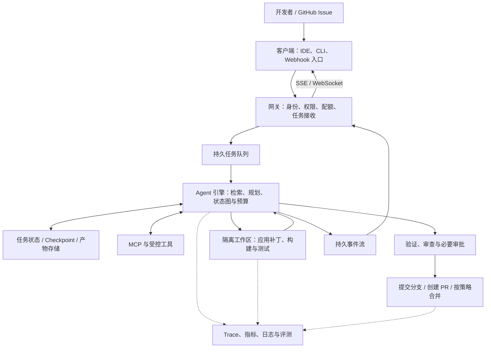
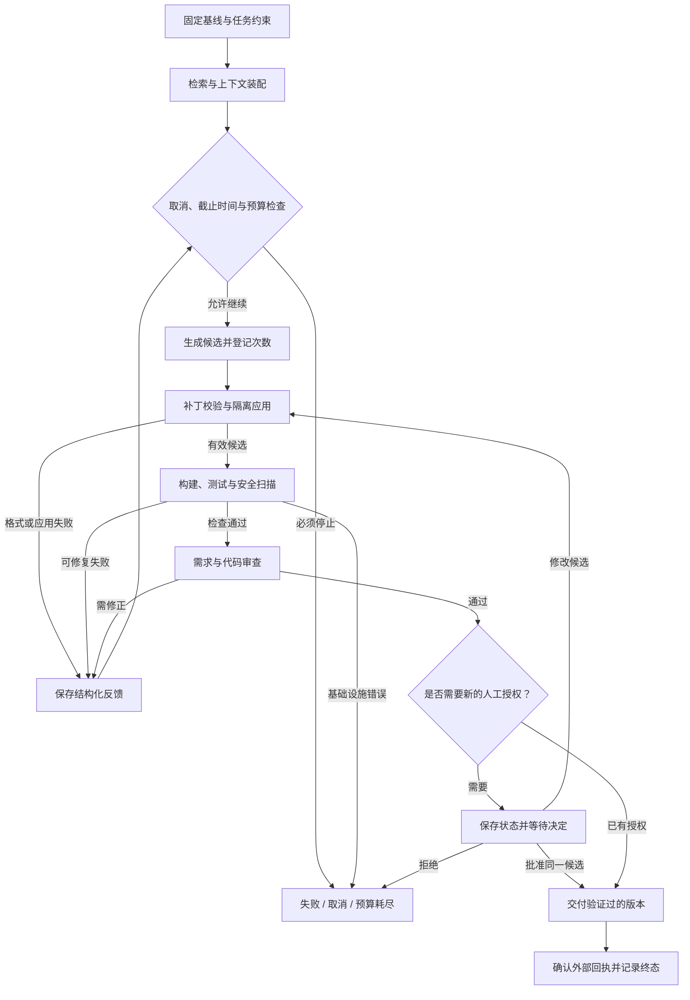

# A8-System-Architecture & Capstone：全栈 AI 编程系统架构与综合实战

> 课程：SE3353（CHP-fa26）。本笔记以本目录 40 页 HTML 课件为主线，整理系统分层、八个核心子系统、可观测性与评测，以及从 GitHub Issue 到代码交付的 Capstone。目录中只有 HTML 课件，未提供独立、完整的 Capstone 工程；课件代码按教学示意解读，未运行云沙箱、模型或 GitHub 写操作。关键协议与框架语义参考官方资料核对（2026-10-23），补充的设计建议与课件展示数据分别注明。

## 1. 本讲主线与知识地图

本讲回答：**如何把 Prompt、MCP、RAG、Skill、Agent、状态图与测试 Harness，组合成可交付、可恢复、可评估的 AI 编程系统？**

A7 主要解决一次 Agent 运行如何受到控制；A8 将视角扩展到整个应用：谁接收请求，谁持久化任务，如何通知用户，如何保护代码库，如何证明新版本比旧版本更好。

| 课程 | 提供的能力 | 在 A8 中的位置 |
| --- | --- | --- |
| A1：Prompt | 表达目标、约束与输出格式 | 系统提示、上下文装配与输出解析 |
| A2：MCP | 标准化接入工具和资源 | Git、Issue、代码导航等能力桥接 |
| A3：RAG | 检索任务相关的事实 | 代码范围定位、依赖与测试检索 |
| A4：Skill | 封装可复用的任务能力 | 修复、重构、测试等操作流程 |
| A5：Skill Pattern | 路由、预检、回退和人工介入 | 能力选择与受控执行 |
| A6：Agent | 围绕目标选择行动并读取反馈 | Triage、Coder、Reviewer 等职责 |
| A7：Harness、Loop、Graph | 控制循环、保存状态、隔离执行 | 有预算的修复循环与恢复机制 |
| A8：System Architecture & Capstone | 整合上述能力并持续运营 | 客户端、网关、引擎、沙箱、交付与评测 |

| 模块 | HTML 页码 | 学习重点 |
| --- | --- | --- |
| 全栈系统分层 | 1～10 | 交互形态、LSP / Tree-sitter、网关、六类原语、SSE |
| 八个核心子系统 | 11～20 | 上下文、骨架、MCP、Prompt、Diff、测试、撤销、审批 |
| 可观测性与评测治理 | 21～30 | Tracing、Metrics、基准、Judge、回放、安全扫描、灰度 |
| Capstone 与课程回顾 | 31～40 | Webhook、分诊、补丁、自愈、审查、PR 交付与架构原则 |

贯穿全讲的分工是：**模型提出候选，控制器检查条件，工具执行动作，验证器提供证据，交付模块确认外部结果。**

## 2. 系统架构：四层职责与三种交互形态

### 2.1 四层架构分别解决什么问题



图中的队列、事件存储和交付模块是对课件分层的工程展开，不代表目录中已有这些实现。

| 层级 | 主要职责 | 关键边界 |
| --- | --- | --- |
| Client | 收集需求、感知代码变化、展示进度与 Diff | 上传什么代码、用户批准什么动作 |
| Gateway | 鉴权、授权、限流、接收任务、推送事件 | 不能只靠客户端传入的租户 ID 判断权限 |
| Engine | 组织上下文、调用模型与工具、管理状态和预算 | 模型输出不能直接成为可信执行命令 |
| Sandbox | 在隔离环境执行补丁、构建、测试与扫描 | 限制文件、网络、凭据和计算资源 |

四层是逻辑职责，不要求部署成四个微服务。小型课程项目可以先采用模块化单体；出现独立扩缩容、故障隔离或权限隔离需求时，再拆分部署。

### 2.2 “无状态 Worker”不等于“任务没有状态”

无状态主要指：**不依赖某个进程的内存作为任务状态的唯一来源。** Worker 可以在执行时持有局部变量，但恢复所需的信息要保存到外部存储。

至少应区分：

- **业务状态**：任务目标、当前阶段、剩余预算、审批结论。
- **代码产物**：基线提交、候选补丁、测试报告和交付提交。
- **执行历史**：事件、工具结果、模型配置、失败原因。
- **运行资源**：当前租约、沙箱 ID、活动连接与超时信息。

Checkpoint 不会自动保存沙箱磁盘，也不会撤销已经创建的 PR。状态恢复与外部动作去重需要共同设计。

### 2.3 从商业产品案例提炼设计取舍

第 2 页以 Cursor、Windsurf、Claude Code、Devin 举例。复习时应掌握下列交互形态，而不是把课件对商业产品内部实现的描述当作已核实事实。

| 形态 | 适合的交互 | 架构关注点 |
| --- | --- | --- |
| IDE 集成 | 补全、选区编辑、多文件 Diff、人机共同修改 | 未保存缓冲区、版本冲突、响应延迟 |
| CLI 工具 | 仓库任务、命令行反馈、脚本组合 | 工具权限、终端体验、工作区保护 |
| 云端任务平台 | 长任务、工单处理、隔离构建与异步交付 | 环境重建、任务恢复、凭据管理、资源成本 |

这些形态可以组合。例如 IDE 负责需求与 Diff 审阅，云端 Worker 负责耗时测试。课件中的 C++、Merkle Tree、具体虚拟化技术及商业产品能力表，不作为当前产品规格或选型结论。

## 3. 代码感知：LSP、语法树与增量索引

### 3.1 LSP 与编辑器 API 的分工

LSP（Language Server Protocol）规定编辑器与语言服务器如何交换语言功能请求和结果。课件关注诊断、文档符号和依赖定位。

| 信息 | 用途 | 需要注意 |
| --- | --- | --- |
| Diagnostics | 定位错误、警告及相关范围 | 信息可能尚未更新；不能代替完整构建与测试 |
| Document Symbols | 获取类、函数、方法的结构与范围 | 符号列表不等于完整语法树或调用图 |
| Definitions / References | 查找声明和引用 | 精度取决于语言服务器及项目配置 |
| 文件变化事件 | 触发索引更新 | 还要处理删除、重命名与版本乱序 |

`vscode.workspace.onDidSaveTextDocument`、`vscode.languages.getDiagnostics` 是 VS Code 扩展 API；不能把编辑器 API 本身与 LSP 协议消息混为一谈。语言能力的实际提供者也不一定采用 LSP。[LSP 规范](https://microsoft.github.io/language-server-protocol/specifications/lsp/3.17/specification/)

仅监听保存事件适合“磁盘版本索引”。如果要处理正在编辑但未保存的内容，应携带文档版本，并明确区分编辑器缓冲区与磁盘文件。

### 3.2 Tree-sitter 与代码骨架

Tree-sitter 是增量解析工具，构造的是 **CST（Concrete Syntax Tree，具体语法树）**。课件广义使用“AST”描述语法结构；实现时应区分具体语法树、抽象语法树与语义分析结果。[Tree-sitter 官方介绍](https://tree-sitter.github.io/tree-sitter/)

代码骨架（Skeleton）保留类声明、函数签名、必要注释和导入，省略与当前任务无关的实现。例如：

```python
class BookService:
    def find_by_isbn(self, isbn: str) -> Book | None:
        """按 ISBN 查询图书。"""
        ...

    def reserve(self, book_id: int, quantity: int) -> Reservation:
        """检查库存并创建预留记录。"""
        ...
```

骨架用于理解接口和定位代码。真正修改库存逻辑时，仍然要读取 `reserve` 的函数体、调用方、事务边界与相关测试，不能仅靠签名判断业务行为。

第 13 页虽然创建了 Tree-sitter 解析结果，但随后用 `startswith("def ")` 等文本规则提取行，没有使用解析树。这样的代码会遗漏多行签名、`async def`、多行注释等情况，也没有完成跨文件符号解析。完整实现应遍历节点或执行语法查询，再按节点范围生成骨架。

### 3.3 增量索引必须带版本

建议的增量流程是：

```text
文件变化
  → 识别仓库、路径、内容哈希与文档版本
  → 更新语法结构和受影响的 Chunk
  → 更新关键词索引、向量索引与符号元数据
  → 删除失效记录
  → 检索时核对代码版本
```

语法变化范围不等于完整语义影响范围。修改函数签名可能影响其他文件的调用者；动态导入、反射或代码生成也会限制静态分析的完整性。

课件中的“压缩 80%”“千行解析小于 5ms”是展示性指标。实际效果应同时测量上下文大小、检索召回、任务成功率和端到端延迟。

## 4. 网关、任务调度与流式通信

### 4.1 接收请求与执行任务分开

长任务可以采用以下接口契约，路径仅作设计示例：

| 接口 | 职责 |
| --- | --- |
| `POST /tasks` | 验证请求、登记任务、可靠入队，返回任务 ID |
| `GET /tasks/{id}` | 查询阶段、状态、结果与失败原因 |
| `GET /tasks/{id}/events` | 订阅进度和产物事件 |
| `POST /tasks/{id}/cancel` | 提交取消请求，由执行器处理 |
| `POST /tasks/{id}/decision` | 提交绑定候选版本的批准、拒绝或修改 |

网关不应只检查“有没有 Bearer Token”。还要验证凭据、确定调用者身份，并检查其是否有权访问目标仓库、任务和产物。

第 5、33 页使用 FastAPI `BackgroundTasks` 演示返回响应后执行工作。它是应用进程内的后台任务机制，**不是持久化分布式队列**。长任务需要另行实现持久任务记录、可靠投递、重试、租约与去重；官方文档也区分了轻量后台任务和 Celery 等跨进程、跨服务器方案。[FastAPI Background Tasks](https://fastapi.tiangolo.com/tutorial/background-tasks/)

为避免“任务已写库，但入队失败”，可以采用事务性 Outbox 等设计；Worker 领取任务后应建立租约，并处理重复投递。具体方案属于工程补充。

### 4.2 限流、并发限制与预算不是同一个东西

| 控制项 | 解决的问题 |
| --- | --- |
| 请求频率限制 | 短时间内大量请求冲击入口 |
| 活动任务数限制 | 同时启动过多 Worker 或沙箱 |
| Token / 金额预算 | 单次任务或租户累计消耗过高 |
| 截止时间 | 任务长时间占用资源 |
| 候选数和工具次数 | 修复循环或工具调用失控 |

请求 QPS 很低，也可能因单个任务无限循环产生高额消耗。预算必须在引擎和执行器中实施，不能只依赖网关限流或事后告警。

### 4.3 SSE 与 WebSocket

| 维度 | SSE | WebSocket |
| --- | --- | --- |
| 数据方向 | 服务器向客户端推送 | 双向消息 |
| 典型用途 | 进度、回答片段、工具状态、测试日志 | 高频双向交互与实时控制 |
| 基本机制 | HTTP 响应体中的 `text/event-stream` | 建立持续双向连接 |
| 恢复 | EventSource 支持重连和事件 ID | 应用自行设计重连、补发与去重 |

SSE 不要求 HTTP/2。浏览器原生 `EventSource` 使用 GET；课件中的 POST 流式接口可以由 `fetch` 等客户端读取，但不会自动获得原生 EventSource 的全部重连行为。[HTML SSE 标准](https://html.spec.whatwg.org/multipage/server-sent-events.html)

一个带序号的事件可以写成：

```text
id: 42
event: test_finished
data: {"task_id":"task-1042","candidate_id":"c2","status":"passed"}

```

实际传输以空行结束一个事件。`Last-Event-ID` 只提供恢复位置；服务端仍需保存事件并实现补发，客户端也应处理重复事件。心跳、代理缓冲、背压和连接超时需要单独配置。

**连接断开不等于任务取消。** 进度流与任务生命周期应分开；用户刷新页面后可以重新订阅同一任务。适合展示的是阶段、计划摘要、工具状态和验证结果，无需把模型内部推理文本作为正确性证据。

## 5. 六类原语与八个子系统如何对应

课件将前七讲浓缩为三组组合：

| 组合 | 协作方式 | 不能由组合自动保证的事情 |
| --- | --- | --- |
| Prompt + MCP | 提示说明目标，协议暴露能力，宿主执行调用 | 工具必然正确、调用天然有权限 |
| Codebase RAG + Skill Pattern | 检索提供代码证据，Skill 组织任务流程 | 检索覆盖完整、流程一定满足业务需求 |
| Graph + Sandbox Harness | 状态图管理反馈，沙箱运行候选与检查 | 外部动作恰好执行一次、代码绝对安全 |

第 12～19 页的八个子系统进一步把这些职责落实到接口：

| 编号 | 子系统 | 输入 | 输出 |
| --- | --- | --- | --- |
| S1 | Context Packager | 文件、诊断、检索结果、预算 | 有来源与版本的上下文包 |
| S2 | AST / Symbol Extractor | 代码快照 | 符号、范围、骨架和相关依赖 |
| S3 | MCP Client Bridge | 服务配置与调用者权限 | 可用工具、受控调用与结果 |
| S4 | System Prompt Engine | 任务、上下文、工具契约、反馈 | 模型请求与结构化候选 |
| S5 | Unified Diff Engine | 基线和候选补丁 | 校验结果、候选工作区 |
| S6 | Sandboxed Tester | 候选快照、环境与测试规格 | 测试状态、日志及报告 |
| S7 | Undo / Workspace Manager | 基线、工作区与改动清单 | 可丢弃候选、受控提交与恢复 |
| S8 | HITL Controller | 风险、候选版本、证据 | 批准、拒绝、修改或继续等待 |

学习目标是能解释接口、状态与失败路径。无需因为课件强调“手写”，就自行重写成熟的协议栈、补丁解析器或虚拟化系统。

## 6. 八个核心子系统的设计要点

### 6.1 S1：Context Packager——相关性、来源与预算

上下文应包括用户任务、必要源码、诊断、失败反馈和工具契约，而不是把仓库全文装入 Prompt。

建议优先保留：任务与约束 → 主要编辑区域 → 相关测试和失败信息 → 直接依赖 → 辅助骨架。某项材料无法装入时，应记录遗漏，必要时在下一步按需读取。

预算关系可表示为：

$$
B_{\text{context}} \le W-B_{\text{system}}-B_{\text{tools}}-B_{\text{history}}-B_{\text{output}}-B_{\text{margin}}
$$

其中 $W$ 是模型上下文窗口，其他项分别为系统提示、工具说明、历史、预留输出和安全余量。分词估算要与目标模型相匹配。

第 12 页示例只累加部分 XML 片段，没有完整计入闭合标签、分隔符和请求中其他内容；遍历字典也没有实现声明中的优先级排序。更可靠的方式是对最终序列化结果重新计数，并反馈哪些材料未被纳入。

XML / JSON 可帮助标注边界，但不能保证防止 Prompt Injection。源码、Issue、检索结果仍属于外部数据；路径与正文应正确转义，工具执行时还要独立实施权限与参数检查。

### 6.2 S2：骨架与检索共同定位修改范围

Scope Finder 可按以下流程工作：

1. 从 Issue 提取错误表现、关键符号和可复现线索。
2. 用关键词检索匹配精确标识符，用向量检索补充语义相近代码。
3. 合并、去重和排序，读取候选代码正文。
4. 查询定义、引用、依赖和关联测试。
5. 对主要修改区域保留实现，对辅助区域按需提供骨架。

检索结果至少应带 `repo_id`、代码版本、路径和范围。RAG 提供的是候选证据；Top-K、检索分数或 AST 边界都不能单独证明影响范围完整。

### 6.3 S3：MCP Bridge——协议之外还要管理生命周期

桥接流程是：建立连接 → 初始化会话 → 发现能力 → 映射 Schema → 注册受控工具 → 执行调用 → 规范化结果 → 清理连接。

`list_tools()` 只列出工具；Resources 与 Prompts 使用各自的接口。工具 Schema 也不能替代服务端的业务授权。

第 14 页在 `async with ClientSession(...)` 内创建引用 `session` 的工具，然后返回这些工具。函数返回时会话已退出；如果后续调用仍依赖该会话，就会失效。应让连接生命周期覆盖工具使用期，或由连接管理器在调用时取得有效会话。

课件将传输概括为 stdio / SSE。MCP 的 2025-06-18 规范定义 stdio 与 Streamable HTTP；后者替代旧 HTTP+SSE 传输，并可使用 SSE 返回流式消息。不要把“使用 SSE”与“旧版 MCP SSE 传输”当成同一概念。[MCP 传输规范](https://modelcontextprotocol.io/specification/2025-06-18/basic/transports)

还应处理工具重名、超时、取消、分页发现、结构化错误，以及写入操作的去重。凭据不应进入模型上下文或普通日志。

### 6.4 S4：System Prompt——清晰契约需要程序执行

课件模板的可取之处是明确角色、权限范围、工作流、输出格式和失败处理。下面是经过整理的教学模板，不是商业产品的真实系统提示：

```text
目标：根据给定 Issue 修复指定仓库中的问题。
上下文：使用提供的基线、源码、测试和工具返回值；不足时先获取信息。
输出：提供简短计划摘要、候选 Unified Diff、验证结果及未解决事项。
约束：只能修改允许的路径；不能通过删除或削弱验收检查伪造成功。
反馈：失败时分析结构化报告，在控制器允许的预算内生成下一候选。
完成：以测试、审查和真实交付回执为依据报告状态。
```

“只修改仓库内文件”“最多三次”不能仅写在 Prompt 中。前者由路径校验和执行权限保证，后者由状态机计数和终止规则保证。格式正确也不等于内容正确。

### 6.5 S5：Unified Diff——验证补丁与验证程序分层进行

Unified Diff 记录原文件、目标文件和局部变化：

```diff
--- a/inventory.py
+++ b/inventory.py
@@ -1,4 +1,4 @@
 def can_reserve(stock, requested):
-    if requested < stock:
+    if 0 < requested <= stock:
         return True
     return False
```

Hunk 头 `@@ -起点,行数 +起点,行数 @@` 描述旧、新文件中的范围；空格开头是上下文，`-` 是删除，`+` 是新增。示例只说明格式，业务上仍需检查参数类型、库存一致性和并发行为。

建议按顺序检查：

| 检查层 | 问题 |
| --- | --- |
| 格式 | 补丁能否解析，是否为空或超限？ |
| 路径 | 是否越界、经过符号链接逃逸、涉及禁止修改的文件？ |
| 基线 | 当前文件是否对应生成补丁时的版本？ |
| 应用 | 每个 Hunk 能否正确应用，是否存在冲突？ |
| 语法与类型 | 候选是否能解析、编译或通过类型检查？ |
| 行为 | 是否修复问题并保持原有功能？ |

第 16 页的 `simulate_patch_in_memory` 没有给出实现；不能由 `patch_set.apply(...)` 一行推出跨文件原子性。`ast.parse()` 仅用于 Python 解析检查，也不能代替编译、类型分析或业务测试。

删除文件应根据 Diff 元数据判断，例如目标为 `/dev/null`；普通补丁同样包含 `--- a/file`，因此第 19 页用这个标记识别删除并不充分。

实践中可在隔离候选工作区应用整份补丁，验证通过后再交付。拒绝不明确的基线冲突，避免模糊匹配把改动放到错误位置。

### 6.6 S6：Sandboxed Tester——测试执行本身也会失败

一次完整测试至少需要：固定仓库基线 → 准备依赖和测试规格 → 应用候选 → 检查应用结果 → 运行测试 → 收集报告 → 保存证据 → 清理资源。

第 17、36 页直接向 `/repo/patch.diff` 写入补丁后运行 `pytest`，省略了仓库准备、依赖安装、目录创建和补丁失败检查，不能视为可独立运行的完整程序。

“只读挂载原始仓库”与“应用补丁”可以通过可写副本或 Overlay 同时实现；完全只读的目标目录无法直接修改。测试目录、缓存和临时文件也需要明确的写入区域。

课件中的 `network_mode="none"` 不能直接当作 E2B Python SDK 参数。核对时官方文档使用 `Sandbox.create(allow_internet_access=False)` 控制互联网访问；仅创建默认 Sandbox 并不会自动禁网。[E2B 网络控制](https://e2b.dev/docs/sandbox/internet-access)

| 执行结果 | 反馈与后续处理 |
| --- | --- |
| `passed` | 保存测试报告，进入审查 |
| `test_failed` | 提供断言与相关日志，允许预算内修复 |
| `patch_failed` | 返回应用冲突，先修正补丁或基线 |
| `execution_error` | 区分依赖、环境、测试收集等错误 |
| `timeout` | 记录超时阶段，终止资源占用并按策略处理 |

只读取 `stderr` 可能遗漏测试信息，应同时保留 stdout、stderr、退出码和结构化报告，并限制输出量。报告是真实运行的证据，但测试也可能有缺陷；测试通过不等于证明代码没有任何错误。

沙箱还需要 CPU、内存、时间、磁盘、进程数和凭据限制。“有 MicroVM”不能自动推出绝对安全。

### 6.7 S7：Undo Manager——保护用户工作区

第 18 页使用 `git stash create`、`git reset --hard HEAD`、`stash apply` 和 `git add -A` 模拟事务，存在几个重要边界：

- `stash create` 返回的是 stash **commit 对象**，不是单个 Blob；它不会自动登记到引用中。
- 不能假定快照包含全部未跟踪和忽略文件，也不能假定恢复保留原来的暂存状态。
- `reset --hard` 会丢弃对应的工作区改动，`stash apply` 可能冲突。
- `git add -A` 可能把任务之外的用户改动一并加入提交。

这些行为可参考 [Git stash 文档](https://git-scm.com/docs/git-stash)。一次 Git 提交可以记录多文件快照，但整个工作区修改流程并不因此具备数据库的全部 ACID 特性。

更清晰的工程方案是为任务创建独立工作区，固定基线，记录允许修改的文件和候选产物；失败时丢弃该候选，成功后只交付验证过的改动。工作区恢复、图状态恢复、远程业务动作撤销分别处理。

### 6.8 S8：HITL——批准必须绑定具体候选

审批记录建议包含：任务 ID、候选 ID / 补丁哈希、代码基线、请求动作、验证报告、审批人、时间与结论。

```text
生成候选 → 检查与测试 → 风险判断
                         ├─ 已在授权范围内 → 交付
                         └─ 需要人工决策 → 保存状态并等待
                                             ├─ 批准同一候选 → 交付
                                             ├─ 修改候选 → 重新检查与测试
                                             └─ 拒绝 → 结束或重规划
```

在 LangGraph 中，中断需要 Checkpointer 与稳定的 `thread_id`；通常使用 `Command(resume=...)` 恢复。恢复时中断所在节点会从开头重新执行，因此中断之前的副作用必须考虑重复执行。[LangGraph Interrupts](https://docs.langchain.com/oss/python/langgraph/interrupts)

`update_state()` 是状态更新，不等同于自动批准或自动恢复。第 19 页将人工修改后的 Diff 直接标记 `approved=True`，但新 Diff 尚未通过原来的检查；应让修改失效旧证据，并回到验证路径。

## 7. 用状态图连接子系统

### 7.1 状态应表达事实、产物和控制信息

以下是补充的教学状态结构，不是课件提供的完整实现；`TypedDict` 只描述类型，不执行运行时校验。

```python
from typing import Literal, TypedDict

class CodingTaskState(TypedDict):
    task_id: str
    repo_id: str
    base_commit: str
    candidate_id: str | None
    patch_ref: str | None
    test_report_ref: str | None
    candidates_used: int
    max_candidates: int
    deadline_at: str
    test_status: Literal[
        "pending", "passed", "test_failed",
        "patch_failed", "execution_error", "timeout"
    ]
    approved_candidate_id: str | None
    outcome: Literal[
        "running", "waiting_approval", "ready_for_pr",
        "delivered", "failed", "cancelled"
    ]
```

大块源码、日志和报告可以放在产物存储中，状态保存引用与哈希。不要把所有运行数据无差别拼接进每次模型请求。

### 7.2 修复回边必须有停止条件



该图补全了课件第 20 页省略的失败与停止路径。实际实现中，格式错误、测试失败和审查失败应共享全局预算，否则只限制 Pytest 重试仍可能出现无限循环。

“最多 3 次重试”通常意味着首次尝试后再允许 3 次；“最多 3 个候选”则总共只有 3 次。字段名称与判定条件必须采用同一口径。

### 7.3 持久化与外部副作用一致性

假设创建 PR 已成功，但 Worker 在保存 PR 编号前崩溃。恢复后直接重新调用创建接口，可能产生重复动作。

解决思路是为交付动作登记稳定标识，保存请求状态，恢复时查询既有结果，再决定是否执行；必要时利用服务提供的幂等机制。不要把 Checkpointer 等同于跨数据库、Git、沙箱和 GitHub 的分布式事务。

第 20 页还省略了 `RefactorState`、多个节点函数、路由、数据库初始化与入口设置。完整状态图需要定义起点，并让成功、错误、拒绝、取消和预算耗尽都具有可解释的去向。

## 8. 可观测性：追踪一次运行，统计系统表现

### 8.1 Tracing、Metrics、Logs 与 Evals

| 类别 | 核心问题 | 示例 |
| --- | --- | --- |
| Trace | 这次任务经过哪些步骤，哪里耗时或失败？ | 检索 → 生成 → 应用 → 测试的 Span |
| Metric | 一段时间内系统表现怎样？ | 成功率、队列长度、延迟分布 |
| Log / Event | 某一步发生了什么？ | 工具错误、候选变化、审批决定 |
| Eval | 新版本在固定任务集上是否更好？ | 修复率、回归率、平均成本 |

建议关联以下标识，但不要把它们混成一个值：

| 标识 | 作用 |
| --- | --- |
| `task_id` | 业务任务身份 |
| `thread_id` | 状态图持久会话身份 |
| `run_id` | 某次具体执行或恢复运行 |
| `trace_id` / `span_id` | 遥测链路及其中的操作 |
| `candidate_id` / `patch_hash` | 精确定位被测试和批准的产物 |

第 22 页把 `X-Trace-Id` 写入 Span 的普通属性，并不会改变该 Span 的真实 Trace ID。跨服务追踪需要传播和提取 Trace Context，例如 W3C `traceparent`，建立正确父子关系；队列消息也需要携带上下文。[OpenTelemetry Context Propagation](https://opentelemetry.io/docs/concepts/context-propagation/)

记录可重建问题的必要数据，包括模型配置、Prompt 版本、代码基线和报告引用；日志内容应脱敏并设置访问与保留策略，不能为了“全量镜像”记录真实密钥。

### 8.2 指标与成本归因

| 指标类型 | 适合记录 |
| --- | --- |
| Counter | 累计请求、Token、失败、已计量成本 |
| Histogram | 排队、检索、模型、沙箱耗时和 TTFT 分布 |
| Gauge | 活动任务数、队列长度、当前资源占用 |

失败率通常由失败计数与请求计数在时间窗口内计算；TTFT（Time to First Token）应说明从哪个时间点开始计时。首个心跳或“任务已接收”事件不是模型的首个输出 Token。

忽略缓存、折扣等细节时，模型成本可以估算为：

$$
C_{\text{model}}=\frac{T_{\text{in}}P_{\text{in}}+T_{\text{out}}P_{\text{out}}}{10^6}
$$

其中 $P$ 是每百万 Token 单价。总任务成本还可能包括检索、沙箱、存储和其他工具。课件第 23 页的硬编码价格只作计算示例，实际应使用带版本的价格配置及供应方用量回执。

Prometheus 的标签组合会产生独立时间序列。无限增长的 `task_id`、原始 URL，或大量租户与模型、节点交叉组合，容易带来高基数问题；详细任务账单适合存入日志或业务账本。[Prometheus 指标埋点建议](https://prometheus.io/docs/practices/instrumentation/)

监控告警与执行熔断分工不同：Alertmanager 可以发出通知，阻止下一次调用或终止沙箱仍需要控制器主动执行。

## 9. 评测：区分测试结果、任务成功率与 Pass@k

### 9.1 HumanEval 与 SWE-bench 的侧重点

| 维度 | HumanEval | SWE-bench |
| --- | --- | --- |
| 任务粒度 | 按函数签名和描述生成实现 | 根据 Issue 修改真实仓库 |
| 主要能力 | 局部代码生成 | 定位、跨文件修改、工具与环境使用 |
| 判定基础 | 函数测试 | 固定任务环境中的补丁评估 |
| 不能直接代表 | 整个工程交付能力 | 任意仓库、需求和环境中的可靠性 |

SWE-bench 的重要概念是：

- **F2P（Fail-to-Pass）**：与修复有关的指定测试应从失败转为通过。
- **P2P（Pass-to-Pass）**：原本通过的指定测试应继续通过。

官方 Harness 根据任务测试规格、环境与日志解析判定结果，不能简单等同于“在任意目录跑一次 `pytest`”。测试是否覆盖整个仓库也取决于具体实例与评测规格。[SWE-bench 评测说明](https://www.swebench.com/SWE-bench/guides/evaluation/)、[Harness 判定接口](https://www.swebench.com/SWE-bench/api/harness/)

### 9.2 Pass@k 的含义与公式

对同一道题，按规定采样策略生成 $n$ 个候选，其中 $c$ 个通过，估计从中选取 $k$ 个候选时至少一个通过的概率：

$$
\widehat{\operatorname{Pass@k}}
=1-\frac{\binom{n-c}{k}}{\binom{n}{k}},
\qquad 1\le k\le n,\quad 0\le c\le n
$$

当 $n-c<k$ 时结果为 1；当 $k=1$ 时为 $c/n$。例如 $n=10,c=2$，则 Pass@1 为 0.2，Pass@2 为 $1-28/45\approx0.378$。多个任务通常先分别估计，再在任务间取平均。[HumanEval 评测实现](https://github.com/openai/human-eval/blob/master/human_eval/evaluation.py)

公式适用于相应的候选采样与评测设置，不能把一条依赖前轮反馈的连续修复轨迹，直接当作若干独立采样候选来套用。

**必须先定义一次“样本”是什么。** 如果样本是首次生成的 Patch，第三轮才通过就不是首次候选成功；如果样本定义为一次包含内部修复循环的完整 Agent 运行，可以报告该运行协议下的单次成功率，但必须披露预算、轮数和测试反馈条件。

因此，课件多处出现的“测试通过即 Pass@1 Gate”不够准确。更清楚的区分是：

| 口径 | 说明 |
| --- | --- |
| 候选测试状态 | 某个指定 Patch 是否通过指定检查 |
| 首次候选通过率 | 不使用修复反馈时，第一个 Patch 的成功比例 |
| 预算内任务解决率 | 在固定时间、成本和轮数内完成任务的比例 |
| 基准 Pass@k | 按规定采样及评测协议计算的指标 |

### 9.3 评测应同时控制质量与成本

比较两个版本时，应固定或记录：任务集合、代码基线、模型配置、工具与沙箱版本、候选预算、可见测试和隐藏验收测试。

除成功率外，还应记录回归、运行错误、人工介入、候选数量、延迟和单个成功任务成本。基础设施失败不能悄悄从统计中删除；可以单独分类，并同时报告其对整体交付的影响。

课件提出的 Pass@1 ≥ 95%、每任务 ≤ $0.50、TTFT ≤ 1.5s、轨迹 ≤ 8 步等，是示例目标，不是普遍标准。阈值应来自任务难度、基线、样本规模和服务目标。

### 9.4 LLM-as-a-Judge 是辅助审查信号

第 25 页的三维 Rubric 可以整理为：

| 维度 | 判断依据 |
| --- | --- |
| Correctness | Issue 要求、实际 Diff、测试证据、边界条件 |
| Security | 权限、输入处理、凭据、风险路径与扫描结果 |
| Style / Architecture | 仓库规范、接口一致性、改动范围与复杂度 |

结果应包含分数、结论、具体文件位置和理由。JSON Schema 可以约束输出结构，程序还应检查枚举、范围、缺失字段和引用有效性；`json.loads()` 只完成 JSON 解析。

结构化输出不使模型裁决变为确定、无偏或绝对正确。应以人工标注样本校准裁判，将测试、静态检查、模型审查和所需人工审查结合；模型输出 `APPROVED` 不等于获得仓库写入或合并权限。

## 10. 回放、安全检查、CI 与版本发布

### 10.1 失败 Fixture 与三种回放

一个可用于分析失败的 Fixture，建议保存任务输入、初始状态、代码基线、候选补丁、模型与工具请求响应、测试报告、环境版本和脱敏信息。

| 回放方式 | 固定的内容 | 能回答什么 |
| --- | --- | --- |
| 历史展示 | 已保存的事件与产物 | 当时发生了什么？ |
| 控制逻辑回放 | 模型与工具响应由 Fixture 替代 | 路由、预算、解析和异常处理是否回归？ |
| 真实重跑 | 重建环境后重新调用工具或模型 | 当前系统能否再次完成任务？ |

`temperature=0` 不能保证模型服务逐字复现；如果仍调用真实模型，也仍可能产生费用。确定性的逻辑回放依赖预先记录的响应、受控时钟、随机源和调度条件。

Mock 回放能发现控制逻辑问题，但不能证明真实 MCP 服务可用、沙箱配置正确或新模型质量提高。不同测试层要分别保留。

### 10.2 安全扫描检查什么

| 机制 | 主要作用 | 边界 |
| --- | --- | --- |
| Secrets 扫描，如 Gitleaks | 发现疑似凭据与密钥 | 无命中不代表不存在敏感信息 |
| SAST，如 Semgrep | 根据规则分析源码风险 | 效果依赖语言、规则、配置和数据流覆盖 |
| 权限与路径校验 | 限制可调用动作和可访问资源 | 需要在真实执行端实施 |
| 隔离测试 | 限制候选运行影响 | 不能替代业务正确性与部署审查 |

扫描应覆盖实际候选源码及适用的改动范围；仅扫描 Diff 可能缺少必要上下文。反馈给 Coder 的结果应包含规则、位置和说明，并对疑似凭据做遮蔽。

扫描器的结果至少分为 `passed`、`findings`、`scan_error`。第 28 页没有完整处理工具启动失败、退出码、非法 JSON 和超时；扫描未完成时不能把空结果当作“安全通过”。

“OWASP 扫描”是对检查目标的概括，不存在某个工具一次运行即可证明全部 OWASP 风险均已消除的结论。

### 10.3 CI 失败如何真正阻止交付

完整链路是：生成评测和扫描结果 → CI 返回相应状态 → 仓库配置 Required Status Checks / Rules → 针对实际待合并版本核对结果 → 按授权交付。

仅在脚本中 `sys.exit(1)`，不意味着所有仓库都自动禁止合并。第 27 页的示例声明 `check_owasp`，函数体却没有使用它，也没有实现完整 Judge 或安全扫描流程。

课程项目可分为两层 CI：

1. **每次改动检查**：格式、类型、控制逻辑回放、候选测试和安全扫描。
2. **模型 / Prompt / Harness 版本评测**：在固定任务集上比较质量、成本、延迟与回归，再决定发布。

这是一种补充的实施建议。评测版本应同时标记模型、Prompt、工具定义、检索配置、环境和预算，不能只记录 Prompt 文件版本。

### 10.4 Shadow 与 Canary 不同

| 方式 | 是否影响真实用户结果 | 主要目的 |
| --- | --- | --- |
| Shadow Run | 影子结果不作为正式响应，真实写操作被隔离或替换 | 对同一输入比较版本表现 |
| Canary Release | 一部分真实请求由新版本处理 | 在受控范围内验证实际服务表现 |

影子测试仍消耗模型和计算资源，也可能争用生产容量。`asyncio.create_task()` 只是并发调度，不能保证任务持久、不增加延迟或没有副作用。

影子环境可以写入自己的临时工作区，但应阻止真实业务写入、发消息、创建 PR 等副作用。只有取得可比的测试或业务结果，才能评估成功率，不能让两个模型自己给出的 `pass1_score` 决定晋级。

第 29～30 页的“100 次影子运行”“5% 熔断”“10% → 50% → 100%”是示例策略。实际应按样本覆盖、统计不确定性、成本和回滚能力决定阶段。

## 11. Capstone：从 Issue 到经过验证的代码交付

### 11.1 七个阶段与完成证据

| 阶段 | 工作内容 | 需要留下的证据 |
| --- | --- | --- |
| 1. 接收 | 验签、识别事件、检查仓库权限、去重、登记任务 | Delivery ID、任务 ID、接收状态 |
| 2. 分诊 | 理解问题、确定范围、固定基线与验收目标 | 问题摘要、基线 SHA、修改范围 |
| 3. 上下文 | 检索源码、依赖、诊断与测试，执行预算裁切 | 带版本的上下文清单与遗漏项 |
| 4. 候选生成 | 生成 Diff，检查格式、路径、基线及语法 | 候选 ID、补丁哈希、预检结果 |
| 5. 隔离验证 | 应用候选、构建、测试、读取反馈并受限修复 | 环境标识、报告、日志和候选关联 |
| 6. 审查与决定 | 安全扫描、需求审查、必要的人工审批 | 具体结论、证据、授权对象 |
| 7. 交付 | 提交分支、创建 PR，并按策略决定是否合并 | 提交 SHA、PR URL、最终远端状态 |

课件的终点是自动合并，但完成标准由任务契约决定。创建可审阅 PR 与已合并是不同终态；系统应准确报告达到哪一步。

### 11.2 Webhook：验签只是入口检查的一部分

第 33 页需要补全的顺序是：

1. 对收到的原始请求字节计算 HMAC，核对 `X-Hub-Signature-256`。
2. 验证 `X-GitHub-Event`，再检查 Payload 中的 `action`，例如 `issues` + `opened`。
3. 检查仓库是否在允许范围内，并利用 `X-GitHub-Delivery` 登记和识别重复投递。
4. 持久保存任务与投递意图，再向发送方返回接收状态。
5. Worker 获取选定分支的代码基线；不要假设 Issue Payload 已直接给出所需的 `base_commit_sha`。

下面只展示签名比较，不构成完整 Webhook 服务：

```python
import hashlib
import hmac

def valid_signature(raw_body: bytes, signature: str | None, secret: bytes) -> bool:
    if not signature or not signature.startswith("sha256="):
        return False
    expected = "sha256=" + hmac.new(secret, raw_body, hashlib.sha256).hexdigest()
    return hmac.compare_digest(expected, signature)
```

应直接验证原始 Body，而不是解析 JSON 后重新序列化。验签确认消息来源与完整性；Issue 正文仍可能包含错误或恶意指令，不应因此获得执行权限。[GitHub Webhook 验签](https://docs.github.com/en/webhooks/using-webhooks/validating-webhook-deliveries)

GitHub 重投递保留原来的 Delivery ID；去重记录要区分“已经成功处理”与“之前处理失败、现在需要恢复”，不能一律丢弃。第 33 页返回 `{"status":"ACCEPTED"}` 也不会自动把 HTTP 状态设为 202，需在接口响应中显式设置。[GitHub Webhook 最佳实践](https://docs.github.com/en/webhooks/using-webhooks/best-practices-for-using-webhooks)

### 11.3 分诊与定位不只是一次 Top-K 检索

Triage 应先判断任务是否清晰、可复现、在支持的仓库和权限范围内，再决定执行、补充信息或停止。

第 34 页用 RAG 获取主要文件，再通过 MCP 补充依赖，是合理的职责组合。但示例中的 `hybrid_search`、`get_symbol_dependencies` 和 `extract_skeleton` 都需要实际实现；MCP `call_tool()` 的返回值还需按协议结果解析，不能默认是含 `imports` 的普通字典。

定位过程应同时关注实现与测试，保留来源、代码版本及检索不足信息。骨架不足以判断时，继续读取必要源码。

### 11.4 一个受控修复过程

以下是帮助理解的假设场景，不是本次运行日志：

```text
Issue：库存刚好等于购买数量时，预留失败。
  → Triage：固定基线，定位库存判断函数与现有测试。
  → Context：读取判断函数、调用方和库存约束。
  → Candidate 1：把 requested < stock 改为 requested <= stock。
  → Test：等量库存测试通过，但请求数量为 0 的测试失败。
  → Feedback：返回失败用例及断言，扣除已使用预算。
  → Candidate 2：加入 requested > 0 条件。
  → Verify：重新运行相关测试与回归检查，并完成审查。
  → Delivery：在获准的范围内创建 PR，记录提交与报告。
```

这里首次候选失败，预算内修复成功。不能只展示最后一次通过就抹去前面的失败、费用和延迟；更不能通过删除失败测试把它包装成成功。

### 11.5 PR 创建、批准与合并是独立动作

第 37 页代码只调用了创建 PR 和 Merge 接口，尚未实现其文字声明的完整流程：

- 没有创建并推送 `agent-fix-{issue_id}` 分支及候选提交。
- 没有实际调用所描述的 LLM Judge，也没有提交 Review Approval。
- 没有完整验证前序测试、扫描和审批对应同一候选。
- 没有检查 HTTP 状态、请求超时和合并结果，就返回 `MERGED`。
- 在 `async def` 中直接使用同步 `requests`，没有解决阻塞调用问题。

真实交付需要先检查分支和提交，再创建或复用 PR，等待所需检查与审查，确认最终 Head SHA 仍是验证过的版本，然后执行授权范围内的动作。

课件所用的同步 Merge API 支持传入 `sha` 检查 PR Head，并在成功响应中返回 `merged`。如果采用异步合并或 Merge Queue，接受请求、入队与实际完成也应分开记录，不能收到接收回执就宣称已合并。[GitHub Pull Requests API](https://docs.github.com/en/rest/pulls/pulls?apiVersion=latest)

### 11.6 如何看待第 38 页的展示日志

课件展示了 Issue / PR #1042、12/12 测试通过、1.82 秒、$0.014 和合并提交。它们是 HTML 中的展示内容；本目录没有相应运行产物，无法据此认定为可复现的实测结果。

一份可核查的 Capstone 交付记录，至少应能关联：

```text
任务与代码基线
  ↔ 候选 Diff / 提交
  ↔ 对应环境中的测试和扫描报告
  ↔ 审查及所需审批
  ↔ 实际 PR / Merge 回执
```

状态图显示成功、模型宣称完成、测试报告变绿、远端合并成功，分别是不同层面的事实，必须建立对应关系。

## 12. 课件中容易混淆的说法

| 课件表述或代码印象 | 更准确的理解 |
| --- | --- |
| 有 RAG 就能“零幻觉” | RAG 提供证据，仍需检查版本、覆盖与解释是否正确 |
| XML 标签能阻止所有提示注入 | 标签帮助组织信息，授权与执行边界仍需独立实现 |
| Prompt 写了约束就形成强制契约 | 程序必须实施参数、权限、预算和结果校验 |
| Document Symbols 就是完整 AST / 调用图 | 符号层次、语法结构和语义关系是不同信息 |
| 几条 `startswith()` 就是 AST 骨架提取 | 没有使用语法节点，无法完整处理语言结构 |
| FastAPI 后台任务等于 Celery | 前者不自动提供持久队列和跨进程恢复 |
| SSE 重连会自动补齐全部事件 | 还要有事件 ID、保留、补发与去重实现 |
| 创建 E2B Sandbox 就自动禁网 | 网络权限必须显式配置并验证 |
| `ast.parse()` 通过就保证代码可用 | 仅是一层解析检查，仍需编译和行为验证 |
| Git Stash 等同于 ACID 事务 | 工作区、索引、未跟踪文件及外部动作需要分别管理 |
| Checkpoint 恢复就能撤销所有动作 | 图状态恢复不等于文件或远端副作用回滚 |
| 修改审批中的 Patch 后可以直接交付 | 新产物必须重新验证，并绑定相应审批 |
| 第三轮测试通过也直接叫首次成功 | 先定义候选或整次 Agent 运行的统计口径 |
| `temperature=0` 保证零成本确定性回放 | 固定响应与隔离副作用才支持相应逻辑回放 |
| JSON Judge 就是无偏确定性裁判 | Schema 约束格式，判断质量仍需评估 |
| CI 退出非零就必定阻止合并 | 还依赖仓库规则、检查绑定和权限配置 |
| Shadow Run 没有成本或资源影响 | 模型、沙箱、网络和调度仍有开销 |
| Merge 请求发出就等于交付成功 | 必须读取并确认最终远端结果 |

## 13. 将“十六大法则”转为可检查的设计问题

第 39 页用十六条原则回顾课程。下面保留其主题，将绝对化表述整理为工程检查问题：

| 原则 | 设计时应能回答 |
| --- | --- |
| 1. 结构化契约 | 输入、候选、错误和结果有哪些字段，谁负责校验？ |
| 2. 决策与执行解耦 | 模型提议后，谁负责批准、执行和验证？ |
| 3. 标准化协议 | 工具通过什么协议接入，连接与权限由谁管理？ |
| 4. 事实锚定 | 源码和知识来自哪里，是否对应本次基线？ |
| 5. 能力封装 | Skill 的输入、输出、前置条件和失败方式是否明确？ |
| 6. 横切治理 | 权限、事务和日志是否在真实执行端统一实施？ |
| 7. 显式控制流 | 循环、分支、并行和交接是否能够解释？ |
| 8. 显式结束 | 成功、失败、拒绝、取消与预算耗尽分别如何终止？ |
| 9. 持久化 | Worker 消失后，哪些信息和产物足以恢复？ |
| 10. 历史与分支 | 回放的是旧记录还是重新执行，副作用如何处理？ |
| 11. 协作边界 | 子任务得到哪些上下文，结果怎样合并和验证？ |
| 12. 停滞与预算控制 | 如何识别重复无进展，并阻止继续消耗？ |
| 13. 隔离执行 | 文件、网络、凭据和资源限制是否实际生效？ |
| 14. Harness | 如何固定输入、替换副作用并保留真实验证层？ |
| 15. 可观测性 | 能否从任务追到候选、工具、测试与交付回执？ |
| 16. 评测驱动演进 | 新版本是否在可比任务、环境和预算下更好？ |

这些原则不要求绑定某个框架，也不要求每个系统都采用多 Agent。能够清楚地分配职责、验证结果和处理失败，比堆叠组件数量更重要。

## 14. 复习问题与材料入口

### 14.1 自测问题

1. **为什么 Worker 可以无状态，任务却必须有持久状态？** 因为进程可替换，但任务进度、产物、预算与外部动作记录不能随进程消失。
2. **为什么“连接断了”不等于“任务失败了”？** 通信与执行是独立生命周期，恢复展示需要查询状态和补发事件。
3. **为何有 Skeleton 仍需要读取源码？** 骨架提供接口与结构，业务逻辑和边界条件通常在函数体、调用方和测试中。
4. **为什么补丁哈希要进入测试和审批记录？** 防止把旧候选的通过证据用于新候选。
5. **怎样区分候选失败与执行器失败？** 前者通常反馈给 Coder，后者要诊断环境并按基础设施策略处理。
6. **为什么 Checkpoint 不能解决重复创建 PR？** 它没有自动与远端副作用形成同一个事务，需要动作登记、去重与结果查询。
7. **为什么 JSON 格式正确不代表 Judge 判定可靠？** 格式验证不检查语义判断是否正确或有偏差。
8. **如何判断新 Prompt 是否值得上线？** 在固定任务、基线、环境和预算下比较质量、成本、延迟与回归，再通过受控发布验证。

### 14.2 建议练习

以下是基于课件的学习建议，不代表本目录已实现这些功能：

- 为一个单仓库修复任务写出输入、允许动作、候选结构和完成条件。
- 用固定模型 / 工具响应，演示成功、语法错误、测试失败、超时、预算耗尽和人工修改六条路径。
- 加入隔离候选工作区，证明失败不会覆盖用户原有改动。
- 模拟 Worker 在远端动作成功后、保存状态前崩溃，检查恢复是否重复交付。
- 选择一组固定任务，分别报告首次候选通过率、预算内解决率和成功任务成本。
- 最后接入真实模型、工具和沙箱，确认 Mock 测试没有掩盖集成问题。

### 14.3 本地资料导航

| 阅读目标 | 课件入口 |
| --- | --- |
| 全栈分层与整体目标 | [第 1 页：课程导论](/Users/xlchen/CHP-fa26/A8-System-Architecture&Capstone/A8-System-Architecture&Capstone/1.html)、[第 10 页：分层拓扑](/Users/xlchen/CHP-fa26/A8-System-Architecture&Capstone/A8-System-Architecture&Capstone/10.html) |
| 八个核心子系统 | [第 11 页：子系统总览](/Users/xlchen/CHP-fa26/A8-System-Architecture&Capstone/A8-System-Architecture&Capstone/11.html)、[第 20 页：管道组装](/Users/xlchen/CHP-fa26/A8-System-Architecture&Capstone/A8-System-Architecture&Capstone/20.html) |
| 追踪、成本与评测 | [第 21 页：可观测性与评测](/Users/xlchen/CHP-fa26/A8-System-Architecture&Capstone/A8-System-Architecture&Capstone/21.html)、[第 24 页：评测基准](/Users/xlchen/CHP-fa26/A8-System-Architecture&Capstone/A8-System-Architecture&Capstone/24.html) |
| Capstone 执行链路 | [第 31 页：综合实战](/Users/xlchen/CHP-fa26/A8-System-Architecture&Capstone/A8-System-Architecture&Capstone/31.html)、[第 37 页：审查与交付](/Users/xlchen/CHP-fa26/A8-System-Architecture&Capstone/A8-System-Architecture&Capstone/37.html) |
| 课程回顾 | [第 39 页：十六条架构原则](/Users/xlchen/CHP-fa26/A8-System-Architecture&Capstone/A8-System-Architecture&Capstone/39.html)、[A7 笔记](/Users/xlchen/CHP-fa26/A7-Harness,Loop&Graph-Engineering/A7-Harness,Loop&Graph-Engineering.md) |

