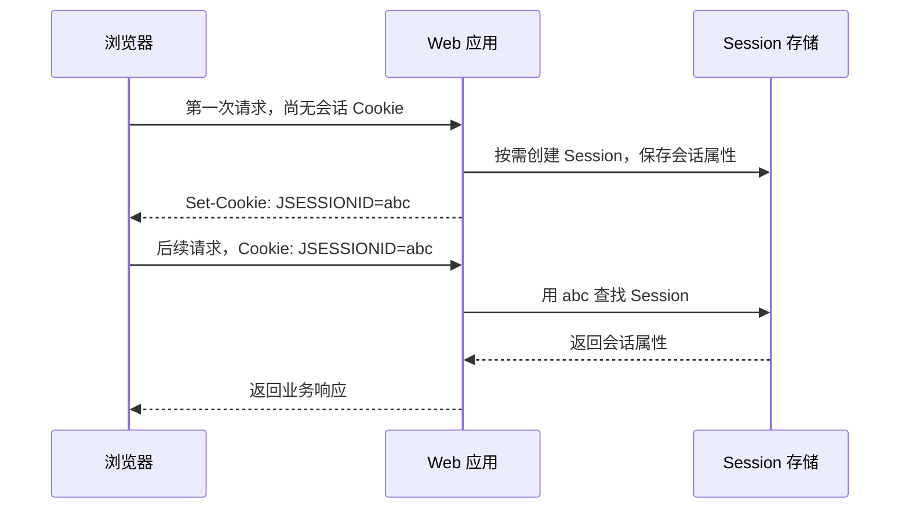
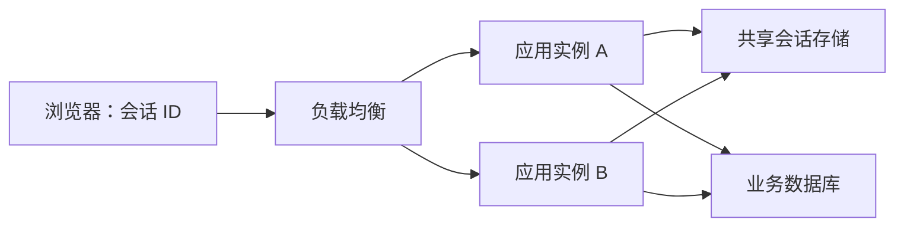
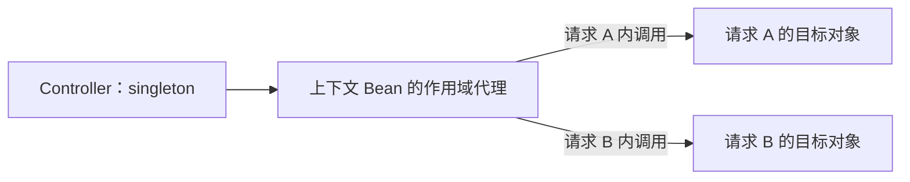
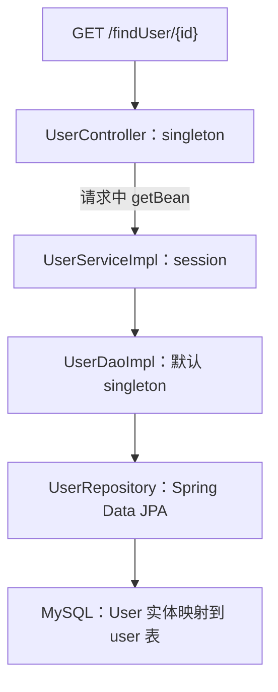

# B1-architecture：应用系统架构与服务状态设计

> 课程：SE3353（CHP-fa26）。本笔记结合本目录两份课件与两个 Spring Boot 示例整理，覆盖架构演进、HTTP Session、Bean 作用域、作用域代理和数据库连接池。课件中的图片页已按图示内容归纳；框架语义参考官方资料核对（2026-10-23）。文中的运行结果均为根据源码推导的预期，未启动示例服务或连接数据库。

## 1. 本讲主线与材料索引

本讲的核心问题是：**当应用从一台机器扩展到多个实例时，业务逻辑如何组织，状态由谁保存，对象和连接又应如何共享？**

学习时把握三条线索：

- **部署架构**：根据瓶颈增加缓存、应用副本、数据库副本、消息队列，或拆分服务。
- **状态归属**：区分一次请求的数据、一个会话的数据和需要长期保存的业务数据。
- **资源生命周期**：决定 Bean 何时创建、由谁复用，以及数据库允许多少并发连接。

| 材料 | 页码 / 内容 | 阅读重点 |
| --- | --- | --- |
| `B1-architecture.pptx`，17 页，简称主课件 | 2～7 | 单体、集群、微服务、云原生与 AI 原生；架构演进的十个阶段 |
| 主课件 | 8～11 | HTTP 无状态、Session、状态外置与扩展性 |
| 主课件 | 12～15 | Bean 作用域、单例并发、Scoped Proxy、实例计数 |
| 主课件 | 16 | 数据库连接池大小 |
| `01-architecture & service component.pptx`，38 页，简称补充课件 | 3～12 | Java Web 架构逐步增加组件的十张图 |
| 补充课件 | 14～18 | Session 对象关系与 Bean Scope 基础 |
| 补充课件 | 19～33 | Controller / Service 的作用域组合实验 |
| 补充课件 | 34～36 | 作用域代理代码与连接池公式 |
| `se3353_1_statefulservice/` | Spring Boot 3.1.3，`java.version=20` | 通过 `getBean()` 获取 session 作用域的 Service |
| `se3353_1_scope/` | Spring Boot 3.5.0，`java.version=17` | singleton Controller 注入带作用域代理的上下文对象 |

**需要先记住的区别：单体不等于单机，无状态不等于没有数据库，singleton 不等于线程安全，prototype 不等于每次 HTTP 请求自动新建。**

## 2. 架构演进：每增加一个组件，都要说明它解决的瓶颈

### 2.1 逻辑分层、部署方式与扩展方向

逻辑分层讨论代码职责，例如 Controller 接收请求、Service 组织业务、DAO 访问数据。物理部署讨论这些部分运行在哪些进程和机器上。两者不能混为一谈。

| 概念 | 含义 | 例子 |
| --- | --- | --- |
| 单体应用 Monolith | 主要业务模块作为一个应用单元构建和部署 | 用户、图书、订单模块打成一个 Spring Boot 应用 |
| 单机部署 | 应用及相关资源集中在一台机器 | 应用、数据库和上传文件共用一台服务器 |
| 集群 Cluster | 多个实例共同承担一类工作 | 三个相同的应用副本接收负载均衡器分配的请求 |
| 微服务 Microservices | 按业务能力划分可独立部署的服务 | 用户服务、订单服务、库存服务分别部署 |
| 垂直扩展 Scale Up | 提升单个节点的资源 | 增加 CPU、内存或磁盘性能 |
| 水平扩展 Scale Out | 增加节点或实例数 | 增加应用副本或只读数据库副本 |

主课件第 3 页用“应用、数据库、文件同机”介绍起点。这是单体应用的一种部署形态；把数据库移到另一台机器，或者部署多个相同应用副本，都不意味着业务已经拆成微服务。

### 2.2 Java Web 架构的十个阶段

下表按补充课件第 3～12 页排列。“新增问题”是帮助理解取舍的工程补充，不表示课件提供了对应完整实现。

| 阶段 | 课件页 | 主要变化 | 解决的问题 | 新增问题 |
| --- | --- | --- | --- | --- |
| 1. 单机一体化 | 3 | 应用、文件、数据库同机 | 开发和部署起步简单 | 资源竞争、容量上限、单点故障 |
| 2. 应用与数据分离 | 4 | 文件和数据库独立部署 | 按 CPU、内存、磁盘需求分别配置 | 网络访问、跨机器故障处理 |
| 3. 引入缓存 | 5 | 本地缓存与远程分布式缓存 | 减少重复查询与数据库 I/O | 失效策略、数据陈旧、缓存与数据库一致性 |
| 4. 应用服务器集群 | 6 | 负载均衡器分发到多个应用副本 | 分摊请求，提高应用层容量 | Session、上传文件等本地状态如何共享 |
| 5. 数据库读写分离 | 7 | 写入主库，部分读取走副本 | 缓解主库读取压力 | 复制延迟、读到旧数据、读请求路由 |
| 6. CDN 与反向代理 | 8 | 缓存和分发可缓存内容 | 降低静态资源访问延迟与源站压力 | 缓存更新、回源策略、不同内容的缓存规则 |
| 7. 分布式数据存储 | 9 | 分布式文件与数据库，统一数据访问入口 | 突破单节点存储和吞吐限制 | 分片路由、复制、一致性、跨分片操作 |
| 8. 搜索引擎与 NoSQL | 10 | 按查询特点增加存储系统 | 全文检索及不同数据模型的访问需求 | 索引同步、多份数据的更新与运维 |
| 9. 消息服务器 | 11 | 不同应用通过消息协作 | 异步处理、解耦、缓冲流量峰值 | 重复消费、积压、失败重试与处理顺序 |
| 10. 服务拆分 | 12 | 抽取独立服务，供不同应用调用 | 复用能力，独立发布和扩展 | 远程调用、接口兼容、链路追踪与跨服务一致性 |

这是一条教学路径，实际系统可以跳过不需要的阶段。例如全文检索需求可能在流量很小时就出现，而一个内部管理系统可能长期使用模块清晰的单体。

### 2.3 几组容易混淆的组件

- **负载均衡器**负责在多个后端实例之间选择请求去向；**反向代理**代表后端接收客户端请求。一个组件可以同时承担这两种职责。
- **CDN**将可缓存内容分发到靠近用户的节点；不能把任意个性化业务响应都作为公共静态内容缓存。
- **本地缓存**保存在当前进程，各副本的内容可能不同；**分布式缓存**由多个应用实例通过网络访问。
- **读写分离**增加读取副本；**分库分表**拆分数据。增加只读副本通常不能直接消除主库的写入瓶颈。
- **消息队列**允许生产与消费按不同速度推进；消息成功入队不代表业务处理已经完成。

以书店为例：图书封面可通过 CDN 分发，热门书目可缓存，库存扣减需要在业务数据层保证正确性，订单通知可异步处理。它们对应不同的访问特点，不能用一个“加缓存”方案解决所有问题。

### 2.4 云原生与 AI 原生的位置

主课件第 2、5、6 页将视角扩展到容器化、服务发现、弹性伸缩，以及模型推理、向量检索和工具调用。

| 方向 | 关注的问题 | 典型能力 |
| --- | --- | --- |
| 微服务与云原生 | 服务如何部署、扩缩容、发现彼此并处理故障 | 容器、编排、网关、监控、自动发布 |
| AI 原生应用 | 如何围绕用户意图，组织上下文、模型推理与工具执行 | LLM、检索、向量存储、Agent、MCP |

这里的“1.0～4.0”是课件的组织方式，不是要求所有系统依次升级的成熟度标准。AI 应用仍然需要传统架构提供身份管理、数据存储、事务和可用性保障；模型推理还会引入延迟、成本与上下文容量约束。

结合 A 系列课程，可以把 AI 编排作为应用的一部分，通过业务接口查询图书或提交订单。业务状态仍需明确归属，不能仅保存在某一次模型调用的上下文中。

## 3. HTTP、Session 与服务状态

### 3.1 三种“状态”讨论的是不同范围

| 范围 | 核心问题 | 例子 |
| --- | --- | --- |
| HTTP 协议 | 协议是否要求服务器记住此前请求，才能解释后续请求？ | HTTP 本身不提供自动延续的用户会话 |
| 应用实例 | 下一次请求是否依赖某个特定实例保留的客户端上下文？ | 购物车仅存在应用 A 的内存中 |
| Java Bean | 同一个对象是否在多次调用之间保存业务或会话数据？ | Service 字段中保存 `currentUser` 或购物车 |

**HTTP 无状态允许应用自行管理状态。** 登录、购物车和订单都可以跨请求存在，关键是应用如何标识用户、保存数据和恢复上下文。

### 3.2 Cookie 与 Session 的配合

典型 Servlet 会话流程如下。应用需要会话时，服务器创建 Session，响应中写入会话标识；浏览器在符合 Cookie 规则的后续请求中带回该标识。响应使用 `Set-Cookie`，请求使用 `Cookie`，二者方向不同。[RFC 6265：HTTP State Management Mechanism](https://www.rfc-editor.org/rfc/rfc6265)



`JSESSIONID` 是 Servlet 场景常见的会话 Cookie 名称。浏览器通常保存的是会话标识，购物车等对象保存在服务端。Session 也不必等到用户登录后才能创建，匿名购物车同样可以使用会话。

课件的“两浏览器、两 Session”实验依赖两组独立的 Cookie。同一浏览器的多个普通标签页通常共享同站点的 Cookie，不能直接当作两个独立 Session。

### 3.3 Session 内部保存的是对象关系

补充课件第 15 页展示了如下关系：

```text
Session A → Cart A → Books A → Book A、Book B
Session B → Cart B → Books B → Book B、Book C
```

会话属性可以指向购物车对象，购物车再引用集合和商品对象。由此可以推导：

- 两个 Session 拥有不同的 Cart，并不意味着它们引用的全部底层对象都不同。
- 如果多个会话引用同一个可变对象，对该对象的修改可能相互影响。
- 内存对象引用只能在相应进程内直接使用；跨节点共享要依靠数据标识、序列化和共享存储等机制。

业务设计中可以把购物车条目表示为商品 ID、数量等数据，再通过业务服务获取价格与库存，明确哪些数据按用户隔离，哪些数据是全局业务事实。

### 3.4 有状态应用实例与无状态应用实例

如果用户在 A 节点登录，而下一次请求被分发到 B 节点，B 无法直接读取 A 的内存 Session。这正是应用集群与状态管理相遇的地方。

| 方案 | 做法 | 适用取舍 |
| --- | --- | --- |
| 会话粘滞 Sticky Session | 尽量把同一会话的请求发往同一节点 | 实现直观，但节点故障、扩缩容和负载不均仍需处理 |
| 会话复制 | 在应用节点间复制会话数据 | 可支持节点切换，但复制量、时序和一致性会影响成本 |
| 外部共享 Session | 各实例访问同一个 Redis 或数据库等会话存储 | 应用实例更容易替换，但共享存储成为重要依赖 |
| 请求携带可验证凭据 | 每次请求携带身份声明，例如 Token | 可减少服务端登录会话查询，但业务数据、凭据失效等仍需单独设计 |



这里的“应用无状态”指处理后续请求时，不要求依赖某个应用实例独有的会话内存。**系统仍然有状态，只是状态被放在可共享、可恢复的位置。**

因此，状态外置可以改善应用层的扩缩容与故障切换，但不会自动保证整个系统高可用。共享存储故障、正在执行的请求中断，以及重试导致的重复操作仍需处理。

## 4. Spring Bean 的作用域

### 4.1 Scope 决定实例的创建与复用边界

Bean 定义描述如何构造对象，Scope 决定这份定义生成的实例在什么范围内复用。以下按补充课件第 16 页和主课件第 12 页整理。

| Scope | 实例复用范围 | 典型用途 |
| --- | --- | --- |
| `singleton` | 每个 Spring IoC 容器内，每个 Bean 定义共享一个实例，默认值 | 无会话状态的 Controller、Service、DAO |
| `prototype` | 每次向容器获取该 Bean 时创建新实例 | 需要独立可变状态的工作对象 |
| `request` | 同一次 HTTP 请求内复用，其他请求使用其他实例 | 请求上下文、请求级辅助数据 |
| `session` | 同一个 HTTP Session 内复用 | 会话偏好、会话内的交互状态 |
| `application` | 同一个 `ServletContext` 内复用 | Web 应用范围共享对象 |
| `websocket` | 同一个 WebSocket 会话范围内复用 | WebSocket 会话相关对象 |

后四种需要支持相应 Web 作用域的上下文。`singleton` 的“一个”以 **Bean 定义和容器**为边界；多个应用进程各有自己的容器，不能把它理解成整个集群只有一个对象。[Spring Framework 6.2：Bean Scopes](https://docs.spring.io/spring-framework/reference/6.2/core/beans/factory-scopes.html)

`application` 与 `singleton` 的边界也不同：前者绑定 `ServletContext`，后者绑定 Spring 容器。不能仅因简单项目中数量相同，就认为两个作用域完全等价。

### 4.2 singleton 不会自动消除可变状态

主课件第 13 页用计数器说明多个请求访问同一实例的风险：

```java
@Service
public class CounterService {
    private int sharedCount = 0;

    public void handleRequest() {
        sharedCount++; // 读、加一、写回，整体不是原子操作
    }
}
```

若线程 T1、T2 都读到 0，再分别写入 1，两次调用最终可能只增加一次。若共享字段存的是当前用户或某次请求参数，还可能发生不同请求之间的数据串用。

对于通常无会话状态的 Service，可将调用数据放在参数和局部变量中，让成员字段主要保存协作组件与配置。例如本地 `UserServiceImpl` 的 `findUserById(id)` 只把参数传给 DAO，并没有把用户 ID 存进成员字段。

主课件中“Service 层和 DAO 层必须无状态”应理解为本讲推荐的常规业务设计。单例可以包含正确同步的共享状态，例如线程安全的缓存或计数器，但需要明确并发语义；`@Service` 和 `@Scope` 本身不会提供这种保证。

如果计数属于整个集群的业务事实，即使将 `int` 换成 `AtomicInteger`，也只能处理当前进程内的原子计数，无法自动统一多个节点的结果。

### 4.3 session 也不自动保证线程安全

同一个用户可以打开多个标签页，或者并发发送多个请求，这些请求可能共享同一个 session Bean。Session 隔离的是会话之间的实例，不能推出“一个 Session 一次只有一个线程访问”。Session 属性对象的并发访问仍由应用负责。[Jakarta Servlet 6.0，§7.7.1](https://jakarta.ee/specifications/servlet/6.0/jakarta-servlet-spec-6.0.pdf)

### 4.4 prototype 的关键是“获取”，不是“调用”

假设 Service 为 prototype，而 Controller 为默认 singleton：

```java
@RestController
public class UserController {
    @Autowired
    private UserService userService;
}
```

在普通直接注入、没有作用域代理或按需获取机制时，Controller 创建过程中获得一个 Service，并把它保存在字段中。之后调用这个字段的方法，不会再次请求容器创建 Service。

```text
创建 Controller C1
  → 解析依赖，创建 prototype Service S1
  → C1.userService = S1
  → 请求 A 调用 S1
  → 请求 B 仍调用 S1
```

要反复获取新对象，需要在适当时机调用容器、Provider 或其他动态获取机制。另一个生命周期细节是：Spring 创建和初始化 prototype 对象后，通常不再自动调用其配置的销毁回调，持有资源时要另行管理清理。[Spring：Prototype Scope 与依赖注入](https://docs.spring.io/spring-framework/reference/6.2/core/beans/factory-scopes.html#beans-factory-scopes-prototype)

## 5. 实例数量：结合作用域和获取方式一起计算

### 5.1 补充课件：两个 Session，各发两个请求

补充课件第 19～33 页的实验条件为：两个独立会话，每个会话发送两个请求，总计四次。以下只统计相应请求使用的 Controller 和 Service **目标实例**，假设同一个容器、每类一个 Bean 定义、会话未失效，没有额外获取操作。

| Controller Scope | Service Scope | 获取 Service 的方式 | Controller 数 | Service 数 |
| --- | --- | --- | --- | --- |
| singleton | singleton | 普通直接注入 | 1 | 1 |
| singleton | prototype | 普通直接注入 | 1 | 1 |
| prototype | prototype | 每个 Controller 创建时直接注入 | 4 | 4 |
| singleton | prototype | 每次请求中调用一次 `getBean()` | 1 | 4 |
| singleton | session | 每次请求中调用一次 `getBean()` | 1 | 2 |
| session | prototype | 每次请求中调用一次 `getBean()` | 2 | 4 |
| session | session | 每次请求中调用一次 `getBean()` | 2 | 2 |
| prototype | session | 每次请求中调用一次 `getBean()` | 4 | 2 |

prototype Controller 的数量采用课件的 Spring MVC 请求处理场景：每次处理相应请求时取得一个新的 Controller。它并不改变 prototype 的一般定义。

注意表中 session Controller + prototype Service 使用的是**方法内 `getBean()`**。如果改成每个 session Controller 创建时直接注入一次，则在上述两会话条件下，Service 数量变成 2。

### 5.2 主课件：两个 Session，总共三个请求

主课件第 15 页采用 A 会话两次请求、B 会话一次请求的例子。若每次请求恰好向容器获取一次目标 Bean，预期数量为：

| Scope | 目标实例数 | 原因 |
| --- | --- | --- |
| singleton | 1 | 同容器、同定义复用 |
| prototype | 3 | 三次获取分别新建 |
| request | 3 | 三个请求各自持有实例 |
| session | 2 | 两个会话各自持有实例 |

prototype 和 request 在这个例子中数量相同，但语义不同：若同一次请求中获取两次，prototype 会给出两个新对象，request 会复用该请求已有的对象。

### 5.3 计算顺序

1. 确定统计范围：多少容器、多少 Bean 定义、多少请求和多少 Session。
2. 确定获取时机：构造时注入，还是每次调用中按需获取。
3. 根据作用域判断当前获取是复用还是新建。
4. 如果存在代理，分别讨论代理对象与背后的目标对象。

实例数量反映生命周期选择，不能直接证明线程安全，也不能仅凭实例多寡判断设计优劣。

## 6. 长生命周期 Bean 如何使用短生命周期 Bean

### 6.1 课件方式：在请求方法内调用 `getBean()`

本地 `se3353_1_statefulservice` 使用这一方式：

```java
@Autowired
WebApplicationContext applicationContext;

@GetMapping(value = "/findUser/{id}")
public User findOne(@PathVariable("id") String id) {
    UserService userService = applicationContext.getBean(UserService.class);
    System.out.println(userService);
    System.out.println(this);
    return userService.findUserById(Integer.valueOf(id));
}
```

Controller 可以保持 singleton，把 Service 的获取推迟到已有 Web 请求上下文的时候。此时 `getBean()` 按 Service 的实际 Scope 决定复用范围：prototype 按获取次数新建，session 按当前会话复用。

课件把“Controller 和 Service 都改为 prototype”与这种方式对比，是为了说明：仅为按需获取 Service，无须让整个 Controller 也反复创建。

### 6.2 补充方式：`ObjectProvider<T>`

若需要显式控制获取时机，也可以注入某一类型的 Provider，避免业务代码依赖整个 `ApplicationContext`。以下为教学补充片段，省略 import，未修改本地项目：

```java
@RestController
public class UserController {
    private final ObjectProvider<UserService> services;

    public UserController(ObjectProvider<UserService> services) {
        this.services = services;
    }

    @GetMapping("/findUser/{id}")
    public User findOne(@PathVariable("id") Integer id) {
        UserService service = services.getObject();
        return service.findUserById(id);
    }
}
```

`getObject()` 会重新通过工厂解析目标，但仍遵守目标的作用域：singleton 复用原实例，session 复用当前会话实例，prototype 创建新实例。Provider 并不意味着每次都产生新对象。[Spring 6.2：ObjectProvider API](https://docs.spring.io/spring-framework/docs/6.2.x/javadoc-api/org/springframework/beans/factory/ObjectProvider.html)

### 6.3 Scoped Proxy：注入代理，调用时找到当前目标

singleton Controller 通常比 request 或 session Bean 活得更久。若直接在容器启动时解析一个没有代理的 request/session Bean，此时可能尚无有效 Web 上下文，无法正确取得目标。

作用域代理让 Controller 保存一个代理引用，调用代理方法时，再查找当前请求或会话的目标实例。



补充课件第 35 页的完整 request 配置是：

```java
@Component
@Scope(
    value = WebApplicationContext.SCOPE_REQUEST,
    proxyMode = ScopedProxyMode.TARGET_CLASS
)
public class RequestContext {
    private final String traceId = UUID.randomUUID().toString();

    public String getTraceId() {
        return traceId;
    }
}
```

这里 `value` 指定目标对象的作用域，`proxyMode` 指定使用基于类的代理。**主课件第 14 页的代码图只写出了 `proxyMode`，缺少 request 的作用域设置，不能直接作为完整的 request Bean 配置照抄。** 应以补充课件的完整声明理解。

代理只解决目标获取与生命周期衔接，不会自动把会话状态同步到其他服务器，也不会自动把请求上下文传播到任意后台线程。

## 7. 本地示例一：`se3353_1_statefulservice`

### 7.1 请求调用链与职责



| 文件 / 类型 | 当前实现 | 阅读要点 |
| --- | --- | --- |
| `controller/UserController.java` | `@RestController`；`@Scope("prototype")` 已注释 | Controller 实际使用默认 singleton |
| `service/impl/UserServiceImpl.java` | `@Service`、`@Scope("session")` | 每个会话复用自己的 Service 实例 |
| `dao/impl/UserDaoImpl.java` | `@Repository`，调用 `userRepository.getOne(id)` | 封装数据获取操作 |
| `repository/UserRepository.java` | 继承 `JpaRepository<User, Integer>` | 通过 Spring Data 提供持久化能力 |
| `entity/User.java` | `@Entity`，包含 ID、昵称、姓名、电话和地址 | 描述持久化对象，并参与接口返回 |
| `pom.xml` | Web、JPA、MySQL 驱动；Java 20 | 运行需要匹配编译配置并具备数据库环境 |

该分层展示职责分离，并不要求每一层都部署成单独服务。当前 Service 和 DAO 的逻辑很薄，主要用于演示实例复用与调用关系。

### 7.2 项目名“statefulservice”与当前代码的关系

`UserServiceImpl` 的成员字段只有 `UserDao`，查询方法接收 ID 后直接调用 DAO。它虽然使用 session 作用域，但没有保存购物车、当前用户或历史查询等会话业务状态。

因此，这个项目主要演示 **session Scope 下对象身份如何复用**。它不能作为“写上 `@Scope("session")` 就自动有了会话业务数据”的例子。

在会话保持有效、各请求都成功进入处理方法的前提下，两个独立会话分别请求两次，预期日志关系如下。C、S_A、S_B 是便于理解的标签，不是真实日志中的固定字符串：

| 请求 | 打印的 Controller | 打印的 Service |
| --- | --- | --- |
| A1 | C | S_A |
| A2 | C | S_A |
| B1 | C | S_B |
| B2 | C | S_B |

当前代码使用普通对象打印辅助观察。实际排查时，应结合目标对象的构造日志或显式实例标识理解；存在代理时，不能只看注入引用是否相同就判断目标是否相同。

### 7.3 查询方法的语义补充

源码中的 `JpaRepository.getOne(id)` 在 Spring Data JPA 3.1 系列已弃用，替代的引用获取方法是 `getReferenceById(id)`。这些方法返回实体引用，访问不存在的实体时可能延迟抛出异常，不能按“查不到就返回 null”理解。[Spring Data JPA 3.1：JpaRepository API](https://docs.spring.io/spring-data/data-jpa/docs/3.1.x/api/org/springframework/data/jpa/repository/JpaRepository.html)

如果业务需要明确区分“用户存在”和“用户不存在”，应选择相应的查询接口并设计返回状态。这个问题属于数据访问与接口契约，和 Service 的 Scope 是两个独立问题。

源码入口：[UserController.java](/Users/xlchen/CHP-fa26/B1-architecture/se3353_1_statefulservice/src/main/java/org/reins/se3353/se3353_1_statefulservice/controller/UserController.java)、[UserServiceImpl.java](/Users/xlchen/CHP-fa26/B1-architecture/se3353_1_statefulservice/src/main/java/org/reins/se3353/se3353_1_statefulservice/service/impl/UserServiceImpl.java)、[UserDaoImpl.java](/Users/xlchen/CHP-fa26/B1-architecture/se3353_1_statefulservice/src/main/java/org/reins/se3353/se3353_1_statefulservice/dao/impl/UserDaoImpl.java)。

## 8. 本地示例二：`se3353_1_scope`

### 8.1 实际配置是 session，类名不能代替配置

当前源码为：

```java
@Component
@Scope(
    value = WebApplicationContext.SCOPE_SESSION,
    proxyMode = ScopedProxyMode.TARGET_CLASS
)
public class RequestContext {
    private final String traceId = UUID.randomUUID().toString();

    public String getTraceId() {
        return traceId;
    }
}
```

`MyController` 使用默认 singleton，注入 `RequestContext`，在 `GET /demo` 中等待 100ms，再返回 `"Trace ID: " + requestContext.getTraceId()`。

| 比较项 | 补充课件第 35 页 | 本地源码 |
| --- | --- | --- |
| 目标作用域 | `SCOPE_REQUEST` | `SCOPE_SESSION` |
| 同一会话连续发两次请求 | 两个目标实例，ID 通常不同 | 复用同一目标实例，ID 相同 |
| 新会话发起请求 | 新请求实例 | 新会话实例 |
| 同一次请求重复调用 getter | 使用同一请求目标 | 使用同一会话目标 |

UUID 在目标对象构造时产生，因此它展示的是**目标实例的生命周期**。在当前 session 配置下，它更接近“会话实例标识”，不能当作每次请求独有的真实链路 Trace ID。

`Thread.sleep(100)` 只延长了请求处理时间，既不改变 Scope，也不提供线程同步。本例字段是初始化后不再变化的字符串，不能用它证明任意可变 session Bean 都线程安全。

源码入口：[MyController.java](/Users/xlchen/CHP-fa26/B1-architecture/se3353_1_scope/src/main/java/org/sjtu/se/se3353_1_scope/MyController.java)、[RequestContext.java](/Users/xlchen/CHP-fa26/B1-architecture/se3353_1_scope/src/main/java/org/sjtu/se/se3353_1_scope/RequestContext.java)。

### 8.2 可复现的观察步骤

以下是可自行执行的实验步骤，未作为本笔记编写过程的运行验证。`se3353_1_scope` 只依赖 Web，不需要连接数据库。先使用符合其 Java 17 编译配置的 JDK，并准备 Maven Wrapper 所需依赖：

```bash
cd /Users/xlchen/CHP-fa26/B1-architecture/se3353_1_scope
./mvnw spring-boot:run
```

应用启动后，在另一个终端创建两份独立 Cookie 文件，模拟两个会话。以下假设服务使用默认端口 8080，且没有设置其他环境覆盖配置：

```bash
b1_cookie_a=$(mktemp)
b1_cookie_b=$(mktemp)

# 会话 A：第一次建立会话，第二次带回 Cookie
curl -sS -c "$b1_cookie_a" http://localhost:8080/demo
curl -sS -b "$b1_cookie_a" -c "$b1_cookie_a" http://localhost:8080/demo

# 会话 B：使用另一份 Cookie
curl -sS -c "$b1_cookie_b" http://localhost:8080/demo
curl -sS -b "$b1_cookie_b" -c "$b1_cookie_b" http://localhost:8080/demo

rm "$b1_cookie_a" "$b1_cookie_b"
```

当前源码的预期关系为 `A1 = A2`、`B1 = B2`，A 与 B 的 UUID 通常不同。若每次 `curl` 都不保存和发送 Cookie，即使是 session Scope，也可能每次看到不同 UUID。

如果做对比实验，可把 `SCOPE_SESSION` 改成 `SCOPE_REQUEST` 后重启，再发送上述请求，观察每次请求的 ID 变化。此修改只是实验建议，本笔记未改动源码。

## 9. 数据库连接池：并发能力与资源竞争

### 9.1 连接池的作用

数据库连接的建立和认证有成本。连接池维护一组可复用连接：业务操作借出连接，使用完毕后归还，其他操作再复用。池还限制同时占用的连接数量。

```text
请求进入应用 → 等待 / 借用连接 → 执行数据库操作 → 归还连接
```

用户数、HTTP 请求数、应用线程数、数据库连接数是不同指标。请求不一定全程访问数据库，数据库也无法无限并行执行查询。

过多连接可能增加上下文切换、内存消耗和锁竞争。连接池限制并发，能让等待发生在应用侧，而不是把过量工作同时压到数据库。

### 9.2 课件公式及边界

主课件第 16 页、补充课件第 36 页引用 HikariCP 的经验式：

```text
connections ≈ 2 × core_count + effective_spindle_count
```

其中 `core_count` 指数据库所用机器的物理 CPU 核心数，不应把超线程数直接算成物理核心数；`effective_spindle_count` 表示与实际 I/O 等待相关的有效磁盘主轴数。HikariCP 原文把它作为需要围绕实际负载测试的起点。[HikariCP：About Pool Sizing](https://github.com/brettwooldridge/HikariCP/wiki/About-Pool-Sizing)

例如，按 4 个物理核心、1 个有效主轴代入，得到 `2 × 4 + 1 = 9`。这只是公式示例，不是所有四核系统的最佳配置。

主课件写“全 SSD 系统通常取 0”需要谨慎理解。HikariCP 原文明确说工作数据集完全命中缓存时有效主轴数为 0，并指出该公式对 SSD 的适用性缺乏相应分析。**不能仅凭“用了 SSD”就断言最佳连接数一定等于两倍核心数。**

### 9.3 从单实例配置推导整个系统的连接预算

以下为架构推导：假设有 `N` 个应用副本，每个副本的池上限为 `P`，仅这一组应用就可能配置出约 `N × P` 个连接的总上限；实际连接数还取决于池的建立策略和负载。

例如，8 个副本、每池 20 个连接，对数据库而言配置上限合计为 160。扩容应用副本时，如果忽略这一乘法关系，数据库可能先成为瓶颈。

配置时应同时观察：

- 业务吞吐量、响应时间，尤其是 P95 / P99 延迟。
- 借连接的等待时间、超时次数和活动连接数。
- 数据库 CPU、I/O 等待、慢查询和锁等待。
- 每次操作持有连接的时间，以及所有应用共同占用的连接预算。

如果连接长期被慢 SQL 或长事务占用，单纯扩大池可能进一步加重竞争。池大小应结合查询和事务行为，通过代表实际业务的压测确定。

## 10. 设计题：书店系统的状态应放在哪里

下面用课程书店场景串联本讲知识，属于笔记补充的设计示例。

| 数据 / 对象 | 需要保存多久 | 可以放在哪里 | 与本讲的关系 |
| --- | --- | --- | --- |
| 一次请求的输入和中间计算 | 请求处理期间 | 方法参数、局部变量 | 避免写入共享 Service 字段 |
| 请求上下文 | 一次请求 | request Bean | singleton 组件通过作用域代理获取 |
| 会话内的界面偏好 | 一段会话 | session Bean / Session 存储 | 同一会话复用，跨节点要处理共享 |
| 需要跨设备恢复的购物车 | 超过单次会话 | 以用户 ID 关联的外部存储 | 生命周期不能只依赖某个进程内的 Session |
| 订单、库存与支付结果 | 长期 | 业务数据库 | 无状态应用仍然需要可靠业务状态 |
| 可重新计算的热门书目 | 允许失效的缓存周期 | 本地或分布式缓存 | 区分缓存与权威业务数据 |
| 数据库连接 | 单次操作 / 事务借用 | 由连接池管理 | 不应让用户 Session 长期独占连接 |

据此，一个常见组合是：Controller、Service 和 DAO 使用 singleton，并避免保存请求或用户私有的可变状态；请求辅助信息用 request Scope；确有会话生命周期的数据使用 Session 或外部会话存储；长期业务数据由数据库等存储负责。

## 11. 易错点与复习自测

### 11.1 易错点速查

| 常见说法 | 更准确的理解 |
| --- | --- |
| 单体应用只能在一台机器上运行 | 单体描述应用的部署单元，相同单体可以部署多个副本 |
| HTTP 无状态，所以服务器不能保存用户状态 | HTTP 不自动延续用户会话，应用可以通过 Cookie、Session 等管理状态 |
| 无状态应用就是完全没有状态 | 应用实例不依赖自身独有的会话内存，业务状态仍然存在 |
| singleton 就是整个 JVM / 集群唯一 | Spring singleton 按容器和 Bean 定义计算 |
| singleton 天生线程安全 | 需要检查共享可变字段及其并发访问 |
| session Bean 只会被一个线程访问 | 同一 Session 的多个请求可以并发 |
| prototype 每次方法调用都会新建 | 新建发生在向容器获取该 Bean 时 |
| singleton 注入 prototype 后，每次请求得到新 Service | 普通直接注入只在依赖解析时获取一次 |
| 加上 `proxyMode` 就设置了 request Scope | 仍须指定作用域，例如 `value = SCOPE_REQUEST` |
| 类名叫 `RequestContext` 就是 request Bean | 以实际注解为准，本地示例目前是 session |
| 两个浏览器窗口必然是两个 Session | 应观察 Cookie 是否独立，以及服务端会话是否有效 |
| 连接池越大越快 | 增加连接可能加重数据库资源竞争 |

### 11.2 自测题与答案要点

1. **图书查询量上升时，为什么未必先拆微服务？** 先定位瓶颈。缓存、索引优化、应用副本或读取副本可能已经解决问题；微服务还会增加远程调用和运维成本。
2. **用户在 A 节点登录，下一次到 B 节点后丢失登录态，问题在哪里？** 如果 Session 只在 A 内存中，B 无法恢复它。可以讨论会话粘滞、复制或外部共享存储及各自取舍。
3. **singleton Controller 普通注入 prototype Service，四次请求会有四个 Service 吗？** 不会仅因四次请求而新建。普通直接注入的字段仍指向最初获取的实例。
4. **同一请求中两次 `getBean()`，prototype 与 request 有何区别？** 前者分别新建，后者在该请求内复用同一目标。
5. **两个 Session 各发送两次请求，singleton Controller 每次 `getBean()` 获取 session Service，数量是多少？** 一个 Controller，两个 Service 目标实例。
6. **作用域代理引用不变，为什么方法返回的 ID 可以变化？** 代理按当前请求或会话找到不同目标，ID 存在目标对象中。
7. **为什么本地 `/demo` 在同一会话中返回相同 ID？** `RequestContext` 实际使用 `SCOPE_SESSION`，UUID 随会话目标实例创建一次。
8. **把会话数据放到 Redis 后，是否可以停止考虑状态问题？** 不可以。还需要考虑共享存储的可用性、数据生命周期和并发更新。
9. **三个应用副本每池 30 个连接意味着什么？** 仅这组应用就配置了合计约 90 个连接的上限，还要结合其他调用方评估数据库容量。
10. **为什么购物车和数据库连接不适合采用相同生命周期？** 购物车可能跨多次请求存在，而连接应在操作或事务结束后归还，避免随会话长期占用。

## 12. 资料与源码入口

课件：

- [B1-architecture.pptx](/Users/xlchen/CHP-fa26/B1-architecture/B1-architecture.pptx)：本讲概览、状态设计、Bean Scope 与连接池。
- [01-architecture & service component.pptx](</Users/xlchen/CHP-fa26/B1-architecture/01-architecture & service component.pptx>)：架构演进图、作用域组合实验和代理代码。

示例依赖配置：

- [statefulservice/pom.xml](/Users/xlchen/CHP-fa26/B1-architecture/se3353_1_statefulservice/pom.xml)：Spring Boot 3.1.3、Java 20、JPA 与 MySQL。
- [scope/pom.xml](/Users/xlchen/CHP-fa26/B1-architecture/se3353_1_scope/pom.xml)：Spring Boot 3.5.0、Java 17、Web。

官方补充资料：

- [Spring Framework 6.2：Bean Scopes](https://docs.spring.io/spring-framework/reference/6.2/core/beans/factory-scopes.html)：作用域边界、prototype 注入、作用域代理。
- [Spring Framework 6.2：ObjectProvider](https://docs.spring.io/spring-framework/docs/6.2.x/javadoc-api/org/springframework/beans/factory/ObjectProvider.html)：按需解析依赖。
- [RFC 6265](https://www.rfc-editor.org/rfc/rfc6265)：`Cookie` 与 `Set-Cookie` 的交互。
- [Jakarta Servlet 6.0 规范](https://jakarta.ee/specifications/servlet/6.0/jakarta-servlet-spec-6.0.pdf)：Session 生命周期与并发访问。
- [Spring Data JPA 3.1：JpaRepository](https://docs.spring.io/spring-data/data-jpa/docs/3.1.x/api/org/springframework/data/jpa/repository/JpaRepository.html)：`getOne()` 与实体引用语义。
- [HikariCP：About Pool Sizing](https://github.com/brettwooldridge/HikariCP/wiki/About-Pool-Sizing)：连接数经验公式和负载测试前提。
