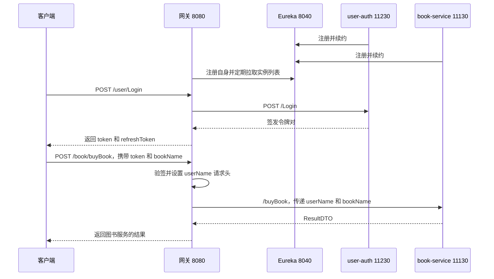

# B10-MicroSvc,Cloud-Native&Modern-BE-Svc-Gov · 微服务、云原生与现代后端服务治理

读者先登录书店，再向网关发出购书请求。登录由谁处理？图书服务重启换了地址，网关怎样找到它？如果读者等了两秒才收到响应，又怎样查出时间花在哪一跳？这三件事分别涉及服务边界、流量治理和可观测性，也是 SE3353 服务端开发第 10 讲的主线。

## 1. 课件与示例导航

HTML 主课件共 40 页，补充 PPT 共 66 页。下表的 HTML 链接指向各主题的起始页，PPT 页码对应目录中的演示文稿。[HTML 课程大纲](B10-MicroSvc,Cloud-Native%26Modern-BE-Svc-Gov/2.html) · [补充 PPT](10-microservices.pptx)

| 主题 | HTML 页码 | PPT 页码与本地示例 |
| --- | --- | --- |
| 单体演进、DDD、数据所有权、故障风险 | [3–10](B10-MicroSvc,Cloud-Native%26Modern-BE-Svc-Gov/3.html) | 3–15，在线商店如何拆分 |
| 服务注册、实例发现、负载均衡 | [11–18](B10-MicroSvc,Cloud-Native%26Modern-BE-Svc-Gov/11.html) | 16–26，[Eureka 最小示例](se3353_10_microservice/) |
| 路由、路径改写、JWT 与熔断 | [19–25](B10-MicroSvc,Cloud-Native%26Modern-BE-Svc-Gov/19.html) | 27–36，[独立网关](se3353_10_gateway/) 与[路径改写示例](se3353_10_routingandfiltering/) |
| Serverless、FaaS、函数组合 | [26–30](B10-MicroSvc,Cloud-Native%26Modern-BE-Svc-Gov/26.html) | 37–42，[Spring Cloud Function 示例](se3353_10_functionsample/) |
| Service Mesh、Dapr 与可观测性 | [31–37](B10-MicroSvc,Cloud-Native%26Modern-BE-Svc-Gov/31.html) | 9–13 有故障、监控、跟踪和日志示意，Istio 与 Dapr 见 HTML |
| 书店综合案例、全讲回顾与思考题 | [38–40](B10-MicroSvc,Cloud-Native%26Modern-BE-Svc-Gov/38.html) | 43–63，[书店的四个模块](se3353_10_bookservice/) |

示例模块声明 Java 20，使用 Spring Cloud 的模块声明版本列车 `2022.0.4`。Spring Boot 父项目版本主要是 `3.1.3`，书店的 `auth` 模块是 `3.1.4`。下文的端口、路由及返回值按本地源码静态核对。各示例独立运行，多处复用了 `8080` 端口。

## 2. 从业务边界到数据所有权

单体书店在同一进程内完成模块调用，一次本地数据库事务就能覆盖多张表。图书浏览量突然上涨时，单体通常要复制整个应用。按业务能力拆分后，团队可以只扩容图书查询服务，也可以单独发布认证服务。代价是进程内调用变成了网络调用，调用方要处理超时、部分失败，以及数据短暂不一致。

### 怎样划定边界

领域驱动设计（DDD）先明确**限界上下文**，即一组业务术语和规则适用的范围。在身份上下文中，“用户”关心凭证和角色。在订单上下文中，“买家”关心订单归属和下单时的收货地址。两个模型可以用同一个用户 ID 关联，各自维护需要的字段。限界上下文提供服务边界的候选，部署粒度还要结合团队分工、变更频率和扩容需求决定。

- **战略设计**关注谁负责哪项能力。梳理“订单已创建”“库存已预留”等领域事件，可以找出规则归属，以及哪些团队需要订阅变化。经常因同一条规则变更而同步发布的服务，值得重新检查边界。
- **战术设计**关注服务内部如何守住规则。实体有稳定标识，值对象由取值定义，聚合根控制一组对象的修改入口。例如让订单聚合根统一校验订单状态和明细，防止已确认的订单继续加购。

### 拆进程之后为什么还要划分数据

| 演进阶段 | 得到的能力 | 随之而来的约束 |
| --- | --- | --- |
| 单体应用、共享数据 | 模块间调用廉价，跨表事务直接 | 一次发布或一次内存故障可能波及整个应用 |
| 服务独立、仍共享表 | 可以分别部署前台与管理服务，迁移成本较低 | 改列名会影响其他服务的 SQL，慢查询与大事务仍会争抢数据库资源 |
| 各服务管理自己的数据 | 表结构可独立演进，服务通过 API 或事件交换数据 | 跨服务查询需要组合或读模型，跨服务业务要定义一致性和补偿策略 |

“一服务一库”首先约束**数据所有权**。订单表由订单服务写入，其他服务通过契约取得订单信息。隔离可以从独立 schema 和权限开始，资源竞争明显时再拆到不同数据库实例。

例如，订单创建后需要发积分。订单服务可在同一本地事务里写订单和待发送事件（Transactional Outbox），发布器再把 `OrderCreated` 送入消息队列。发布器重试可能重复投递，积分服务可用事件 ID 去重，并把去重记录与加积分放在同一个本地事务里。这样，积分服务短暂停机时，订单仍可受理，积分在消费恢复后补齐。[B5 事件驱动架构](../B5-EDA%26MoM/B5-EDA%26MoM.md) · [B7 分布式事务](../B7-Distributed-Transactions/B7-Distributed-Transactions.md)

## 3. 服务发现与负载均衡

书店网关配置的是 `lb://BOOK-SERVICE`。服务名代表一种能力，同名服务的每个副本都有自己的实例 ID 和地址。以 Eureka 为例，地址从注册到被使用，经过三个步骤。

1. **注册与续约。** 实例启动时登记服务名、主机、端口和元数据，随后定期发送心跳。课件用 30 秒续约、90 秒租约举例。租约到期、服务端扫描剔除、消费端刷新缓存是不同环节，实际停止向旧地址发流量的时刻还受自我保护机制影响。
2. **发现与缓存。** 消费方获取注册表，并定期刷新本地副本。新实例注册成功后，各客户端可能在不同时间看到它。注册中心暂时失联时，已有客户端仍可尝试缓存中的地址。
3. **选择与调用。** 客户端负载均衡器按轮询、随机或配置的权重选择一个实例，直接访问其地址。注册中心负责提供地址，业务请求从消费方发往选中的实例。[Spring Cloud Netflix 参考文档](https://docs.spring.io/spring-cloud-netflix/docs/4.0.3/reference/html/)

**客户端与服务端负载均衡的区别在于谁选实例。** 客户端模式把候选列表和选择逻辑放在调用方。服务端模式让客户端连接一个稳定的代理入口，由代理挑选后端。书店网关同时扮演这两个角色。它接收浏览器请求，又作为 `BOOK-SERVICE` 的客户端选择图书服务实例。课件从 Ribbon 讲到 Spring Cloud LoadBalancer，也给出了 `@LoadBalanced` 的用法，用它标记的 `RestTemplate` 可以通过服务名发起调用。

### 最小 Eureka 示例

| 位置 | 源码中的设置 | 可观察的行为 |
| --- | --- | --- |
| `eureka-service` | `@EnableEurekaServer`，监听 `8761`。单机模式设置 `register-with-eureka=false` 和 `fetch-registry=false` | `localhost:8761` 提供注册中心控制台 |
| `eureka-client` | 客户端 starter 加上 `spring.application.name=a-bootiful-client` | 客户端按服务名注册，Web 端口默认 `8080` |
| `ServiceInstanceRestController` | `DiscoveryClient.getInstances(applicationName)` | `GET /service-instances/a-bootiful-client` 返回发现的实例列表，可检查 `host`、`port`、`uri` |

这个接口只查询列表。要观察负载均衡的选择结果，还需要跟踪随后发出的业务请求。综合书店使用另一套 Eureka 配置，注册中心监听 `8040`。[单机注册中心配置](se3353_10_microservice/eureka-service/src/main/resources/application.properties) · [实例查询控制器](se3353_10_microservice/eureka-client/src/main/java/org/reins/se3353/eurekaclient/ServiceInstanceRestController.java)

### 注册中心与 Kubernetes 服务发现

CAP 讨论网络分区（P）期间的取舍。偏向可用性（AP）的注册中心可在分区两侧继续服务，各节点看到的实例列表可能暂时不同。要求强一致性（CP）的操作需要确认最新状态，失去多数派时，部分请求必须等待或失败。具体到服务发现，还要分别看注册写入、目录查询和客户端缓存。

| 机制 | 分区、扩缩容时需要理解的行为 |
| --- | --- |
| Eureka | 一个 Region 可包含多个 Zone，服务端可跨区对等复制，客户端可配置同区优先。续约量异常下降时，自我保护会抑制批量过期剔除，以保留旧地址换取部分可用性。 |
| Nacos | 可同时提供服务发现与配置管理。临时实例随客户端生命周期变化，使用 Distro 协议同步。持久实例通过要求强一致性的路径写入，分区时两类实例的行为有所不同。[实例生命周期](https://nacos.io/docs/latest/manual/user/naming/instance-lifecycle/) |
| Consul | 服务目录的写入依赖 Raft 多数派。查询可选择读取模式，`consistent` 要确认领导权，`stale` 允许服务器返回较旧的本地视图。[Consul 读取一致性](https://developer.hashicorp.com/consul/api-docs/features/consistency) |
| Kubernetes Service / DNS | 普通 ClusterIP Service 的 DNS 名解析到稳定的服务虚拟 IP，数据面再转发到就绪端点。Headless Service 可直接返回后端 Pod 地址。[Kubernetes 服务 DNS](https://kubernetes.io/docs/concepts/services-networking/dns-pod-service/) |

Spring Cloud 的**注册中心**回答“服务实例在哪里”，Spring Cloud Config 或 Nacos 等**配置中心**分发“服务应按什么参数运行”。例如给订单服务增加一个副本会改变注册表，调整它的下游超时则属于配置变更。

## 4. 网关如何匹配、改写和转发请求

一条 Spring Cloud Gateway 路由由三个部分构成。**Predicate** 根据 Path、Host 或请求头等条件选中路由，**Filter** 在转发前后处理请求或响应，**URI** 指定目的地。固定的 `http://` 地址适合观察路径改写，`lb://` 地址则交给负载均衡器解析。

| 本地示例 | 匹配条件 | 处理过程与结果 |
| --- | --- | --- |
| 路径改写 | `/books/**` | `GET localhost:8080/books/available` 经 `rewritePath("/books", "")` 后到达 `localhost:8090/available`，控制器返回 `Spring in Action`。同一路由下的 `/books/checked-out` 返回 `Spring Boot in Action`。 |
| 独立网关的请求头路由 | `/get` | 加入请求头 `Hello: World` 后转发至配置的 `httpbin` 目标。下游因此可以看到网关写入的头。 |
| 独立网关的熔断路由 | Host 匹配 `*.circuitbreaker.com` | 为这条路由绑定名为 `mycmd` 的断路器，降级目的地是网关本地的 `forward:/fallback`。 |

路径改写示例中的图书控制器直接声明 `/available`。外部的复数前缀 `/books` 由网关处理。综合书店另用单数前缀 `/book`，目标由 Eureka 发现。[改写规则](se3353_10_routingandfiltering/gateway/src/main/java/org/reins/se3353/gateway/GatewayApplication.java) · [图书端点](se3353_10_routingandfiltering/book/src/main/java/org/reins/se3353/book/BookApplication.java) · [独立网关路由](se3353_10_gateway/src/main/java/org/reins/se3353/se3353_10_gateway/Se335310GatewayApplication.java)

书店通过 `RouteLocatorBuilder` 构造 `RouteLocator` Bean。其中的购书路由把匹配条件、路径重写、JWT 过滤器与逻辑目的地写在一起。

```java
.route(r -> r.path("/book/**")
        .filters(f -> f.rewritePath("/book", "").filter(jwtCheckFilter))
        .uri("lb://BOOK-SERVICE"))
```

课件用 Zuul 1.x 的 Servlet 阻塞式请求处理，对照本例基于 WebFlux、Reactor 和 Netty 的网关。响应式网关可在等待下游 I/O 时让事件循环处理其他连接。若在过滤器里执行阻塞调用，同一事件循环上的其他请求也会等待。

## 5. 下游变慢时，怎样保护调用方

课件把一种故障的风险写成 **发生概率 × 影响程度**。修复反复引发超时的慢查询，可以降低复发概率。为该依赖设置独立的并发额度，可以缩小故障发生后的影响范围。监控则帮助团队缩短发现异常的时间。

| 手段 | 具体控制什么 | 书店中的例子 |
| --- | --- | --- |
| 超时（Timeout） | 一次调用最多等待多久 | 把推荐服务的等待时间限制在页面剩余延迟预算内 |
| 重试（Retry） | 哪些失败值得再试、最多试几次 | 查询遇到瞬时断连可限次退避重试，扣款重试需有幂等保障 |
| 舱壁隔离（Bulkhead） | 某项依赖最多占用多少并发资源 | 推荐服务使用单独的信号量或线程池，为结算保留容量 |
| 限流（Rate Limiting） | 单位时间允许多少请求进入 | 大促时在入口按调用方限制请求速率 |
| 熔断（Circuit Breaker） | 近期失败或慢调用达到什么程度就暂停访问 | 当推荐服务持续失败，后续请求快速失败，给下游恢复时间 |
| 降级（Fallback） | 本次调用失败后给用户什么结果 | 推荐区域可返回缓存或暂时隐藏。支付结果未知时应显示待确认 |

课件从 Netflix Hystrix 讲到 Resilience4j，本地独立网关通过 Spring Cloud CircuitBreaker 接入 Resilience4j。其断路器按调用次数或时间维护滑动窗口。例如把最小样本数设为 20、失败率阈值设为 50%。若窗口里恰有 20 次调用，其中 10 次失败，就触发从 `CLOSED` 到 `OPEN` 的转移。慢调用率也可单独触发熔断。[Resilience4j 状态机](https://resilience4j.readme.io/docs/circuitbreaker)

| 状态 | 对新调用的处理 | 转移条件 |
| --- | --- | --- |
| `CLOSED` | 放行并记录调用结果与耗时 | 窗口样本足够且统计值达到阈值，进入 `OPEN` |
| `OPEN` | 快速拒绝对该依赖的新调用 | 等待窗口结束后，可进入 `HALF_OPEN` |
| `HALF_OPEN` | 只放行有限数量的探测调用 | 探测结果达标回到 `CLOSED`，仍然超标则回到 `OPEN` |

独立网关的测试用 WireMock 把 `/delay/3` 延迟 3 秒，再带上 `Host: www.circuitbreaker.com` 发起请求，断言响应正文为 `fallback`。单次下游调用超时即可触发网关内部转发到降级处理器。要判断断路器是否已打开，还需查看窗口统计与状态指标。[对应测试用例](se3353_10_gateway/src/test/java/org/reins/se3353/se3353_10_gateway/Se335310GatewayApplicationTests.java)

## 6. 书店综合案例中的两次请求

`se3353_10_bookservice` 有四个模块。Eureka 在 `8040` 保存实例目录，网关在 `8080` 接收客户端请求，`user-auth` 在 `11230` 访问 MySQL 的 `bookstore` 库，`book-service` 在 `11130` 提供图书端点。图的前三步是服务发现，后面是两次独立的 HTTP 请求。



1. **登录。** 客户端向 `POST /user/Login` 提交 `username`、`password` 表单字段，注意 `Login` 的大写 L。网关移除 `/user` 并通过 `lb://USER-AUTH` 选择实例。认证服务查询用户，登录成功时在 `data.token` 和 `data.refreshToken` 返回令牌。示例给访问令牌设置 1 小时有效期，刷新令牌为 10 天。[登录控制器](se3353_10_bookservice/auth/src/main/java/org/reins/se3353/auth/controller/UserinfoController.java) · [签发逻辑](se3353_10_bookservice/auth/src/main/java/org/reins/se3353/auth/util/JWTUtils.java)
2. **携令牌购书。** 客户端向 `/book/buyBook` 传入请求参数 `bookName`，并把访问令牌放进名为 `token` 的请求头。`/book/**` 路由移除前缀，`JwtCheckFilter` 使用 HMAC256 验签，取出 `user_name`，构造带 `userName` 头的新请求，再通过 `lb://BOOK-SERVICE` 转发。网关在本地验证令牌，因此这次调用可以直接抵达图书服务。[书店路由](se3353_10_bookservice/gateway/src/main/java/org/reins/se3353/gateway/GatewayApplication.java) · [JWT 过滤器](se3353_10_bookservice/gateway/src/main/java/org/reins/se3353/gateway/filters/JwtCheckFilter.java)
3. **读懂响应。** `BookController` 读取 `@RequestHeader("userName")` 和 `@RequestParam("bookName")`，把两者回显到 `ResultDTO.data`，成功时业务码为 `20000`。该端点演示身份传递，真实购书所需的库存和支付操作属于另外的业务逻辑。令牌缺失或无效时，示例过滤器返回 HTTP `502`。常见 API 约定用 `401` 表示缺少有效身份凭证，`403` 表示权限不足。[图书控制器](se3353_10_bookservice/book/src/main/java/org/reins/se3353/book/Controller/BookController.java)

**跨源资源共享（CORS）、认证与授权。** 浏览器跨域发送带自定义 `token` 头的请求时，会先用 `OPTIONS` 预检来源、方法和请求头是否获准。书店的 `globalcors` 配置允许来源 `*`，显式列出 `GET`、`POST`，使用自定义头还需核对预检响应。网关通过 JWT（JSON Web Token）验签确认令牌来源和完整性。如果业务还要求只有管理员能修改书价，服务就需要按角色或资源权限执行授权规则。[网关配置](se3353_10_bookservice/gateway/src/main/resources/application.yml)

第 38 页把熔断也画入了书店架构。书店网关的 POM 引入了 Resilience4j，源码里的 `/book/**` 路由绑定路径改写和 JWT 过滤器，`/user/**` 只绑定路径改写。要查看课件中熔断环节的实现，可对照第 5 节独立网关的 `mycmd` 和 `/fallback`。

## 7. Serverless、FaaS 与 Spring Cloud Function

Serverless 将实例准备、调度和伸缩交给平台。FaaS（Function as a Service）是其中一种执行模型，开发者交付函数，声明触发事件。例如编辑上传图书封面后，对象存储事件触发缩略图生成，函数把结果写回存储。空闲时平台可将执行实例缩至零（Scale-to-Zero）。

| 特性 | 对函数设计的影响 |
| --- | --- |
| 事件驱动 | HTTP、定时器、对象上传或消息都可触发。若事件源会重投，需要让相同事件重复到达时产生相同的业务结果。 |
| 平台管理生命周期 | 热实例可复用初始化后的客户端或连接。实例可能随时被回收，订单状态、处理进度等持久数据应放在外部存储。 |
| 弹性与成本 | 空闲时能节省执行资源，突发调用可能遇到冷启动或并发配额。存储、网关和预置并发仍可能产生费用。 |

**Spring Cloud Function** 将业务逻辑声明为 Java 函数 Bean。`Supplier<T>` 产生一个值，`Function<T,R>` 把输入转换为输出，`Consumer<T>` 消费输入。Web、消息或云平台适配层负责把事件映射到这些接口。

本地 `functionsample` 引入 `spring-cloud-function-web`。例如，向 `POST /uppercase` 发送文本 `book`，同名 Bean 会将其转换为 `BOOK`。部署到 AWS Lambda 等环境时，由平台适配器接入事件，执行平台管理伸缩。Reactor 的 `Mono<T>` 最多产生一个元素，适合前文网关的单个降级结果。`Flux<T>` 可以产生多个元素，数值示例用 `map` 逐项转换整数流，函数组合的方向可用输入 `3` 检查。[函数定义](se3353_10_functionsample/src/main/java/org/reins/se3353/se3353_10_functionsample/Se335310FunctionsampleApplication.java) · [Web 适配依赖](se3353_10_functionsample/pom.xml)

| 函数 | 对流中一个元素执行的运算 | 输入 `3` 的结果 |
| --- | --- | --- |
| `name()` | 乘以 2 | `6` |
| `square()` | 平方 | `9` |
| `name().compose(square())` | 先平方，再乘以 2 | `18` |
| `name().andThen(square())` | 先乘以 2，再平方 | `36` |

## 8. Service Mesh、Istio 与 Dapr

把重试、证书轮换、流量分配都放在客户端 SDK，意味着 Java、Go 和 Python 服务各自要集成并升级这些能力。课件介绍的 **Sidecar（边车）模式**让同一 Pod 中的代理承接服务间的东西向流量。业务可以沿用 HTTP 或 gRPC，代理统一执行传输策略。成本来自额外的代理转发、CPU 和内存占用，以及代理配置本身的运维。下表以书店部署到网格后的场景说明分工。

| 层次 | 职责 | 书店中的例子 |
| --- | --- | --- |
| API Gateway | 处理进入系统的南北向流量，维护对外 API 契约、用户认证和配额 | 对读者保留 `/book/**`，在入口核验用户 JWT |
| Istio 控制面 `istiod` | 读取服务和路由策略，通过 xDS 向代理分发端点与配置，并管理工作负载证书 | 把“将 5% 流量发往图书服务新版本”翻译成代理配置 |
| Istio 数据面 Envoy | 在请求路径上执行选址、流量分配、超时和双向 TLS（mTLS），产生遥测数据 | 两个服务通信时验证对端工作负载身份，按路由权重选择版本 |
| Dapr 运行时 | 应用通过本地 HTTP/gRPC API 显式使用状态存储、发布订阅、服务调用等构建块 | 订单服务通过命名的 pub/sub 组件发布事件，组件配置指定消息中间件 |

若 `istiod` 暂时不可达，已有代理通常能继续按最近一次配置转发。新增端点的发现、策略变更和证书续期则依赖控制面恢复。Dapr 暴露的是应用可调用的分布式能力，例如 `/v1.0/state/{store}`。替换底层组件时，仍要核对业务是否依赖特定事务能力或消息顺序。[Istio 架构](https://istio.io/latest/docs/ops/deployment/architecture/) · [Dapr 构建块](https://docs.dapr.io/concepts/building-blocks-concept/)

## 9. 用指标、追踪和日志定位慢请求

假设读者反映“登录变慢，浏览图书正常”。大量快速的浏览请求可能让全站平均耗时看起来正常。先看登录接口自身的延迟分布，再沿一条慢请求查找等待发生的位置。

| 信号 | 可以回答的问题 | 采集与关联方式 |
| --- | --- | --- |
| 指标（Metrics） | 哪个接口、哪个时间窗出现异常？多少请求受影响？ | Micrometer 记录请求数、当前资源用量和延迟分布。启用对应依赖和 Actuator 端点后，Prometheus 抓取 `/actuator/prometheus`。Grafana 展示查询，Prometheus 评估告警规则，Alertmanager 分组、去重并发送通知。 |
| 追踪（Traces） | 一次慢登录的时间花在网关、认证服务还是数据库？ | OpenTelemetry 将处理步骤记录为 Span。一个 Trace 共享 `traceId`，各 Span 有自己的 `spanId`，父子关系把请求串起。Collector 可接收并导出遥测数据，Jaeger 或 Zipkin 可用于查看调用时间线。 |
| 日志（Logs） | 对应实例当时记录了哪项操作、哪条异常？ | 写结构化日志并带上服务名、时间、`traceId` 和 `spanId`。ELK 用 Logstash，EFK 用 Fluentd 收集或处理日志，随后写入 Elasticsearch，在 Kibana 中关联检索。 |

### 用计数器算 QPS，用直方图估计 P99

以下 PromQL 假设 Prometheus 将认证服务标为 `job="auth"`，HTTP 指标带有 `uri="/Login"` 标签，并已启用经典延迟直方图。第一条取最近五分钟平均每秒请求数。第二条先把各副本相同上界 `le` 的桶合并，再估计 99% 的请求能在多少秒以内完成。[Prometheus 直方图说明](https://prometheus.io/docs/practices/histograms/)

```promql
sum(rate(http_server_requests_seconds_count{job="auth", uri="/Login"}[5m]))

histogram_quantile(
  0.99,
  sum by (le) (rate(http_server_requests_seconds_bucket{job="auth", uri="/Login"}[5m]))
)
```

请求计数能给出吞吐量，估计 P99 还需要延迟分布。把服务、路由模板、状态码作为指标维度，单次请求的 `traceId` 则留给追踪和日志，以控制时间序列数量。

### 从一条慢 Trace 回到日志

1. 在登录 P99 上升的时间窗里选取一条慢 Trace。W3C `traceparent` 头包含版本、`trace-id`、`parent-id` 和标志位。服务提取上游上下文，创建自己的 Span，再向下游传播。在异步或消息链路中，生产者和消费者也要传递上下文。[W3C Trace Context](https://www.w3.org/TR/trace-context/)
2. 沿调用的关键路径比较 Span。若延迟集中在认证服务的数据库调用，就进一步看连接池等待和 SQL 耗时。并行 Span 的耗时可以重叠，把所有 Span 时长相加会高估端到端耗时。
3. 在 Kibana 里用相同的 `traceId` 找到对应实例的日志，结合时间戳判断耗时点。Reactor 等异步执行环境会切换线程，日志关联需要正确传播上下文。登录与购书是两次客户端请求，通常各有自己的 Trace。

## 10. 课后三道思考题

### 网络分区时，Eureka 与采用一致性协议的注册中心怎样取舍？

假设三个注册节点分成“两台互通、一台孤立”。Eureka 客户端可以继续从可达节点或已有缓存取得实例列表，代价是部分地址可能已经失效，调用方需要超时和故障处理。Consul 的 Raft 写入、ZooKeeper 的 ZAB 更新需要多数派确认。形成多数派的一侧可推进更新，少数派上的新注册可能无法提交。目录还能否查询、业务还能否调用，取决于读取模式、已有缓存和目标实例是否可达。选型时要同时估算**路由到旧实例的代价**和**暂时注册不了新实例的代价**。

### 有 API Gateway，为什么还需要 Service Mesh？

读者登录涉及用户身份、公网路径和跨域策略，由入口网关集中处理。订单服务调用库存服务时，流量通常直接在集群内流动，网格代理可在这一跳执行工作负载 mTLS、灰度路由与超时策略。一次下单可以同时经过两层。若网关和网格都配置了重试，要协调重试次数和总时限，以免一次用户请求放大为多次下游调用。

### 怎样降低 Java FaaS 的冷启动延迟？

当服务缩至零或突发并发超过热实例容量时，首批请求还要等待新环境就绪。先分开测量冷实例初始化和热实例处理请求的耗时。若类加载和 Spring 上下文初始化占主导，可裁剪依赖和初始化工作，或评估 AOT 与 GraalVM Native Image。若平台支持快照恢复，可用 CRaC 类机制或托管方案复用初始化成果，恢复后检查网络连接与需要唯一性的状态。对首个请求延迟有严格要求时，可配置预置并发或最小实例数，用常驻费用换取更稳定的尾延迟。最后比较冷、热调用各自的 P95/P99、突发时的冷启动比例与成本。[课后原题](B10-MicroSvc,Cloud-Native%26Modern-BE-Svc-Gov/40.html) · [AWS Lambda SnapStart](https://docs.aws.amazon.com/lambda/latest/dg/snapstart.html)
