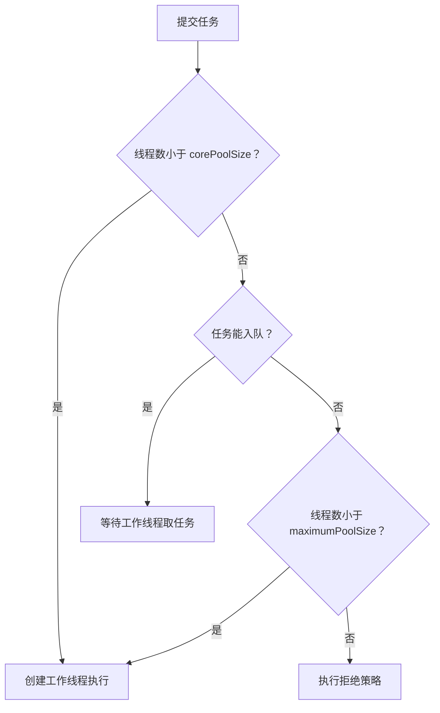

# B2-Java-Concurrency-Programming：Java 并发编程与并发模型演进

> 课程：SE3353（CHP-fa26）。本笔记依据本目录 31 页 HTML 课件、84 页 `06-multithreading.pptx` 和 `se3353_6_multithread/` 中的 Java 示例整理。以 Java 21 为主要讲解基线，补充线程协作、代码阅读和复习要点；涉及预览 API、JVM 实现及后续版本变化时单独标明。官方语义核对日期：2026-10-28。课件中的性能数字仅作教学示意，不视为本项目的实测结果。

## 1. 本讲主线与材料索引

本讲回答两个相互关联的问题：**多个任务怎样正确地共享数据？大量任务等待 I/O 时，怎样控制资源开销？**

- **正确性**：原子性、可见性、有序性，以及共享状态的不变量。
- **活跃性**：线程能否继续推进，是否会死锁、饥饿或无法取消。
- **性能与容量**：线程、任务队列、数据库连接、CPU 和内存各自有什么上限。

| 材料 | 页码 | 重点 |
| --- | --- | --- |
| [HTML 主课件](B2-Java%20Concurrency%20Programming/1.html) | 1～2 | 课程结构与并发模型演进 |
| HTML 主课件 | 3～9 | 线程、生命周期、中断、竞态、JMM、`synchronized` |
| HTML 主课件 | 10～17 | 显式锁、AQS、CAS、并发容器、线程池、Fork/Join、异步编排 |
| HTML 主课件 | 18～20 | 平台线程开销、阻塞 I/O、扩展性模型 |
| HTML 主课件 | 21～26 | 虚拟线程、调度、上下文、Pinning、资源限制 |
| HTML 主课件 | 27～31 | 架构选型、Echo Server、结构化并发与总结 |
| [补充 PPT](06-multithreading.pptx) | 3～14 | 创建线程、`sleep`、中断、`join` |
| 补充 PPT | 15～34 | 同步、原子访问与活跃性问题 |
| 补充 PPT | 35～53 | Guarded Blocks、生产者—消费者、不可变对象 |
| 补充 PPT | 54～74 | Lock、Executor、Fork/Join、原子变量 |
| 补充 PPT | 75～82 | 虚拟线程与 Echo 客户端/服务端 |
| [Java 示例目录](se3353_6_multithread/src/org/reins.se3353/) | 23 个源文件 | 将概念与具体代码对应 |

与 B1 的联系：Spring singleton Bean 可以同时被多个请求线程调用。把用户数据写进共享字段、在内存里执行库存扣减，都需要先明确状态归属，再选择并发控制方式。

## 2. 并发基础：进程、线程与任务

### 2.1 并发不等于并行

| 概念 | 含义 | 例子 |
| --- | --- | --- |
| 并发 Concurrency | 多个任务在一段时间内交替或重叠推进 | 单核 CPU 轮流处理多个请求 |
| 并行 Parallelism | 多个任务在同一时刻执行 | 多核 CPU 同时处理多个图像分块 |
| 进程 Process | 拥有相对独立的地址空间和运行资源 | 一个运行中的 JVM |
| 线程 Thread | 进程内的一条执行路径 | 请求处理线程、后台任务线程 |
| 任务 Task | 要完成的一项工作 | 查询订单、压缩图片 |

同一进程中的线程共享堆中的对象等资源，各自具有执行栈和程序计数器等执行状态。**局部变量中的引用属于当前调用栈，但引用指向的对象仍可能被多个线程共享。**

平台线程通常与 OS 线程一一对应；虚拟线程由 JVM 调度到载体线程上。线程中的普通未捕获 Java 异常通常终止该线程，不应理解成一定导致整个 JVM 崩溃。

### 2.2 定义任务与启动线程

补充 PPT 和 `HelloRunnable.java`、`HelloThread.java` 展示两种写法：

```java
// Runnable 描述任务，Thread 负责执行。
Runnable task = () -> System.out.println("Hello from a thread!");
Thread worker = new Thread(task, "hello-worker");
worker.start();
worker.join(); // 片段所在方法需要处理或声明 InterruptedException
```

也可以继承 `Thread` 并重写 `run()`。一般把任务写成 `Runnable` 或 `Callable`，更方便交给不同执行器运行。

- `start()` 启动一个新线程，由它执行任务。
- 对普通 `Runnable` 调用 `run()` 是当前线程中的普通方法调用，不产生并发。
- 同一个 `Thread` 只能启动一次，结束后不能再次 `start()`。
- `Callable<T>` 可以返回结果并抛出受检异常；`Runnable.run()` 没有返回值。

### 2.3 Java 的六种线程状态

| `Thread.State` | 含义 | 典型情形 |
| --- | --- | --- |
| `NEW` | 已创建，尚未启动 | `new Thread(...)` |
| `RUNNABLE` | 在 JVM 中可运行或正在执行 | 等待 CPU、执行计算；某些 I/O 等待也可能这样显示 |
| `BLOCKED` | 等待进入或重新进入监视器 | 竞争 `synchronized` 的同一把锁 |
| `WAITING` | 无期限等待其他动作 | `wait()`、等待存活线程的 `join()`、`park()` |
| `TIMED_WAITING` | 带时间限制的等待 | `sleep(...)`、带超时的 `wait` / `join` / `park` |
| `TERMINATED` | 执行结束 | `run()` 返回或因未捕获异常退出 |

Java 没有独立的 `RUNNING` 枚举值。这些是 JVM 状态，不与操作系统状态一一对应。等待 `ReentrantLock` 时通常通过 `park` 进入等待状态，不能把所有“拿不到锁”都叫作 Java 的 `BLOCKED`。诊断时应同时查看栈、CPU 使用率和等待对象。[Thread.State 官方定义](https://docs.oracle.com/en/java/javase/21/docs/api/java.base/java/lang/Thread.State.html)

## 3. 线程控制与协作式中断

### 3.1 `sleep`、`yield`、`join` 的区别

| 操作 | 作用于谁 | 是否释放调用者已经持有的锁 | 用途 |
| --- | --- | --- | --- |
| `Thread.sleep(ms)` | 当前线程 | 不释放 | 暂停一段时间；不能替代同步 |
| `Thread.yield()` | 当前线程 | 不释放 | 给调度器一个提示，调度器可忽略 |
| `t.join()` | 当前线程等待目标线程 `t` | 不会自动释放调用者持有的其他业务锁 | 等待目标结束 |
| `lock.wait()` | 当前线程 | 释放 `lock` 的监视器，保留其他锁 | 等待条件改变 |

`join(timeout)` 返回可能只是超时，不能直接认定目标线程已结束，应继续检查 `isAlive()`。计时也不保证到点后立即获得 CPU。

### 3.2 中断是一项请求

| API | 含义 |
| --- | --- |
| `t.interrupt()` | 向目标线程发出中断请求；具体响应由阻塞操作和任务代码决定 |
| `t.isInterrupted()` | 查询目标线程的中断状态，不清除 |
| `Thread.interrupted()` | 查询并清除**当前线程**的中断状态 |

`sleep`、`wait`、`join` 等操作因中断抛出 `InterruptedException` 时会清除中断状态。常见处理方式是向上传播异常，或者恢复状态并结束当前任务。任务已经决定退出并完成清理时，也可以把中断视为已处理；问题在于捕获后什么也不做、继续无限工作。

```java
// Runnable 任务片段：响应取消，finally 保证清理路径。
try {
    while (!Thread.currentThread().isInterrupted()) {
        Thread.sleep(1000);
        // 执行一小段工作；长计算也应在合适位置检查中断。
    }
} catch (InterruptedException e) {
    Thread.currentThread().interrupt();
} finally {
    // 关闭任务拥有的文件、连接等资源。
}
```

中断不会强制终止任意代码，也不会自动打断所有 I/O。调用链还需要超时、可取消的 API 和明确的资源关闭策略。

### 3.3 `SimpleThreads` 的执行逻辑

主线程启动 `MessageLoop` 后，每次 `join(1000)` 最多等待约一秒，检查是否超过耐心阈值。超过阈值且工作线程仍存活时，调用 `interrupt()`，再通过无超时 `join()` 等它结束。

本地源码的实际值是：工作线程每条消息前 `sleep(2000)`，默认 `patience = 4000` 毫秒。部分注释仍写着“四秒”“一小时”，阅读时以执行语句为准。具体打印了几条消息受调度影响，不应死记唯一输出顺序。

## 4. 线程安全与 Java 内存模型

### 4.1 原子性、可见性、有序性

| 性质 | 要解决的问题 | 常见误解 |
| --- | --- | --- |
| 原子性 | 操作能否作为不可分割的整体完成 | 一行 Java 代码就是原子操作 |
| 可见性 | 一个线程的写入能否按约定被另一个线程观察到 | 等一会儿或 `sleep` 后一定能看到 |
| 有序性 | 线程之间允许观察到什么执行顺序 | 源码先写的操作一定先被其他线程观察到 |

例如 `count++` 至少包含“读取、计算、写回”三个逻辑步骤。以下交错会丢失一次递增：

| 时刻 | 线程 A | 线程 B | 共享 `count` |
| --- | --- | --- | --- |
| 1 | 读到 0 | | 0 |
| 2 | | 读到 0 | 0 |
| 3 | 计算并写入 1 | | 1 |
| 4 | | 计算并写入 1 | 1 |

两个线程各递增一次，结果仍可能为 1。即使把字段改成 `volatile int count`，复合的读—改—写仍不具备原子性。

单次读写的原子性也不能与复合操作混淆：普通引用和大多数基本类型的单次读写是原子的；规范允许非 volatile 的 `long` / `double` 读写被拆分，volatile 的读写则包括这两类在内都具有原子性。这些保证仍不涵盖 `++`。[JLS §17.7](https://docs.oracle.com/javase/specs/jls/se21/html/jls-17.html#jls-17.7)

**Data race** 指不同线程对同一变量存在未被 happens-before 排序的冲突访问，且至少一个为写入。更广义的 **race condition** 还包括“单个方法都线程安全，但组合起来业务结果仍依赖时序”的情况，例如先检查再更新。

### 4.2 JMM 是语义契约

JMM（Java Memory Model）描述跨线程读写可以观察到的行为。CPU 缓存、写缓冲区和编译器优化有助于解释问题，但不能把“工作内存”简单等同于某一级缓存。

正确的推理路径是：**找到共享数据 → 确定同步动作 → 建立 happens-before → 判断允许的读取结果。** 不依赖“这台机器看起来总能读到最新值”。

### 4.3 常用 happens-before 规则

| 规则 | 可用于推导的保证 |
| --- | --- |
| 程序次序 | 同一线程中，前面的动作 happens-before 后面的动作 |
| 监视器 | 对某监视器的解锁 happens-before 后续对同一监视器的加锁 |
| `volatile` | 对某 volatile 字段的写 happens-before 后续对同一字段的读 |
| 启动线程 | `start()` happens-before 被启动线程中的动作 |
| 线程结束 | 线程中的动作 happens-before 其他线程成功检测到其终止，例如等待结束的 `join()` 返回 |
| 传递性 | A happens-before B，B happens-before C，则 A happens-before C |

happens-before 是可见性与顺序约束，不是要求每条机器指令都按墙钟时间执行，也不意味着“禁止全部重排”。实现仍可优化，只要可观察行为符合规范。带超时的 `join()` 仅因超时返回，不能当作已观察到线程终止。[JLS §17.4.5](https://docs.oracle.com/javase/specs/jls/se21/html/jls-17.html#jls-17.4.5)

### 4.4 `volatile` 能做什么

一次发布的简化示意：

```java
class PublishedResult {
    private int answer;
    private volatile boolean ready;

    void publish() {           // 假设只有一次发布
        answer = 42;
        ready = true;
    }

    Integer readIfReady() {
        return ready ? answer : null;
    }
}
```

读线程读到发布者写入的 `ready == true` 后，可以观察到此前的 `answer = 42`。这不意味着任意多次修改 `answer` 都受保护。

- 适合状态标志、正确设计的安全发布等情形。
- 不提供互斥，不能使 `count++`、先检查再扣减自动原子化。
- `volatile` 引用不等于对象所有字段或数组元素都变成 volatile。
- 双重检查锁单例的共享实例引用需要正确的发布机制；典型写法使用 `volatile`，也可使用静态初始化等更直接的方式。

## 5. `synchronized`、复合操作与不可变对象

### 5.1 必须明确锁的是哪个对象

| 写法 | 使用的监视器 |
| --- | --- |
| 实例 `synchronized` 方法 | 当前实例 `this` |
| `static synchronized` 方法 | 对应的 `Class` 对象 |
| `synchronized (lock)` | 表达式求值所得对象 |

两个线程锁住不同对象，就没有形成同一把锁上的互斥。类锁与实例锁也不是同一把锁。

`synchronized` 同时提供互斥和可见性，正常返回、抛异常退出时都会释放监视器。它支持可重入：`SynchronizedCounter.increment()` 持有 `this` 后，再调用同样同步的 `value()`，不会因为重复获取自己的锁而死锁。

锁要覆盖完整的不变量。例如“库存不能为负”，需要把**检查库存与扣减库存**放进同一受保护操作。将读取、写入分别加锁，仍可能在两次调用之间被其他线程插入。

### 5.2 `SynchronizedRGB`：单个方法安全，组合读取未必一致

`SynChronizedRGBDemo` 先读 `getRGB()`，睡眠后再读 `getName()`。另一个线程可能在两次读取之间把黑色改成红色，从而得到“黑色数值 + Scarlet 名称”。每个 getter 加锁，只保证各自调用的正确性。

```java
int rgb;
String name;
synchronized (color) {
    rgb = color.getRGB();
    name = color.getName();
}
System.out.println(rgb + " / " + name);
```

这里用同一把锁保护组合读取，并将打印放在临界区外。另一种接口设计是提供一个加锁的 `snapshot()`，一次返回包含两个字段的不可变快照。

### 5.3 不可变对象减少共享写入

`ImmutableRGB` 的字段为 `private final`，类为 `final`，没有 setter；`invert()` 返回新对象，不修改原对象。

设计不可变对象时，还需注意：

- 对数组、集合等可变成员进行防御性复制，避免通过 getter 泄漏内部可变状态。
- `final` 引用只保证引用不变，不保证引用指向的对象不变。
- 构造期间不要让 `this` 逃逸给其他线程。
- 若通过共享变量替换整个不可变对象，仍需为该变量选择正确的发布方式。

### 5.4 锁实现细节需要带版本阅读

课件以“偏向锁 → 轻量级锁 → 重量级锁”介绍 HotSpot 的历史优化。它不应被背成所有 JDK 的固定状态机；偏向锁已经不适合作为 Java 21 的常规运行路径来解释。

同样，Mark Word 位布局、Monitor 内部队列、锁膨胀与回收属于实现细节。“锁只能升级、永远不能退回”过于绝对。应用首先应依赖互斥、可重入和内存可见性契约，再针对实际 JVM 版本分析性能。

## 6. 线程协作：Guarded Blocks 与生产者—消费者

### 6.1 等待条件，而不是等待某条通知

`Drop` 是容量为 1 的消息槽：

| 状态 | 生产者 `put` | 消费者 `take` |
| --- | --- | --- |
| `empty == true` | 可以放入消息，改成非空 | 等待 |
| `empty == false` | 等待 | 可以取出消息，改成空 |

正确模式是：**持锁检查条件 → 条件不满足则等待 → 被唤醒并重新拿到锁 → 再检查条件。**

```java
// 教学改写：与原 Drop 相比，向调用者传播中断。
final class MessageSlot {
    private String message;
    private boolean empty = true;

    public synchronized void put(String value) throws InterruptedException {
        while (!empty) {
            wait();
        }
        message = value;
        empty = false;
        notifyAll();
    }

    public synchronized String take() throws InterruptedException {
        while (empty) {
            wait();
        }
        String result = message;
        message = null;
        empty = true;
        notifyAll();
        return result;
    }
}
```

关键规则：

1. 调用某对象的 `wait` / `notify` / `notifyAll` 前，必须持有该对象的监视器。
2. `wait()` 释放该监视器；返回前重新获得它。
3. `notifyAll()` 发出通知后，当前线程仍持锁，其他线程必须等它释放。
4. 用 `while`，不用 `if`：存在虚假唤醒，而且醒来重新拿到锁时条件可能已再次变化。
5. 条件检查、状态修改和等待协议必须使用一致的同步方式。

### 6.2 本地示例的边界

`Producer` 发送四条消息后放入 `"DONE"`，`Consumer` 读到它后退出。这是终止标记（poison pill）的简化形式。

- 该协议适用于示例中的一个生产者、一个消费者；多个消费者不能指望一个标记让所有人退出。
- 标记不能与正常业务消息混淆。
- 原 `Drop`、`Producer`、`Consumer` 存在空的中断捕获块，不适合作为可取消服务的完整实现。

业务中通常优先使用 `ArrayBlockingQueue` 等现成队列，让 `put()` / `take()` 处理条件等待；仍需设计容量、结束协议、超时和中断处理。

## 7. 活跃性：死锁、饥饿与活锁

| 问题 | 表现 | 思路 |
| --- | --- | --- |
| 死锁 Deadlock | 线程相互等待，谁也无法继续 | 统一锁顺序、避免嵌套锁、超时失败并释放已持有资源 |
| 饥饿 Starvation | 某些任务长期得不到资源 | 检查公平性、临界区长度和资源分配 |
| 活锁 Livelock | 线程不断重试或让步，但没有业务进展 | 有限重试、退避、减少相互干扰 |

`Deadlock.java` 的风险来自两把锁的获取顺序相反：

```text
线程 A：持有 Alphonse 的锁 → 调用 Gaston.bowBack() → 等 Gaston 的锁
线程 B：持有 Gaston 的锁   → 调用 Alphonse.bowBack() → 等 Alphonse 的锁
```

死锁发生与线程交错有关，这个演示不保证每次都卡住。死锁的经典必要条件是互斥、占有并等待、不可抢占和循环等待；统一锁顺序可以破坏循环等待条件。

`Safelock.java` 依次尝试两把锁，没有全部成功就释放已经取得的锁，因此不会持有一把锁无限等待另一把锁。但 `tryLock()` 本身不自动保证无死锁；失败分支的释放、重试策略和其他加锁路径同样重要。随机等待也不是公平性证明。

## 8. 显式锁、Condition 与 AQS

### 8.1 `ReentrantLock` 提供更灵活的获取方式

| 能力 | `synchronized` | `ReentrantLock` |
| --- | --- | --- |
| 可重入与互斥 | 支持 | 支持 |
| 异常退出后释放 | 自动 | 需要 `finally` 中 `unlock()` |
| 立即尝试获取 | 无对应语法 | `tryLock()` |
| 限时等待锁 | 无对应语法 | `tryLock(timeout, unit)` |
| 等锁时响应中断 | 进入监视器不因此抛中断异常 | `lockInterruptibly()` |
| 公平性配置 | 无对应选项 | 构造时指定 |
| 多个条件等待集合 | 一个对象的 wait set | 多个 `Condition` |

```java
// lock 是共享的 ReentrantLock；方法向上传播 InterruptedException。
lock.lockInterruptibly();
try {
    // 访问由该锁保护的状态。
} finally {
    lock.unlock();
}
```

获取成功后才进入负责解锁的 `try`，避免获取失败却执行 `unlock()`。公平锁偏向等待最久者，但不保证 OS 调度公平；无参数 `tryLock()` 不遵守公平设置。[ReentrantLock API](https://docs.oracle.com/en/java/javase/21/docs/api/java.base/java/util/concurrent/locks/ReentrantLock.html)

### 8.2 `Condition` 将不同条件分开

一个有界缓冲区可用同一把锁创建 `notEmpty` 与 `notFull`：消费者等 `notEmpty`，生产者等 `notFull`。`await()` 释放关联锁，返回前重新获得；`signal()` / `signalAll()` 仍需在持锁时调用，条件判断仍使用 `while`。

“精准通知”指可以选择哪一组条件等待者，并不保证被唤醒者马上执行，或者条件一直保持成立。

### 8.3 AQS 负责状态、排队和等待

AbstractQueuedSynchronizer 的核心结构可以理解为：

- 一个可原子更新的 `state`，含义由具体同步器定义。
- 获取失败的线程进入等待队列。
- 通过挂起、唤醒、重新竞争来推进获取，支持独占与共享模式。

| 使用者 | `state` 的典型含义 | 模式 |
| --- | --- | --- |
| `ReentrantLock` | 重入次数 | 独占 |
| `Semaphore` | 可用许可数 | 共享 |
| `CountDownLatch` | 尚未归零的计数 | 共享 |

FIFO 排队不自动等于公平获取，具体同步器决定是否允许插队。课件中的 `SIGNAL(-1)` 等节点状态和 `acquireQueued` 代码属于特定版本的实现讲解，不是 Java 21 必须保持的源码结构。[AQS 官方说明](https://docs.oracle.com/en/java/javase/21/docs/api/java.base/java/util/concurrent/locks/AbstractQueuedSynchronizer.html)

## 9. CAS、原子类与统计计数

### 9.1 CAS 的含义

`compareAndSet(expected, update)` 原子地检查当前值是否符合预期，符合则更新，否则失败。失败后通常重新读取状态、重新计算并重试。

```java
import java.util.concurrent.atomic.AtomicInteger;

final class AtomicStock {
    private final AtomicInteger remaining = new AtomicInteger(10);

    boolean tryBuyOne() {
        while (true) {
            int current = remaining.get();
            if (current <= 0) {
                return false;
            }
            if (remaining.compareAndSet(current, current - 1)) {
                return true;
            }
        }
    }
}
```

这只是**单 JVM 内存库存**的示意。多实例、数据库事务和持久化库存需要在相应的数据一致性边界内处理，不能靠进程内原子变量覆盖。

CAS 避免使用阻塞锁不等于没有成本：竞争可能导致反复重试与缓存协调；一个算法使用 CAS 也不自动证明它是 lock-free 或 wait-free。回调式原子更新中的计算可能多次执行，应避免把扣款、发送通知等副作用放进去。

### 9.2 ABA 与版本标记

某线程看到 A 后暂停，其他线程将值从 A 改为 B 再改回 A。前者恢复后 CAS 仍可能成功，但状态曾经变化。只有算法依赖“期间没有发生变化”时，这才构成问题。

`AtomicStampedReference` 将引用与版本号一起比较。读取时应获取一致的引用/版本组合，所有参与更新者也必须维护版本协议；不能只给其中一个写入点加版本号。

### 9.3 `AtomicLong` 与 `LongAdder`

| 工具 | 适合的需求 | 边界 |
| --- | --- | --- |
| `AtomicInteger` / `AtomicLong` | 对单一状态执行原子更新、条件转换 | 多字段业务不变量仍需额外设计 |
| `AtomicReference` | 原子替换一个对象引用 | 对象内部可变状态不会自动受到保护 |
| `LongAdder` | 高争用的累计统计 | `sum()` 在并发更新时不是原子快照，不适合精确库存判断 |

`LongAdder` 通过分散更新位置缓解热点竞争，使用更多空间。不能将它当作所有原子计数器的通用替代品。[LongAdder API](https://docs.oracle.com/en/java/javase/21/docs/api/java.base/java/util/concurrent/atomic/LongAdder.html)

**本地源码提醒**：`AtomicCounter.decrement()` 的活动代码是 `c.incrementAndGet()`，实际仍然递增；补充 PPT 第 74 页使用的才是 `decrementAndGet()`。这是业务逻辑错误，与操作是否原子无关。

## 10. 并发容器与线程局部状态

### 10.1 容器选择

| 容器 | 特征 | 常见用途与注意点 |
| --- | --- | --- |
| `ConcurrentHashMap` | 并发映射、细粒度更新协调 | 用 `putIfAbsent`、`compute`、`merge` 表达单键原子操作 |
| `CopyOnWriteArrayList` | 写入复制底层数组，迭代器读取快照 | 读多写少且规模可控的列表；迭代不反映后续修改 |
| `ConcurrentLinkedQueue` | 无界、非阻塞队列 | 不提供“队满后等待”的容量控制 |
| `ArrayBlockingQueue` | 有界、数组实现 | 需要显式容量的生产者—消费者 |
| `LinkedBlockingQueue` | 链表实现，可指定容量 | 不指定时容量上限为 `Integer.MAX_VALUE` |
| `SynchronousQueue` | 不存储元素，直接交接 | `put` 等待配对；`offer` 可立即失败 |
| `PriorityBlockingQueue` | 按优先级取出，逻辑上无界 | 要防止低优先级任务长期等待 |

`ConcurrentHashMap` 的线程安全不覆盖任意跨调用组合，也不覆盖存进去的可变 value。比如 `containsKey()` 后再 `put()` 不是整体原子操作。`size()` 等聚合结果在并发修改时也不是全表一致快照。[ConcurrentHashMap API](https://docs.oracle.com/en/java/javase/21/docs/api/java.base/java/util/concurrent/ConcurrentHashMap.html)

```java
// 单键累计；假设 counts 是 ConcurrentHashMap<String, Integer>。
counts.merge("book-42", 1, Integer::sum);
```

课件中的两点需要修正：

- `Collections.synchronizedMap` 可以用于并发，只是采用全局同步；遍历和复合操作仍需遵循它的外部同步要求，不能说“绝对禁止”。
- 对数组引用声明 `volatile` 不会让所有数组元素自动具有 volatile 语义；并发哈希表还依赖节点字段及专门的原子访问机制。

### 10.2 `ThreadLocal` 与 `ThreadLocalRandom`

`ThreadLocal` 为每个线程维护独立绑定，常用于请求上下文。平台线程池会复用线程，应在作用域结束时清理：

```java
// context 是 ThreadLocal<UserContext>，user 是本次请求的上下文。
context.set(user);
try {
    // 处理本次请求。
} finally {
    context.remove();
}
```

`ThreadLocal` 不会自动跨线程传播，也不保证绑定对象本身不可变。若多个线程的绑定指向同一个可变对象，仍可能共享状态。

`RandomNumbers.java` 在执行任务的线程内调用 `ThreadLocalRandom.current()`，避免多个线程争用一个随机数生成器的更新状态。它适合普通并发随机需求，不用于密码学随机数。

## 11. Executor 与平台线程池

### 11.1 将任务与执行策略分离

| 接口 | 主要能力 |
| --- | --- |
| `Executor` | `execute(Runnable)`，提交任务 |
| `ExecutorService` | `submit`、`Future`、关闭执行器 |
| `ScheduledExecutorService` | 延迟或周期调度 |

`submit()` 返回 `Future`；任务异常通常通过 `Future.get()` 的 `ExecutionException` 暴露。只提交任务而不观察结果，可能遗漏失败。`shutdown()` 停止接受新任务并处理已提交任务，调用本身不等待全部完成；`shutdownNow()` 尝试中断正在执行的任务，依然依赖任务配合。

### 11.2 `ThreadPoolExecutor` 的七个参数

| 参数 | 作用 |
| --- | --- |
| `corePoolSize` | 核心线程数；默认按需创建，并非构造时就全部启动 |
| `maximumPoolSize` | 工作线程数量上限 |
| `keepAliveTime` | 空闲线程的保留时长，默认作用于非核心线程 |
| `unit` | 保留时长的时间单位 |
| `workQueue` | 等待执行的任务队列 |
| `threadFactory` | 创建线程，设置名称等属性 |
| `handler` | 饱和或关闭时的拒绝策略 |

线程池处于运行状态、线程可正常创建时，提交路径可以概括为：



**先入队，队列不能接收时才继续扩到最大线程数。** 因此，无界队列可能让 `maximumPoolSize` 无法发挥预期的扩容作用；运行状态变化时还涉及重新检查与拒绝。[ThreadPoolExecutor API](https://docs.oracle.com/en/java/javase/21/docs/api/java.base/java/util/concurrent/ThreadPoolExecutor.html)

### 11.3 队列与拒绝策略必须一起考虑

| 策略 | 行为 | 需要考虑的后果 |
| --- | --- | --- |
| `AbortPolicy` | 抛出 `RejectedExecutionException` | 调用方处理繁忙、重试或降级 |
| `CallerRunsPolicy` | 由提交线程执行；执行器已关闭则丢弃 | 可降低提交速度，但会阻塞调用线程，不适合随意放在事件循环中 |
| `DiscardPolicy` | 静默丢弃当前任务 | 关键业务不能默认接受丢失 |
| `DiscardOldestPolicy` | 丢弃队首任务后重试；关闭时丢弃 | 队首未必是最早提交的任务，取决于队列排序 |

丢弃被 `submit()` 包装的任务还可能让对应 `Future` 一直不完成。自定义降级也需要业务消息格式、可靠存储和幂等设计，不能把任意 `Runnable` 直接当作可持久化消息发送。

显式容量的配置示意，以下数字只是演示：

```java
import java.util.concurrent.*;

final class PoolExample {
    static ExecutorService create() {
        return new ThreadPoolExecutor(
                4, 8,
                30, TimeUnit.SECONDS,
                new ArrayBlockingQueue<>(100),
                Executors.defaultThreadFactory(),
                new ThreadPoolExecutor.AbortPolicy());
    }
}
```

`newFixedThreadPool` 默认使用无界等待队列，`newCachedThreadPool` 允许线程数量大幅增长。要理解这些工厂方法的容量行为，而不是把“禁止所有 `Executors` 方法”视作 Java 规则。

### 11.4 线程数是需要验证的配置

课件经验公式：

$$N_{threads} \approx N_{cpu} \times (1 + W/C)$$

其中 `W` 是任务等待时间，`C` 是计算时间。CPU 密集任务通常从接近可用核心数开始试验；`Ncpu + 1` 不是定律。公式也未直接包含下游配额、内存、容器 CPU 限制和锁竞争。

监控应包括活跃线程、队列长度、排队时间、拒绝次数、吞吐和延迟分位数。若任务在同一个已占满的线程池内提交子任务并阻塞等待，可能造成线程饥饿死锁。

## 12. Fork/Join 与 `CompletableFuture`

### 12.1 Fork/Join：适合可拆分计算

Fork/Join 将大任务递归拆成小任务，达到阈值后直接计算，再合并结果：

```text
计算任务
├─ 左半部分：fork，允许其他工作线程执行
└─ 右半部分：当前线程直接计算
最后 join 左半部分，合并结果
```

- `RecursiveTask<V>` 有返回值；`RecursiveAction` 无返回值。
- 工作窃取让空闲线程从其他工作线程的队列获取任务。
- 默认计算模式下，本地通常优先处理较新任务，窃取者从另一端取任务；不必死记示意图中 head/tail 的命名。
- 拆分太细会增加调度与对象创建开销，太粗则并行度不足。

`ForkBlur.java` 共享只读源数组，各子任务写入目标数组中不重叠的区间，因此无需为每个像素加锁。其本地阈值为 `10000`，补充 PPT 示例为 `100000`，应以实际源码为准。

大量普通阻塞 I/O 不适合直接压到共享 common pool；`ManagedBlocker` 等机制能处理特定阻塞情形，但不代表可以忽略容量设计。

### 12.2 `CompletableFuture`：表达任务依赖

| 方法 | 作用 |
| --- | --- |
| `supplyAsync` | 提交有结果的异步任务 |
| `thenApply` / `thenAccept` | 转换结果 / 消费结果 |
| `thenCompose` | 将返回另一个异步阶段的操作串接起来 |
| `thenCombine` | 两个阶段都完成后合并结果，不负责自动启动它们 |
| `allOf` | 等待所有阶段完成，结果类型为 `Void` |
| `anyOf` | 采用最先完成的结果或异常，不等同于“首个成功” |
| `exceptionally` / `handle` | 异常恢复 / 同时处理结果与异常 |
| `orTimeout` | 超时后让该 Future 异常完成 |

不带 `Async` 的回调不保证换线程；未显式指定执行器的异步方法通常使用 common pool。阻塞任务应选择合适的执行器，避免影响不相关任务。

**Future 的完成状态与底层任务生命周期要分别管理。** `orTimeout()` 不自动停止底层 I/O；`CompletableFuture.cancel(true)` 也不能被当作可靠中断工作线程的手段。超时还需要传到 HTTP、数据库或其他实际执行层。[CompletableFuture API](https://docs.oracle.com/en/java/javase/21/docs/api/java.base/java/util/concurrent/CompletableFuture.html)

## 13. 平台线程瓶颈与扩展性

### 13.1 I/O 等待为什么消耗并发容量

在“一个请求占用一个平台线程”的同步模型中，请求等待数据库时虽然通常不消耗大量 CPU，仍占用线程资源。增加线程可以覆盖部分等待时间，但会增加内存、调度和资源竞争成本。

课件用“线程数 × 1 MB 栈”说明量级。实际默认栈大小与平台、JVM 配置有关，**预留地址空间不等于全部已经提交的物理内存**。上下文切换也不意味着所有缓存和 TLB 必然清空，不能套用固定损耗比例。

### 13.2 Amdahl 定律

设固定任务中可并行部分比例为 `p`，处理器数量为 `N`：

$$S(N) = \frac{1}{(1-p) + p/N}$$

$$S_{max} = \frac{1}{1-p}$$

若 10% 的工作必须串行，理想加速比上限为 10。增加线程不会自动消除锁串行化，也不会让一个计算任务获得无限加速。

### 13.3 USL 与容量估算

课件给出的通用扩展性模型为：

$$X(N) = \frac{\gamma N}{1 + \sigma(N-1) + \kappa N(N-1)}$$

`γ` 表示基准吞吐量，`σ` 表示争用相关项，`κ` 表示协调相关项。它用于描述“并发增加后吞吐可能先升后降”，参数应结合测量拟合，不能直接把某个系数认作某种硬件耗时。

补充一个容量直觉：稳态下可用 Little 定律估计平均在途量 `L = λW`。例如吞吐为 1000 请求/秒、平均响应时间为 0.2 秒时，平均约有 200 个在途请求。连接数、在途请求数、每秒请求数和实际同时运行的线程数是不同指标。

## 14. Java 21 虚拟线程

### 14.1 M:N 调度与挂载、卸载


虚拟线程仍是 `Thread`。它挂载到 carrier 上执行，在支持卸载的阻塞点保存执行状态并释放 carrier，之后可以在另一条 carrier 上恢复。它的调用栈可按需保存在堆中的栈块里；`Continuation` 是运行时实现概念，业务不应直接调用内部 API。

**虚拟线程主要提高等待密集型任务的可扩展性，不让计算指令执行得更快。** 不应把“百万线程”“几百字节”“吞吐翻倍”视为固定保证。并非所有阻塞操作都能卸载，堆、网络、文件描述符和下游容量仍然有限。[Java 21 虚拟线程指南](https://docs.oracle.com/en/java/javase/21/core/virtual-threads.html)

### 14.2 创建、等待与结果处理

```java
// Java 21 标准 API，无需 --enable-preview。
import java.util.concurrent.Executors;

public class VirtualTaskDemo {
    public static void main(String[] args) throws Exception {
        try (var executor = Executors.newVirtualThreadPerTaskExecutor()) {
            var first = executor.submit(() -> {
                Thread.sleep(100);
                return "book";
            });
            var second = executor.submit(() -> {
                Thread.sleep(100);
                return "price";
            });
            System.out.println(first.get() + " / " + second.get());
        }
    }
}
```

两个任务先提交，再等待结果。执行器的 `close()` 会等待任务结束；但它不自动实现“一个失败就取消所有兄弟任务”，任务不响应取消时也可能迟迟无法关闭。

也可以直接调用 `Thread.ofVirtual().name("worker").start(task)`，并用 `join()` 管理结束。虚拟线程是 daemon 线程，单独启动后立即让所有非 daemon 线程结束，不能保证任务完成。

通常采用一任务一虚拟线程，不通过复用虚拟线程来摊薄创建成本。虚拟线程调度器也不等于 `ForkJoinPool.commonPool()`。

### 14.3 Semaphore 限制资源并发

虚拟线程减少的是线程等待成本，数据库连接和服务配额仍需限制。信号量限制**同时执行数量**，不直接限制每秒请求速率。

```java
// Java 17+；可从虚拟线程调用。许可数量只是演示。
import java.util.concurrent.Callable;
import java.util.concurrent.Semaphore;
import java.util.concurrent.TimeUnit;
import java.util.concurrent.TimeoutException;

final class LimitedAccess {
    private final Semaphore permits = new Semaphore(30);

    <T> T call(Callable<T> operation) throws Exception {
        if (!permits.tryAcquire(200, TimeUnit.MILLISECONDS)) {
            throw new TimeoutException("等待资源许可超时");
        }
        try {
            return operation.call();
        } finally {
            permits.release();
        }
    }
}
```

只有成功取得许可才释放。这里的 200 ms 限制等待许可的时间，**不限制业务操作本身**，后者需要自己的超时。

现有数据库连接池已经限制连接数量，额外信号量是否需要、放在哪一层，取决于业务隔离目标。还要限制入口在途请求或等待规模，否则海量“等待许可的虚拟线程”仍可能耗尽内存。单 JVM 信号量也不是全局分布式限流。

### 14.4 Pinning 必须按 JDK 版本理解

| 版本范围 | 与本讲有关的行为 |
| --- | --- |
| JDK 21～23 | 持有 `synchronized` 监视器时发生某些阻塞，会导致虚拟线程无法卸载，占住 carrier |
| JDK 24 起 | JEP 491 消除了 `synchronized` 导致的这类 Pinning，不能继续套用“全部替换成 ReentrantLock” |
| 仍需关注的情况 | native / foreign 调用及实际阻塞路径，需要结合版本和诊断观察 |

Java 21 中可使用 `-Djdk.tracePinnedThreads=full` 辅助定位相关 Pinning；后续版本应使用对应版本的诊断方式，例如 JFR 的 `jdk.VirtualThreadPinned`。JDK 24 的改动已交付，不是尚未实现的展望。[JDK 24 变更说明](https://docs.oracle.com/en/java/javase/24/migrate/significant-changes-jdk-24.html)、[JDK 24 虚拟线程诊断](https://docs.oracle.com/en/java/javase/24/core/virtual-threads.html)

即使改用 `ReentrantLock` 让 carrier 可以释放，持有同一把锁执行长时间 I/O 仍然会串行化业务。首先考虑缩短临界区，再决定是否需要换锁。

### 14.5 Spring Boot 集成

Spring Boot 3.2 配合 Java 21 可以使用：

```properties
spring.threads.virtual.enabled=true
```

这影响受支持的自动配置路径，不会把应用里手动创建的所有线程池自动替换。自定义 `Executor`、`@Async` 选择、Web 容器和调度配置都应按项目核对，也不能据此承诺吞吐量翻倍。虚拟线程作为 daemon 线程还会影响仅靠后台任务维持进程的应用。[Spring Boot 3.2.12 官方文档](https://docs.spring.io/spring-boot/docs/3.2.12/reference/html/features.html#features.spring-application.virtual-threads)

## 15. Scoped Values 与结构化并发

### 15.1 先分清版本状态

| 特性 | Java 21 中的状态 | 阅读课件时的注意点 |
| --- | --- | --- |
| 虚拟线程 | 标准特性 | 补充 PPT 第 75 页的“预览”描述来自较早版本 |
| `ScopedValue` | 预览 API | Java 25 已成为标准 API |
| `StructuredTaskScope` | 预览 API | 本节代码固定为 Java 21 写法，不承诺兼容后续预览版本 |

同为 Loom 相关技术，不代表同一版本中都已正式定型。参见 [Java 21 预览 API 列表](https://docs.oracle.com/en/java/javase/21/docs/api/preview-list.html)与 [Java 25 ScopedValue](https://docs.oracle.com/en/java/javase/25/docs/api/java.base/java/lang/ScopedValue.html)。

### 15.2 `ScopedValue`：有界作用域中的隐式参数

```java
// Java 21 预览 API；完整的独立示例。
public class ScopedContextDemo {
    private static final ScopedValue<String> USER = ScopedValue.newInstance();

    public static void main(String[] args) {
        ScopedValue.where(USER, "user-42").run(ScopedContextDemo::handle);
    }

    private static void handle() {
        System.out.println(USER.get());
    }
}
```

执行作用域内可以读取绑定，退出后绑定恢复到外层状态或解除。需要区分：

- 绑定不能像 `ThreadLocal.set()` 那样任意改写，但嵌套作用域可以建立新绑定。
- **绑定只读不等于对象深度不可变**，共享的对象仍应不可变或正确同步。
- 跨线程继承配合结构化任务作用域，不是任意 `new Thread()` 或线程池提交都会自动继承。
- 适合单向传递请求上下文，不是所有 `ThreadLocal` 用法的直接替代。

课件称 `InheritableThreadLocal` 会“完整深拷贝 Map”，不应据此理解成复制全部业务对象；默认继承也不会让共享可变对象变安全。[Java 21 ScopedValue API](https://docs.oracle.com/en/java/javase/21/docs/api/java.base/java/lang/ScopedValue.html)

### 15.3 结构化并发：统一管理相关子任务

例如一次请求需要并发查询用户与订单，两个结果都齐备才能响应。若一个任务失败，应统一决定是否取消另一个，并等待它退出。

```java
// 仅用于 JDK 21，需启用预览。
import java.util.concurrent.StructuredTaskScope;

public class StructuredDemo {
    public static void main(String[] args) throws Exception {
        try (var scope = new StructuredTaskScope.ShutdownOnFailure()) {
            var user = scope.fork(() -> "user-42");
            var orders = scope.fork(() -> 3);
            scope.join();
            scope.throwIfFailed();
            System.out.println(user.get() + ": " + orders.get());
        }
    }
}
```

- `ShutdownOnFailure`：失败时关闭作用域，向尚未结束的子任务发送中断。
- `ShutdownOnSuccess`：取得首个成功结果后关闭作用域，停止不再需要的任务。
- `close()` 等待子线程退出；取消仍是协作式的，忽略中断的任务可能拖延关闭。
- Java 21 默认 `throwIfFailed()` 用 `ExecutionException` 包装失败，不能理解为无条件原样抛出子任务异常。

结构化并发提供生命周期约束，不替代业务补偿、事务、幂等和实际 I/O 超时。[Java 21 StructuredTaskScope API](https://docs.oracle.com/en/java/javase/21/docs/api/java.base/java/util/concurrent/StructuredTaskScope.html)

保存上面两个预览示例后，使用 **JDK 21 的编译器和运行时**：

```bash
javac --enable-preview --release 21 ScopedContextDemo.java StructuredDemo.java
java --enable-preview ScopedContextDemo
java --enable-preview StructuredDemo
```

预览功能与 JDK 版本绑定，不能默认把 Java 21 预览代码直接交给另一个主版本编译或运行。

## 16. 并发模型选型与性能验证

| 工作负载 | 可优先考虑 | 仍要解决的问题 |
| --- | --- | --- |
| CPU 密集且可拆分 | 有界平台线程池、Fork/Join | 并行度、拆分阈值、共享写热点 |
| 大量独立的阻塞 I/O 请求 | 虚拟线程 + 同步调用代码 | 下游容量、超时、取消、入口负载 |
| 已有成熟异步系统 | 保留异步执行器与编排 | 执行器隔离、失败传播、上下文 |
| 流式处理、复杂数据流与需求控制 | Reactive Streams / Reactor 等 | 全链路执行模型、缓冲上限、阻塞隔离 |
| 多个相关子任务一起结束 | 结构化并发，匹配所用 JDK | 版本状态、取消响应、错误策略 |

虚拟线程和响应式编程不是互相淘汰的关系。SSE / WebSocket 也不必然要求 Reactor；是否采用响应式方案，要看流组合、背压、现有生态与团队维护能力。Reactive Streams 的需求信号不等于 SSE 协议天然提供应用层背压。

HTML 第 28 页列出“10 万连接、8.2 万 RPS、650 MB”等对比数字，但本目录未提供对应基准程序、完整配置与原始数据。它们不能证明本地 EchoServer 的性能，也不能推导“虚拟线程永远只比 Netty 慢几个百分点”。

比较方案时至少保持 JDK、硬件、数据量、请求协议、连接复用和日志配置一致，记录预热过程、错误率、吞吐、P95/P99、CPU、堆与进程内存、下游连接数。尤其要区分空闲连接数量和持续发送请求的并发负载。

## 17. 配套源码阅读与运行

### 17.1 建议阅读顺序

以下文件均位于 `se3353_6_multithread/src/org/reins.se3353/`。

| 文件 | 观察点 | 实际源码注意事项 |
| --- | --- | --- |
| `HelloRunnable`、`HelloThread` | 定义任务与启动线程 | 比较任务与线程是否耦合 |
| `SleepMessages`、`SimpleThreads` | 暂停、等待、取消 | 部分注释中的时间与代码值不一致 |
| `Counter`、`SynchronizedCounter`、`UnSafeMultipleThreads` | 共享计数器与锁 | 驱动当前启用的是 `SynchronizedCounter`；未在 main 中 `join` 后断言最终值 |
| `AtomicCounter` | 原子操作 | `decrement()` 实际递增，需要识别方法名与行为不一致 |
| `Deadlock`、`Safelock` | 相反锁顺序与失败释放 | 死锁演示依赖时序；本地 Safelock 每线程循环 10 次 |
| `Drop`、`Producer`、`Consumer`、`ProducerConsumerExample` | 条件等待与结束协议 | 原代码吞掉中断；`DONE` 协议针对示例规模 |
| `SynchronizedRGB`、`SynChronizedRGBDemo`、`ImmutableRGB` | 组合读取与不可变性 | getter 各自安全不等于两次读取构成快照 |
| `ForkBlur`、`ImagePanel` | 分治与独立目标区间 | 会写出模糊图，但当前 Swing 窗口传入的是 `srcFile`，显示原图 |
| `RandomNumbers` | 线程内获取随机数生成器 | 不要据此选取安全令牌的随机方案 |
| `CreateNamedThreadsWithBuilders` | 虚拟线程命名 | 每启动一个就 `join`，因此两个任务顺序完成，并未并行启动 |
| `EchoServer`、`EchoClient` | 一个连接一个虚拟线程 | 行协议、逐行日志、缺少完整超时与服务关闭管理 |

并发示例中的 `println` 本身会改变时间与同步行为，不能靠“输出看起来没错”证明线程安全，也不适合直接拿来做计数器性能基准。

### 17.2 使用 JDK 21 编译本目录示例

先确认 `java -version` 与 `javac -version` 使用同一个合适的 JDK。以下从仓库根目录执行，将产物放在临时目录：

```bash
mkdir -p /tmp/chp-b2-classes
javac -d /tmp/chp-b2-classes \
  B2-Java-Concurrency-Programming/se3353_6_multithread/src/org/reins.se3353/*.java

java -cp /tmp/chp-b2-classes org.reins.se3353.HelloRunnable
java -cp /tmp/chp-b2-classes org.reins.se3353.CreateNamedThreadsWithBuilders
```

物理目录使用 `org/reins.se3353`，包声明为 `org.reins.se3353`。通过显式传入源文件并使用 `javac -d`，编译器会生成正确的包输出目录。无需为了理解示例先改目录结构。

整理笔记时，本机默认 JDK 为 20.0.2，另有 JDK 17，未发现 JDK 21。全部 23 个原始源文件已使用 `javac --enable-preview --release 20` 编译通过，命名虚拟线程示例运行成功；这项检查不等于已经在 JDK 21 验证了本笔记的预览 API 示例，也不证明并发行为在所有时序下正确。

### 17.3 Echo Server 小实验

终端 A：

```bash
java -cp /tmp/chp-b2-classes org.reins.se3353.EchoServer 8080
```

终端 B：

```bash
java -cp /tmp/chp-b2-classes org.reins.se3353.EchoClient localhost 8080
```

输入 `Hello`，客户端预期显示 `echo: Hello`。`echo: ` 是客户端打印的前缀，服务端回传原始行。输入 `bye` 后客户端读完响应再退出，服务端在后续读到连接结束时结束该连接的处理。

注意这是按行读写的协议：没有换行时，`readLine()` 可能继续等。服务端是长时间运行的 accept 循环，需在实验结束后停止。源码只是教学骨架，容量实验前还需考虑 socket 关闭、行长度、读写超时、连接准入与日志开销。本次没有启动该服务或进行高并发压测。

## 18. 复习自测

1. **为什么 `volatile count++` 仍会丢失更新？** 可见性不把读—改—写合成一个原子操作。
2. **两个同步方法是否一定互斥？** 要看是否竞争同一个监视器。
3. **`sleep()` 能保证另一个线程完成写入吗？** 不能，它不建立所需的线程间同步关系。
4. **`wait()` 为什么放在 `while` 中？** 唤醒不等于条件成立，还要处理虚假唤醒与重新竞争。
5. **`interrupt()` 为什么不保证线程立刻退出？** 它是协作请求，任务和阻塞 API 必须响应。
6. **同步 getter 为什么仍可能读出不一致的 RGB 与名称？** 两次调用之间允许插入更新。
7. **线程池何时从核心线程数扩到最大线程数？** 通常在任务不能进入队列时尝试扩容。
8. **`CallerRunsPolicy` 是否适用于所有调用方？** 不适用，它可能阻塞事件循环或关键请求线程。
9. **`CompletableFuture` 超时后，下游请求是否已经停止？** 不一定，需要执行层的取消与超时机制。
10. **虚拟线程为什么适合大量 I/O 等待？** 等待期间可释放 carrier，减少平台线程占用。
11. **虚拟线程能否让 CPU 密集任务无限加速？** 不能，仍受核心数、串行部分与竞争约束。
12. **Semaphore 是否等同于每秒请求限速？** 不等同，它控制的是同时持有许可的数量。
13. **Java 24 以后是否必须因 Pinning 全面替换 `synchronized`？** 不需要，Monitor 相关行为已改变，应按版本和实际瓶颈判断。
14. **`ScopedValue` 是否保证其中的 List 不可修改？** 不保证，绑定语义与对象可变性是两件事。
15. **`ShutdownOnFailure` 能强制杀掉忽略中断的子任务吗？** 不能，作用域关闭仍需等待子线程结束。
16. **哪两个本地示例的名称容易误导？** `UnSafeMultipleThreads` 当前使用同步计数器，`AtomicCounter.decrement()` 当前实际递增。

复习时，用一个具体共享对象说明“谁读写、谁加锁、什么时候等待、如何取消、容量由谁限制”，比单独记住 API 名称更能检验是否理解了本讲内容。
