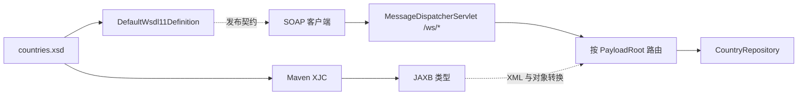
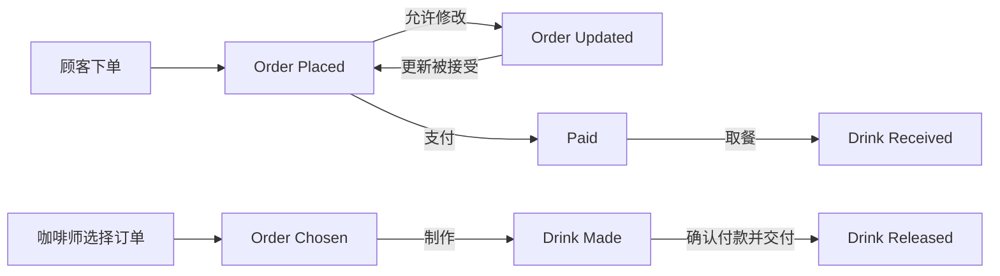
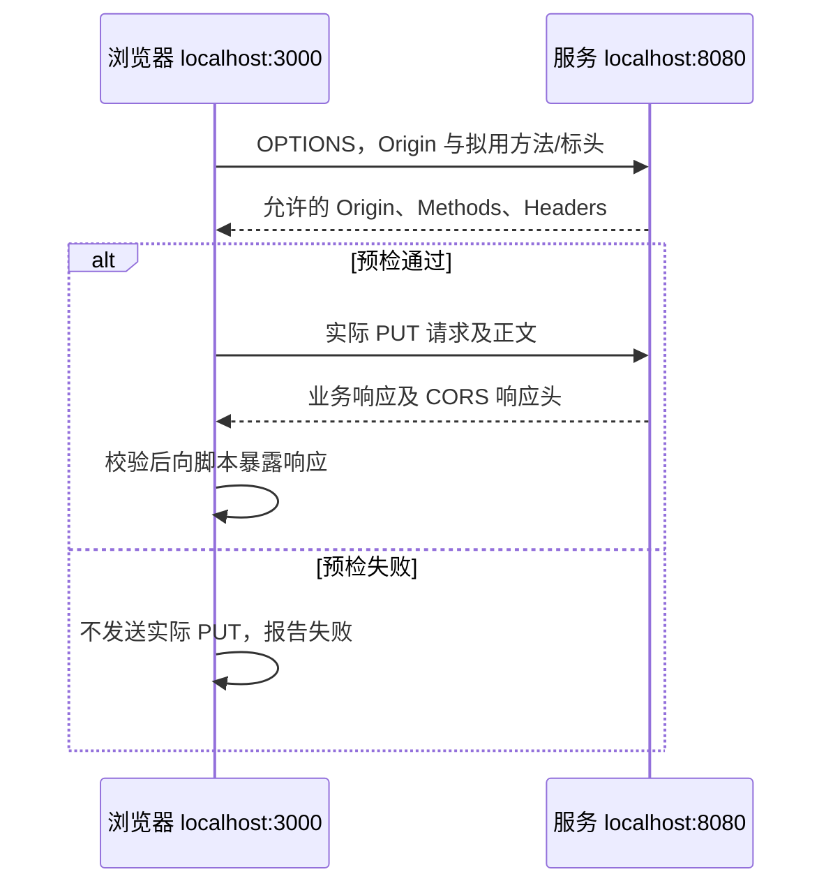
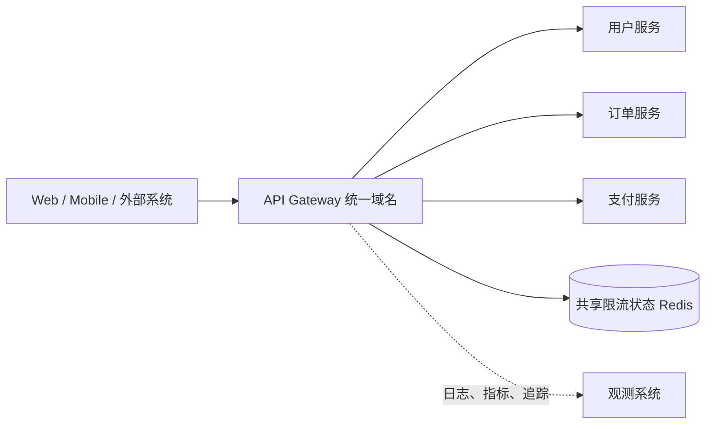

# B3-Web-API&API-Gateway：Web API、RESTful 服务与 API 网关

> 课程：SE3353（CHP-fa26）。本笔记依据本目录 35 页 HTML 课件、61 页 `09-web services.pptx` 及五个配套示例目录整理，结合官方资料核对容易混淆的协议与框架语义（2026-10-28）。本地 Java 示例使用 Spring Boot 3.1.3，`java.version=20`；网关配置另行标注版本范围。文中区分源码现状、课件示意与工程补充，未启动示例服务、连接数据库或执行性能测试。

## 1. 本讲主线与材料索引

本讲讨论：**不同技术栈的系统如何通过稳定契约通信，如何用 HTTP 表达资源操作，以及如何在统一入口管理请求？**

- **SOAP 与契约**：通过 XML、XSD、WSDL 描述消息和服务，屏蔽调用双方的语言差异。
- **REST 与资源**：用资源标识、表述、HTTP 方法及超媒体组织交互。
- **实现与集成**：用 Spring Boot 暴露接口，由浏览器客户端消费，并正确处理错误与跨域。
- **网关与治理**：集中处理路由、边界认证、限流、协议适配与可观测性。

### 1.1 课件索引

以下按页面实际内容划分；HTML 第 2 页的大纲范围与后续页面不完全一致，例如 Spring Boot 实际从第 19 页开始。

| 材料 | 页码 | 阅读重点 |
| --- | --- | --- |
| [HTML 主课件](B3-Web%20API%20%26%20API%20Gateway/1.html) | 1～2 | 总体路线与教学目标 |
| HTML 主课件 | 3～10 | SOAP、XSD、WSDL、Spring WS、契约取舍 |
| HTML 主课件 | 11～15 | REST 约束、资源、HTTP 方法、状态码、URI |
| HTML 主课件 | 16～18 | 咖啡订单、超媒体、支付与 Atom Feed |
| HTML 主课件 | 19～25 | Spring REST、内容协商、异常处理、OpenAPI、React、CORS |
| HTML 主课件 | 26～27 | Web API 成本与通信场景选择 |
| HTML 主课件 | 28～31 | 网关职责、产品比较、Redis 令牌桶 |
| HTML 主课件 | 32～35 | 演进路线、选型与复习问题 |
| [补充 PPT](09-web%20services.pptx) | 3～9 | 跨平台调用与 WSDL 结构 |
| 补充 PPT | 10～26 | SOAP 服务生产与消费 |
| 补充 PPT | 27～34 | JAX-WS 与客户端代理 |
| 补充 PPT | 35～52 | REST、咖啡状态机与 HTTP 交互 |
| 补充 PPT | 53～57 | Greeting、React、CORS |
| 补充 PPT | 58～61 | 权衡、场景与参考资料 |

### 1.2 配套项目

| 目录 | 实际内容 | 主要入口 |
| --- | --- | --- |
| [SOAP 服务端](se3353_9_soapwsproducer/) | XSD 生成 DTO，Spring WS 查询国家 | `CountryEndpoint`、`WebServiceConfig` |
| [SOAP 客户端](se3353_9_soapwsconsumer/) | WSDL 生成类型，发送 SOAP 请求 | `CountryClient`、`CountryConfiguration` |
| [REST 服务端](se3353_9_restfulwsproducer/) | 返回 Greeting JSON，配置 CORS | `GreetingController`、`CorsConfig` |
| [REST 客户端](se3353_9_restfulwsconsumer/se3353_9_restfulwsconsumer/) | React 18 页面调用 `/greeting` | `src/App.js` |
| [Spring REST CRUD](se3353_9_springrestfulws/) | Controller → Service → JPA → MySQL | `PersonController`、`PersonServiceImpl` |

本目录**没有完整的 API Gateway、Redis 限流或咖啡订单工程**。对应内容来自课件与下文的教学配置，不能把它们当作已经实现的本地功能。

与前两讲的联系：B1 讨论服务拆分与状态归属，B2 讨论并发正确性和资源容量，B3 则把这些问题带到网络边界。一次 HTTP 调用仍可能遇到共享状态竞争、下游容量不足和调用超时。

## 2. Web API 与跨平台互操作

### 2.1 调用双方共同遵守什么

Web API 对外暴露的是网络可访问的能力。调用方不需要知道服务端使用 Java、C# 还是 Python，但必须理解接口契约：

| 契约内容 | 需要明确的问题 |
| --- | --- |
| 地址与操作 | 请求发往哪里，用什么方法或消息类型？ |
| 数据结构 | 字段、类型、必填项、枚举与编码是什么？ |
| 结果与错误 | 什么表示成功，失败时如何区分原因？ |
| 身份与权限 | 如何证明身份，哪些资源允许访问？ |
| 行为语义 | 能否重试、能否缓存、是否支持分页与版本演进？ |

跨平台的基础是双方理解同一套**协议和数据语义**。HTTP 使用常见端口有利于部署和集成，但不意味着能够绕过防火墙、代理或访问控制。

### 2.2 几个概念的层次

| 名称 | 所处层次 | 作用 |
| --- | --- | --- |
| HTTP / HTTPS | 应用协议 / 受 TLS 保护的 HTTP 通信 | 请求、响应、方法、状态码与传输保护 |
| XML / JSON | 数据表示格式 | 编码请求和响应数据 |
| XSD | XML 数据模式 | 定义元素结构和类型约束 |
| SOAP | XML 消息协议 | 规定信封、消息头、消息体和错误结构 |
| WSDL | 服务描述语言 | 描述操作、消息、协议绑定和端点 |
| REST | 架构风格 | 约束资源交互、状态管理和统一接口 |
| OpenAPI | HTTP API 描述规范 | 用机器可读文档描述接口契约 |
| API Gateway | 架构组件 | 作为服务入口实施路由和横向策略 |

**SOAP 与 REST 不在完全相同的抽象层次，JSON 也不是 REST 的必要条件。** 使用 HTTP 返回 JSON，不代表接口已经满足 REST 的全部约束。

## 3. SOAP 消息、XSD 与 WSDL

### 3.1 SOAP Envelope

本地 [request.xml](se3353_9_soapwsproducer/request.xml) 使用 SOAP 1.1 信封：

```xml
<soapenv:Envelope
    xmlns:soapenv="http://schemas.xmlsoap.org/soap/envelope/"
    xmlns:gs="http://spring.io/guides/gs-producing-web-service">
  <soapenv:Header/>
  <soapenv:Body>
    <gs:getCountryRequest>
      <gs:name>Spain</gs:name>
    </gs:getCountryRequest>
  </soapenv:Body>
</soapenv:Envelope>
```

- `Envelope` 是消息根元素。
- `Header` 可选，携带安全、寻址等扩展元数据。
- `Body` 必需，承载应用消息；错误可通过其中的 `Fault` 表达。
- XML 元素由“命名空间 URI + 本地名称”标识。`gs` 只是前缀，可以换名；命名空间 URI 不需要是可访问的网页。

SOAP 可以承载文档式消息，也可表达 RPC。不能把所有 SOAP 调用都理解为“XML 中一定写一个远程 Java 方法名”。本例通过 HTTP POST 发送 SOAP，但 SOAP 消息模型本身不等同于 HTTP。

### 3.2 XSD 定义数据契约

本地 [countries.xsd](se3353_9_soapwsproducer/src/main/resources/countries.xsd) 定义了：

| 类型 / 元素 | 内容 |
| --- | --- |
| `getCountryRequest` | 一个字符串 `name` |
| `getCountryResponse` | 一个 `country` 对象 |
| `country` | `name`、`population`、`capital`、`currency` |
| `currency` | `GBP`、`EUR`、`PLN` 枚举 |

`elementFormDefault="qualified"` 要求这里的局部元素带相应命名空间，因此请求中的 `gs:name` 与契约对应。

XSD 规定“合法数据应是什么样”，但**有 XSD 或生成了 JAXB 类型，不代表运行时自动执行所有模式校验**。本地配置没有展示专门的消息校验拦截器；需要严格校验时，应显式配置校验并处理失败结果。

### 3.3 WSDL 1.1 的抽象层与具体层

课件的 `TravelAgent.makeReservation(...)` 用来说明 Java 接口与 WSDL 的对应关系：

| WSDL 元素 | 职责 | 类比 |
| --- | --- | --- |
| `types` | 描述数据类型，常嵌入或引用 XSD | DTO 的结构定义 |
| `message` / `part` | 描述输入、输出消息及组成部分 | 参数与返回数据 |
| `portType` / `operation` | 汇总抽象操作及其输入输出 | 接口与方法 |
| `binding` | 指定协议、消息样式和编码方式 | 如何把接口放到网络上 |
| `service` / `port` | 聚合端点，将 binding 关联到地址 | 去哪里调用 |

可按三个问题记忆：**提供什么能力 → 采用什么协议 → 在哪个地址访问。**

`rpc` / `document` 是消息样式，`literal` / `encoded` 是使用方式，属于不同维度。课件的 `rpc/literal` 例子不能概括所有 SOAP 服务。这里的元素名对应 **WSDL 1.1**，不要与 WSDL 2.0 的术语混用。

### 3.4 契约优先的价值与代价

契约优先（Contract-First）先确定外部消息，再生成或编写服务实现。Java 类内部重构不应意外改变外部契约。契约仍然可以演进，但新增字段、修改必填性、改变枚举等，都要检查已有消费者的兼容性。

SOAP 的 XML 信封、WS-* 扩展和代码生成工具增加学习与维护成本，也能服务于已有的跨机构契约和消息级安全要求。REST 同样会发生字段和行为兼容性问题；两者都需要管理版本。SOAP 也能使用普通 HTTP 客户端调试，下文给出了 `curl` 示例。

## 4. Spring WS：生产与消费 SOAP 服务

### 4.1 服务端处理链



源码阅读顺序：`countries.xsd` → `pom.xml` → `CountryRepository` → `CountryEndpoint` → `WebServiceConfig`。

1. `jaxb2-maven-plugin:3.1.0` 的 `xjc` 目标生成 JAXB 类型，供源码引用。
2. `CountryRepository` 在初始化时放入 Spain、Poland、United Kingdom，是内存演示数据。
3. `CountryEndpoint` 接收请求对象，按名称查找国家，构造响应。
4. `MessageDispatcherServlet` 处理 `/ws/*` 范围的 SOAP 请求。
5. 名为 `countries` 的 WSDL Bean 结合 XSD 发布 `/ws/countries.wsdl`。

核心方法与本地源码一致：

```java
@PayloadRoot(
    namespace = "http://spring.io/guides/gs-producing-web-service",
    localPart = "getCountryRequest"
)
@ResponsePayload
public GetCountryResponse getCountry(@RequestPayload GetCountryRequest request) {
    GetCountryResponse response = new GetCountryResponse();
    response.setCountry(countryRepository.findCountry(request.getName()));
    return response;
}
```

`@Endpoint` 声明 SOAP 处理组件；`@PayloadRoot` 匹配 Body 中载荷根元素；`@RequestPayload`、`@ResponsePayload` 处理消息与对象的转换。URL 先决定进入哪个 Servlet，再由 XML 载荷选择处理方法。

`setTransformWsdlLocations(true)` 根据请求地址转换 WSDL 中的地址。若前面有反向代理，还需正确处理外部域名、协议和可信代理信息，不能把它理解成自动解决所有部署地址问题。参见 [Spring SOAP 服务端指南](https://spring.io/guides/gs/producing-web-service/)。

### 4.2 SOAP 客户端处理链

```text
服务端 WSDL
  → jaxws-maven-plugin 的 wsimport 生成类型
  → Jaxb2Marshaller 配置生成包
  → 构造 GetCountryRequest
  → WebServiceTemplate.marshalSendAndReceive(...)
  → SOAP 请求与响应
  → GetCountryResponse
```

本地客户端要注意三个地址：

| 位置 | 地址 | 含义 |
| --- | --- | --- |
| `pom.xml` 中 `wsdlUrl` | `http://localhost:8080/ws/countries.wsdl` | 构建时读取契约 |
| `CountryConfiguration` 的默认 URI | `http://localhost:8080/ws` | 没有显式地址时使用 |
| `CountryClient` 调用参数 | `http://localhost:8080/ws/countries` | 本次调用实际使用，覆盖默认 URI |

`/ws/countries` 位于 `/ws/*` 的映射范围内，业务操作仍由载荷根元素路由。不要把 `.wsdl` 文档地址当成发送 SOAP 业务消息的地址。

`Jaxb2Marshaller.contextPath` 必须匹配生成类的包。`SoapActionCallback` 设置 SOAPAction，本地端点展示的是 `@PayloadRoot` 映射，不能据此推断端点只靠 SOAPAction 选方法。

客户端的 `CommandLineRunner` 默认查询 Spain，读取国家货币并打印。按源码预期为 `EUR`，这不是本次实际执行结果。参见 [Spring SOAP 消费指南](https://spring.io/guides/gs/consuming-web-service/)。

### 4.3 Spring WS 与 JAX-WS 的区别

补充 PPT 第 27～33 页还介绍了另一条路径：

```text
@WebService 类 → Endpoint.publish(...) → WSDL
WSDL → wsimport → Service / Port 代理 → 调用代理方法
```

这是 JAX-WS 的发布与代理调用模式。本地 `CountryClient` 实际使用 **Spring WS 的 WebServiceTemplate**；虽然构建过程用了 JAX-WS 的生成工具，并不意味着运行时就在调用生成的 Service/Port 代理。

JDK 11 已移除内置 JAX-WS/JAXB 模块以及 `wsimport` 等工具。现代 JDK 上应通过项目依赖和构建插件提供相关能力，不能直接照旧课件假设命令随 JDK 安装。[Oracle 移除组件说明](https://docs.oracle.com/en/java/javase/17/migrate/removed-tools-and-components.html)

## 5. REST：资源、表述与架构约束

### 5.1 资源与表述

以图书为例：

```text
资源：编号为 42 的图书
标识：/v1/books/42
表述：JSON、XML 或 HTML
操作：GET 读取，PUT 替换可写状态，DELETE 删除
```

资源是可被命名的抽象，不必等同于一行数据库记录。“某用户的订单集合”“一次导出任务”“订单支付状态”都可以建模为资源。同一资源可以有多种表述，不应因为 JSON 变成 XML 就断言资源一定变了。

资源状态存于服务端，客户端应用状态则包括“当前查看哪个资源、下一步沿哪个链接操作”。REST 的状态转移不能简单理解成服务器上的所有操作都在改变数据库。

### 5.2 六项约束

| 约束 | 含义 |
| --- | --- |
| Client–Server | 分离客户端交互与服务端职责，使两端可分别演进 |
| Stateless | 每次请求携带处理所需的上下文，不依赖服务端保存的客户端会话上下文 |
| Cache | 响应明确或隐含地说明缓存适用性 |
| Uniform Interface | 通过统一接口降低不同组件之间的耦合 |
| Layered System | 组件只需与相邻层交互，允许代理、缓存、网关等中间层 |
| Code on Demand | 可选地向客户端提供可执行代码 |

统一接口还包括：**资源标识、通过表述操作资源、自描述消息、以超媒体驱动应用状态。** 这些约束的原始定义见 [Fielding 论文第 5 章](https://ics.uci.edu/~fielding/pubs/dissertation/rest_arch_style.htm)。

“无状态”不禁止保存订单、库存和账户，也不等于“必须使用 JWT”。它要求请求的解释不依赖上一次请求留下的隐式会话上下文。HTTP 协议无状态、应用使用 Session、REST 无状态约束，是相关但不同的层次。

### 5.3 URI 设计是资源建模的一部分

| 需求 | 一种清晰的设计 |
| --- | --- |
| 图书集合 | `GET /v1/books` |
| 指定图书 | `GET /v1/books/42` |
| 创建图书 | `POST /v1/books` |
| 用户订单 | `GET /v1/users/7/orders` |
| 过滤与分页 | `GET /v1/orders?status=PAID&page=2&limit=20` |
| 为订单创建取消申请 | `POST /v1/orders/42/cancellations` |

复数名词、小写、连字符、控制嵌套深度都是有用的团队约定，**不是 HTTP 对 URI 的语法禁令**。查询参数完全可以用于 REST API；关键是资源含义和方法语义一致。

版本可以放在 `/v1` 路径、请求头或媒体类型中。应根据客户端、路由和缓存支持选择，重点是兼容性与迁移成本，而不是背诵某个未经验证的行业使用比例。

## 6. HTTP 方法、安全性与幂等性

### 6.1 方法语义

| 方法 | 典型用途 | 安全 | 按方法定义幂等 |
| --- | --- | --- | --- |
| `GET` | 获取资源表述 | 是 | 是 |
| `HEAD` | 获取与 GET 对应的响应元数据，不返回内容 | 是 | 是 |
| `OPTIONS` | 查询通信选项 | 是 | 是 |
| `POST` | 由目标资源处理提交内容，常用于创建子资源 | 否 | 不保证 |
| `PUT` | 在目标 URI 创建或替换资源状态 | 否 | 是 |
| `PATCH` | 按补丁语义修改资源 | 否 | 不保证 |
| `DELETE` | 删除目标 URI 与当前功能的关联 | 否 | 是 |

**安全性**指客户端请求的语义基本为只读，并不禁止服务端记录访问日志。不能用 `GET /orders/42?delete=true` 删除业务数据，因为预取、爬虫和缓存可能触发 GET。

**幂等性**比较的是相同请求执行多次与执行一次的预期服务端效果，不要求状态码、响应正文或时间戳相同。第一次 DELETE 返回 204，第二次返回 404，仍可能满足幂等语义。[HTTP 方法定义，RFC 9110 §9](https://www.rfc-editor.org/rfc/rfc9110.html#section-9)

### 6.2 PUT 与 PATCH

```http
PUT /v1/users/42
Content-Type: application/json

{"name":"Alice","email":"alice@example.com"}
```

这个请求提交目标资源可写状态的完整表述。完整性由接口契约定义：服务器生成的 ID、创建时间等字段不一定可写；缺失字段可能被拒绝、置默认值或按契约处理，不能笼统说“所有缺失数据库字段都会被清空”。

```http
PATCH /v1/users/42
Content-Type: application/merge-patch+json

{"email":"new@example.com"}
```

补丁必须有明确语义。“把邮箱设为某值”可以设计为幂等；“余额增加 10”重复执行则不同。PATCH 方法本身不保证幂等，不能只看请求体字段少就认为它是标准补丁。[PATCH 定义，RFC 5789](https://www.rfc-editor.org/rfc/rfc5789.html)

### 6.3 超时与重试

超时只说明调用方没及时收到结果，**不说明服务端没有成功执行**。可靠的重试还需要超时预算、次数上限、退避，以及对业务幂等性的确认。

以创建订单为例，可以为一次业务操作约定 `Idempotency-Key`：服务端把键、请求摘要和处理结果关联保存；相同键和相同请求返回已有结果，相同键对应不同内容则拒绝。检查与写入必须具备并发控制，不能只在内存中做一次“先查后写”。这是应用契约设计，不是添加一个请求头就自动获得的功能。

PUT 支付也必须由服务端保证重复请求不会产生第二次外部扣款。HTTP 方法表达承诺，数据库约束和下游调用策略负责兑现承诺。

## 7. 状态码、缓存与并发更新

### 7.1 状态码速查

| 状态码 | 常见含义与使用场景 |
| --- | --- |
| `200 OK` | 请求成功，可返回资源或操作结果 |
| `201 Created` | 创建成功，通常用 `Location` 告知新资源地址 |
| `202 Accepted` | 已接受处理，但尚未完成；可提供任务查询地址 |
| `204 No Content` | 成功且没有响应内容，客户端不应再解析 JSON 正文 |
| `304 Not Modified` | 条件 GET/HEAD 验证通过，可复用已有缓存表述 |
| `400 Bad Request` | 请求语法、参数等不合法 |
| `401 Unauthorized` | 缺少有效认证凭证；响应需包含适用的认证挑战 |
| `403 Forbidden` | 服务器理解请求但拒绝执行，常见于权限不足 |
| `404 Not Found` | 未找到资源，或服务端不愿披露其存在 |
| `405 Method Not Allowed` | 资源不支持该方法，响应中提供 `Allow` |
| `406 Not Acceptable` | 无法提供符合内容协商要求的表述 |
| `409 Conflict` | 请求与资源当前状态冲突，例如制作中订单不可修改 |
| `412 Precondition Failed` | `If-Match` 等前置条件不成立 |
| `415 Unsupported Media Type` | 请求内容类型或编码不受支持 |
| `422 Unprocessable Content` | 内容格式可理解，但语义无法处理 |
| `429 Too Many Requests` | 请求被限流 |
| `500 Internal Server Error` | 服务端遇到未预期错误 |
| `502 Bad Gateway` | 网关从上游收到无效响应 |
| `503 Service Unavailable` | 服务暂时不可用，例如过载或维护 |
| `504 Gateway Timeout` | 网关等待上游超时 |

不要把“用户不存在”包装成 `HTTP 200` 再在正文写 `code: 500`。HTTP 状态应反映请求处理结果，正文可进一步描述业务错误。

### 7.2 缓存不由幂等性单独决定

是否可以缓存，要结合方法、响应状态、缓存指令和身份信息。幂等不意味着必定可缓存，也不意味着查询结果永不变化。

常见设计是：使用 `Cache-Control` 规定缓存策略，使用 `ETag` 标识表述版本，后续请求携带 `If-None-Match` 做条件验证。用户私有数据不能直接套用公共 CDN 缓存策略。若同一 URL 根据 `Accept` 返回不同格式，缓存还需要正确区分相关请求头。

### 7.3 ETag 防止覆盖他人的修改

工程补充示例：

```text
A、B 都读到订单版本 "v7"
A 提交 PUT，携带 If-Match: "v7" → 成功，版本变为 "v8"
B 提交 PUT，仍携带 If-Match: "v7" → 412，重新读取后再决定
```

服务端必须原子地完成版本检查与写入，否则“先检查后修改”仍会发生竞态。`409` 常用于业务状态冲突，`412` 专门表达请求前置条件失败；二者不必混用。

## 8. 咖啡订单案例：资源状态机与 HATEOAS

### 8.1 两个角色的状态

补充 PPT 第 40 页分别画出了顾客和咖啡师的流程：



这是角色视角的业务模型，不能直接把两条线合并成唯一线性顺序。是否必须先付款才开始制作，由具体业务规则决定。

### 8.2 一次资源交互

下表保留课件路径，便于对应原文；新接口也可以采用统一的复数路径约定。

| 阶段 | 请求 | 响应与约束 |
| --- | --- | --- |
| 创建订单 | `POST /order` | `201`，`Location: /order/1234`，返回订单与支付链接 |
| 修改订单 | `PUT /order/1234` | 未开始制作时允许；否则 `409` |
| 创建支付资源 | `PUT /payment/order/1234` | 固定 URI，服务端实现幂等语义 |
| 获取待处理订单 | `GET /orders/feed` | Atom Feed，可结合 HTTP 缓存 |
| 咖啡师接单 | 更新 `/order/1234` 的状态 | 原子地检查状态，防止两人同时接单 |
| 查询支付 | `GET /payment/order/1234` | 需验证身份与访问权限 |
| 完成订单 | 课件用 `DELETE /order/1234` | 移除活动订单资源；实际系统可保留历史记录 |

课件早期示例用只含 `additions` 的 PUT 修改订单。按严格的替换语义，更清楚的接口应提交完整可写表述，或改为有明确补丁格式的 PATCH。

### 8.3 超媒体告诉客户端下一步做什么

```json
{
  "id": 1234,
  "drink": "latte",
  "status": "PLACED",
  "links": [
    {"rel": "self", "href": "/order/1234"},
    {"rel": "payment", "href": "/payment/order/1234"}
  ]
}
```

这是将课件 XML 表述改写为 JSON 的示意。客户端根据约定的链接关系、媒体类型及其操作语义发现下一步，而不是拼接所有 URL。只有链接仍不足以让客户端自动理解业务，双方还需要共享 `payment` 等关系的含义。

HATEOAS 不代替服务端检查：客户端看见“可修改”链接后，资源可能已经变成制作中。最终写入必须重新验证状态和权限。

### 8.4 需要区分的机制

- `GET` 查询订单不应顺便把订单改成“已取餐”。取餐确认属于状态变更。
- `OPTIONS` 返回 `Allow` 可以说明方法支持情况，不能保证稍后的更新一定成功；它也不自动等同于 CORS 预检。
- `Expect: 100-continue` 用于在发送正文前协商是否继续传输，不是业务锁，也不表示最终操作成功。
- Atom 是 Feed 表示格式，轮询与缓存是访问策略，不能等同于消息队列的投递、确认和去重保证。
- HTTP 状态机不会自动解决跨服务事务。支付完成但订单更新失败，仍需补偿、对账、重试或可靠事件等设计。
- 课件中的 Digest 认证只作历史协议示意，不能据此声称完整请求体始终受保护，更不能代替 HTTPS。

## 9. Spring Boot REST：从请求到 JSON

### 9.1 核心注解与分层

| 注解 / 类型 | 职责 |
| --- | --- |
| `@RestController` | `@Controller` 与 `@ResponseBody` 的组合，返回值作为响应内容处理 |
| `@RequestMapping` | 声明路径、方法、媒体类型等映射条件 |
| `@GetMapping` 等 | 对应 HTTP 方法的映射快捷写法 |
| `@PathVariable` | 绑定路径变量，如 `/persons/{id}` |
| `@RequestParam` | 绑定查询参数或表单参数 |
| `@RequestBody` | 通过消息转换器读取请求体 |
| `ResponseEntity<T>` | 显式控制状态码、响应头与正文 |
| `@RestControllerAdvice` | 集中提供适用于控制器的响应处理能力 |
| `@ExceptionHandler` | 将特定异常映射为响应 |

```text
HTTP 请求 → DispatcherServlet → 路由与参数绑定
         → Controller → Service → Repository
         → 返回对象 → HttpMessageConverter → HTTP 响应
```

SOAP 的 `MessageDispatcherServlet` 与 Spring MVC 的 `DispatcherServlet` 负责不同消息处理路径，不能仅因都运行在 Spring Boot 中就混为一谈。

### 9.2 本地 Greeting 示例

`Greeting.java`：

```java
public record Greeting(long id, String content) { }
```

`GreetingController.java` 的核心部分：

```java
private static final String template = "Hello, %s!";
private final AtomicLong counter = new AtomicLong();

@GetMapping("/greeting")
public Greeting greeting(
        @RequestParam(value = "name", defaultValue = "World") String name) {
    return new Greeting(
            counter.incrementAndGet(),
            String.format(template, name));
}
```

预期行为：`GET /greeting` 返回问候 World，`GET /greeting?name=User` 返回问候 User。ID 随调用递增，其具体值依赖此前请求，不能假定每次都是 1。

- `AtomicLong` 使同一实例中的递增具备原子性，不提供跨实例唯一性，也不保证重启后连续。
- 返回内容变化不等于破坏 GET 幂等性；该计数是演示元数据，不应被拿来替代真正的“创建业务资源”接口。
- **本地源码只有 GET**。HTML 第 19 页和 PPT 第 53 页另有 POST 例子，但当前工程没有实现它。

`record` 自动提供构造器、组件访问器、`equals`、`hashCode`、`toString` 等。组件字段为 final，但若组件引用可变集合，集合内容仍可能改变，因此不是自动的深度不可变对象。参见 [Java Record 类说明](https://docs.oracle.com/en/java/javase/17/language/records.html)。

### 9.3 Accept 与 Content-Type

| 标头 | 表达的意思 |
| --- | --- |
| 请求 `Content-Type` | 我发送的正文是什么格式 |
| 请求 `Accept` | 我希望接收什么格式 |
| 响应 `Content-Type` | 服务端实际返回了什么格式 |

```http
POST /api/persons
Content-Type: application/json
Accept: application/json

{"personId":1001,"firstname":"Alice","lastname":"Chen","age":20}
```

Spring 根据映射条件和已注册的 `HttpMessageConverter` 读写消息。`consumes` 限制请求类型，`produces` 限制响应类型。

本地 Greeting 项目只有基础 Web 依赖，不能只发送 `Accept: application/xml` 就保证得到 XML。需要相应转换器、依赖和可序列化模型；多种表述的字段与命名也应纳入契约。

## 10. 统一错误响应与 OpenAPI

### 10.1 Problem Details

课件引用 RFC 7807，它已由 **RFC 9457** 取代。标准提供 `type`、`title`、`status`、`detail`、`instance` 等成员以及扩展机制。`status` 是实际 HTTP 状态的辅助信息，不能与响应行矛盾。[RFC 9457](https://www.rfc-editor.org/rfc/rfc9457.html)

教学示例：

```http
HTTP/1.1 404 Not Found
Content-Type: application/problem+json

{
  "type": "about:blank",
  "title": "Not Found",
  "status": 404,
  "detail": "The requested person does not exist.",
  "instance": "/api/persons/42"
}
```

课件第 21 页的 `status/error/message/timestamp` 是自定义错误结构，不能仅凭“返回 JSON”就称其为标准 Problem Details。

下面是 Spring 6 风格的补充代码，**本地 Person 项目尚未包含它**；还需在服务层对资源缺失抛出对应异常：

```java
import org.springframework.http.HttpStatus;
import org.springframework.http.ProblemDetail;
import org.springframework.web.bind.annotation.ExceptionHandler;
import org.springframework.web.bind.annotation.RestControllerAdvice;

@RestControllerAdvice
public class ApiExceptionHandler {
    public static final class PersonNotFoundException extends RuntimeException {
        public PersonNotFoundException() {
            super("Person not found");
        }
    }

    @ExceptionHandler(PersonNotFoundException.class)
    public ProblemDetail handleNotFound(PersonNotFoundException ex) {
        ProblemDetail problem = ProblemDetail.forStatusAndDetail(
                HttpStatus.NOT_FOUND,
                "The requested person does not exist.");
        problem.setTitle("Not Found");
        return problem;
    }
}
```

这是 Spring MVC 异常解析机制的一部分，不应简单描述为“通过普通 AOP 代理拦截所有异常”。安全过滤器、异步任务等位置的错误可能需要各自处理。服务端日志保留诊断信息，客户端只接收适合公开的错误描述。[Spring 错误响应文档](https://docs.spring.io/spring-framework/reference/web/webmvc/mvc-ann-rest-exceptions.html)

### 10.2 OpenAPI 描述什么

| 部分 | 描述内容 |
| --- | --- |
| `info` | API 名称、描述、版本 |
| `servers` | 服务基础地址 |
| `paths` | 路径及其 HTTP 操作 |
| `parameters` / `requestBody` | 参数位置、类型、约束与正文 |
| `responses` | 不同状态码对应的标头和正文 |
| `components.schemas` | 可复用的数据模型 |
| `securitySchemes` / `security` | 认证方案与操作的认证要求 |

OpenAPI 是描述规范，Swagger UI 是展示和交互工具，springdoc 是从 Spring 应用生成文档的集成库。OpenAPI 可以描述 HTTP API，不会自动证明某个接口符合完整 REST 架构。[OpenAPI 3.0.3 规范](https://spec.openapis.org/oas/v3.0.3.html)

Spring MVC 项目可引入匹配版本的 `springdoc-openapi-starter-webmvc-ui`，通常访问 `/v3/api-docs` 和 `/swagger-ui.html`。Spring Boot 3 对应 springdoc 2.x，还应核对具体小版本兼容性。**本目录工程尚未加入该依赖**，这些地址不是现有功能。[springdoc 2.x 文档](https://springdoc.org/v2/)

自动生成能减少文档漂移，但不能推导所有业务规则。仍应明确权限、幂等键、错误条件和分页语义，并用契约验证检查实现；声明 `security` 也不会自动实施认证。

## 11. React 消费 REST API

本地 `App.js` 在组件函数体内直接 `fetch`，再通过 `document.getElementById` 写入页面。它能展示 HTTP 调用，但不适合作为完整 React 数据获取模式：渲染可能多次执行，请求应放到副作用中，界面由状态驱动。

下例是可用于理解的替代写法，未修改本地前端源码：

```jsx
import { useEffect, useState } from 'react';

export default function GreetingView() {
  const [data, setData] = useState(null);
  const [error, setError] = useState(null);
  const [loading, setLoading] = useState(true);

  useEffect(() => {
    const controller = new AbortController();

    async function load() {
      try {
        const response = await fetch('http://localhost:8080/greeting', {
          headers: { Accept: 'application/json' },
          signal: controller.signal,
        });
        if (!response.ok) throw new Error(`HTTP ${response.status}`);
        const result = await response.json();
        if (!controller.signal.aborted) setData(result);
      } catch (err) {
        if (!controller.signal.aborted) setError(String(err));
      } finally {
        if (!controller.signal.aborted) setLoading(false);
      }
    }

    load();
    return () => controller.abort();
  }, []);

  if (loading) return <p>加载中……</p>;
  if (error) return <p role="alert">{error}</p>;
  return <p>{data.content}</p>;
}
```

需要理解：

- `fetch` 收到 404/500 通常仍会兑现 Promise，要检查 `response.ok`。
- 网络失败、CORS 失败和 JSON 解析失败可能进入 `catch`，排查时看浏览器 Network 面板。
- 204 响应没有正文，不应无条件 `response.json()`。
- React 开发环境的 Strict Mode 可能额外执行 Effect 的建立与清理；取消请求也不保证服务器尚未开始处理。业务写操作应由明确事件触发，并具备合适的重复提交保护。

## 12. CORS：浏览器何时允许读取跨域响应

### 12.1 同源由三部分决定

Origin 由 **scheme、host、port** 决定：

| 页面与接口 | 是否同源 |
| --- | --- |
| `http://localhost:3000` → `http://localhost:8080` | 否，端口不同 |
| `https://app.example.com` → `https://api.example.com` | 否，主机不同 |
| `http://example.com` → `https://example.com` | 否，协议不同 |
| `https://example.com/books` → `https://example.com/orders` | 是，路径不参与源判断 |

CORS 是浏览器对跨源请求及响应共享的控制机制，不是用户认证，也不能防止任意服务端程序或 `curl` 调用接口。

### 12.2 简单请求与预检

常说的“简单请求”要求方法和标头等符合 CORS safelist，例如特定条件下的 GET/HEAD/POST；可用的简单 `Content-Type` 包括表单编码、`multipart/form-data` 和 `text/plain`。还存在值等限制，不能只看方法。

在普通跨源 Fetch 场景中，PUT、DELETE、`Content-Type: application/json` 或 `Authorization` 常会触发预检。**`Accept: application/json` 与 `Content-Type: application/json` 不同**，前者本身通常不会触发预检。



简单请求可能已经到达服务端，只是脚本不能读取响应；需要预检的请求则可能在预检阶段被阻止。不能一概说“所有 CORS 失败时业务请求都已经发送”。实际响应也必须满足 CORS 检查，只有 OPTIONS 返回 200 并不充分。详见 [Fetch Standard 的 CORS 协议](https://fetch.spec.whatwg.org/#http-cors-protocol)。

### 12.3 标头各自负责什么

| 标头 | 作用 |
| --- | --- |
| `Origin` | 浏览器说明发起请求的源 |
| `Access-Control-Request-Method` | 预检声明实际请求拟用的方法 |
| `Access-Control-Request-Headers` | 预检声明实际请求拟用的非简单标头 |
| `Access-Control-Allow-Origin` | 服务端允许共享响应的源 |
| `Access-Control-Allow-Methods` | 预检允许的方法 |
| `Access-Control-Allow-Headers` | 预检允许的请求标头 |
| `Access-Control-Allow-Credentials` | 允许凭证模式下的响应共享 |
| `Access-Control-Expose-Headers` | 额外允许脚本读取的响应标头 |
| `Access-Control-Max-Age` | 预检许可可缓存时长，受浏览器实现限制 |

`Allow` 与 `Access-Control-Allow-Methods` 不是同一个标头；前者描述 HTTP 方法支持，后者服务于 CORS 预检。

### 12.4 Spring MVC 配置

本地 `CorsConfig` 使用：

```java
.allowedOriginPatterns("*")
.allowedMethods("*")
.allowedHeaders("*")
.exposedHeaders(HttpHeaders.SET_COOKIE)
.allowCredentials(true)
```

这属于宽松的演示配置。`allowedOriginPatterns("*")` 可以匹配任意源并回写具体源，虽然与直接响应 `Access-Control-Allow-Origin: *` 不同，仍然建立了非常宽泛的信任。

下面是只允许本地课程前端、不需要 Cookie 的教学配置片段：

```java
@Override
public void addCorsMappings(CorsRegistry registry) {
    registry.addMapping("/greeting")
            .allowedOrigins("http://localhost:3000")
            .allowedMethods("GET")
            .allowedHeaders("Accept")
            .allowCredentials(false)
            .maxAge(1800);
}
```

它只是说明如何收窄范围，没有修改原工程。实际应用应按端点需要允许方法和标头。

若业务确实需要跨源 Cookie：客户端使用 `credentials: 'include'`，服务端允许凭证并指定可信来源；Cookie 本身还受 SameSite、Secure、第三方 Cookie 策略等约束。跨源不一定跨站，CORS 与 Cookie 的站点规则不能混为一谈。

**允许凭证时，不必强制改用 patterns**：列出精确的 `allowedOrigins` 就可以；需要子域匹配时才使用 `allowedOriginPatterns`，它也不是任意正则表达式接口。[Spring MVC CORS 文档](https://docs.spring.io/spring-framework/reference/web/webmvc-cors.html)

`Set-Cookie` 是浏览器 Fetch 禁止向脚本暴露的响应头，写进 `exposedHeaders` 也不能让 JavaScript 读到它。Cookie 由浏览器根据策略处理；可暴露的是 `X-Total-Count` 等业务响应头。[Fetch 禁止响应头定义](https://fetch.spec.whatwg.org/#forbidden-response-header-name)

### 12.5 Spring Security 与网关

预检通常不携带业务 Cookie，因此 CORS 处理需要位于认证检查之前。可以通过 Spring Security 的 CORS 集成使用 MVC 配置或 `CorsConfigurationSource`，**不一定必须手动注册一个最高优先级的独立 CorsFilter**。[Spring Security CORS 集成](https://docs.spring.io/spring-security/reference/servlet/integrations/cors.html)

CORS 不替代 CSRF 防护或业务鉴权。引入网关后，可选择由网关集中处理跨域，避免网关和服务重复附加相互冲突的 CORS 响应头；还要覆盖预检和错误响应路径。

## 13. Person CRUD：把协议映射到业务与存储

### 13.1 本地接口清单

[PersonController.java](se3353_9_springrestfulws/src/main/java/org/reins/se3353/se3353_9_springrestfulws/controller/PersonController.java) 的基础路径是 `/api/persons`：

| 接口 | 对应方法 | 当前成功响应 |
| --- | --- | --- |
| `POST /api/persons` | `createPerson` | `201` + 保存后的 Person |
| `GET /api/persons/{id}` | `getUserById` | `200` + Person |
| `GET /api/persons` | `getAllPersons` | `200` + 全部 Person 列表 |
| `PUT /api/persons/{id}` | `updatePerson` | `200` + 更新后的 Person |
| `DELETE /api/persons/{id}` | `deletePerson` | `200` + 文本消息 |

成功响应描述来自源码，错误行为不能根据路径名称自动推断。

### 13.2 每层的职责

```text
PersonController
  HTTP 参数、请求体、状态码
        ↓
PersonService / PersonServiceImpl
  组织业务操作，事务边界
        ↓
PersonRepository extends JpaRepository<Person, Integer>
  持久化读写
        ↓
MySQL ormsample，Person 映射 PERSONS 表
```

`@Transactional` 在服务实现类上，但事务不等于自动解决所有并发覆盖问题。多用户同时修改同一个人时，还需要结合业务选择版本字段、锁或其他并发控制。

### 13.3 源码现状与改进方向

| 源码现状 | 影响与可以补充的设计 |
| --- | --- |
| 查询和更新直接 `Optional.get()` | 缺失时抛异常；应转为明确的资源不存在错误，并映射 404 |
| `Person.personId` 是 `int`，路径参数是 `Long` | 经 `Math.toIntExact` 转换，越界会抛异常；应统一 ID 类型并定义错误响应 |
| 主键有 `@Id`，没有 `@GeneratedValue` | 不可假定自动生成 ID；附带的 `request.json` 未提供 ID，基本类型默认值为 0，可能带来非预期保存行为 |
| POST 直接 `repository.save` | 不自动保证“只创建”；应明确主键生成、已存在 ID 的处理方式 |
| 创建响应没有 `Location` | 可补上新资源地址，帮助客户端发现资源 |
| PUT 复制姓名、年龄等字段 | 应定义完整可写状态、必填字段与校验规则 |
| 直接暴露 JPA Entity | API 字段与持久化模型耦合；可使用请求和响应 DTO |
| `findAll()` 一次读全部数据 | 数据增长后应增加分页和访问范围约束 |
| 删除返回 `200` 和消息 | 本身合法；若改用 204，则同时去掉正文 |

这是阅读示例时的边界说明，并未替换课程代码。数据库连接参数应在本机环境配置，笔记不复制源码中的账户信息。

## 14. API Gateway：统一入口与职责边界

### 14.1 为什么需要网关

如果客户端直接连接多个服务，它需要知道不同服务的地址、认证方式和错误行为。服务拆分、迁移与扩容会反过来影响客户端。



网关提供稳定的外部门面，把路由和通用策略集中在入口。图中是逻辑组件；生产部署通常需要多个网关实例和相应的流量分配机制，避免入口成为单点。

### 14.2 四类核心职责

| 职责 | 典型动作 | 必须保留的边界 |
| --- | --- | --- |
| 路由与负载均衡 | 按路径、Header 等选择服务，分发到实例，灰度发布 | 路径重写和服务发现需要实际配置 |
| 边界认证与防护 | 验证 Token、实施入口访问策略，统一 CORS | 订单归属、租户隔离等细粒度授权仍需服务端保证 |
| 流量与故障治理 | 限流、超时、熔断、受控重试 | 限流不能代替并发控制，重试不能放大故障 |
| 协议与连接处理 | TLS 终止，必要时进行协议适配 | TLS 终止不意味着内部必须明文，转码也不是自动功能 |

日志、成功率、延迟分位数、请求关联标识等贯穿这些职责。WAF 可增加入口保护，但不能替代参数校验、参数化 SQL 和业务权限检查。

### 14.3 认证、授权与身份传递

- **认证**回答“调用者是谁”，例如验证 Token 签名、有效期、签发者和目标受众。
- **授权**回答“这个调用者能否操作这条资源”，例如用户 A 是否能读取订单 B。
- 网关转发可信身份时，应清除或覆盖外部伪造的身份头，并保护网关到服务的信任边界。

课件第 31 页直接读取 `X-User-Id` 作为限流键，只适用于身份头已被可信组件验证并设置的前提。对公网客户端原样开放时，调用者可以随意换值绕过按用户限流。

### 14.4 几个相近组件

| 组件 | 主要关注点 |
| --- | --- |
| 反向代理 / 负载均衡器 | 转发、实例分配、连接和 TLS 处理 |
| API Gateway | 面向 API 的路由、身份、配额与协议策略 |
| BFF | 为某类前端聚合或适配业务数据 |
| Service Mesh | 服务间通信策略、身份和可观测性，通常面向东西向流量 |

它们的能力可能重叠。内网部署的业务网关不一定就是 Service Mesh，也不能仅凭“位于内网”就断言它承担了所有东西向通信。

## 15. Spring Cloud Gateway 与分布式限流

### 15.1 Route、Predicate、Filter

| 概念 | 问题 | 例子 |
| --- | --- | --- |
| Route | 这条路由转发到哪里？ | 一个上游 URI、一个路由 ID |
| Predicate | 哪些请求匹配它？ | Path、Method、Header |
| Filter | 转发前后做什么？ | 限流、添加标头、重写路径 |

课件讲的是 **Spring Cloud Gateway 的 WebFlux 响应式服务端路线**。自定义 Filter 不应在事件循环上执行阻塞数据库查询或长时间计算。SCG 也有基于 Servlet 的 Server Web MVC 变体，不能把所有版本和形态都概括为 Netty。[Server Web MVC 官方文档](https://docs.spring.io/spring-cloud-gateway/reference/spring-cloud-gateway-server-webmvc/starter.html)

### 15.2 令牌桶

设桶容量为 `B`，每秒补充 `r` 个令牌，每个请求消耗 `c` 个令牌。概念模型为：

```text
新令牌数 = min(B, 上次剩余令牌数 + r × 经过时间)
若新令牌数 ≥ c：放行，并扣除 c
否则：拒绝
```

- `replenishRate` 控制持续补充速度。
- `burstCapacity` 控制桶容量，允许积累后承受短时突发。
- `requestedTokens` 控制单次请求成本，默认通常为 1。

例如 `r=100`、`B=200`、`c=1`，满桶时可立即承受约 200 个请求，之后靠每秒补充 100 个令牌维持流量。不能理解成“任意连续一秒都严格最多 200 次”。这也是概念估算，具体离散时间行为以限流器实现为准。

多网关实例若各用独立内存桶，整体配额可能随实例数变化。Redis 共享状态并在服务端原子执行补充与扣减，可以协调同一限流键的并发请求；它不保证任意部署下都具有某个固定延迟。

### 15.3 配置示意与版本范围

下面采用 **SCG 4.1 WebFlux 文档**的 `spring.cloud.gateway.routes` 配置格式，作为独立网关工程的教学片段。需要匹配的 Spring Boot / Spring Cloud 版本、响应式 Redis starter、可用 Redis，以及已经实施的认证；本地 B3 示例尚不具备这些条件。

```yaml
spring:
  data:
    redis:
      host: localhost
      port: 6379
  cloud:
    gateway:
      routes:
        - id: person-api
          uri: http://localhost:8081
          predicates:
            - Path=/api/persons,/api/persons/**
          filters:
            - name: RequestRateLimiter
              args:
                redis-rate-limiter.replenishRate: 100
                redis-rate-limiter.burstCapacity: 200
                redis-rate-limiter.requestedTokens: 1
                key-resolver: "#{@authenticatedUserKeyResolver}"
```

上游示意为运行在 8081 的 Person 服务，路径原样转发。如果改为 `lb://person-service`，还需要负载均衡及相应的服务实例发现配置，不能只换一个 URI 就完成服务注册。

从已认证的 Principal 取得限流身份，比直接信任公网请求头更清楚：

```java
import java.security.Principal;
import org.springframework.cloud.gateway.filter.ratelimit.KeyResolver;
import org.springframework.context.annotation.Bean;
import org.springframework.context.annotation.Configuration;

@Configuration
public class RateLimitConfig {
    @Bean
    public KeyResolver authenticatedUserKeyResolver() {
        return exchange -> exchange.getPrincipal().map(Principal::getName);
    }
}
```

这里要求认证系统提供稳定的身份名称；多租户系统还应避免不同租户下同名用户共用配额。空键默认被拒绝，不能假设匿名请求会自动按 IP 限流。达到配额限制时默认返回 429；空键拒绝是另一种情况。

使用 IP 限流时要考虑 NAT、代理链和可信转发头，不能直接信任任意客户端提供的 `X-Forwarded-For`。限流逻辑还应明确 Redis 故障时采用什么策略，并纳入监控。[SCG 4.1 RequestRateLimiter 文档](https://docs.spring.io/spring-cloud-gateway/reference/4.1/spring-cloud-gateway/gatewayfilter-factories/requestratelimiter-factory.html)

较新版本调整过 starter 名称和配置前缀。不要把这里的示例无条件粘贴到另一版本；应对照目标版本迁移说明。[Spring Cloud 2025.0 配置迁移说明](https://github.com/spring-cloud/spring-cloud-release/wiki/Spring-Cloud-2025.0-Release-Notes)

### 15.4 限流、并发限制、超时与熔断

| 机制 | 主要控制什么 | 典型效果 |
| --- | --- | --- |
| 限流 | 单位时间内进入的请求量 | 配额耗尽后拒绝请求 |
| 并发限制 / 隔离 | 同时进行中的工作数量 | 保护连接池、线程、内存等资源 |
| 超时 | 单次等待的最长时间 | 及时释放调用方等待资源 |
| 熔断 | 持续故障下是否继续调用 | 暂时停止访问故障依赖，之后试探恢复 |
| 重试 | 临时失败后再次尝试 | 仅在语义允许且有预算时使用 |

以稳定系统的平均量作估算：`并发数 ≈ 吞吐率 × 平均耗时`。同样 100 请求/秒，耗时从 0.1 秒变为 5 秒时，平均在途请求可能从约 10 增至约 500。只限制 QPS 不足以保护慢下来的下游。

“限流失败”“服务暂不可用”“业务成功但采用备用数据”也应通过各自的契约表达，不要所有降级都无条件返回成功。

## 16. 网关与通信技术选型

### 16.1 网关产品应分别比较

| 选项 | 可以关注的特点 | 需要核对的条件 |
| --- | --- | --- |
| Spring Cloud Gateway | Spring 集成、Java Filter、WebFlux 或 Web MVC 路线 | 版本兼容、执行模型、过滤器是否阻塞、运行与观测成本 |
| Apache APISIX | OpenResty/Nginx 数据面、插件、动态配置 | 部署模式、配置中心、插件能力和运维经验 |
| Kong Gateway | 插件生态、控制面与数据面部署方式 | 传统、混合、DB-less 等模式，以及所需能力的可用范围 |

APISIX 的部署可使用 etcd 配置中心，也有文件驱动等模式。Kong 有不同配置与部署机制，不能把两者合写成“全部由 etcd 长轮询驱动”的同一种产品。[APISIX 架构](https://apisix.apache.org/docs/apisix/architecture-design/apisix/)、[Kong 部署模式](https://developer.konghq.com/gateway/deployment-topologies/)

课件中的 QPS、微秒级延迟、CPU 降低比例没有配套测试条件，本笔记不把它们视为测量结论。比较时至少固定硬件、TLS、插件链、请求大小、并发、上游行为，并观察吞吐、错误率和 P95/P99 延迟。

### 16.2 SOAP、REST 与 gRPC

| 场景要求 | 可以考虑的方式 | 主要取舍 |
| --- | --- | --- |
| 浏览器、移动端、第三方 HTTP 集成 | HTTP API，按需采用 REST 设计 | 客户端可用性、文档、缓存、接口演进 |
| 已有 WSDL/XSD 与 WS-* 契约 | SOAP | 对接方兼容性、消息规范、工具链 |
| 内部强类型调用、流式 RPC 等 | gRPC | 契约生成、传输特性、代理支持与运维能力 |
| 同一进程内模块调用 | 普通函数 / 对象调用 | 避免不必要的网络和序列化成本 |

“对外 REST、对内 gRPC”是一种可行组合，不是必须遵循的行业定律。内部也可以继续使用 HTTP API；REST 不限于 HTTP/1.1，gRPC 的实际性能优势需要在业务负载下验证。

网关支持 gRPC 转码时，通常需要协议描述、字段映射和相应插件。安装一个网关不会自动把任意 REST 接口转换为正确的 gRPC 业务调用。

双层网关同样有成本：多一跳、重复策略、故障排查和配置同步。只有边缘流量治理与业务聚合确实需要不同边界时，再引入额外层次。

## 17. 配套示例阅读与运行指引

以下命令供本地学习，**本次未执行**。先在终端进入本讲目录；路径中有 `&`，需要引号：

```bash
cd '/Users/xlchen/CHP-fa26/B3-Web-API&API-Gateway'
```

本地四个 Java 项目声明 Java 20，先准备能支持该编译目标且与依赖兼容的 JDK 和 Maven。SOAP 服务端、Greeting 服务端、Person 服务端默认会竞争 8080，应逐个运行，或显式更改端口并同步调用地址。

### 17.1 SOAP：先启动生产者，再构建消费者

终端一：

```bash
mvn -f se3353_9_soapwsproducer/pom.xml spring-boot:run
```

终端二同样位于本讲目录，可先读取契约，再发送本地 XML：

```bash
curl -i 'http://localhost:8080/ws/countries.wsdl'

curl -i 'http://localhost:8080/ws' \
  -H 'Content-Type: text/xml; charset=utf-8' \
  -H 'SOAPAction: ""' \
  --data-binary @se3353_9_soapwsproducer/request.xml
```

预期响应包含 Spain、Madrid、EUR 等演示字段；人口数只是代码中固定的数据，不是实时统计。

消费者构建时需要读取在线 WSDL，因此要保持生产者运行：

```bash
mvn -f se3353_9_soapwsconsumer/pom.xml compile
mvn -f se3353_9_soapwsconsumer/pom.xml spring-boot:run
```

若生成类缺失，依次检查 WSDL 是否可访问、插件是否执行、生成包是否匹配。该 POM 还引用了 `${sourcesDir}` 和 `${classesDir}`，文件自身未声明它们；若构建报输出路径问题，应检查有效 POM 或补充明确路径配置。

### 17.2 Greeting：观察方法与参数

先停止占用 8080 的其他示例，再启动：

```bash
mvn -f se3353_9_restfulwsproducer/pom.xml spring-boot:run
```

```bash
curl -i 'http://localhost:8080/greeting'
curl -i 'http://localhost:8080/greeting?name=User'
curl -i -X POST 'http://localhost:8080/greeting'
```

按当前源码，前两个返回 JSON，POST 没有对应处理方法，预期为 405。目录里的 `request.json` 实际放了两段独立响应示例，不是一个合法的单一 JSON 文档，也不是该 GET 接口的请求体。

### 17.3 React 与 CORS

另开终端，在本讲目录执行：

```bash
cd se3353_9_restfulwsconsumer/se3353_9_restfulwsconsumer
npm ci
npm start
```

React 应用通常使用 3000 端口。通过浏览器 Network 面板观察 `/greeting` 请求、Origin 和 CORS 响应头；实际端口如果变化，也要与允许来源一致。

也可以单独观察服务端如何响应预检：

```bash
curl -i -X OPTIONS 'http://localhost:8080/greeting' \
  -H 'Origin: http://localhost:3000' \
  -H 'Access-Control-Request-Method: GET' \
  -H 'Access-Control-Request-Headers: authorization'
```

`curl` 可展示响应头，但不会执行浏览器的 CORS 拦截，因此“curl 成功”不能证明浏览器跨域配置正确。

### 17.4 Person CRUD：先准备数据环境

准备本地测试 MySQL 数据库 `ormsample`、与实体相符的 `PERSONS` 表和本机连接配置，再启动项目。源码没有展示完整的数据库初始化脚本或自动建表配置，不能假定首次启动会自动准备好所有表。

```bash
mvn -f se3353_9_springrestfulws/pom.xml spring-boot:run
```

只在测试数据库中进行写入实验，使用未占用的示例 ID：

```bash
curl -i 'http://localhost:8080/api/persons' \
  -H 'Content-Type: application/json' \
  --data '{"personId":1001,"age":20,"firstname":"Alice","lastname":"Chen"}'

curl -i 'http://localhost:8080/api/persons/1001'
```

重点观察“创建”和“已有 ID 再提交”的差别，以及查询缺失 ID 时的真实响应。将观察结果与第 13 节列出的代码边界对应起来。

## 18. 复习自测

| 问题 | 回答要点 |
| --- | --- |
| SOAP、WSDL、XSD 分别解决什么？ | 消息结构、服务描述、XML 数据约束 |
| Spring WS 如何找到 `getCountry`？ | URL 进入 SOAP Servlet，再匹配 PayloadRoot 的命名空间和本地名 |
| SOAP 客户端为什么可能在编译时就依赖服务端？ | 本地 wsimport 配置从在线 WSDL 生成类型 |
| REST 无状态是否禁止数据库？ | 不禁止业务资源状态，限制的是请求对隐式会话上下文的依赖 |
| GET 每次返回不同时间或计数是否必然不幂等？ | 否，要看请求的预期服务端效果，不能只比较正文 |
| PUT 与 PATCH 怎样区分？ | 完整可写表述的创建/替换，与有明确语义的补丁操作 |
| 两次 DELETE 状态码不同是否破坏幂等？ | 不一定，资源最终效果可以相同 |
| 网络超时后能否直接重试创建订单？ | 先确认幂等契约，考虑服务端已成功但响应丢失 |
| `409` 与 `412` 有何区别？ | 当前业务状态冲突，与请求前置条件失败 |
| HATEOAS 是否让服务端不必再检查状态？ | 否，发现链接与执行动作之间状态可能变化 |
| CORS 失败是否意味着请求没到服务端？ | 简单请求可能已发送；预检失败时实际请求不发送 |
| `allowedOriginPatterns("*")` 加凭证是否自动安全？ | 否，它可能对任意来源建立信任 |
| `exposedHeaders("Set-Cookie")` 能否让脚本读 Cookie？ | 不能，浏览器禁止暴露该响应头 |
| 网关验签后，订单服务还要检查什么？ | 用户与订单归属、租户、业务操作权限和状态 |
| 令牌桶的速率和容量分别控制什么？ | 持续补充速度，与可积累的突发额度 |
| 100 QPS 限流能否保证最多 100 个并发请求？ | 不能，并发还取决于请求处理时长 |
| 配了 `RequestRateLimiter` 是否已经完成网关工程？ | 没有，还需要依赖、Redis、身份来源、路由和故障策略 |
| 本地 Greeting 与 PPT 最大的接口差异是什么？ | 本地只有 GET，PPT 还展示了 POST |
| Person POST 能否假定数据库自动生成主键？ | 不能，当前实体未声明 `@GeneratedValue` |

复习时可以沿一条请求链串联全讲：**契约描述 → HTTP / SOAP 消息 → 网关策略 → 参数绑定与业务校验 → 持久化与并发控制 → 响应语义 → 浏览器读取与展示**。每一步都应明确自己的输入、输出及失败行为。
