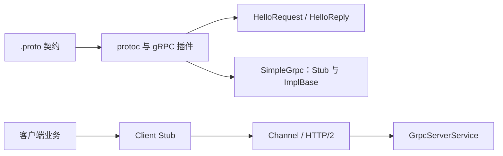
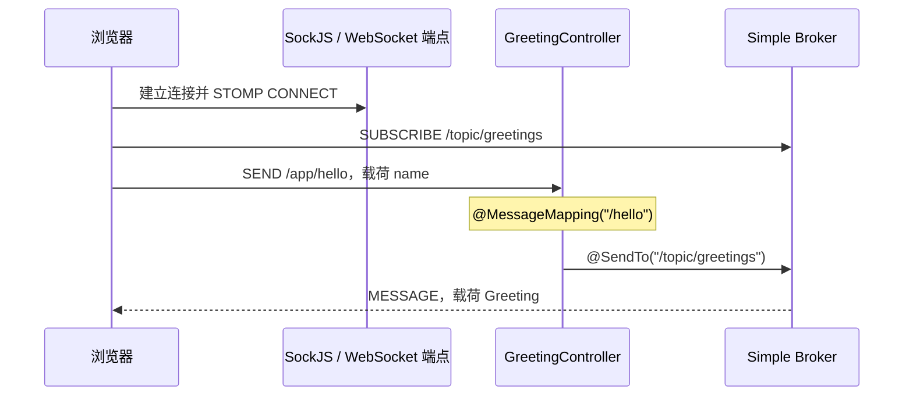
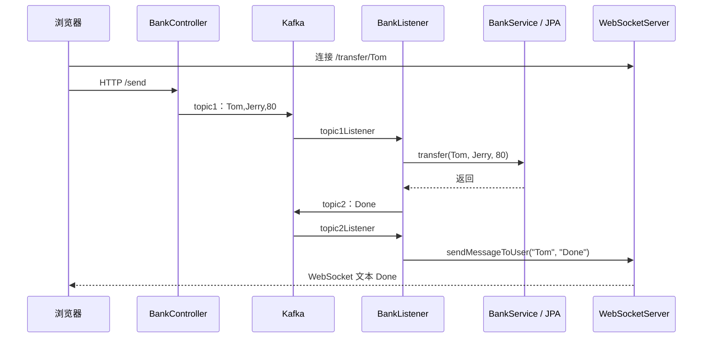
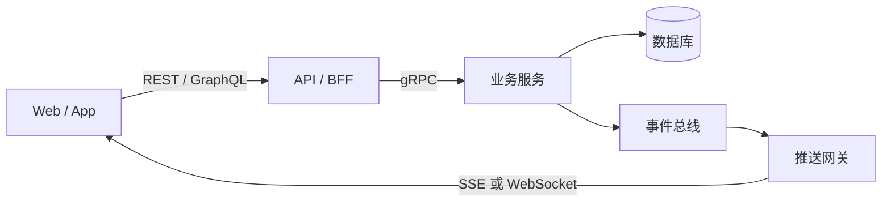

# B4-High-Performance-Communication&Real-Time-Protocols：高性能通信与实时交互协议

> 课程：SE3353（CHP-fa26）。依据本目录 40 页 HTML 主课件、48 页 `22-graphql&grpc.pptx`、70 页 `03-websocket.pptx` 及配套源码整理，并以官方规范核对易混概念（2026-10-28）。文中明确区分本地实现、课件示意和工程补充；未启动服务、执行转账、连接数据库或进行性能测试。

## 1. 本讲主线与材料索引

本讲围绕四个问题展开：**服务间如何高效调用、客户端如何按需取数、双方如何持续交互、服务端如何增量推送结果？**

| 技术 | 主要解决的问题 | 核心抽象 |
| --- | --- | --- |
| gRPC + Protobuf | 跨语言服务调用、强类型契约、流式 RPC | Service、Message、Stub、Channel |
| GraphQL | 多端界面所需字段不同、关联数据需要聚合 | Schema、Query、Resolver |
| WebSocket | 客户端与服务端持续双向通信 | Connection、Session、Message |
| STOMP | 为消息增加目的地、订阅和路由语义 | Destination、Subscription、Broker |
| SSE | 在 HTTP 响应中持续向客户端发送事件 | Event Stream、EventSource |

这些技术处于不同层次。GraphQL 是查询语言和执行模型，Protobuf 是结构化数据的序列化机制，gRPC 是 RPC 框架，WebSocket 是应用层通信协议，STOMP 是可承载于 WebSocket 之上的消息协议。它们可以在同一系统中组合使用。

### 1.1 课件阅读路线

| 材料 | 页码 | 内容 |
| --- | --- | --- |
| [HTML 主课件](B4-High-Performance%20Communication%20%26%20Real-Time%20Protocols/1.html) | 1～3 | 课程目标、协议分工 |
| HTML 主课件 | 4～13 | HTTP/2、Protobuf、四种 RPC、Spring gRPC |
| HTML 主课件 | 14～23 | GraphQL 语法、Spring 映射、N+1 与批处理 |
| HTML 主课件 | 24～29 | WebSocket 握手、帧、Java 生命周期、编解码器 |
| HTML 主课件 | 30～34 | STOMP、SockJS、行情推送、Kafka 与连接路由 |
| HTML 主课件 | 35～37 | SSE、实时通信比较、大模型流式输出 |
| HTML 主课件 | 38～40 | 选型与研讨题 |
| [GraphQL / gRPC 补充 PPT](22-graphql%26grpc.pptx) | 3～23、26～46 | GraphQL 查询示例、Book 服务、gRPC 概念与 Hello World |
| [WebSocket 补充 PPT](03-websocket.pptx) | 3～29 | 协议、Java API、ETF 推送、Encoder / Decoder |
| WebSocket 补充 PPT | 30～43、44～68 | Spring STOMP、转账通知、聊天室 |

### 1.2 配套项目与版本

| 目录 | 源码中的实现 | 版本或运行方式 |
| --- | --- | --- |
| [gRPC 示例](se3353_22_grpcsample/) | `Simple.SayHello`、`Simple.StreamHello`，独立客户端 | Spring Boot 4.0.0、Spring gRPC 1.0.0、Java 17 |
| [GraphQL 示例](se3353_22_graphql/) | 查询图书及作者，数据保存在静态 List 中 | Spring Boot 3.2.0、Java 17 |
| [原生 ETF 推送](se3353_3_websocketsample/) | 定时产生模拟行情，广播到 `/dukeetf` | `javax.websocket`、编译目标 Java 20，需匹配 Web 容器 |
| [原生聊天室](se3353_3_chatroom/) | `/websocketbot`、JSON 编解码、群聊和用户列表 | `javax.websocket`、Java 20、WAR |
| [Spring STOMP 示例](se3353_3_springwebsocket/) | `/app/hello` 处理消息，`/topic/greetings` 广播 | Spring Boot 3.1.3、Java 20 |
| [异步转账后端](se3353_3_websockettransfer/) | HTTP 提交、Kafka 消费、JPA 转账、WebSocket 通知 | Spring Boot 3.1.3、Java 20，依赖 Kafka / MySQL |
| [转账前端](se3353_3_wstransferfront/se3353_3_wstransferfront/) | React 页面结合 jQuery 和原生 WebSocket | 连接 `/transfer/{userId}` |

本地没有独立的 SSE / Spring AI 工程，也没有完整的 GraphQL Mutation、Subscription、DataLoader 或集群推送实现。后文相应内容属于课件知识与工程补充。

## 2. 性能问题要先分层

一次远程调用的时间可以粗略拆为：

```text
总耗时 ≈ 连接建立 + 请求编码与传输 + 排队 + 业务处理
       + 下游访问 + 响应编码与传输
```

不同优化作用于不同环节：

- **连接复用、多路复用**：减少反复建立连接的成本，允许多个请求并发推进。
- **紧凑编码**：减少字节数以及部分序列化开销。
- **聚合与批处理**：减少前后端、服务间或数据库之间的往返次数。
- **流式传输**：结果逐步产生、逐步消费，降低等待完整结果的时间。
- **背压和容量限制**：让发送速率与消费能力匹配，限制队列和内存增长。

“吞吐高”“平均延迟低”“首字出现早”“尾延迟稳定”是不同目标。流式返回能更早展示部分结果，但不保证计算本身更快，也不保证总完成时间更短。

### 2.1 HTTP/2 的多路复用

HTTP/2 在连接上划分多个 Stream，再把消息拆成 Frame 交错发送。它还通过 HPACK 压缩首部，减少重复字段的传输。

```text
一个 TCP 连接
  Stream 1：请求 A / 响应 A
  Stream 3：请求 B / 响应 B
  Stream 5：请求 C / 响应 C

发送次序示意：A 的帧 → B 的帧 → A 的后续帧 → C 的帧
```

要区分三件事：

1. 不同 Stream 的帧可以交错，但同一 Stream 的帧顺序仍有约束。
2. HTTP/2 改善 HTTP/1.1 流水线中的应用层队头阻塞，**没有消除 TCP 丢包引起的队头阻塞**。
3. REST、JSON 同样可以运行在 HTTP/2 上，不能把 REST 固定等同于 HTTP/1.1。

参见 [RFC 9113：HTTP/2](https://www.rfc-editor.org/rfc/rfc9113.html#section-1)。

## 3. Protobuf：消息契约与二进制编码

### 3.1 `.proto` 文件的组成

下面与本地服务端的 [helloworld.proto](se3353_22_grpcsample/se3353_22_grpc/src/main/proto/helloworld.proto) 一致：

```proto
syntax = "proto3";

option java_multiple_files = true;
option java_package = "org.sjtu.se.se3353_22_grpc";
option java_outer_classname = "HelloWorldProto";

service Simple {
  rpc SayHello(HelloRequest) returns (HelloReply) {}
  rpc StreamHello(HelloRequest) returns (stream HelloReply) {}
}

message HelloRequest {
  string name = 1;
}

message HelloReply {
  string message = 1;
}
```

| 元素 | 含义 |
| --- | --- |
| `syntax = "proto3"` | 选择 proto3 语法 |
| `message` | 定义消息结构 |
| `string name = 1` | 类型为 string，字段名 name，字段编号 1 |
| `service` / `rpc` | 定义服务及远程方法 |
| `stream` | 表示该方向可以传输一系列消息 |
| `java_package` | 生成 Java 类的包名，不等于 Protobuf 的 `package` 声明 |
| `java_multiple_files` | 将相关类型分别生成到 Java 文件 |
| `repeated` | 声明重复字段，表示列表 |

本地契约未声明 Protobuf `package`，所以 RPC 服务名是 `Simple`。不要把 Java 包名拼到线上服务名之前。

### 3.2 字段编号如何节省空间

Protobuf 在线路上传输字段编号和 Wire Type，而不必逐字段传输完整字段名：

```text
tag = (field_number << 3) | wire_type
```

常见 Wire Type 包括 Varint、固定 32 位、固定 64 位和 Length-delimited。字符串、嵌套消息等采用长度限定形式；不能把所有字段都理解成“Tag + Length + Value”。Tag 自身也是变长整数，并非永远只占一个字节。

以 `HelloRequest { name: "Tom" }` 为例，其 Protobuf 消息体可以编码为：

```text
0A 03 54 6F 6D
│  │  └────── UTF-8 字节：Tom
│  └───────── 长度：3
└──────────── (1 << 3) | 2 = 10，即 0x0A
```

这 5 个字节仅指消息体，不包含 gRPC 消息封装、HTTP/2、TCP 或 TLS 开销。字段编号 1～15 的 Tag 通常用 1 字节表示；`sint32` / `sint64` 使用 ZigZag 编码改善小负数的编码长度。参见 [Protobuf 编码说明](https://protobuf.dev/programming-guides/encoding/)。

### 3.3 契约演进

- 已发布字段的编号应保持稳定，删除字段后用 `reserved` 保留旧编号及必要的旧名称。
- 不要重新使用旧编号，也不要随意把字段改成不兼容的类型。
- proto3 隐式存在性的标量字段通常省略默认值，但 `optional`、消息字段等有不同的存在性规则。
- 强类型契约约束数据形状；“金额为正”“调用者有权限”等业务规则仍需服务端校验。

例如删除旧字段后，可以声明 `reserved 2;`。参见 [proto3 语言指南](https://protobuf.dev/programming-guides/proto3/)。

## 4. gRPC：四种通信模式与本地实现

### 4.1 四种模式

| 模式 | 请求 / 响应 | 契约形式 | 适用示例 |
| --- | --- | --- | --- |
| Unary RPC | 单个 / 单个 | `rpc Get(Req) returns (Resp)` | 用户信息查询 |
| Server Streaming | 单个 / 消息流 | `rpc Watch(Req) returns (stream Resp)` | 日志、行情订阅 |
| Client Streaming | 消息流 / 单个 | `rpc Upload(stream Req) returns (Resp)` | 分块上传后汇总 |
| Bidirectional Streaming | 消息流 / 消息流 | `rpc Chat(stream Req) returns (stream Resp)` | 持续双向交互 |

双向流两端可以独立发送消息，不必严格一问一答。单次 RPC 内每个方向的消息顺序得到保持，但这不等于跨调用全局有序或业务“恰好一次”。一次 RPC 结束关闭的是该调用的流，底层连接通常仍可复用。参见 [gRPC 核心概念](https://grpc.io/docs/what-is-grpc/core-concepts/)。

### 4.2 代码生成与 Stub



本地 Maven 使用 `protobuf-maven-plugin` 4.0.3，结合 `protoc-gen-grpc-java` 生成消息类型和服务代码。自动生成来自构建插件配置，不能只添加 Starter 就假定一定会生成类型。

常见 Java Stub：

| Stub | 调用方式 | 本讲关注的范围 |
| --- | --- | --- |
| `newBlockingStub(channel)` | 调用线程等待结果 | Unary、通过 Iterator 读取服务端流 |
| `newStub(channel)` | `StreamObserver` 回调 | 四种模式 |
| `newFutureStub(channel)` | 返回 `ListenableFuture` | Unary |

“异步 API”表示通过回调交付结果，不意味着业务方法中的阻塞数据库操作或 `Thread.sleep` 自动变成非阻塞操作。

### 4.3 服务端观察者与实际行为

本地 [GrpcServerService.java](se3353_22_grpcsample/se3353_22_grpc/src/main/java/org/sjtu/se/se3353_22_grpc/GrpcServerService.java) 使用 `@Service`，继承 `SimpleGrpc.SimpleImplBase`：

```java
HelloReply reply = HelloReply.newBuilder()
    .setMessage("Hello ==> " + req.getName())
    .build();
responseObserver.onNext(reply);
responseObserver.onCompleted();
```

- `onNext`：交付一条消息。
- `onCompleted`：成功结束响应流。
- `onError`：以错误结束响应流。

成功的 Unary 调用返回一条响应，然后完成；终止后不能继续 `onNext`。同一个观察者若由多个线程使用，需要协调调用，不能假设它天然线程安全。

本地 `streamHello` 返回 **10 条** `Hello(0) ==> name` 至 `Hello(9) ==> name`，每轮休眠 1 秒。这与 HTML 第 12 页“五条、500ms、检查取消”的教学片段不同。本地只处理线程中断，没有显式实现取消检查和应用层背压。

工程上还需处理：

1. **截止时间**：客户端设置 deadline，服务端及时停止失去意义的工作。
2. **错误映射**：将参数错误等映射为清晰的 gRPC Status。本地直接抛出 Java 异常，不宜假定客户端一定收到某个特定状态码。
3. **流量控制**：慢客户端可能导致发送缓冲积压；`onNext` 返回不等于对端已处理。流式传输不会自动保证恒定内存。
4. **重试语义**：超时不能证明服务端未执行。写操作需要幂等键或去重设计。

参见 [gRPC 流量控制](https://grpc.io/docs/guides/flow-control/)。

### 4.4 Spring gRPC 配置注意点

本地 `pom.xml` 引用的是官方 `org.springframework.grpc`，但服务端 `application.yml` 仍写着 `grpc.server.port` 等另一套风格的配置。官方 Spring gRPC 1.0 系列使用 `spring.grpc.*` 前缀，且默认端口就是 9090。因此“能在 9090 连接成功”不足以证明旧前缀生效。

与官方前缀对应的本地调试配置示意如下，笔记没有修改原项目：

```properties
# 服务端
spring.grpc.server.port=9090

# 客户端：与 createChannel("local") 的命名对应
spring.grpc.client.channels.local.address=static://localhost:9090
spring.grpc.client.channels.local.negotiation-type=plaintext
```

本地客户端用 `default-channel.address` 指向 `0.0.0.0`。该地址通常用于服务端绑定所有接口；作为连接目标应使用实际主机名或 `localhost`。配置键参见 [Spring gRPC 1.0 系列属性表](https://docs.spring.io/spring-grpc/reference/1.0/appendix.html)，Bean 注册机制参见 [服务端说明](https://docs.spring.io/spring-grpc/reference/server.html)。

客户端还直接依赖服务端 Maven artifact，同时持有同一份 `.proto`。独立构建前应核对依赖是否已安装及打包布局；更清晰的工程拆分是公共契约模块、服务端模块和客户端模块。

## 5. GraphQL：按需查询与执行语义

### 5.1 Over-fetching 与 Under-fetching

- **Over-fetching**：界面只需要姓名，却拿到了完整用户对象。
- **Under-fetching**：一次响应缺少所需关联数据，客户端还需继续请求。

GraphQL 让客户端声明需要的字段和关联层次，有助于减少响应冗余与网络往返。代价是服务端必须控制查询成本、权限、缓存和关联加载。一次 GraphQL 请求可能触发很多次数据库或下游调用。

REST 也可以通过字段选择、聚合端点、BFF 等设计改善这些问题；GraphQL 的优势在于提供统一的声明式查询机制。

### 5.2 Schema 与 Resolver

本地 [schema.graphqls](se3353_22_graphql/src/main/resources/graphql/schema.graphqls) 定义了：

```graphql
type Query {
  bookById(id: ID): Book
}

type Book {
  id: ID
  name: String
  pageCount: Int
  author: Author
}

type Author {
  id: ID
  firstName: String
  lastName: String
}
```

Schema 声明允许查询什么；Resolver 决定字段值从哪里来，可以访问内存、数据库、REST 或 gRPC 服务。普通属性常由默认字段解析器读取，并非每个字段都需要手写方法。

| 类型写法 | 可空性 |
| --- | --- |
| `Book` | 可以为 null |
| `Book!` | 不能为 null |
| `[Book]` | 列表及其中元素都可以为 null |
| `[Book!]!` | 列表和元素都不能为 null，但可以是空列表 |

`ID` 表示标识符，不保证是整数。本地 Schema 没有使用 `!`，查询不存在的图书时，源码返回 `null`。

### 5.3 查询、参数、变量、别名与片段

以下查询可对应本地 Book Schema：

```graphql
query BookComparison($first: ID!, $second: ID!) {
  left: bookById(id: $first) {
    ...BookSummary
  }
  right: bookById(id: $second) {
    ...BookSummary
  }
}

fragment BookSummary on Book {
  name
  author {
    firstName
    lastName
  }
}
```

独立传入的 Variables：

```json
{"first":"book-1","second":"book-2"}
```

| 语法 | 作用 |
| --- | --- |
| `name` | 选择标量字段 |
| `author { ... }` | 沿关联关系继续选择字段 |
| `bookById(id: ...)` | 向字段传递参数，参数必须由 Schema 声明 |
| `$first` | 将动态值与查询文本分开 |
| `left: bookById(...)` | 使用别名，避免不同参数下的响应键冲突 |
| `...BookSummary` | 复用命名片段 |
| `... on SomeType { ... }` | 按具体类型选择字段，常用于接口和联合类型 |

变量减少手工拼接查询的需要，但不替代 Resolver 内的参数化 SQL、输入校验或权限检查。

### 5.4 Query、Mutation、Subscription

| 操作 | 语义 | 本地实现 |
| --- | --- | --- |
| Query | 读取数据，字段应避免业务副作用 | `bookById` |
| Mutation | 执行写操作，并选择返回字段 | 未实现 |
| Subscription | 对事件流逐次执行选择集 | 未实现 |

Mutation 的**同一次操作内顶层字段按顺序执行**，这不代表多个字段共享数据库事务，也不保证失败后一起回滚。跨请求的并发控制仍由业务和数据层负责。Subscription 的传输可以采用相应的 WebSocket 或 HTTP 流方案，GraphQL 本身不等于 WebSocket。参见 [GraphQL 执行规范](https://spec.graphql.org/October2021/#sec-Execution)。

GraphQL 响应可能同时包含部分 `data` 和 `errors`；HTTP 成功状态不等于所有字段执行成功。非空字段出错还可能使 null 向父级传播。

## 6. Spring for GraphQL 与 N+1

### 6.1 本地 Book 查询链路

[BookController.java](se3353_22_graphql/src/main/java/org/se/reins/se3353/se3353_22_graphql/BookController.java) 的核心代码：

```java
@Controller
public class BookController {
    @QueryMapping
    public Book bookById(@Argument String id) {
        return Book.getById(id);
    }

    @SchemaMapping
    public Author author(Book book) {
        return Author.getById(book.authorId());
    }
}
```

执行过程：

```text
POST /graphql
  → 解析查询并按 Schema 校验
  → @QueryMapping：Query.bookById
  → Book.getById：在静态 List 中查图书
  → 如果选择了 author，调用 @SchemaMapping：Book.author
  → Author.getById：在静态 List 中查作者
  → 组装 data / errors
```

`@SchemaMapping` 根据参数类型 `Book` 推断父类型，根据方法名 `author` 推断字段。`Book` record 中的 `authorId` 用于内部关联，未在 Schema 暴露，所以客户端不能直接选择这个字段。

选择 `book-1` 的完整字段时，按本地数据应得到：

```json
{
  "data": {
    "bookById": {
      "id": "book-1",
      "name": "Effective Java",
      "pageCount": 416,
      "author": {
        "firstName": "Joshua",
        "lastName": "Bloch"
      }
    }
  }
}
```

项目显式设置 `spring.graphql.graphiql.enabled=true`，因此可以使用 `/graphiql` 调试。GraphiQL 是交互工具，GraphQL 是查询机制，二者不能混为一谈。已有 `BookControllerTests` 使用 `@GraphQlTest` 和 `GraphQlTester` 验证查询结果；笔记未运行该测试。

### 6.2 一次前端请求为何仍会发生 N+1

假设扩展出一个查询 N 本图书的根字段，并把存储改成数据库：

```text
1 次 SELECT 查询图书列表
N 次 SELECT 分别查询每本图书的作者
合计：1 + N 次数据库访问
```

这是服务端数据加载的问题，与前端发送了几次 HTTP 请求不同。DataLoader 将一批关联加载请求合并，并可在同一请求中复用相同 Key 的结果；Spring 的 `@BatchMapping` 可以将字段解析映射为批量处理方法。

教学伪代码如下，本地未实现 `authorRepository`：

```java
@BatchMapping(typeName = "Book", field = "author")
public Map<Book, Author> authors(List<Book> books) {
    // 收集并去重 authorId。
    // 一次批量查询作者，再按每个 Book 建立对应关系。
    // 明确作者缺失时返回 null 或错误的策略。
}
```

**只有底层真的批量访问数据，才可能把 1+N 降为 1+1。** 在批处理方法里继续逐本查库仍然是 N 次查询；多层关联、批次大小限制也可能产生更多访问。参见 [Spring GraphQL 注解控制器与 BatchMapping](https://docs.spring.io/spring-graphql/reference/controllers.html#controllers-batch-mapping)。

批处理之外，还要限制分页大小、查询深度与总体复杂度，并在字段或业务层授权。DataLoader 缓存通常限定于请求范围，不能无条件跨用户复用敏感数据。

## 7. WebSocket：握手、消息与连接

### 7.1 轮询和持续连接

| 模式 | 交互方式 | 主要成本 |
| --- | --- | --- |
| 短轮询 | 客户端每隔 T 秒请求一次 | 无更新时仍有请求，更新等待受轮询间隔影响 |
| 长轮询 | 服务端把响应保留到有事件或超时，再由客户端重新请求 | 重复 HTTP 请求、超时及重连管理 |
| WebSocket | 建立连接后双方独立发送消息 | 长连接容量、心跳、重连、路由管理 |
| SSE | 在同一个 HTTP 响应中持续发送服务端事件 | 长响应、代理缓冲、重连与补发管理 |

HTTP/1.1 本身可以复用连接，长轮询重新发起请求也不意味着每次都重新建立 TCP。HTTP 请求由客户端发起，但已经打开的响应可以持续传输数据，SSE 正是利用这一点。

### 7.2 HTTP/1.1 Upgrade 握手

本讲采用 RFC 6455 的经典 HTTP/1.1 握手路径：

```http
GET /chat HTTP/1.1
Host: example.com
Upgrade: websocket
Connection: Upgrade
Sec-WebSocket-Key: dGhlIHNhbXBsZSBub25jZQ==
Sec-WebSocket-Version: 13
Origin: https://example.com
```

```http
HTTP/1.1 101 Switching Protocols
Upgrade: websocket
Connection: Upgrade
Sec-WebSocket-Accept: s3pPLMBiTxaQ9kYGzzhZRbK+xOo=
```

服务端计算：

```text
Accept = Base64(SHA-1(Key + "258EAFA5-E914-47DA-95CA-C5AB0DC85B11"))
```

该校验帮助确认对方理解 WebSocket 握手，**不提供用户认证、数据加密或消息签名**。HTTP/2 上另有扩展 CONNECT 机制，因此不能把 `101` 说成所有 WebSocket 部署必然采用的方式。参见 [RFC 6455](https://datatracker.ietf.org/doc/html/rfc6455) 及其列出的后续更新。

### 7.3 帧、消息、TLS

| 概念 | 需要掌握的要点 |
| --- | --- |
| Text / Binary | 文本和二进制消息；JSON 是应用选择的载荷格式 |
| FIN / Continuation | 一条消息可以拆成多个帧 |
| Ping / Pong / Close | 连接控制帧，与业务消息分开 |
| Mask | 客户端发往服务端的帧需要掩码，服务端发往客户端的帧不加掩码 |
| `ws://` | 明文 WebSocket，默认端口 80 |
| `wss://` | 受 TLS 保护的 WebSocket，默认端口 443 |

基础帧头最少 2 字节，但客户端方向还包括 4 字节 Mask Key，长载荷还需要扩展长度字段，且尚未计入 TCP / TLS。Mask 是协议要求的变换，不能代替 TLS 加密。

`wss://` 适合 HTTPS 页面和需要传输保护的场景，但不能保证绕过所有代理或防火墙。反向代理仍需支持相应握手、设置合适的空闲超时，并协调心跳策略。

## 8. Java WebSocket 编程模型

### 8.1 Endpoint 与生命周期

Java API 支持两种形式：继承 `Endpoint` 的编程式端点，以及使用注解的端点。Web 应用部署时，最终地址还可能包含容器的 context path。

| API | 职责 |
| --- | --- |
| `@ServerEndpoint("/path")` | 声明端点路径 |
| `@OnOpen` | 接受连接后登记 Session |
| `@OnMessage` | 处理收到的消息 |
| `@OnClose` | 关闭时清理连接状态 |
| `@OnError` | 处理异常并清理相关资源 |
| `Session` | 表示当前连接，提供发送接口和连接属性 |

最小 Echo 片段，使用 Jakarta 命名空间：

```java
@ServerEndpoint("/echo")
public class EchoEndpoint {
    @OnMessage
    public void echo(String text, Session session) throws IOException {
        session.getBasicRemote().sendText(text);
    }
}
```

本地 ETF / 聊天室使用 `javax.websocket`，Spring Boot 3 转账项目使用 `jakarta.websocket`。两套包名不能混用，部署容器也必须匹配。

在本地 Spring Boot 嵌入式容器方案中，`WebSocketConfig` 注册 `ServerEndpointExporter` 导出原生端点；使用外部容器的部署方式时，要按容器的扫描机制处理，不能机械地套用同一配置。

### 8.2 Session 存储与并发

默认情况下，容器为各连接建立独立 Endpoint 实例。共享在线连接可以放在统一注册表中，本地示例使用 `static ConcurrentHashMap` 或并发队列；也可以交给独立共享组件管理，`static` 不是唯一方式。

- `getBasicRemote().sendText(...)`：同步发送，慢客户端可能拖慢调用线程。
- `getAsyncRemote().sendText(...)`：异步发送，需要处理完成回调、失败及发送队列容量。
- 并发集合只保护集合操作，不保证“查找 → 检查 → 发送 → 删除”整个流程原子，也不自动协调同一 Session 的并发发送。
- 一个用户可能有多个设备或标签页，`userId → 单个 Session` 需要明确重复登录策略。

### 8.3 Encoder / Decoder

```text
客户端 JSON 文本
  → Decoder.Text<Message>
  → @OnMessage(Session, Message)
  → 业务处理
  → session.getBasicRemote().sendObject(reply)
  → Encoder.Text<Reply>
  → 客户端收到 JSON 文本
```

| 接口或方法 | 作用 |
| --- | --- |
| `Encoder.Text<T>` / `Encoder.Binary<T>` | 对象编码为文本或二进制消息 |
| `Decoder.Text<T>` / `Decoder.Binary<T>` | 将传输消息解码为业务对象 |
| `willDecode` | 判断当前解码器是否适用 |
| `decode` / `encode` | 完成转换，失败时报告相应异常 |
| `init` / `destroy` | 初始化和释放相关资源 |

本地聊天室根据 JSON 的 `type` 解码为 `JoinMessage` 或 `ChatMessage`，输出则包含 `chat`、`info`、`users` 等类型。`willDecode` 只是预判入口，仍要处理非法 JSON、缺字段、错误类型和大小限制；不能仅凭文本以 `{` 开头就认为数据合法。

## 9. STOMP 与 SockJS：连接之上的消息路由

### 9.1 三者分别负责什么

| 技术 | 职责 |
| --- | --- |
| WebSocket | 传输双向消息 |
| SockJS | 提供类似 WebSocket 的接口，并在适当情况下使用 HTTP 流或轮询等后备传输 |
| STOMP | 规定消息命令、首部、目的地与订阅交互 |

STOMP 帧的教学示意：

```text
SEND
destination:/app/hello
content-type:application/json

{"name":"Tom"}
<NUL>
```

`<NUL>` 表示真实的空字节，不是发送这五个字符。常见命令包括 CONNECT、SEND、SUBSCRIBE、UNSUBSCRIBE、DISCONNECT。STOMP 心跳可使用换行数据，与 WebSocket Ping / Pong 控制帧不同。

目的地是由服务端解释的字符串，`/topic` 与 `/queue` 的名字本身不自动赋予广播或持久队列语义。参见 [STOMP 1.2 规范](https://stomp.github.io/stomp-specification-1.2.html)。

### 9.2 本地 Greeting 示例的三个地址

本地 [WebSocketConfig.java](se3353_3_springwebsocket/src/main/java/org/reins/se3353/se3353_3_springwebsocket/WebSocketConfig.java) 配置：

```java
config.enableSimpleBroker("/topic");
config.setApplicationDestinationPrefixes("/app");
registry.addEndpoint("/gs-guide-websocket").withSockJS();
```

这三行分别位于消息代理配置和端点注册方法中。

| 地址 | 使用位置 | 含义 |
| --- | --- | --- |
| `/gs-guide-websocket` | `new SockJS(...)` | 建立传输连接的端点 |
| `/app/hello` | `stompClient.send(...)` | 发往应用处理器 |
| `/topic/greetings` | `stompClient.subscribe(...)` | 订阅 Broker 的广播目的地 |



`/app/hello` 是 STOMP 目的地，不能把它当成同名 REST URL 调用。本地 Controller 休眠一秒模拟处理，再广播 `Hello, name!`；所有订阅者都会收到，返回值不只发给原发送者。

### 9.3 主动推送与用户目的地

课件扩展使用 `SimpMessagingTemplate`，允许定时任务、业务事件或 MQ 监听器主动发送：

```java
messagingTemplate.convertAndSend("/topic/stocks", quote);
messagingTemplate.convertAndSendToUser(userName, "/queue/notices", notice);
```

第二种情况下，客户端通常订阅 `/user/queue/notices`，Spring 将其解析到用户会话对应的实际目的地。身份应与认证得到的 Principal 对应，还需要订阅授权；路径中写了用户 ID 不代表已经证明用户身份。参见 [Spring 用户目的地](https://docs.spring.io/spring-framework/reference/web/websocket/stomp/user-destination.html)。

本地 Greeting 工程只启用内存 Simple Broker，没有外部 Broker Relay 或用户私聊。集群使用 RabbitMQ / ActiveMQ 等外部 STOMP Broker 时，还需配置中继、用户目的地跨节点解析和授权。

SockJS 后备传输、STOMP 心跳、断线重连和业务消息重放也是不同能力。固定 `setTimeout(connect, 5000)` 是固定间隔重试，并非指数退避；重连后还需要恢复订阅，不能假定断线期间的消息会自动补齐。

## 10. 配套案例：行情、群聊与异步转账

### 10.1 ETF 行情推送

本地调用链：

```text
ETFListener.contextInitialized
  → 每秒调度 ReportBean
  → 随机更新 price / volume
  → ETFEndpoint.send
  → 遍历当前 Session 并 sendText
  → 浏览器更新显示
```

这是模拟行情、每秒推送的教学程序。HTML 第 33 页的 100ms 窗口、增量合并和 Disruptor 是扩展设计，本地并未实现。

将其扩展为高频推送时，要考虑慢连接隔离、消息合并、队列上限和调度器生命周期。只展示最新价格的界面可以合并中间状态；需要逐条保留的成交记录则不能随意丢弃。

课件的 `new HashMap<>(deltaBuffer)` 后接 `deltaBuffer.clear()` 存在并发窗口：两步之间写入的更新可能尚未进入快照就被清除。并发集合不保证这两步原子，应通过同步、单线程归并或经过协调的缓冲区交接形成明确边界。100ms 是可调整的业务窗口，不是通用的人眼极限。

### 10.2 聊天室

本地 [BotEndpoint.java](se3353_3_chatroom/src/main/java/websocketbot/BotEndpoint.java) 的事件处理：

1. 建立连接，加入共享 Session 队列。
2. 收到 `JoinMessage`，把 name / active 写入连接属性并广播加入消息、用户列表。
3. 收到 `ChatMessage`，广播聊天消息。
4. 关闭连接，将 active 置为 false，并广播离开消息。

阅读源码时注意：

- `target` 字段用于表达提及对象，但当前发送逻辑仍遍历所有开放连接，**没有实现保密私聊**。
- 关闭时未从 `mySession` 队列移除连接，长期运行可能积累无效引用。
- 未发送 Join 的连接没有 active 属性，直接拆箱 `(boolean) ...get("active")` 可能产生空指针。
- `sendAll` 的实例级 `synchronized` 只锁住一个 Endpoint 实例，不能统一协调所有连接实例对共享 Session 的发送。

这些观察用于理解生命周期与共享状态，不代表已修改示例。

### 10.3 HTTP + Kafka + WebSocket 转账链路

本地使用的是原生 Jakarta WebSocket，未使用 STOMP：



关键区分：

- `/send` 触发 Kafka 异步链路；`/transfer` 是另一个直接调用转账服务的 HTTP 入口。
- WebSocket 端点实际是 `/transfer/{userId}`，PPT 中出现的 `/websocket/transfer/{userId}` 与当前源码不同。
- 前端按钮通过 AJAX 发起 HTTP 请求，`socket.send(...)` 被注释掉了；WebSocket 在此主要承接通知。
- 消息中的用户、金额和返回文本均被简化或硬编码，没有 requestId、可靠结果查询和完整失败通知。
- 前端声明 JSONP，但后端 `/send` 没有返回 JSONP callback，不能据此认为跨域响应处理已经正确完成。

本例展示“请求受理与结果通知解耦”。真实业务中还需分别保证数据库事务、Kafka 消息投递和通知状态的一致性。DAO 默认加入服务层事务，但捕获异常不代表事务可以正常提交，仍需关注 rollback-only；数据库提交后进程崩溃也可能导致结果事件尚未发出。可以围绕持久任务状态、幂等处理、Outbox 等机制设计可靠链路。

### 10.4 集群中消息必须到达连接所属节点

Session 是某个进程持有的连接句柄，不能把对象存入 Redis 就让另一进程获得写 Socket 的能力。

```text
用户 A 的连接在节点 1
完成事件由节点 2 消费
  → 节点 2 本地 Session 表没有 A
  → 需要把事件路由或广播到节点 1
```

**Kafka 同一 Consumer Group 内的消费者分担分区，不是每个节点都收到每条消息。** HTML 第 34 页“相同 groupId 会向所有节点广播”的说明不成立。参见 [Kafka Consumer 的消费组说明](https://kafka.apache.org/40/javadoc/org/apache/kafka/clients/consumer/KafkaConsumer.html)。

常见设计包括：

| 方案 | 适用思路与代价 |
| --- | --- |
| 每个网关节点使用独立消费组 | 每组消费同一 Topic，再筛选本地用户；读放大和组数量增加 |
| 按用户连接归属路由 | 保存用户到节点的路由元数据，把通知送到目标节点；需处理重连和过期 |
| 广播总线或外部消息代理 | 由总线分发，再由节点写本地连接；需明确离线、持久化和重放语义 |

只把业务消费者都改成不同组可能造成重复转账。应区分“执行一次业务任务”的工作分发与“通知连接节点”的事件分发，分别设计消费组、幂等与重试。

## 11. SSE 与大模型流式输出

### 11.1 SSE 的 HTTP 事件格式

SSE 在一个持续的 HTTP 响应中发送 UTF-8 事件文本，响应媒体类型为 `text/event-stream`。每个事件用空行分隔，例如：

```text
id: 42
event: token
data: {"text":"你好"}

id: 43
event: token
data: {"text":"，世界"}

event: done
data: {}

```

| 字段 | 含义 |
| --- | --- |
| `data` | 事件数据，多行 data 合并时以换行分隔 |
| `event` | 事件类型；未指定时通常作为 message 事件 |
| `id` | 设置事件 ID，供重连追踪使用 |
| `retry` | 提示 EventSource 的重连等待时间，单位毫秒 |
| `:` 开头的行 | 注释，可用于保活 |

浏览器 EventSource 可以在连接中断后重连，并使用已经收到的 ID 设置 `Last-Event-ID`。**补发事件需要服务端保存历史并实现重放逻辑**，单有 ID 不会自动恢复丢失数据。参见 [WHATWG SSE 标准](https://html.spec.whatwg.org/multipage/server-sent-events.html)。

### 11.2 EventSource 与 Fetch 的区别

假设服务端提供上面的 `token` 和 `done` 事件，浏览器代码可以写为：

```javascript
const source = new EventSource('/api/events');

source.addEventListener('token', (event) => {
  const { text } = JSON.parse(event.data);
  document.querySelector('#answer').append(document.createTextNode(text));
});

source.addEventListener('done', () => {
  source.close();
});

source.onerror = () => {
  // 更新连接提示；临时错误时保留原生重连行为。
  // 若业务已结束或用户主动停止，再显式 close()。
};
```

这是教学端点示意，本地没有 `/api/events`。

原生 EventSource 以 GET 建立连接，构造参数不提供通用 POST body 或任意请求头设置。带复杂 Prompt 的 POST 流式请求可以使用 `fetch` 和 `ReadableStream`，也可以先创建任务，再通过任务 ID 建立 EventSource 连接。

使用 Fetch 时，需要自行实现 SSE 解析和所需的重连策略：

1. 检查 HTTP 状态及响应媒体类型。
2. 用增量 `TextDecoder` 处理跨块 UTF-8 字符。
3. 保存尚未完整的文本，按 SSE 的行和空行规则解析事件。
4. 处理同一次读取含多个事件、一个事件被拆到多次读取的情况。
5. 按 `event` 分发并解析完整 `data`，不能把网络块直接当作 JSON。
6. 区分业务完成事件、业务错误、网络异常和用户取消。
7. 用 AbortController 等机制取消请求，并在服务端清理对应工作。

课件中直接将 `reader.read()` 获得的 chunk 追加到页面，只能表达增量读取思路。**网络块、SSE 事件和模型 Token 没有一一对应关系。**

### 11.3 Spring 推流与资源生命周期

| 服务端方式 | 常见 API | 关注点 |
| --- | --- | --- |
| Spring MVC | `SseEmitter` | 异步生产数据、完成、超时、错误回调与资源清理 |
| Spring WebFlux | `Flux<ServerSentEvent<T>>` | 响应式订阅、取消传播、背压及阻塞边界 |

MVC 示意流程：

```text
Controller 创建 SseEmitter 并返回
  → 后台任务逐次 emitter.send(event)
  → 正常完成：emitter.complete()
  → 失败：emitter.completeWithError(error)
  → 完成 / 超时 / 断连时撤销订阅并清理生产任务
```

HTML 第 35 页每个请求新建 `newSingleThreadExecutor()`，没有配套关闭逻辑。实际实现应使用受管理且有容量限制的执行器，或有完整生命周期管理的响应式管道。SSE 连接同样持有响应、缓冲和业务订阅资源，不能理解成“完全没有状态”。

反向代理可能缓冲输出，导致服务端持续发送而浏览器最后才一次看到。端到端调试需要检查 flush、代理缓冲、空闲超时、心跳、压缩及慢客户端处理。

### 11.4 流式输出改善什么

```text
用户提交 Prompt
  → 网关 / 应用接收请求
  → 模型排队与首段计算
  → 首个增量事件到达浏览器
  → 持续生成、传输和渲染
  → 业务结束事件与连接清理
```

测量时至少区分：

- **TTFT（首 Token 延迟）**：请求发起到首个可用输出到达，包含排队、模型计算、网络及缓冲影响。
- **输出速度**：后续增量产生和到达的速度。
- **总完成时间**：从提交请求到整段结果完成。

SSE 允许结果产生后尽早交付，但不能保证 TTFT 小于 150ms 或 200ms。`[DONE]` 也不是 SSE 标准的保留终止符，只是某些应用协议的约定；应按具体 API 的事件定义判断完成。

对于普通文本问答，“一次请求后持续返回结果”适合 HTTP 流。若应用需要同时上传实时音频、发送控制指令并接收增量输出，则应重新评估双向通信需求。

## 12. 协议选型与组合架构

### 12.1 比较矩阵

| 维度 | REST / HTTP API | gRPC | GraphQL | WebSocket | SSE |
| --- | --- | --- | --- | --- | --- |
| 主要抽象 | 资源与操作 | 远程方法 | 字段选择与对象图 | 双向消息 | 服务端事件流 |
| 契约 | 常配 OpenAPI | 常用 `.proto` | Schema | 业务自行规定，可选 STOMP | 事件结构由应用规定 |
| 数据形式 | JSON 等 | 默认 Protobuf | 常见响应为 JSON | 文本或二进制 | UTF-8 文本 |
| 持续流 | 可由具体 API 支持 | 四种 RPC 模式 | Subscription 等执行模型 | 原生双向消息通道 | 服务端持续推送 |
| 常见用途 | 公共接口、CRUD | 服务间调用 | 多端聚合查询 | 聊天、协作、双向控制 | 日志、进度、文本生成 |
| 主要成本 | 接口聚合与演进 | 契约发布、超时、连接与工具链 | 查询复杂度、授权、N+1 | 连接容量、重连、路由、交付语义 | 代理缓冲、续传、连接资源 |

这张表比较的是常见用法，不表示互斥。例如 GraphQL Resolver 可以调用 gRPC，下游事件可以通过 SSE 或 WebSocket 向浏览器交付。

### 12.2 选型时依次判断

1. **通信双方是什么客户端？** 浏览器、移动端、内部服务的协议支持和工具链不同。
2. **需要查询还是持续事件？** 普通请求响应不必引入长连接状态管理。
3. **持续事件是否需要双向高频发送？** 单向交付可考虑 SSE，双向消息可考虑 WebSocket 或 gRPC 双向流。
4. **数据形状是否随客户端变化？** 复杂关联查询可考虑 GraphQL，并评估服务端执行成本。
5. **真正瓶颈在哪里？** 数据库、CPU、网络、队列或浏览器渲染，不同瓶颈需要不同优化。
6. **交付保证是什么？** 是否允许合并、丢弃、重复，是否需要离线补发和业务确认？

一种可能的组合架构：



这个设计体现通信边界分工，是否需要每个组件要由业务复杂度决定。

## 13. 复习时容易混淆的结论

| 容易误记的说法 | 更准确的理解 |
| --- | --- |
| HTTP/2 消除了所有队头阻塞 | 改善应用层多路请求，TCP 层队头阻塞仍存在 |
| Protobuf 每个字段都只有 1 字节头 | Tag 是变长整数，编号和 Wire Type 决定编码 |
| gRPC 一定比 JSON 接口快固定倍数 | 需要在同样负载、网络、压缩、连接复用条件下测量 |
| 一个 `onNext` 就是一个 HTTP/2 帧 | 消息封装与传输分帧是不同层次 |
| GraphQL 一次请求等于一次 SQL | Resolver 可能触发 N+1 或多个下游调用 |
| Mutation 串行意味着事务原子性 | 串行执行规则不提供数据库事务和全局回滚 |
| `@BatchMapping` 自动把循环查库变成批量 SQL | 批量查询仍需在方法的数据访问逻辑中实现 |
| WebSocket `target` 或 URL 用户名就是私聊权限 | 路由字段不能代替认证和授权 |
| Kafka 同组订阅就能向所有网关广播 | 同组分担分区，跨节点通知需要明确路由方案 |
| EventSource 自动重连等于业务断点续传 | 还需要服务端事件存储、游标与重放策略 |
| SSE 没有状态，也不需要资源治理 | 长响应、订阅、缓冲和后台任务都需要管理 |
| 传输成功等于业务成功 | 需要业务结果、幂等、持久状态和必要的确认机制 |

## 14. 本地阅读与实验顺序

以下命令和步骤用于自行学习，未在整理笔记时执行。各项目版本不同，先按第 1 节核对 JDK、依赖与端口，默认使用 8080 的示例应分开启动或改用不同端口。

### 14.1 GraphQL：先观察字段裁剪

进入 `se3353_22_graphql`，构建环境就绪后启动：

```bash
./mvnw spring-boot:run
```

另一个终端发送只查询 name 的请求：

```bash
curl -sS http://localhost:8080/graphql \
  -H 'Content-Type: application/json' \
  --data '{"query":"query($id:ID!){bookById(id:$id){name}}","variables":{"id":"book-1"}}'
```

应重点观察：返回只有 name；增加 `author { lastName }` 后触发关联字段解析；查询不存在的 ID 与查询不存在的字段是两种不同情况。也可通过 `/graphiql` 查看 Schema，并阅读已有测试。

### 14.2 gRPC：比较 Unary 与 Server Streaming

进入 `se3353_22_grpcsample/se3353_22_grpc`，先核对官方配置前缀，再启动服务。若已经安装 `grpcurl`，可显式传入契约，避免依赖服务端反射是否启用：

```bash
grpcurl -plaintext \
  -import-path src/main/proto -proto helloworld.proto \
  -d '{"name":"Tom"}' localhost:9090 Simple/SayHello
```

```bash
grpcurl -plaintext \
  -import-path src/main/proto -proto helloworld.proto \
  -d '{"name":"Tom"}' localhost:9090 Simple/StreamHello
```

第一条应对应单个 `Hello ==> Tom`，第二条按源码逐次产生 10 条问候。可以进一步比较正常结束与客户端中途取消时服务端是否停止工作。

### 14.3 STOMP：观察订阅范围

启动 `se3353_3_springwebsocket`，用两个浏览器标签页连接并订阅广播。任意一页发送姓名，检查两个订阅者是否都收到问候，再断开其中一个连接观察差异。

重点识别连接地址、发送目的地、订阅目的地，而不是只看页面上出现了消息。

### 14.4 原生 WebSocket 与转账链路

ETF 和聊天室先核对 `javax` 容器、context path、前端 URL 与消息格式。转账示例还需要隔离的教学数据库与 Kafka Topics；先沿 `BankController → BankListener → WebSocketServer` 阅读调用链，理解其硬编码和失败处理边界，再安排专门实验。

## 15. 自测问题与答案要点

1. **gRPC 四种模式由什么决定？** `.proto` 中请求和响应位置是否带 `stream`。
2. **为何 gRPC 看起来像本地调用，但不能按本地调用处理？** 网络会超时、中断和产生不确定结果，重试可能重复执行。
3. **Protobuf 字段编号为何不能随意改？** 编解码依靠编号识别字段语义，复用旧编号可能误解旧数据。
4. **GraphQL 如何减少前端请求却增加后端 SQL？** 一个对象图查询会逐层触发 Resolver，朴素关联加载形成 N+1。
5. **`@QueryMapping` 与 `@SchemaMapping` 如何分工？** 前者是 Query 根字段的便捷映射，后者映射指定父类型的字段。
6. **WebSocket 握手中的 Accept 校验能证明用户是谁吗？** 不能，它确认协议握手，身份仍需单独认证。
7. **`/gs-guide-websocket`、`/app/hello`、`/topic/greetings` 有何不同？** 分别是连接端点、应用目的地、订阅目的地。
8. **本地聊天室带 `target` 的消息为何不算私聊？** 后端依然向所有开放连接广播。
9. **并发 Map 为什么仍会丢失行情更新？** 复制快照与清空是两个操作，组合没有原子边界。
10. **用户连到节点 A，事件被节点 B 消费怎么办？** 通过连接归属路由或明确的事件扇出送到 A，同一 Kafka Group 不会自动广播。
11. **为什么不能对每个 Fetch chunk 直接 JSON.parse？** 网络切块与事件边界不同，JSON 可能不完整，也可能一次包含多个事件。
12. **断线重连后能否保证不重不漏？** 还要依靠事件 ID、持久记录、补发和去重；重连只是恢复传输连接。

## 16. 参考资料

本地课件与源码链接见第 1 节。官方资料用于核对协议语义和框架行为，具体依赖版本仍以各项目 `pom.xml` 为准。

- [gRPC 核心概念](https://grpc.io/docs/what-is-grpc/core-concepts/)：服务定义、RPC 模式及生命周期。
- [Protobuf 编码](https://protobuf.dev/programming-guides/encoding/)与 [proto3 指南](https://protobuf.dev/programming-guides/proto3/)：Wire Type、字段编号、存在性与演进。
- [Spring gRPC 1.0 配置属性](https://docs.spring.io/spring-grpc/reference/1.0/appendix.html)：官方 Starter 的配置前缀。
- [GraphQL 规范](https://spec.graphql.org/October2021/)与 [Spring GraphQL Controller](https://docs.spring.io/spring-graphql/reference/controllers.html)：执行语义、字段映射与批处理。
- [RFC 9113](https://www.rfc-editor.org/rfc/rfc9113.html)与 [RFC 6455](https://datatracker.ietf.org/doc/html/rfc6455)：HTTP/2 和 WebSocket。
- [STOMP 1.2](https://stomp.github.io/stomp-specification-1.2.html)与 [Spring 用户目的地](https://docs.spring.io/spring-framework/reference/web/websocket/stomp/user-destination.html)：消息格式、订阅和用户路由。
- [Kafka Consumer API](https://kafka.apache.org/40/javadoc/org/apache/kafka/clients/consumer/KafkaConsumer.html)：消费组与分区分配。
- [WHATWG SSE 标准](https://html.spec.whatwg.org/multipage/server-sent-events.html)：EventSource、事件解析及 Last-Event-ID。
