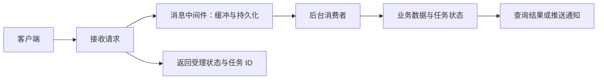
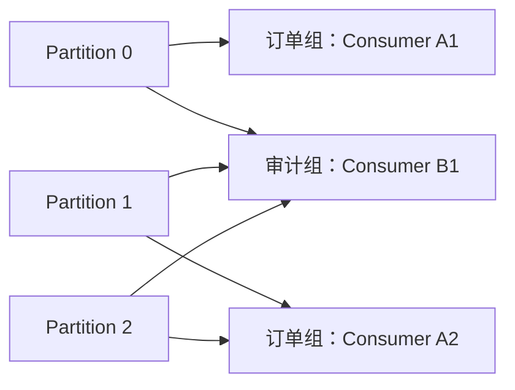
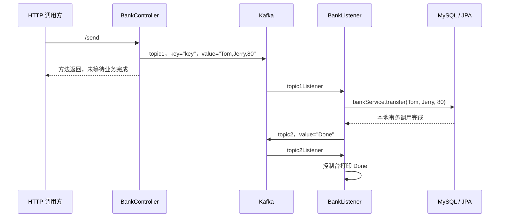
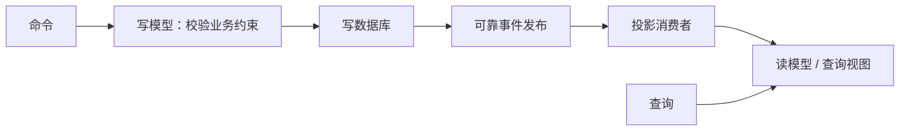
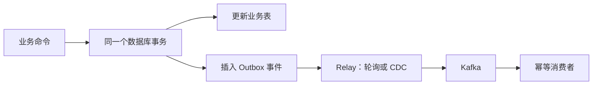

# B5-EDA&MoM：事件驱动架构与消息中间件

> 课程：SE3353（CHP-fa26）。依据本目录 40 页 HTML 主课件、37 页 JMS 补充 PPT、32 页 Kafka 补充 PPT 及配套 Java 源码整理，并用官方规范核对易混概念（2026-10-30）。文中区分本地实现、课件示意与工程补充；未启动服务、连接数据库或执行转账。

## 1. 本讲主线与材料索引

本讲讨论：**如何把同步调用链中的工作拆成可独立处理的消息，以及在异步、重试和故障条件下保持业务正确。**

| 概念 | 全称 | 所处层次 |
| --- | --- | --- |
| EDA | Event-Driven Architecture，事件驱动架构 | 用事件组织组件协作的架构风格 |
| MoM / MOM | Message-Oriented Middleware，面向消息的中间件 | 提供消息传输、路由、存储等能力的基础设施 |
| JMS | Java Message Service | Java 消息 API 规范，不是一个具体 Broker |
| Kafka / Pulsar / RabbitMQ | 消息与事件流平台 | 不同存储、分发与扩展模型的实现 |
| CQRS / Event Sourcing / Outbox / Saga | 架构与一致性模式 | 分别处理读写模型、状态历史、双写与跨服务流程 |

使用消息队列不自动等于采用了 EDA；Kafka 中也可以传递命令，而不只是领域事件。

### 1.1 课件阅读路线

| 材料 | 页码 | 阅读重点 |
| --- | --- | --- |
| [HTML 主课件](B5-EDA%20%26%20MoM/1.html) | 1～4 | 本讲目标、同步与异步、解耦和削峰 |
| HTML 主课件 | 5～10 | JMS API、消息结构、Queue / Topic、Spring JMS |
| HTML 主课件 | 11～20 | Kafka 日志、分区、副本、消费组、可靠性、事务与 KRaft |
| HTML 主课件 | 21～28 | CLI、Java API、Spring Kafka、异常处理与幂等 |
| HTML 主课件 | 29～36 | Pulsar、EDA、CQRS、事件溯源、Outbox、Saga、流计算 |
| HTML 主课件 | 37～40 | 选型权衡、总结与研讨题 |
| [JMS 补充 PPT](02-messaging-jms.pptx) | 3～15、16～28、29～35 | 消息模型、原生 API、Spring JMS 示例 |
| [Kafka 补充 PPT](02-messaging-kafka.pptx) | 4～14、15～21、22～30 | 核心概念、旧版启动演示、Java / Spring / 转账示例 |

### 1.2 配套项目与版本

| 目录 | 实际实现 | 本地版本声明 |
| --- | --- | --- |
| [JMS 示例](se3353_2_jms/) | 嵌入式 Artemis，发送并打印 `Email` 消息 | Spring Boot 3.1.3、Java 20、`jakarta.jms` |
| [原生 Kafka 示例](se3353_2_kafkasample/se3353_2_kafkasample/) | 事务发送 100 条消息，轮询并打印消息 | `kafka-clients` 3.5.1、Java 20 |
| [Spring Kafka 示例](se3353_2_springkafka/) | 独立 producer / consumer，`topic1` 的简单收发 | Spring Boot 3.1.3、Java 20、`spring-kafka` |
| [Kafka 转账示例](se3353_2_kafkatransfer/se3353_2_kafkatransfer/) | HTTP → Kafka → JPA 转账 → Kafka 结果消息 | Spring Boot 3.1.3、Java 20、MySQL |

版本以本地 `pom.xml` 为准：Kafka PPT 第 22 页写的是客户端 3.8.0，本地原生示例声明的是 3.5.1。客户端依赖版本也不代表已安装 Broker 的版本。

本目录没有完整的 Pulsar、DLQ、Redis 去重、CQRS、Event Sourcing、Outbox / CDC、Saga 或流计算工程。后文相应部分属于课件知识与工程补充。

与前几讲的联系：B3、B4 讨论网络调用与实时连接；B5 进一步把“请求提交”“后台处理”“结果通知”分开，重点转向持久化、消费进度和故障恢复。

## 2. 同步调用、异步消息与事件

### 2.1 三类消息的语义

| 类型 | 表达什么 | 示例 | 接收方行为 |
| --- | --- | --- | --- |
| Command，命令 | 希望执行的动作 | `TransferMoney`、`ReserveStock` | 校验后执行，也可能拒绝 |
| Event，事件 | 已经发生的事实 | `MoneyTransferred`、`StockReserved` | 各订阅方自行决定如何响应 |
| Query，查询 | 希望获取的信息 | `GetTransferStatus` | 返回结果，通常不改变业务状态 |

`TransferRequested` 表示“转账请求已产生”，不表示“钱已转好”；`MoneyTransferred` 才应在转账成功后发布。名称与发布时机必须对应，否则消费者会误判业务状态。

### 2.2 异步消息的价值与代价



- **异步化**：把邮件发送、报表生成等后续工作移出当前请求的等待路径。
- **时间解耦**：在保留策略允许的范围内，消费者可以稍后处理。
- **位置解耦**：发送方面向 Queue / Topic，不必直接寻址每个消费者。
- **削峰**：先暂存突发任务，再按下游能力处理。

解耦仍有边界：双方依然共享消息契约，生产者仍依赖中间件，消费者不能无限期离线。同步 RPC 也可以使用服务发现、限流和非阻塞 I/O；不能将它一概理解为“硬编码 IP、必然阻塞一个线程”。

异步缩短的是**受理响应时间**，不一定缩短任务完成时间。例如，返回 HTTP `202 Accepted` 应表示请求已按约定受理，随后通过任务状态查询、WebSocket 或 SSE 获取结果。调用了异步 `send()` 本身不代表消息已经可靠保存。

### 2.3 削峰不等于增加处理能力

设到达速率为 λ、消费速率为 μ，持续超载时：

```text
积压增长速度 ≈ λ - μ
```

教学算例：入口每秒 5,000 条、消费者每秒处理 1,000 条，持续 10 秒，约积压 40,000 条；之后若没有新请求，仍需约 40 秒清空。

因此还需限制积压、设置超时或过期策略，并监控消费延迟。队列满、磁盘满或保留期耗尽时，必须有明确的拒绝、限流或降级行为。

## 3. JMS：Java 消息规范

### 3.1 API 对象关系

```text
ConnectionFactory → Connection → Session
                                  ├─ MessageProducer → Destination
                                  └─ MessageConsumer ← Destination

JMS 2.0 简化 API：JMSContext 封装 Connection 与 Session 的常用能力
Destination：Queue 或 Topic
```

- `ConnectionFactory`：创建与消息提供者交互的连接。
- `Session` / `JMSContext`：创建消息和生产者、消费者，并管理确认或事务；会话使用通常应串行化。
- `JMSProducer` / `JMSConsumer`：发送与接收消息。
- `receive()`：同步等待；`MessageListener.onMessage()`：由提供者在消息到达时回调。
- `ConnectionFactory` 与 `Destination` 可以通过 JNDI 查找，也可以由 Spring 配置和注入。

以下是原生简化 API 的教学片段，假设已取得 `connectionFactory` 和 `queue`：

```java
try (JMSContext context = connectionFactory.createContext()) {
    context.createProducer().send(queue, "Hello JMS");
}
```

旧版课件使用 `javax.jms`；本地 Spring Boot 3 示例使用 `jakarta.jms`，代码迁移时不能直接混用两个命名空间。JMS 统一的是 API 与行为契约，不保证更换提供者时部署、认证和扩展配置完全不变。

### 3.2 消息结构

| 部分 | 含义 | 例子 |
| --- | --- | --- |
| Header | 标准消息元数据 | `JMSMessageID`、`JMSDestination`、`JMSReplyTo`、`JMSCorrelationID` |
| Properties | 应用或规范定义的扩展属性 | `Region`、`Priority`、`JMSXDeliveryCount` |
| Body | 业务载荷，可为空 | 文本、键值对、二进制、对象 |

`JMSCorrelationID` 可关联请求与回复；`JMSReplyTo` 可指定回复目的地。它们支持请求／回复模式，但业务仍需处理超时、重复回复及请求方退出。

| 消息类型 | 载荷 | 记忆点 |
| --- | --- | --- |
| `TextMessage` | String | 常用于 JSON / XML |
| `MapMessage` | 命名的类型化值 | 按名称读取，不依赖字段顺序 |
| `BytesMessage` | 未解释的字节 | 可承载 Protobuf 等编码 |
| `StreamMessage` | 按序写入的类型化值 | 按顺序读取 |
| `ObjectMessage` | Java 可序列化对象 | 与 Java 类型耦合，需关注反序列化风险 |
| `Message` | 无 Body | 仅使用 Header 和 Properties |

### 3.3 Queue、Topic 与持久订阅

| 维度 | Queue：点对点 | Topic：发布／订阅 |
| --- | --- | --- |
| 分发单位 | 一条消息交给某个消费者处理 | 各独立订阅分别接收消息 |
| 多消费者 | 竞争消费，分摊任务 | 不同订阅各得一份；共享订阅内可以分摊 |
| 消费者离线 | 未消费消息可等待后续接收，受过期和可靠性配置约束 | 非持久订阅不保留其关闭期间的消息；持久订阅可保留 |
| 典型用途 | 后台任务、工作分发 | 多系统通知、状态传播 |

“一条消息由一个消费者处理”描述分发模型，**不表示业务绝不会重复执行**。消费者处理后、确认前故障，可能触发重新投递。

必须区分：

- **Persistent Delivery**：消息在提供者故障后的可靠性要求。
- **Durable Subscription**：订阅者离线时是否保留属于该订阅的消息。

持久订阅需要预先建立；它不会自动补齐订阅创建前的全部历史。普通持久订阅还需要正确维护客户端身份和订阅名，`close()` 关闭消费者与 `unsubscribe()` 删除订阅也不是同一动作。

### 3.4 Selector、Browser 与确认

Selector 使用 SQL-92 条件表达式的子集筛选允许引用的 Header 与 Properties，不能直接查询 Body 中的 JSON 字段：

```java
message.setStringProperty("Region", "EAST");
message.setIntProperty("Priority", 5);
String selector = "Region = 'EAST' AND Priority >= 4";
JMSConsumer consumer = context.createConsumer(queue, selector);
```

不匹配某个 Queue 消费者的消息不会因此自动从队列删除，其他匹配消费者仍可能接收。`QueueBrowser` 用于查看队列消息而不消费，但不应把浏览结果当成冻结不变的事务快照。

| 模式 | 核心语义 |
| --- | --- |
| `AUTO_ACKNOWLEDGE` | 由会话按同步接收或监听回调的相应规则自动确认 |
| `CLIENT_ACKNOWLEDGE` | 调用 `acknowledge()`；通常确认该会话已消费的消息，不仅是当前一条 |
| `DUPS_OK_ACKNOWLEDGE` | 允许延迟确认，应用应能承受重复 |
| 事务会话 | 用 `commit()` / `rollback()` 管理会话内的消息操作 |

JMS 可以配合支持 XA 的资源和事务管理器参与分布式事务；普通本地事务不会自动把数据库与消息系统绑定起来。确认、选择器和订阅的精确定义见 [Jakarta Messaging 3.1 规范](https://jakarta.ee/specifications/messaging/3.1/jakarta-messaging-spec-3.1.html)。

## 4. 本地 Spring JMS 示例

源码入口：[Application.java](se3353_2_jms/src/main/java/org/reins/se3353/se3353_2_jms/Application.java)、[MsgController.java](se3353_2_jms/src/main/java/org/reins/se3353/se3353_2_jms/MsgController.java)、[Receiver.java](se3353_2_jms/src/main/java/org/reins/se3353/se3353_2_jms/Receiver.java)。

```text
启动 Application.main() 或访问 GET /msg
  → JmsTemplate.convertAndSend("mailbox", Email)
  → MappingJackson2MessageConverter：Email → JSON TextMessage
  → 嵌入式 Artemis 的 mailbox
  → myFactory 创建的监听容器
  → Receiver.receiveMessage(Email)
  → 控制台打印
```

本地关键配置：

```properties
spring.artemis.mode=embedded
```

```java
@Bean
public MessageConverter jacksonJmsMessageConverter() {
    MappingJackson2MessageConverter converter = new MappingJackson2MessageConverter();
    converter.setTargetType(MessageType.TEXT);
    converter.setTypeIdPropertyName("_type");
    return converter;
}

@JmsListener(destination = "mailbox", containerFactory = "myFactory")
public void receiveMessage(Email email) {
    System.out.println("Received <" + email + ">");
}
```

这里的 `Email` 只是包含 `to`、`body` 的 POJO，**没有真正发送邮件**。`_type` 是转换器用于类型恢复的消息属性；POJO 也不需要因此实现 Java `Serializable`。

`JmsTemplate` 管理底层资源的使用，监听容器负责接收和调度。消息交互在业务上是异步的，不代表每个发送方法都无等待，也不代表监听方法中的阻塞操作自动变为非阻塞。

示例使用 GET 触发发送便于课堂演示；实际改变状态的提交接口应使用合适的写操作方法。嵌入式模式也不等于已配置生产级持久化和高可用。

## 5. Kafka：分区日志与消费进度

### 5.1 核心概念

| 概念 | 含义 |
| --- | --- |
| Topic | 事件的逻辑分类 |
| Partition | Topic 的分片，各自维护有序追加日志 |
| Record | 一条记录，包含 Key、Value、Timestamp、Headers 等 |
| Offset | 记录在某个分区中的逻辑位置 |
| Broker | 提供日志存储和客户端服务的节点 |
| Producer | 写入记录的客户端 |
| Consumer Group | 协作消费的一组客户端，维护独立的消费进度 |

Kafka 记录的定位通常使用 **`(topic, partition, offset)`**。Offset 只在相应分区内标识位置，不是跨 Topic、跨分区的全局 ID，也不是文件中的字节偏移。

Kafka 将消费进度与日志保留分开：消费者读过或提交 Offset，通常不会直接删除记录。记录是否仍可回放取决于时间／大小保留、日志压缩等策略。日志压缩可能留下 Offset 空洞；“追加日志”不表示所有历史永久存在。

### 5.2 Key、序列化与顺序性

Kafka 在存储与传输层处理字节，应用通过 Serializer / Deserializer 将 String、JSON、Avro、Protobuf 等类型转为字节。

- **Key**：常用于分区路由，也可作为日志压缩的键；它不是自动去重的业务主键。
- **Value**：业务载荷。
- **Timestamp**：可使用生产时间或 Broker 追加时间；不自动等于业务事实发生时间。
- **Headers**：可携带事件类型、模式版本、追踪 ID 等元数据。

在固定分区数、相同键序列化和相同分区策略下，同一 Key 通常进入同一分区。例如订单事件以 `orderId` 为 Key，可以在订单之间并行、在单个订单内维护顺序。

仍需考虑三个边界：

1. 增加分区数可能改变 Key 的映射，旧记录不会自动重新分区。
2. 分区日志有序，不表示多个生产者的业务发生时间天然有序。
3. 消费者把同分区记录交给线程池乱序执行，或把失败消息转移到重试 Topic，都可能改变业务完成顺序。

### 5.3 Consumer Group 与并行度

以下针对本地示例使用的普通 `subscribe()` 消费组模型：



- **同组竞争**：一个分区在稳定分配下交给组内一个消费者；一个消费者可以负责多个分区。
- **异组独立**：每组有自己的进度，可以独立读取保留范围内的记录。
- 若仅订阅一个 3 分区 Topic，组内启用 5 个消费者，最多 3 个能获得分区。
- 一个组订阅多个 Topic 时，应按总分区和分配策略分析，不能只看其中一个 Topic。

**消费者组 Rebalance** 是分区消费权的重新分配；**副本重分配** 是 Broker 之间的存储迁移，二者不能混为一谈。

成员加入、退出、失联或订阅分区变化可能触发 Rebalance。长时间不调用 `poll()` 也可能失去分区；优化方向包括减少单批处理量、控制耗时，以及正确处理未完成任务。合作式重平衡可以减少暂停，但不保证完全无停顿。

### 5.4 Position、Committed Offset 与重放

```text
分区记录：       0  1  2  3  4  5  6
已成功处理：     ✓  ✓  ✓  ✓  ✓
应提交的位置：                  5 ← 下一条需要读取的位置
```

`position` 表示客户端下一次取数的位置；`committed offset` 是持久化的恢复位置。拉到一批消息后，position 可以前进，而业务处理尚未完成。

| 配置／操作 | 正确理解 |
| --- | --- |
| `auto.offset.reset=earliest` | 没有有效已提交位置或位置越界时，从最早仍保留的位置开始 |
| `auto.offset.reset=latest` | 同样条件下，从日志末尾开始，不补读已有记录 |
| `seek()` | 改变当前消费者某分区的读取位置，仍受分配和保留范围约束 |
| 提交 Offset | 保存恢复进度；不是向业务数据库提交事务 |
| `--from-beginning` | 不能理解为无条件覆盖一个已有消费组的已提交进度 |

重放会再次执行消费者逻辑；重建搜索索引与再次扣款的后果完全不同。Offset 与线程模型的定义见 [KafkaConsumer 3.5 API](https://kafka.apache.org/35/javadoc/org/apache/kafka/clients/consumer/KafkaConsumer.html)。

## 6. Kafka 的吞吐、复制与可靠性

### 6.1 吞吐从哪里来

| 机制 | 减少的开销 | 对应代价或限制 |
| --- | --- | --- |
| 追加写日志 | 降低随机写开销 | 清理、索引和压缩仍有成本 |
| OS Page Cache | 复用操作系统缓存，减少重复读取 | 性能受工作集与内存容量影响 |
| 批量发送、批量拉取 | 摊薄请求和网络开销 | 等待攒批可能增加延迟 |
| 批量压缩 | 降低带宽与存储占用 | 消耗 CPU，效果依数据而异 |
| 零拷贝路径 | 减少内核与用户态间的数据复制 | 受 TLS、格式转换和系统实现影响 |
| 分区并行 | 利用更多 CPU、磁盘与网络 | 放弃跨分区的统一顺序 |

`batch.size` 控制分区批次大小，`linger.ms` 控制等待攒批的时间。批次达到发送条件可以提前发送，不能把 `linger.ms` 当作每条消息必然增加的固定延迟。

“零拷贝”不等于没有任何数据移动，也不意味着 JVM 没有 GC。课件中的百万 TPS、CPU 降低比例、毫秒级故障恢复等数字不能直接作为系统保证；需要固定消息大小、副本、确认、压缩、硬件和延迟分位数后比较。

### 6.2 Leader、Follower 与 ISR

一个分区有一个 Leader 和若干 Follower 副本。生产请求发给 Leader，Follower 拉取日志；消费者默认向 Leader 取数，也存在特定配置下的副本读取能力。

- `replication.factor=3`：总共 3 个副本，包含 Leader。
- ISR（In-Sync Replicas）：保持同步进度要求的副本集合，包含 Leader，成员可动态变化。
- Leader 故障后，能否安全选出新 Leader、能否继续写入，取决于存活副本、ISR、选举策略与最低同步副本要求。

副本数为 3 不能直接推出“任意两台机器宕机后仍可安全写入”。还要区分**已有数据是否保住**和**新写入是否继续可用**。

### 6.3 Producer ACK 与最低 ISR

| 配置 | 成功响应的含义 | 主要风险 |
| --- | --- | --- |
| `acks=0` | 不等待 Broker 确认 | 无法据此判断 Broker 是否收到 |
| `acks=1` | Leader 已追加本地日志 | Leader 在复制前故障可能丢失记录 |
| `acks=all` / `-1` | 等待当前 ISR 的确认条件满足 | 仍需配合最低 ISR 和故障假设 |

教学配置：`replication.factor=3`、`min.insync.replicas=2`、`acks=all`。ISR 只剩 1 个副本时，拒绝这类写入以避免降低到单副本确认；当 ISR 有 3 个成员时，`acks=all` 也不只是“任意两个返回即可”。

确认日志写入并不等于每条消息都完成一次物理磁盘 `fsync`。端到端可靠性还涉及生产失败的处理、保留策略、消费提交、业务幂等及故障恢复。

**版本提醒**：本地原生示例使用的 Kafka 3.5 系列，生产者默认 `acks=all`，无冲突配置时默认启用幂等；不能照抄主课件第 18 页的“`acks=1` 是默认值”。参见 [Kafka 3.5 Producer 配置](https://kafka.apache.org/35/generated/producer_config.html)。

### 6.4 至多一次、至少一次与恰好一次

| 语义 | 故障窗口示例 | 业务含义 |
| --- | --- | --- |
| At-most-once，至多一次 | 先提交进度，执行前崩溃 | 可能漏处理 |
| At-least-once，至少一次 | 业务成功，提交进度前崩溃 | 恢复后可能重复处理 |
| Exactly-once，恰好一次 | 在明确范围内原子绑定结果与进度 | 对该范围内的可观察结果提供一次效果 |

手动提交只是控制提交时机，不自动防止重复。至少一次也以系统能继续重试、数据未过期等条件为前提。

Kafka 的幂等 Producer 主要消除协议重试导致的重复追加；业务代码再次调用 `send()`、重新提交同一笔订单，不会因为 Key 相同就自动合并。

### 6.5 Kafka 事务的边界

Kafka 事务可以把多个分区／Topic 的写入，以及输入消费组的 Offset 提交，组合为一个原子事务：

```text
读取 input-topic
  → beginTransaction()
  → 计算并发送 output-topic
  → sendOffsetsToTransaction(各分区下一读取位置, 消费组元数据)
  → commitTransaction()

下游：isolation.level=read_committed
```

`read_committed` 过滤中止事务的记录，并受未完成事务的可见性边界限制；它仍能读取非事务记录。

**Kafka 事务不会自动回滚 MySQL 更新、邮件发送或外部 HTTP 调用。** Kafka 输入→处理→Kafka 输出可以在相应配置下实现 EOS；外部系统需要另行协调，例如同库去重事务、Outbox 或外部幂等接口。参见 [Kafka 设计：消息传递语义](https://kafka.apache.org/35/design/design/)。

### 6.6 ZooKeeper 与 KRaft

旧 Kafka 部署使用 ZooKeeper 管理部分集群元数据；KRaft 使用 Controller Quorum 和 Raft 元数据日志。它改变的是控制面，不是把每个业务分区都改成 Raft 复制。

Kafka 4.0 起只支持 KRaft，因此补充 PPT 中启动 ZooKeeper 的步骤属于旧部署路线。应按实际 Broker 版本使用对应启动方式，不能从 Java 客户端版本推断部署模式。参见 [Kafka 4.0 升级说明](https://kafka.apache.org/40/getting-started/upgrade/)。

## 7. 原生 Java 与 Spring Kafka 源码走读

### 7.1 原生 Producer / Consumer

| 文件 | 本地实际行为 | 阅读时关注 |
| --- | --- | --- |
| [KafkaPro.java](se3353_2_kafkasample/se3353_2_kafkasample/src/main/java/KafkaPro.java) | 设置 `transactional.id=my-transactional-id`，在一个事务中向 `quickstart-events` 发 100 条消息 | `initTransactions()`、`beginTransaction()`、`commitTransaction()`、`abortTransaction()` |
| [KafkaCon.java](se3353_2_kafkasample/se3353_2_kafkasample/src/main/java/KafkaCon.java) | 以 `group.id=test` 订阅 `quickstart-events`，循环 `poll()` 并打印 | 显式自动提交，间隔 100 ms |

两者都使用 `localhost:9092` 和 String 序列化／反序列化器。

这组示例并不是完整的 EOS 消费处理管线：

1. Producer 没有消费输入消息，也没有调用 `sendOffsetsToTransaction()`。
2. Consumer 未配置 `read_committed`，会采用原生客户端默认的 `read_uncommitted`，不能用它验证事务消息只在提交后可见。
3. 固定 `transactional.id` 适合单个逻辑实例演示；并发启动使用相同 ID 的独立生产者可能互相 fencing。
4. Consumer 没有优雅关闭流程；Producer 的初始化失败路径还应处理实例未创建的情况。异常示例不是完整的资源管理模板。

线程模型：`KafkaProducer` 可在线程间共享；`KafkaConsumer` 大多数操作不允许多线程并发访问。即使业务计算交给线程池，也必须按分区跟踪已完成记录，不能在任务尚未完成时提交整个 poll 批次。

异步 `send()` 一般先进入客户端缓冲，但等待元数据或缓冲空间时仍可能阻塞或失败。回调中也不宜执行长时间阻塞任务。参见 [KafkaProducer 3.5 API](https://kafka.apache.org/35/javadoc/org/apache/kafka/clients/producer/KafkaProducer.html)。

### 7.2 Spring Kafka 的职责分工

| 组件 | 作用 |
| --- | --- |
| `KafkaTemplate<K,V>` | 封装发送 API |
| `ProducerFactory` / `ConsumerFactory` | 创建并配置客户端 |
| `@KafkaListener` | 声明消费入口 |
| Listener Container | 管理 poll 循环、线程、提交与异常处理 |
| `KafkaAdmin` + `NewTopic` | 声明并管理 Topic |

本地 Spring Boot 3.1.3 项目使用以下依赖，版本由 Boot 管理：

```xml
<dependency>
    <groupId>org.springframework.kafka</groupId>
    <artifactId>spring-kafka</artifactId>
</dependency>
```

主课件第 23 页提到的 `spring-boot-starter-kafka` 不能直接当成本地项目的依赖写法。

本地 [ProducerApplication.java](se3353_2_springkafka/producer/src/main/java/org/reins/se3353/producer/ProducerApplication.java) 声明 `topic1`，设为 **10 个分区、1 个副本**；启动后的 `ApplicationRunner` 执行：

```java
template.send("topic1", "hello");
```

本地 [ConsumerApplication.java](se3353_2_springkafka/consumer/src/main/java/org/reins/se3353/consumer/ConsumerApplication.java) 也声明同样的 Topic，并监听：

```java
@KafkaListener(id = "myId", topics = "topic1")
public void listen(String in) {
    System.out.println(in);
}
```

两个项目的 `application.properties` 都为空，因此需要理解 Boot 自动配置的默认值。在这里，监听器 `id` 默认也作为消费组 ID，所以是 `myId`；10 个分区也不会自动创建 10 个消费线程，仍需配置并发容器或启动多个实例。

### 7.3 发送结果与消费确认

以下是 Spring Kafka 3.x 的发送回调教学片段，本地简单发送示例尚未实现此回调：

```java
kafkaTemplate.send("order-events", orderId, payload)
    .whenComplete((result, error) -> {
        if (error != null) {
            // 记录失败并进入明确的重试或恢复流程
            return;
        }
        var metadata = result.getRecordMetadata();
        System.out.printf("partition=%d offset=%d%n",
            metadata.partition(), metadata.offset());
    });
```

发送成功回调表示满足相应 Producer 确认条件，不表示消费者已处理完成；事务发送还要区分记录发送完成与事务提交成功。

**原生自动提交与 Spring 容器提交不同**：Spring Kafka 3.x 在未显式覆盖时关闭客户端自动提交，并默认由容器按 `BATCH` 模式提交。因此，源码没有写 `ack.acknowledge()`，不代表没有提交 Offset。

手动确认是一种选择；同步监听器也可以由容器在方法成功返回后提交。若选择手动模式，配置与代码必须配套：

```yaml
spring:
  kafka:
    bootstrap-servers: localhost:9092
    consumer:
      group-id: order-service
      enable-auto-commit: false
    listener:
      ack-mode: manual_immediate
```

然后在业务事务**已经成功提交后**调用 `ack.acknowledge()`。`MANUAL_IMMEDIATE` 在消费线程调用时可立即提交；若把业务交给异步线程，不能直接沿用同样的时序假设。默认值与确认模式参见 [Spring Kafka 3.0.10：提交 Offset](https://docs.spring.io/spring-kafka/docs/3.0.10/reference/html/#committing-offsets)。

## 8. 本地 Kafka 转账案例

### 8.1 实际调用链



源码入口：[BankController.java](se3353_2_kafkatransfer/se3353_2_kafkatransfer/src/main/java/org/reins/se3353/se3353_2_kafkatransfer/BankController.java)、[BankListener.java](se3353_2_kafkatransfer/se3353_2_kafkatransfer/src/main/java/org/reins/se3353/se3353_2_kafkatransfer/BankListener.java)。

另有 `GET /transfer` 直接调用同步转账并返回 `Done`。两条路径都硬编码 Tom、Jerry 和 80；`/send` 的 `topic2` 结果只被打印，并没有回到原 HTTP 响应。

### 8.2 数据库事务边界

[BankServiceImpl.transfer()](se3353_2_kafkatransfer/se3353_2_kafkatransfer/src/main/java/org/reins/se3353/se3353_2_kafkatransfer/BankServiceImpl.java) 与 [BankDaoImpl](se3353_2_kafkatransfer/se3353_2_kafkatransfer/src/main/java/org/reins/se3353/se3353_2_kafkatransfer/BankDaoImpl.java) 的方法均有 `@Transactional`。默认 `REQUIRED` 传播下，DAO 调用加入外层事务；通过 JPA 查询出的受管实体修改余额后，可由脏检查在事务提交时写回。

源码在 `deposit()` 外捕获了异常，不能简单得出“异常被吞掉，所以扣款一定会单独提交”：若 DAO 事务代理已经将参与的事务标为 rollback-only，外层提交仍可能失败，并抛出 `UnexpectedRollbackException`。课件中注释掉的 `REQUIRES_NEW` 若启用，会改变事务边界；当前不能按独立事务解释。

这里的数据库事务**没有覆盖** `topic1` 的 Offset 和 `topic2` 的发送。

### 8.3 从演示升级为可靠处理需要补什么

| 源码现状 | 可能后果 | 设计方向 |
| --- | --- | --- |
| 消息是逗号分隔的三个值 | 解析脆弱，无版本和唯一交易 ID | 定义类型化契约，增加 `transferId`、版本和校验 |
| 所有消息使用常量 Key `key` | 在相同路由规则下集中到同一分区 | 根据业务顺序需求设计 Key，并处理热点 |
| 没有消费去重记录 | DB 成功后重投可能再次扣款 | 同库事务中的业务唯一约束／去重表 |
| DB 更新后异步发 `Done`，未处理发送结果 | 转账已成功但结果消息丢失或失败 | 将结果事件写入 Outbox 后可靠转发 |
| 没有展示余额不足、负金额和账户存在性校验 | 非法操作或异常 | 在事务内验证业务约束 |
| 没有版本字段或明确锁策略 | 并发读改写可能覆盖余额更新 | 条件更新、乐观锁或适当的行锁 |
| 没有任务状态查询与关联结果 | 客户端无法识别哪笔任务成功 | 持久化处理状态，按交易 ID 查询／通知 |

即使用 `fromAccount` 作为 Kafka Key，也只能约束同一路由键的消息；一笔转账同时涉及两个账户，不同转出账户仍可能并发更新同一收款账户。**消息顺序不能代替数据库并发控制。**

## 9. 重试、死信与消费幂等

### 9.1 先分类错误，再选择处理策略

| 错误类型 | 例子 | 处理方式 |
| --- | --- | --- |
| 临时基础设施错误 | 短暂网络故障、数据库暂不可用 | 有上限的退避重试 |
| 业务拒绝 | 余额不足、订单状态不允许 | 记录明确失败结果，不进行无意义重试 |
| 报文／契约错误 | JSON 损坏、字段类型不兼容 | 保存原始数据和错误，隔离到 DLT 等通道 |
| 程序缺陷 | 空指针、未处理分支 | 告警、修复后有控制地重放 |

**DLQ** 是死信队列的通用概念；Kafka 通常用 **DLT，Dead Letter Topic** 实现。进入 DLT 表示需要进一步处置，不表示原业务成功。

Spring Kafka 的常见组合：

```text
ErrorHandlingDeserializer：包装真正的反序列化器
  → DefaultErrorHandler：判断是否重试、控制退避
  → DeadLetterPublishingRecoverer：恢复失败记录到 DLT
```

反序列化可能在监听方法执行前失败，因此单在业务方法中 `try/catch` 不一定能接住。DLT 发送配置也要能处理失败记录的原始字节；不能把它一律当成已经成功反序列化的 POJO。

处理器教学片段：

```java
var recoverer = new DeadLetterPublishingRecoverer(kafkaTemplate);
var handler = new DefaultErrorHandler(
    recoverer, new FixedBackOff(1000L, 2L));
```

`FixedBackOff(1000L, 2L)` 表示首次失败后最多再重试 2 次，即最多 3 次处理尝试；不是“首次处理后再重试 3 次”。DLT 发布失败时也需要保留可恢复路径，不能一边投递失败一边永久跳过原记录。参见 [Spring Kafka：错误处理](https://docs.spring.io/spring-kafka/docs/3.0.10/reference/html/#default-eh)。

### 9.2 阻塞重试与 Retry Topic

| 方案 | 好处 | 代价 |
| --- | --- | --- |
| 原消费路径等待并重试 | 易于保持分区内处理顺序 | 后续消息可能被阻塞 |
| 转发到 Retry Topic 后延时重试 | 主消费路径可继续 | 后续事件可能先完成，不能再假设原顺序 |

`@RetryableTopic(attempts="3")` 的 3 包含初次尝试。重试、DLT 的主题创建、后缀与确认行为依所选机制和配置而定；不要混用不同方案的示例后假定配置已经完整。

### 9.3 幂等性：重复执行仍产生同样的业务效果

`balance = balance - amount` 不是幂等操作。把同一个 `transferId` 的转账限制为只成功记账一次，才能抵御消息重投。

`eventId` 可识别同一事件的重复投递；如果同一笔业务可能被包装成多个不同事件，还需要以 `transferId` 等业务标识建立唯一约束，不能只依赖事件 ID。

可靠思路是将“消费记录”与“业务修改”放进**同一个数据库事务**，例如唯一键为 `(consumer_name, event_id)`：

```text
收到事件 E
  → 开始数据库事务
  → 尝试登记 (本消费者, E.eventId)，由唯一约束解决并发竞争
      若此前已有成功提交的处理结果：返回该结果，不重复执行
      若是新事件：校验并更新业务表，保存处理结果
  → 提交数据库事务
  → 再确认 Kafka 消费进度
```

若数据库提交前故障，登记与业务一起回滚，可重试；若提交后、Offset 提交前故障，重投会命中已提交的处理记录，避免再次执行。

实现时必须正确处理唯一冲突导致的事务状态：可使用数据库支持的原子冲突处理，或回滚后在新事务读取已提交结果；不要在已标为失败的事务中捕获异常后继续提交。去重记录的保留期也应覆盖预期的重试和重放窗口。

### 9.4 为什么单独 `SETNX` 不够

主课件第 26 页先写 Redis `DONE` 再执行转账，第 28 页又把 `PROCESSING` 当作可直接确认的重复消息，这些示意都需要补足故障处理：

```text
先写 DONE → 业务失败 → 重试看到 DONE 被跳过 → 漏处理
先写 PROCESSING → 工作进程崩溃 → 另一消费者直接 Ack → 仍可能漏处理
先提交业务 → 尚未写 DONE 就崩溃 → 重试再次执行 → 重复处理
```

`PROCESSING` 只能表示有人尝试处理，不能证明业务成功。Redis 可辅助降低重复请求压力，但跨 Redis 与数据库的正确性不能仅靠一个状态键保证；还要考虑锁过期、持有者身份、并发和恢复流程。

“至少一次 + 幂等”描述的是在明确业务边界内达到一次效果，不能推出所有外部副作用都恰好执行一次。调用支付、发货等外部接口时，还需使用对方支持的幂等键或可查询的业务操作状态。

## 10. EDA 的事件设计与协作拓扑

### 10.1 消息契约

以下为订单事件的教学示例，本地项目尚未定义此结构：

```json
{
  "eventId": "evt-1001",
  "eventType": "OrderCreated",
  "schemaVersion": 1,
  "aggregateId": "order-42",
  "aggregateVersion": 1,
  "occurredAt": "2026-10-30T08:00:00+08:00",
  "correlationId": "request-88",
  "data": {
    "userId": "user-7",
    "amountMinor": 19900,
    "currency": "CNY"
  }
}
```

- `eventId`：标识一次事实，供去重使用；重投时保持不变。
- `aggregateId`：标识订单等业务实体，可作为 Kafka Key。
- `aggregateVersion`：帮助消费者识别乱序、缺口或旧状态覆盖。
- `schemaVersion`：约束字段演进与兼容策略。
- `correlationId`：关联一次用户请求或业务流程；还可增加 `causationId` 记录因果来源。
- 金额明确单位和币种；不要用未定义精度的浮点数传递结算金额。

新增订阅者是否无需修改生产者，取决于现有事件是否已包含它需要的事实。契约演进仍需要协调，尤其是删除字段、改变单位和修改事件语义。

### 10.2 通知与状态传递

| 方式 | 内容 | 权衡 |
| --- | --- | --- |
| Event Notification | 事件类型与实体 ID | 消息小，但消费者通常要回查上游；回查可能看到更晚的状态 |
| Event-Carried State Transfer | 事件携带处理所需的业务状态 | 减少回查，增加消息大小、数据复制和版本管理成本 |

事件是否携带完整快照应由消费者需求决定。通常应只包含必要信息，避免把数据库整行无差别广播。

### 10.3 Choreography 与 Orchestration

| 方式 | 谁掌握流程 | 适合情况 | 主要代价 |
| --- | --- | --- | --- |
| Choreography，事件协作 | 各服务响应事实并发布后续事件 | 独立通知、较简单的事件响应链 | 流程分散，追踪因果关系较难 |
| Orchestration，集中编排 | 编排器维护状态并发出命令 | 多步骤工作流、超时与补偿较复杂 | 需要维护编排状态及其可用性 |

消息 Broker 负责分发，不自动等于业务编排器。集中编排也不必只有一个物理实例；持久化状态、恢复和并发控制属于编排系统的设计问题。

## 11. CQRS 与 Event Sourcing

### 11.1 CQRS：拆分读写职责和模型

CQRS（Command Query Responsibility Segregation）允许写模型集中表达业务规则，读模型按查询需求组织，例如把订单、商品摘要和配送信息投影成一张便于查询的视图。



CQRS 的核心是模型与职责分离，**不强制两个数据库、不强制 Kafka，也不强制 Event Sourcing**。使用异步投影时才需要面对相应的读视图延迟；普通数据库主从复制也不自动构成 CQRS。

写后立即查询可能读到旧视图。可选处理包括返回命令结果和版本、显示处理中、等待投影追上版本、或对关键查询读取权威写模型。乐观 UI 改善体验，但不能替代后端成功确认。

主课件第 32 页的 `orderRepo.save()` 后直接 `kafkaTemplate.send()` 仍有双写窗口，需结合下一节 Outbox 理解。参见 [Martin Fowler：CQRS](https://martinfowler.com/bliki/CQRS.html)。

### 11.2 Event Sourcing：事件历史是权威状态来源

传统 CRUD 主要保存当前状态；事件溯源把业务变化保存为事件序列，通过重放计算当前状态：

```text
OrderCreated → PaymentReceived → OrderShipped
             顺序 apply
        当前状态 = SHIPPED
```

事件处理器应区分两个动作：命令处理负责校验并决定产生哪些新事件；`apply(event)` 只把已经发生的事实应用到状态。重放历史时不应重新扣款、发短信或调用外部系统。

| 机制 | 作用 |
| --- | --- |
| 聚合版本／期望版本 | 检测并发追加，防止两个命令都基于旧状态成功 |
| Snapshot | 从已知版本的快照开始，再应用后续事件，减少重放成本 |
| 事件版本兼容 | 让新代码仍能解释历史事件 |
| Projection | 从权威事件构造不同查询视图 |

事件溯源不只是“保存一份操作日志”：如果当前数据库仍是唯一权威来源，日志不能完整重建状态，就不是同样的存储模型。Kafka 可承载事件流，但有限保留或压缩后的 Topic 不能未经设计就当作完整 Event Store。

审计、重建和新投影是收益；历史模式演进、并发追加、快照和回放副作用控制是成本。参见 [Martin Fowler：Event Sourcing](https://martinfowler.com/eaaDev/EventSourcing.html)。

## 12. Transactional Outbox 与 CDC

### 12.1 双写问题

```text
先写 DB，再发 MQ：DB 成功，发送失败 → 业务存在但下游不知道
先发 MQ，再写 DB：发送成功，DB 回滚 → 下游看见不存在的业务事实
```

在普通数据库 `@Transactional` 方法中调用 Kafka 的 `send()`，不能消除上述窗口。

### 12.2 Outbox 的处理链



Outbox 把“修改业务”与“记录待发布事件”放进同一个本地事务，二者一起成功或回滚。Relay 再独立发布已提交的事件。

| 方式 | 实现 | 关注点 |
| --- | --- | --- |
| 轮询发布 | 定期扫描待发布 Outbox 行 | 并发领取、索引、顺序、发布状态与清理 |
| CDC | 读取数据库变更日志，如 Binlog / WAL | 日志保留、Connector 进度、重启恢复与事件路由 |

Relay 在消息已发出、进度未保存时崩溃，恢复后可能重复发布。因此 Outbox 解决双写的原子记录问题，**没有取消消费者幂等的必要性**；它也不保证下游立刻收到。参见 [Transactional Outbox 模式](https://microservices.io/patterns/data/transactional-outbox.html)。

Debezium 的 Outbox Event Router 常用字段包括 `id`、`aggregatetype`、`aggregateid`、`type`、`payload`，其中事件 ID 用于识别重复，聚合 ID 可作为消息 Key。Connector 还需配置数据库连接、捕获范围和转换规则；单写一个 `EventRouter` 类名不是完整部署。参见 [Debezium Outbox Event Router](https://debezium.io/documentation/reference/stable/transformations/outbox-event-router.html)。

应用到本地转账例子：可以在“余额更新 + 转账流水”事务中同时写 `TransferCompleted` Outbox 行，再由 Relay 发往结果 Topic，替代提交数据库后直接异步发送裸字符串 `Done`。

## 13. Saga：跨服务流程与业务补偿

Saga 将跨服务长流程拆成多个本地事务。若后续步骤失败，对已成功步骤执行业务补偿。

```text
T1 创建待支付订单 → T2 扣款 → T3 预留库存
                              └─ 库存不足
                     C2 退款 ← 触发补偿
          C1 取消订单 ← 退款结果及流程规则
```

| 名称 | 含义 |
| --- | --- |
| 本地事务 | 由各服务自己的数据库保证原子性 |
| 补偿 | 追加一个业务动作，修正已经提交的结果 |
| 编排 Saga | 编排器持久化步骤状态，发送命令并处理结果 |
| 协作 Saga | 服务通过事件自行触发下一步或补偿 |

**补偿不是数据库回滚**：退款不会抹除原支付记录，已发出的通知也无法“撤回到从未发生”。补偿可能失败，必须能够重试、查询状态并进入人工处理；课件的“补偿绝不失败”应理解为设计目标，不能作为现实假设。

还需考虑幂等命令、重复结果、超时后迟到的成功事件，以及步骤间可见的中间状态。Saga 不自动提供全局隔离，若不能接受中间状态，应重新评估流程、预留策略或事务边界。参见 [Saga 模式](https://microservices.io/patterns/data/saga.html)。

四个模式可以组合，但解决的问题不同：

| 模式 | 主要问题 | 不自动提供什么 |
| --- | --- | --- |
| CQRS | 读写模型需求不同 | 可靠事件发布、完整历史 |
| Event Sourcing | 以事件历史重建权威状态 | 跨服务原子事务 |
| Outbox | 业务数据与待发布事件的双写 | 消费去重、跨服务业务补偿 |
| Saga | 多服务已提交步骤的推进与补偿 | 全局 ACID 回滚和隔离 |

## 14. Pulsar、流计算与选型

### 14.1 Pulsar 的存算分离

Pulsar Broker 负责连接、分发、缓存和 Topic 服务，持久消息主要由 BookKeeper 的 Bookie 节点保存，另有元数据服务协调。计算层与持久存储层可以分别扩展。

这种设计减少了 Broker 所有权迁移与本地持久消息搬迁的绑定，但不意味着系统没有缓存、连接迁移、负载重分配或存储修复成本。分层存储也需配置和容量规划。参见 [Pulsar 架构](https://pulsar.apache.org/docs/4.0.x/concepts-architecture-overview/)。

| 订阅模式 | 核心行为 |
| --- | --- |
| `Exclusive` | 订阅仅允许一个消费者 |
| `Failover` | 活跃消费者处理，其他消费者待命；分区主题按分区分配活跃消费责任 |
| `Shared` | 同订阅的多个消费者分摊消息，不提供通常意义上的消息顺序保证 |
| `Key_Shared` | 按 Key 分配，使同 Key 消息由同一消费者处理，需匹配生产批处理等配置 |

这里的“订阅”承载消费进度和分发语义，不能机械套用 JMS Topic 或 Kafka Group 的所有规则。参见 [Pulsar 消息与订阅](https://pulsar.apache.org/docs/4.0.x/concepts-messaging/)。

### 14.2 Kafka Streams 与 Flink

| 维度 | Kafka Streams | Flink |
| --- | --- | --- |
| 使用方式 | 嵌入 Java 应用的流处理库 | 运行流处理作业的计算引擎 |
| 常见能力 | 过滤、映射、聚合、Join、窗口、状态存储 | 状态计算、事件时间、窗口、多种源与目标、SQL 等 |
| 恢复思路 | 状态存储与 Kafka Changelog 等机制 | Checkpoint、状态恢复与相应连接器语义 |

`KStream` 把记录作为事件处理；`KTable` 将记录解释为按 Key 更新的变更流。把 KTable 转成流得到的是表更新流，并不会自动恢复已经丢失的全部历史。参见 [Kafka Streams DSL](https://kafka.apache.org/35/streams/developer-guide/dsl-api/)。

- **Event Time**：事件实际发生的时间。
- **Processing Time**：处理程序执行时的时间。
- **Watermark**：在 Flink 中推进事件时间、触发窗口等计算的进度信息；不是“此后绝不会再来迟到事件”的物理保证。
- **迟到策略**：需要规定等待多久，以及迟到记录丢弃、旁路处理还是修正结果。

Kafka Streams 通常通过 stream-time 与 grace period 表达相应时间边界，不应把它与 Flink Watermark API 混为一套机制。主课件第 36 页的 `TimeWindows.ofSizeWithNoGrace(Duration.ofMinutes(5))` 对应无 grace 的固定大小时间窗口，不能仅凭标题把它称为滑动窗口。参见 [Flink 时间语义](https://nightlies.apache.org/flink/flink-docs-stable/docs/concepts/time/)。

### 14.3 如何比较中间件

| 关注的问题 | 可重点考察的模型／产品 | 需要验证 |
| --- | --- | --- |
| Java 消息 API 集成 | JMS 提供者，如 Artemis | API 兼容性、确认与事务、运维配置 |
| 任务分发与灵活路由 | RabbitMQ 的 Exchange / Queue 模型 | 路由、积压、确认、重试与队列类型 |
| 多业务独立读取事件日志 | Kafka 的分区日志与消费组 | Key、保留期、复制、消费延迟 |
| 独立扩展服务层和存储层、多种订阅 | Pulsar | BookKeeper、元数据层、订阅策略与运维成本 |

这不是吞吐排行榜。RabbitMQ 也提供可回放的 Streams，不能笼统写成“RabbitMQ 不支持历史回放”；JMS 是 API 规范，也不能给它规定一个统一的万级吞吐上限。参见 [RabbitMQ Streams](https://www.rabbitmq.com/docs/streams)。

选型时先确定：允许多长完成延迟、能否重复、要保留多久、顺序范围是什么、是否有跨系统副作用，再用相同负载与可靠性条件比较。不能仅凭“毫秒级”“百万 TPS”或“云原生”标签决定。

## 15. 命令行学习路线与排查

以下命令仅供在**已经运行的本地实验 Broker** 上手动练习，未在整理笔记时执行。示例使用独立的 `b5-notes-demo` Topic，避免与转账示例的 `topic1` 混用。

```bash
# 在 Kafka 安装目录下执行；单 Broker 演示仅设 1 个副本
bin/kafka-topics.sh --bootstrap-server localhost:9092 \
  --create --topic b5-notes-demo --partitions 3 --replication-factor 1

bin/kafka-topics.sh --bootstrap-server localhost:9092 \
  --describe --topic b5-notes-demo

# 启动交互式生产者；输入示例：order-1:created
bin/kafka-console-producer.sh --bootstrap-server localhost:9092 \
  --topic b5-notes-demo --property parse.key=true --property key.separator=:

# 在另一终端启动消费者；新消费组可从最早保留记录开始读
bin/kafka-console-consumer.sh --bootstrap-server localhost:9092 \
  --topic b5-notes-demo --from-beginning --group b5-notes-group \
  --property print.key=true --property print.partition=true \
  --property print.offset=true

bin/kafka-consumer-groups.sh --bootstrap-server localhost:9092 \
  --describe --group b5-notes-group
```

创建 1 副本 Topic 只是为了单机演示，没有副本容错。原生 `KafkaPro` 使用事务，单 Broker 还需检查事务状态内部 Topic 的副本数与最低 ISR 配置；只改业务 Topic 的副本数并不能保证事务初始化成功。

| 现象 | 优先检查 |
| --- | --- |
| 已发送但消费者看不到旧消息 | Topic 名、消费组已提交位置、`auto.offset.reset`、事务隔离级别 |
| 连不上 Broker | 启动模式、地址、`advertised.listeners` 是否可达 |
| 消费者增加但吞吐不变 | 分区数、热点 Key、数据库瓶颈、监听并发度 |
| 经常 Rebalance | 处理耗时、poll 间隔、实例重启、心跳与超时配置 |
| 单条消息反复失败 | 原始载荷、反序列化、业务校验、异常分类与 DLT |
| 同一业务重复执行 | 业务 ID、重试／重放来源、DB 与 Offset 提交窗口 |

常用积压估计为 `LOG-END-OFFSET - CURRENT-OFFSET`，但 Offset 差不一定精确等于待处理业务条数，例如存在压缩空洞、事务控制记录或过滤时。还应观测最老未处理事件年龄、处理耗时、重试量、DLT 数量和业务完成率。

重置 Offset 会导致重放，应先明确业务副作用并停止相关活动消费者。学习时优先使用新测试组；不要把生产转账组直接重置到最早位置进行验证。

## 16. 易混点与复习题

### 16.1 易混点速查

| 容易混淆的说法 | 应掌握的边界 |
| --- | --- |
| 引入 MQ 就完全解耦 | 仍有中间件、契约和保留策略依赖 |
| Queue 只交给一个消费者，所以不会重复 | 分发模型不等于故障后的业务执行次数 |
| 持久订阅就是持久消息 | 订阅离线保留与消息故障持久性是两个维度 |
| JMS Ack 后必须立刻物理擦除 | Ack 影响消息生命周期，具体磁盘回收由提供者实现 |
| Kafka Offset 全局唯一 | 在分区内定位，需与 Topic 和 Partition 共同使用 |
| 同 Key 永久进入同一分区 | 依赖分区数、序列化和分区策略不变 |
| `acks=all` 等于所有配置副本每条强制刷盘 | 确认基于 ISR，不是每条 `fsync` 承诺 |
| 手动 Ack 就是 Exactly-once | 仍有业务提交后、进度提交前的重投窗口 |
| Redis 已有标记就能直接 Ack | `PROCESSING` 不证明业务完成，需可靠状态与恢复机制 |
| `@Transactional` 包住方法就同时管 DB 和 Kafka | 取决于事务管理器及参与资源，普通本地事务没有此保证 |
| Outbox 或 Saga 保证瞬间全局一致 | 前者可靠记录待发布事件，后者推进／补偿本地事务序列 |
| Kafka 能重放，所以自然就是 Event Sourcing | 还要设计权威事件、版本、保留与状态重构 |

### 16.2 复习问答

**1. 为什么消息中间件能削峰，却不能解决长期超载？**

它把瞬时差额转成积压；若长期 λ > μ，积压仍持续增长。最终需要提高处理能力、降低入口速率或减少工作量。

**2. 3 分区 Topic，一个组有 5 个消费者，最多几个获得分区？再增加一个独立消费组呢？**

在本讲普通消费组模型下，第一个组最多 3 个获得分区。第二个组有独立分配和进度，可以再次读取相同的保留记录。

**3. 为什么业务成功后再提交 Offset 仍会重复？**

两次提交之间可能崩溃。恢复后 Kafka 从旧进度重投，消费者需根据已提交的业务处理记录去重。

**4. Kafka 事务能否让本地转账示例的 MySQL 更新和 `topic2` 结果消息一起回滚？**

不能自动实现。可以将转账与结果 Outbox 行放入同一数据库事务，再异步发布；输入消息仍需幂等消费。

**5. 为什么把重试消息移到另一个 Topic 会影响顺序？**

后续消息继续在主 Topic 处理，可能先于失败消息完成。若业务要求严格顺序，应设计阻塞重试、按实体暂停或版本校验等策略。

**6. CQRS 和 Event Sourcing 是不是必须一起用？**

不是。前者拆分读写模型，后者以事件历史保存权威状态；两者可以组合，也可以独立使用。

**7. Outbox 和 Saga 能否互相替代？**

不能。Outbox 解决单服务内业务更新与事件记录的原子性；Saga 处理多个服务已提交步骤的推进和补偿，Saga 的每个服务也可以使用 Outbox 发布事件。

**8. 同步调用、异步消息该如何取舍？**

需要立刻知道当前结果时可采用同步调用；允许延迟完成、需要缓冲或独立消费者时可考虑消息。决定前先明确“受理成功”和“业务完成”的区别，以及超时、重复和失败如何呈现给调用方。
