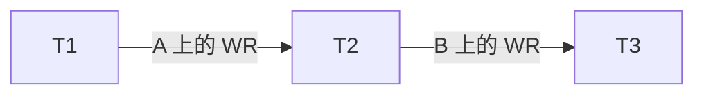
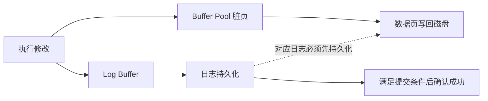

# B6-Database-Transactions：数据库事务机制、并发控制与故障恢复

> 课程：SE3353（CHP-fa26）。依据本目录 40 页 HTML 主课件、70 页 `slides06.pptx` 和 142 页 `slides07.pptx` 整理。以数据库内核原理为主，涉及具体产品时主要使用 MySQL 8.4 / InnoDB 的语义，并用官方文档核对易混概念（2026-11-04）。文中的 SQL 与推演案例用于学习，未实际连接数据库执行。

## 1. 本讲主线与材料索引

本讲回答两个问题：**多个事务同时读写时，怎样保证结果正确？内存丢失或事务失败后，怎样恢复正确的数据？**

| 主线 | 关键问题 | 核心机制 |
| --- | --- | --- |
| 事务边界与 ACID | 哪些修改必须作为一个整体生效？ | `BEGIN`、`COMMIT`、`ROLLBACK`、完整性约束 |
| 并发控制 | 哪些交错执行等价于串行执行？ | 冲突可串行化、优先图、2PL、隔离级别 |
| 多版本读取 | 读事务应该看到哪个版本？ | MVCC、Undo 版本链、ReadView |
| 崩溃恢复 | 哪些修改要重做，哪些要撤销？ | WAL、Undo / Redo、Checkpoint、ARIES |
| 备份与容灾 | 数据文件或整台机器不可用怎么办？ | 备份、时间点恢复、复制、故障切换 |

### 1.1 课件阅读路线

| 材料 | 页码 | 阅读重点 |
| --- | --- | --- |
| [HTML 主课件](B6-Database%20Transactions/1.html) | 1～8 | 本讲定位、事务定义、ACID 与实现机制 |
| HTML 主课件 | 9～15 | 调度、冲突、优先图、视图可串行化、可恢复性 |
| HTML 主课件 | 16～24 | 并发异常、隔离级别、锁、2PL 与死锁 |
| HTML 主课件 | 25～29 | InnoDB MVCC、隐藏列、ReadView、两种读模式 |
| HTML 主课件 | 30～36 | Buffer Pool、STEAL / FORCE、WAL、日志与 CLR |
| HTML 主课件 | 37～40 | 检查点、ARIES 数据结构与恢复流程 |
| [事务管理补充 PPT](slides06.pptx) | 3～18、20～55、57～70 | ACID、可串行化推导、可恢复调度、隔离级别 |
| [故障恢复补充 PPT](slides07.pptx) | 4～37、38～67 | 故障分类、日志、四类恢复方法与检查点 |
| 故障恢复补充 PPT | 69～103、104～123 | ARIES 原理、日志表推演与增量检查点 |
| 故障恢复补充 PPT | 125～142 | 备份、时间点恢复、闪回、多机容灾 |

`slides07.pptx` 的“第 7 章”是补充教材中的故障恢复章节，**不是** HTML 末页预告的下一讲“分布式事务”。本目录没有配套可运行的数据库工程；Spring / JTA、2PC、Saga 等不在本笔记的主体范围内。

与前几讲的联系：B2 的 Java 锁主要协调同一进程中的线程；数据库事务可以协调多个应用实例对同一数据库的并发访问。B5 的数据库与消息双写问题则超出了单个本地数据库事务的边界。

## 2. 事务边界与 ACID

### 2.1 事务是一个逻辑工作单元

事务（Transaction）由一条或多条数据库操作组成。应用声明边界，数据库负责在相应隔离与持久化配置下处理并发和失败。

```sql
START TRANSACTION;

UPDATE account SET balance = balance - 100.00 WHERE id = 1;
UPDATE account SET balance = balance + 100.00 WHERE id = 2;

COMMIT;
-- 若业务检查或执行失败，应走 ROLLBACK 分支。
```

这只是事务边界示意，还没有检查账户是否存在、余额是否充足、请求是否重复等业务条件。**把错误的业务逻辑放进事务，仍然会原子地提交错误结果。**

| 操作 | 含义 | 注意点 |
| --- | --- | --- |
| `START TRANSACTION` / `BEGIN` | 显式开始事务 | 具体语法依数据库而异 |
| `COMMIT` | 提交事务 | 持久化保障取决于数据库配置与存储条件 |
| `ROLLBACK` | 撤销当前事务尚未提交的修改 | 不能用来撤销已经提交的业务操作 |
| `SAVEPOINT` | 设置事务内的回滚位置 | 回滚到保存点不等于结束整个事务 |
| Autocommit | 自动把单条语句作为事务提交 | 两条独立自动提交的 `UPDATE` 不构成一次原子转账 |

事务应覆盖“读取决策依据、验证条件、修改数据”的完整过程；多条语句还必须通过正确的连接与事务上下文执行。

### 2.2 ACID 的准确含义

| 特性 | 含义 | 转账例子 | 常见支撑机制 |
| --- | --- | --- | --- |
| Atomicity，原子性 | 事务的数据库修改整体提交，或撤销其影响 | 扣款与入账一起成功或一起回滚 | Undo、回滚、恢复协议 |
| Consistency，一致性 | 正确事务把满足约束的状态转移到仍满足约束的状态 | 金额守恒、余额满足业务规则 | 数据库约束、正确业务逻辑、合适隔离 |
| Isolation，隔离性 | 限制并发事务之间允许出现的相互影响 | 不读取中间扣款状态，不因竞态破坏规则 | 锁、MVCC、冲突检测等 |
| Durability，持久性 | 已确认提交的修改在约定的故障模型内能够恢复 | 重启后仍能查到已提交转账 | 持久日志、WAL、必要的复制与备份 |

需要区分三个边界：

- 原子性不要求事务在 CPU 上一次执行完，也不要求所有数据页同时落盘。
- 可串行化是隔离性的强保证；RC、RR 等较弱隔离级别允许部分并发异常。
- 本地事务不会自动撤销已发送的邮件、外部支付请求或其他数据库的修改。

“Undo 支撑 A，Redo 支撑 D，锁与 MVCC 支撑 I”适合记忆，但不是所有数据库都使用同一套物理实现。尤其不能把 InnoDB 的 Undo 链直接套用到 PostgreSQL 等其他引擎。

### 2.3 一致性需要业务约束参与

转账前后要求：

```text
balance(A) + balance(B) = 常量
balance(A) >= 0                 // 假设业务禁止透支
每个业务请求最多执行一次          // 若接口要求幂等
```

主键、唯一约束、外键和 `CHECK` 能维护一部分规则，跨行、跨表和跨系统规则仍需要应用设计。例如，防止重复请求应有唯一业务流水号及相应处理逻辑。

遇到 SQL 错误时，要确认回滚范围。InnoDB 的重复键等错误可能只撤销当前语句，死锁通常撤销整个事务；不能一律假设“抛异常就已经全部回滚”。[MySQL：错误处理](https://dev.mysql.com/doc/refman/8.4/en/innodb-error-handling.html)

## 3. 事务调度与冲突可串行化

### 3.1 调度的表示法

调度（Schedule）是多个事务操作的执行序列，必须保留**每个事务内部原有的操作顺序**。

| 记号 | 含义 |
| --- | --- |
| `r_i(X)` | 事务 `Ti` 读取数据项 `X` |
| `w_i(X)` | 事务 `Ti` 写入数据项 `X` |
| `c_i` | `Ti` 提交 |
| `a_i` | `Ti` 中止 |

串行调度中，一个事务结束后才执行下一个。可串行化调度可以交错执行，但其读写效果应等价于某个串行顺序。串行化顺序不一定等于事务开始顺序。

只看某组初始值下的最终余额碰巧相同，不能证明可串行化；还要考虑事务读到了什么、读写依赖以及采用的等价定义。课件中的“终态等价”是理解入口，后续重点是可严格判定的冲突等价与视图等价。

### 3.2 冲突操作的三个条件

两个操作冲突，当且仅当它们：

1. 属于不同事务。
2. 操作同一个数据项。
3. 至少一个是写操作。

| 顺序 | 是否冲突 | 顺序为什么重要 |
| --- | --- | --- |
| `r1(X), r2(X)` | 否 | 都不修改 `X` |
| `r1(X), w2(X)` | 是，RW | 交换后 `T1` 可能读到不同版本 |
| `w1(X), r2(X)` | 是，WR | 决定 `T2` 读取哪个写入结果 |
| `w1(X), w2(X)` | 是，WW | 决定最后由谁写入 |
| `w1(X), w2(Y)`，`X ≠ Y` | 否 | 在此数据项模型中互不影响 |

**冲突不等于异常。** `w1(X), c1, r2(X)` 仍有 WR 冲突，但 `T2` 读的是已提交数据，没有脏读。冲突描述顺序约束，异常还取决于提交时机、读取版本和业务依赖。

### 3.3 等价交换

交换相邻、不同事务、互不冲突的操作，可以保持冲突等价。若能通过这类交换把调度变成串行调度，就证明它是冲突可串行化的。

```text
S  = r1(A), w1(A), r2(A), r1(B), w1(B), w2(A)
S' = r1(A), w1(A), r1(B), r2(A), w1(B), w2(A)
S''= r1(A), w1(A), r1(B), w1(B), r2(A), w2(A)
```

先交换 `r2(A)` 与 `r1(B)`，再交换 `r2(A)` 与 `w1(B)`，得到 `T1 → T2`。所有原有操作均保留；这是忽略提交操作、只分析冲突可串行性的例子。

### 3.4 优先图：判断题的标准方法

构建优先图（Precedence Graph）：每个事务是一个顶点；若 `Ti` 的操作先于 `Tj` 的冲突操作，就加边 `Ti → Tj`。

> **调度冲突可串行化，当且仅当优先图无环。** 无环图的任一拓扑序都是可行的等价串行顺序。

例一：

```text
S1 = r1(A), w1(A), r2(A), r2(B), w2(B), r3(B)
```

| 数据项 | 关键冲突 | 产生的边 |
| --- | --- | --- |
| A | `w1(A)` 在 `r2(A)` 前 | `T1 → T2` |
| B | `w2(B)` 在 `r3(B)` 前 | `T2 → T3` |



图无环，等价串行顺序为 `T1 → T2 → T3`。

例二：`S2 = r1(A), r2(B), w1(B), w2(A)`。由 A 得到 `T1 → T2`，由 B 得到 `T2 → T1`，存在环，因此**不是冲突可串行化调度**。

做题时要检查所有跨事务冲突，而不只看相邻操作。图建好后的拓扑检查是 `O(V + E)`；构建图的成本另算。优先图有环也不能直接断言“发生了死锁”，死锁要看后面的等待图。

## 4. 视图可串行化与可恢复调度

### 4.1 视图等价的三个条件

两个调度包含相同事务及操作，并对每个数据项满足：

| 条件 | 要保持什么 |
| --- | --- |
| 初始读一致 | 在一个调度读初值的操作，在另一个调度仍读初值 |
| 读来源一致 | 每个读操作仍读取同一个写操作产生的值 |
| 最终写一致 | 最后写该数据项的事务相同 |

与某个串行调度视图等价，称为**视图可串行化**。

```text
串行调度 ⊆ 冲突可串行化调度 ⊆ 视图可串行化调度
```

典型例子：

```text
S = r1(A), w2(A), w1(A), w3(A)
```

`r1(A)` 与 `w2(A)` 产生 `T1 → T2`，`w2(A)` 与 `w1(A)` 产生 `T2 → T1`，所以不是冲突可串行化。但它与 `T1 → T2 → T3` 视图等价：唯一的读都读初值，最后写 A 的都是 `T3`。

这里 `T2`、`T3` 对 A 的写是**盲写**：没有事先读取 A。`T1` 先读后写，因此 `w1(A)` 不能称为盲写，尽管它的结果后来被覆盖。

补充 PPT 第 43～49 页给出带标记图的验证思路：若 `Ti` 读自 `Tj`，另一个写者 `Tk` 必须放在 `Tj` 前或 `Ti` 后，不能插到两者之间。对这些二选一约束枚举，寻找无环解。一般视图可串行化判定是 NP 完全问题，不宜把它当成简单的普通优先图检查。

### 4.2 可恢复性关心提交依赖

可串行化讨论并发执行效果，可恢复性讨论失败后能否正确处理事务之间的依赖。

| 调度性质 | 约束 | 解决什么问题 |
| --- | --- | --- |
| Recoverable，可恢复 | 若 `Tj` 读到 `Ti` 的写入，且 `Tj` 要提交，则 `Ti` 必须先提交 | 避免依赖未提交事务的结果先被永久提交 |
| Cascadeless，无级联 | `Tj` 读取 `Ti` 的写入前，`Ti` 已提交 | 不形成脏读依赖，避免读依赖导致的级联回滚 |
| Strict，严格 | `Ti` 写 X 后，在 `Ti` 提交或中止前，其他事务不能读写这个未提交的 X | 同时避免脏读与脏写，简化恢复 |

在经典单版本调度模型中：

```text
严格调度 ⊆ 无级联调度 ⊆ 可恢复调度
```

三个序列分别说明区别：

```text
w1(A), r2(A), c2, a1       // 不可恢复：T2 已提交，但它依赖的 T1 回滚
w1(A), r2(A), c1, c2       // 可恢复，但读时 T1 未提交，并非无级联
w1(A), c1, r2(A), c2       // 无级联：读时来源已提交
```

**严格调度与 Strict 2PL 不是同一个定义。** 严格性本身不保证冲突可串行化。例如 `r1(X), r2(X), w1(X), c1, w2(X), c2` 没有读写未提交的写入，但优先图有环。Strict 2PL 还要求两阶段加解锁规则，才能同时获得相应的串行化保证。

## 5. 并发异常与四种隔离级别

### 5.1 常见异常

| 异常 | 核心现象 | 示例 |
| --- | --- | --- |
| 脏读 Dirty Read | 读到其他事务未提交的修改 | `T1` 改余额后未提交，`T2` 读到了它 |
| 脏写 Dirty Write | 覆盖其他事务尚未提交的写入 | `T1` 未结束，`T2` 已覆盖同一数据项 |
| 不可重复读 Non-repeatable Read | 再读同一数据时，发现其他事务已提交的修改 | 第一次余额 100，第二次 200 |
| 幻读 Phantom Read | 重复谓词查询时，符合条件的行集合改变 | `age > 20` 的查询新增或减少匹配行 |
| 丢失更新 Lost Update | 基于旧值计算的新值覆盖了别人的更新 | 两人都读 100，分别写 150、200，结果不是 250 |
| 写偏差 Write Skew | 各事务写不同记录，却共同破坏跨记录约束 | 两位值班医生各自认为另一人在岗，同时退出值班 |

幻读关注**谓词结果集合**，不只由 `INSERT` 引发；`DELETE` 或让某行进入、离开查询范围的 `UPDATE` 也可能改变集合。

丢失更新可以发生在前一个写事务已经提交之后，因此不等于脏写。数据库写锁会串行化写入，但不能自动修正应用提前计算出来的过期常量。

### 5.2 SQL 隔离级别的经典对照表

| 隔离级别 | 脏读 | 不可重复读 | 幻读 | 是否保证可串行化 |
| --- | --- | --- | --- | --- |
| Read Uncommitted，RU | 允许 | 允许 | 允许 | 否 |
| Read Committed，RC | 禁止 | 允许 | 允许 | 否 |
| Repeatable Read，RR | 禁止 | 禁止 | 标准允许 | 否 |
| Serializable | 禁止 | 禁止 | 禁止 | 是 |

“允许”表示该级别不要求禁止，具体数据库可以提供更强保证。标准描述的是可观察行为，不要求每个级别都使用某一种锁或某一种快照实现。

产品差异示例：InnoDB 默认 RR；PostgreSQL 默认 RC，其 RU 按 RC 实现，RR 不发生幻读，但仍可能出现序列化异常。PostgreSQL 的 Serializable 使用 SSI，在快照基础上检测危险依赖并可能中止事务，因此可串行化不等于“所有事务排队逐个运行”。[MySQL：隔离级别](https://dev.mysql.com/doc/refman/8.4/en/innodb-transaction-isolation-levels.html)；[PostgreSQL：事务隔离](https://www.postgresql.org/docs/current/transaction-iso.html)

### 5.3 快照隔离为什么还可能出错

假设规则是“至少一名医生值班”，初始 A、B 都在岗：

| 时刻 | T1 | T2 |
| --- | --- | --- |
| 1 | 从快照读到 A、B 都在岗 | |
| 2 | | 从快照读到 A、B 都在岗 |
| 3 | 判断 B 在岗，将 A 改为离岗 | |
| 4 | | 判断 A 在岗，将 B 改为离岗 |
| 5 | 提交 | 提交 |

在允许此执行的快照隔离模型中，双方写的是不同记录，同一行上的写冲突检测拦不住它；最终无人值班，任何串行执行都不会得到该结果。

因此，**MVCC 是实现技术，快照隔离是隔离语义，可串行化是更强的正确性要求**。解决跨行约束可使用 Serializable，或让所有相关事务遵循同一个覆盖约束范围的锁协议，例如先锁共同的“值班组”记录再检查。只锁各自要修改的行通常不够。

## 6. 锁机制：记录、表与索引范围

### 6.1 S / X 锁

| 已持有锁 \ 其他事务申请锁 | S，共享锁 | X，排他锁 |
| --- | --- | --- |
| S | 兼容 | 冲突 |
| X | 冲突 | 冲突 |

S 锁允许多个加锁读取者共存；X 锁保护修改，排斥其他事务对同一对象申请 S / X 锁。这个兼容矩阵描述的是**需要申请锁的操作**，不能据此断言普通 MVCC 快照读也一定等待 X 锁。

```sql
START TRANSACTION;
SELECT balance FROM account WHERE id = 1 FOR UPDATE;
-- 在同一事务中完成校验与修改。
COMMIT;
```

`FOR SHARE` 用于共享锁读取，`FOR UPDATE` 用于排他锁读取。应将锁定读取和后续操作放进显式事务；InnoDB 的一致性读仍可读取适合其快照的旧版本。[MySQL：锁定读取](https://dev.mysql.com/doc/refman/8.4/en/innodb-locking-reads.html)

### 6.2 意向锁与多粒度封锁

表锁管理成本较低，但覆盖面大；记录锁可以缩小冲突范围，却需要更多锁管理。粒度不是死锁是否存在的充分判据，多个表锁同样可能形成循环等待。

意向锁用于协调表级锁与记录级锁：

- `IS`：事务要在表内某些记录上取得共享锁。
- `IX`：事务要在表内某些记录上取得排他锁。

表级兼容矩阵：

| 请求锁 \ 已持锁 | IS | IX | S | X |
| --- | --- | --- | --- | --- |
| IS | ✓ | ✓ | ✓ | × |
| IX | ✓ | ✓ | × | × |
| S | ✓ | × | ✓ | × |
| X | × | × | × | × |

两个事务可以同时持有同一张表的 IX，再分别修改不同记录。IX 不表示整张表已被排他锁住；它使表级锁申请者不必逐条检查所有记录锁。

### 6.3 InnoDB 的三类索引锁

| 锁类型 | 锁定对象 | 作用 |
| --- | --- | --- |
| Record Lock | 某条索引记录 | 保护已有记录 |
| Gap Lock | 两条记录间、首条前或末条后的间隙 | 阻止向该间隙插入 |
| Next-Key Lock | 索引记录及其前面的间隙 | 同时保护记录与范围 |

假设索引键为 `10, 20, 30`，对应的典型 Next-Key 区间为：

```text
(-∞, 10]    (10, 20]    (20, 30]    (30, +∞)
```

锁住 `(10, 20]` 表示既保护记录 20，也阻止其他事务在 `(10, 20)` 插入。纯间隙锁不保护端点记录；InnoDB 的纯 Gap Lock 之间可以共存，不能直接套用普通记录 S / X 锁的互斥规则。[MySQL：InnoDB 锁](https://dev.mysql.com/doc/refman/8.4/en/innodb-locking.html)

### 6.4 SQL 条件不一定等于锁范围

理解 InnoDB 加锁时，依次检查隔离级别、索引、执行计划、唯一性及条件范围：

- RR 下，通过唯一索引的完整唯一条件找到已有行，通常只需记录锁。
- 范围查询、非唯一条件或查找不存在的键，可能需要间隙锁或 Next-Key Lock。
- RC 下，搜索与索引扫描通常不使用间隙锁，但外键和重复键检查有例外。
- 缺少合适索引可能扫描并锁住大量记录。即使没有用户定义索引，InnoDB 仍有聚簇索引可加记录锁；不能把这种现象概括成“行锁自动升级为表锁”。

实际锁范围可能超出 SQL 结果集，不能只按 `WHERE` 的数学区间猜测。应结合执行计划与锁观测确认边界。[MySQL：隔离级别下的锁策略](https://dev.mysql.com/doc/refman/8.4/en/innodb-transaction-isolation-levels.html)

## 7. 两阶段锁与死锁

### 7.1 2PL 的两个阶段

两阶段锁（Two-Phase Locking，2PL）要求：

| 阶段 | 可以做什么 | 不可以做什么 |
| --- | --- | --- |
| 增长阶段 Growing | 获取锁，按规则升级锁 | 释放锁 |
| 收缩阶段 Shrinking | 释放锁，按规则降级锁 | 再获取新锁 |

核心规则是：**释放第一把锁之后，不再获取新锁。** 获取最后一把锁的时刻称为锁点（Lock Point）。在经典读写加锁模型中，各事务均遵循 2PL，可按锁点排序得到等价串行顺序。

| 协议 | 额外要求 | 主要保证 |
| --- | --- | --- |
| Basic 2PL | 只有增长、收缩两阶段 | 冲突可串行化；仍可能级联回滚 |
| Strict 2PL | 在 2PL 上，将 X 锁持有到事务结束 | 冲突可串行化及严格调度 |
| Rigorous 2PL | 将 S、X 锁都持有到事务结束 | 更强的锁持有约束，可按提交顺序串行化 |

不同教材对 Strict / Rigorous 的命名可能合并，答题时先明确本题定义。仅说“写锁持有到提交”不够证明所有操作遵循 2PL；尤其 InnoDB 的普通快照读不能直接按单版本 S 锁读取处理。

2PL 与分布式提交协议 2PC 是两回事：前者控制并发访问顺序，后者协调多个参与者的提交决定。

### 7.2 优先图与等待图不能混淆

| 图 | `T1 → T2` 的含义 | 有环说明什么 |
| --- | --- | --- |
| 优先图 | `T1` 的冲突操作先于 `T2` | 该调度不是冲突可串行化 |
| 等待图 Waits-for Graph | `T1` 等待 `T2` 释放锁 | 在通常的事务锁等待模型中存在死锁 |

```text
T1：持有 X(A)，申请 X(B)
T2：持有 X(B)，申请 X(A)
```

双方都还在 2PL 增长阶段，却形成循环等待。因此 **2PL，包括 Strict 2PL，都不能保证无死锁**。

数据库可以检测等待环，选择事务作为牺牲者回滚；也可以用超时避免无限等待。超时可能只是等待太久，不必然证明存在死锁。

### 7.3 应用怎样处理

固定访问顺序、缩短事务、减少扫描范围，可以降低锁竞争。事务中应避免等待用户输入或执行耗时网络调用。需要重试时，从有效的事务边界重新读取并计算，配合有限次数、退避与业务幂等。

InnoDB 的两种失败要分别处理：死锁会回滚整个事务；锁等待超时默认只回滚当前语句，开启 `innodb_rollback_on_timeout` 才改变该范围。业务要求整组操作一起失败时，应用应明确结束并回滚当前事务。[MySQL：错误处理与重试](https://dev.mysql.com/doc/refman/8.4/en/innodb-error-handling.html)

## 8. InnoDB MVCC 与 ReadView

### 8.1 多版本解决什么问题

多版本并发控制（Multi-Version Concurrency Control，MVCC）保留可重建的历史版本，让读取者根据快照选择数据，而不必等待当前写事务释放记录锁。

```text
最新记录：balance=500，trx_id=210
    ↓ Undo 信息重建
历史版本：balance=400，trx_id=150
    ↓
历史版本：balance=300，trx_id=120
    ↓
更早版本：balance=200，trx_id=60
```

上述是逻辑示意。Undo 通常保存重建所需的信息，不意味着每次都完整复制整行，更不意味着复制整页。

“读不阻塞写，写不阻塞读”主要描述一致性快照读与记录写锁之间的关系。写写冲突、显式锁定读、元数据锁以及内部页访问同步依然存在，MVCC 不等于数据库完全无锁。

### 8.2 隐藏字段与 Undo 的生命周期

| 字段 | InnoDB 中的作用 |
| --- | --- |
| `DB_TRX_ID`，6 字节 | 最近插入或更新聚簇索引记录的事务 ID；删除标记也属于修改 |
| `DB_ROLL_PTR`，7 字节 | 指向 Undo 记录，用于重建旧版本 |
| `DB_ROW_ID`，6 字节 | 没有合适主键或非空唯一索引时，供隐藏聚簇索引使用 |

Undo 同时服务于两个目标：事务失败时撤销修改，快照读时重建历史版本。Insert Undo 提交后即可具备回收条件；Update Undo 还要等待相关快照不再需要它，之后由 Purge 清理。长时间持有快照会延迟历史版本回收。[MySQL：多版本机制](https://dev.mysql.com/doc/refman/8.4/en/innodb-multi-versioning.html)

这里的版本链属于**一条记录的历史**，不能与 ARIES 中按 `PrevLSN` 串联的**一个事务的日志链**混为一谈。

### 8.3 ReadView 可见性规则

沿用课件的教学字段名，ReadView 可以抽象为：

| 字段 | 含义 |
| --- | --- |
| `m_ids` | 创建视图时活跃的读写事务 ID 集合，自身改动单独处理 |
| `min_trx_id` | 活跃 ID 的下界；集合为空时可按上界理解 |
| `max_trx_id` | 创建视图时尚未分配的事务 ID 上界，不是活跃集合的最大值 |
| `creator_trx_id` | 创建视图的事务自身 ID |

对某个候选版本的 `trx_id`，按以下顺序判断：

```text
if trx_id == creator_trx_id:
    可见                          // 自身此前的修改
else if trx_id < min_trx_id:
    可见                          // 早于活跃下界
else if trx_id >= max_trx_id:
    不可见                        // 创建视图时尚未分配的 ID
else if trx_id in m_ids:
    不可见                        // 创建视图时仍活跃
else:
    可见                          // 处于中间区间且已完成
```

从最新版本开始检查，不可见就沿 Undo 信息向前重建，直到找到可见版本。若可见状态表示该行尚未存在或已删除，查询不返回该行。

事务 ID 是引擎分配的标识，不能简单等同于墙上时钟或 `BEGIN` 的时间；只读事务的 ID 分配还有优化。上面的名称与算法用于掌握可见性逻辑，不作为某一版本源码结构的逐字定义。

### 8.4 判断例题

假设视图为 `m_ids={100,150}`、`min_trx_id=100`、`max_trx_id=200`，读事务自身为 180。

| 版本所属事务 | 判断 | 结论 |
| --- | --- | --- |
| 210 | `210 >= 200` | 不可见 |
| 150 | 在创建视图时的活跃集合中 | 不可见 |
| 120 | 在 `[100,200)` 中且不在活跃集合 | 可见 |
| 60 | `60 < 100` | 可见 |
| 180 | 属于当前事务自身 | 自身改动可见 |

对前面的 `210 → 150 → 120 → 60` 版本链，首次找到的可见版本是 120，因此读取 `balance=300`。后来事务 150 提交，也不会改变这份既有 ReadView 的活跃集合。

### 8.5 RC 与 RR：快照何时建立

| InnoDB 隔离级别 | 一致性读的快照策略 | 其他事务在两次查询之间提交后 |
| --- | --- | --- |
| RC | 每次一致性读使用新快照 | 后一次查询可以看到新提交版本 |
| RR | 通常由首次一致性读建立，后续复用 | 后一次一致性读继续使用旧快照 |

RR 的普通 `BEGIN` 不意味着立即建立 ReadView，应区分“事务开始”和“首次一致性读”。`START TRANSACTION WITH CONSISTENT SNAPSHOT` 是显式建立一致性快照的另一种用法，需要与适用隔离级别一起理解。

稳定快照也不表示“事务内永远只能看到开始时的数据”：**自身此前的修改可见**。在 RR 中混用普通查询和锁定操作，可能同时观察到快照中的旧状态与当前写入产生的新状态。[MySQL：一致性非锁定读](https://dev.mysql.com/doc/refman/8.4/en/innodb-consistent-read.html)

### 8.6 快照读与当前读

| 维度 | 一致性快照读 | 通常所说的当前读 / 锁定访问 |
| --- | --- | --- |
| 典型操作 | RC / RR 下的普通 `SELECT` | `SELECT ... FOR SHARE/FOR UPDATE`、更新与删除的相关访问 |
| 版本依据 | ReadView 和自身改动 | 当前可加锁、可修改的记录状态，必要时等待冲突事务 |
| 历史版本 | 可以通过 Undo 重建 | 不按旧快照锁住一个历史版本 |
| RR 下防止新增行干扰的方式 | 新版本对原快照不可见 | 适用时锁住索引范围，阻止其他事务插入 |

例子：T1 先做快照查询，T2 插入并提交，T1 再做锁定查询或更新时可能接触到该新行；如果 T1 修改了它，后续快照查询也能看到自己的改动。这不能用“RR 的所有语句都在同一个冻结数据库上运行”解释。

需要维护约束时，应从**第一次读取决策依据**开始设计锁或隔离策略，不能在已经基于旧快照作出决定后，才假设一次加锁能够补救之前的竞态。

## 9. SQL 实践：避免丢失更新并观察隔离效果

### 9.1 三种更新方式

以下是教学片段，`:n`、`:sku` 等表示应用绑定的参数。

**方式一：在一条 SQL 内完成条件判断与增量更新。**

```sql
UPDATE inventory
SET stock = stock - :n
WHERE sku = :sku AND stock >= :n;
```

应用先验证 `n > 0`，然后检查受影响行数。返回 0 可能表示商品不存在或库存不足，不应当作扣减成功。若还要写订单，应把扣库存与订单写入放进同一事务，并处理后续失败。

**方式二：先锁定，再读取与修改。**

```text
开始事务
按统一顺序对需要的账户执行 SELECT ... FOR UPDATE
检查账户存在、金额合法、余额充足
扣款并入账，验证写入结果
全部成功 → COMMIT
任一步失败 → ROLLBACK
```

**方式三：用版本号检测旧值覆盖。**

```sql
UPDATE account
SET balance = :new_balance,
    version = version + 1
WHERE id = :id AND version = :old_version;
```

若受影响行数为 0，要重新读取并重新判断业务条件；不能只重复提交同一旧结果。参与更新的其他代码也必须维护版本号，否则协议会被绕过。

### 9.2 双会话观察 RC 与 RR

下面实验应在独立练习数据库内操作。准备数据后，再打开两个数据库会话：

```sql
CREATE TABLE account_demo (
    id INT PRIMARY KEY,
    balance DECIMAL(12, 2) NOT NULL
) ENGINE = InnoDB;

INSERT INTO account_demo VALUES (1, 100.00), (2, 100.00);
```

按表格逐步执行，不要把两列一次性运行：

| 步骤 | 会话 A | 会话 B |
| --- | --- | --- |
| 1 | `SET TRANSACTION ISOLATION LEVEL READ COMMITTED;` | |
| 2 | `START TRANSACTION;` | |
| 3 | `SELECT balance FROM account_demo WHERE id=1;` → 100 | |
| 4 | | `START TRANSACTION;` |
| 5 | | `UPDATE account_demo SET balance=200 WHERE id=1;` |
| 6 | | `COMMIT;` |
| 7 | 再执行相同 `SELECT` → 200 | |
| 8 | `COMMIT;` | |

所有事务结束后，将余额重新设为 100 并提交；把步骤 1 改为 `REPEATABLE READ` 后重做，步骤 7 的普通一致性读应仍返回 100。步骤 3 才是本例 RR 快照建立的关键时刻。

### 9.3 观察写锁等待

| 步骤 | 会话 A | 会话 B |
| --- | --- | --- |
| 1 | `START TRANSACTION;` | |
| 2 | `SELECT * FROM account_demo WHERE id=1 FOR UPDATE;` | |
| 3 | | `START TRANSACTION;` |
| 4 | | `UPDATE account_demo SET balance=balance+10 WHERE id=1;` → 等待 |
| 5 | `COMMIT;` | |
| 6 | | 更新返回后执行 `COMMIT;` |

步骤 4 应在超时前释放 A 的锁。这个例子只有单向等待，不是死锁。若 B 在 RC / RR 下改为普通一致性查询，通常仍可读取适合其快照的版本。

## 10. Buffer Pool 与 STEAL / FORCE

### 10.1 脏页与未提交数据不同

数据库通常先在 Buffer Pool 中访问数据页。页面修改后，若尚未写回数据文件，就称为**脏页（Dirty Page）**。

| 概念 | 描述的维度 |
| --- | --- |
| 脏页 | 内存页与磁盘页是否一致 |
| 未提交修改 | 事务是否已经提交 |
| 脏读 | 是否读取了其他事务未提交的修改 |

已提交事务也可能留下脏页；未提交事务的修改也可能已经写进数据文件。一个物理页还可能包含多个事务修改的不同记录。

InnoDB 常见默认页大小是 16 KiB，但页大小不是所有数据库的固定常量。刷脏可能由缓存淘汰、后台清理、检查点推进和关闭流程等触发。

### 10.2 两个独立的策略维度

- **STEAL**：允许含有未提交修改的页面写回磁盘，以便复用缓冲空间。
- **NO-STEAL**：禁止未提交修改进入持久数据库页。
- **FORCE**：事务提交时要求其修改的数据页落盘。
- **NO-FORCE**：事务提交时不强制所有修改页落盘。

在课件采用的经典原地更新、单机崩溃恢复模型中：

| 缓冲策略 | FORCE | NO-FORCE |
| --- | --- | --- |
| NO-STEAL | 崩溃恢复无需 Undo / Redo | 需要 Redo，不需要为磁盘未提交修改做 Undo |
| STEAL | 需要 Undo，不需要为已提交修改做 Redo | 同时需要 Undo 与 Redo |

推导只需记住：

```text
STEAL    → 未提交修改可能已在磁盘上 → 要能撤销
NO-FORCE → 已提交修改可能只在内存中 → 要能重做
```

“无需 Undo”限定于上述崩溃恢复问题，不表示运行时回滚、历史版本管理或提交原子性不需要任何机制。其他多版本存储设计也可能通过事务状态与可见性处理失败修改，不能由这张矩阵断言所有产品都有独立 Undo 文件。

### 10.3 四类恢复方案

| 方案 | 主要思路 | 主要代价 |
| --- | --- | --- |
| 影子分页 Shadow Paging | 保留旧页映射，在新副本修改；提交前持久化新页及映射，再原子切换根指针 | 页复制、碎片、映射维护与并发管理 |
| Undo-only | 旧值先有日志保护，提交前强制相关数据落盘；崩溃后撤销未完成事务 | 提交路径的数据页 I/O 较重 |
| Redo-only | 未提交修改不进入持久数据库页，提交先持久化日志；崩溃后重做已提交事务 | 缓存空间与大事务管理受限 |
| Undo / Redo | 允许未提交页刷盘，也允许提交后延迟刷页 | 恢复协议和日志管理更复杂 |

Undo 通常按修改的逆序处理，Redo 通常按日志正序处理。例如一个事务把 X 从 `10 → 20 → 30`，撤销应按 `30 → 20 → 10`，否则会留下错误的中间值。

## 11. WAL 与持久化日志

### 11.1 WAL 的两条顺序约束

预写日志（Write-Ahead Logging，WAL）的“先写”主要约束**持久化顺序**，不是要求每次修改内存前都单独执行一次磁盘同步。

1. **数据页落盘前**，保护该页修改所需的日志必须已经持久化。
2. **确认持久提交前**，事务的必要日志与提交记录必须已经持久化。

使用后文的 LSN 记号表示：

```text
允许页面 P 刷盘：pageLSN(P) <= flushedLSN
允许确认持久提交：commitLSN(T) <= flushedLSN
```



图中提交确认和刷数据页之间没有固定先后：STEAL 允许先刷页再提交，NO-FORCE 允许先提交再刷页。两条路径都必须遵守 WAL。

WAL 使提交不必等待全部离散数据页写回，并能通过日志追加、合并刷脏与组提交减少开销。数据页最终仍要写回，不能理解成“从此消除了随机 I/O”。性能收益取决于存储介质、事务大小、冲突和配置，课件中的延迟与倍数不是通用保证。

### 11.2 内存、OS 缓存与稳定存储

```text
数据库 Log Buffer → 操作系统写入路径 / 缓存 → 稳定存储
```

日志写出和日志持久化是不同阶段。操作系统崩溃或掉电是否会丢失已确认事务，取决于数据库是否等待了相应持久化动作，以及设备是否正确实现持久化承诺。

MySQL 8.4 的 `innodb_flush_log_at_trx_commit`：

| 值 | 提交与后台行为 | 主要风险 |
| --- | --- | --- |
| `1`，默认 | 提交要求 Redo 写出并持久化 | 在预期存储与故障模型内提供严格提交持久性 |
| `0` | 日志由后台周期性写出并持久化 | 进程或系统故障可能丢失尚未持久化的已确认事务 |
| `2` | 提交写出日志，后台周期性持久化 | OS 崩溃、掉电等可能丢失尚未持久化部分 |

后台通常按配置周期执行，“约一秒”不是严格的最大丢失窗口；调度可能延迟。组提交可以让多个事务共享持久化动作，不意味着每个提交都必须独占一次 `fsync`。若还启用 Binlog，应同时理解其持久化设置，例如 `sync_binlog`。[MySQL：日志刷盘参数](https://dev.mysql.com/doc/refman/8.4/en/innodb-parameters.html#sysvar_innodb_flush_log_at_trx_commit)

### 11.3 Undo / Redo 与物理 / 逻辑是不同分类

| 分类维度 | 类型 | 说明 |
| --- | --- | --- |
| 功能 | Undo | 保存撤销修改所需的信息 |
| 功能 | Redo | 保存重做修改所需的信息 |
| 表达方式 | Physical，物理日志 | 描述某页某位置的具体变化 |
| 表达方式 | Logical，逻辑日志 | 描述插入、删除、更新等逻辑操作 |
| 表达方式 | Physiological，物理逻辑日志 | 物理定位到页，在页内描述操作 |

例如，`Page 42, Offset 100: 7 → 9` 是物理描述；“删除键为 K 的记录”是逻辑描述；“在 Page 42 的某槽位插入记录”具有物理到页、页内逻辑的特点。

不要把“物理日志一定可逆、逻辑日志一定不可重做”等表格化概括当成绝对定理。记录是否包含旧值、目标位置是否变化、是否检测重复应用，都会影响恢复行为。`x = x + 1` 裸执行两次不幂等，而用 `pageLSN` 识别已应用记录，可以让整个重放协议避免重复效果。

### 11.4 InnoDB Redo 与 MySQL Binlog

| 日志 | 所处层次与主要用途 |
| --- | --- |
| InnoDB Undo | 引擎内部的回滚与历史版本重建 |
| InnoDB Redo | 引擎内部的持久化与崩溃恢复 |
| MySQL Binlog | Server 层记录变更事件，支持复制及基于备份的时间点恢复 |

Redo 不是 SQL 文本历史，Binlog 也不能一律理解成只记录 SQL。它们用途不同，不能相互替代。

InnoDB 的 Mini-Transaction（MTR）组织底层页修改与 Redo 记录组；一次业务事务可以包含多个 MTR。**MTR 完成不等于业务事务 COMMIT。**

课件中的 `ib_logfile0`、`ib_logfile1` 是旧版文件布局示意。MySQL 8.4 文档使用 `#innodb_redo` 下的 `#ib_redoN` 文件与 `innodb_redo_log_capacity` 管理容量，应按版本理解。空间能够复用的前提是恢复不再需要相应日志。[MySQL：Redo Log](https://dev.mysql.com/doc/refman/8.4/en/innodb-redo-log.html)

## 12. 检查点与恢复边界

### 12.1 检查点解决什么问题

检查点（Checkpoint）保存恢复所需的进度或状态，使系统不必每次从日志最早端开始重建。其目标是缩短恢复扫描范围，并为安全回收日志提供依据。

| 方式 | 主要做法 | 代价与边界 |
| --- | --- | --- |
| 静态 / 阻塞式检查点 | 暂停相关更新，按方案刷新脏页并记录恢复位置 | 容易理解，但集中 I/O 和暂停影响业务 |
| ARIES 模糊检查点 | 允许事务继续运行，记录事务表、脏页表及检查点边界 | 不要求在检查点时把所有脏页写回 |
| 增量推进 | 后台逐步刷脏并推进安全恢复边界 | 平滑 I/O；具体元数据依引擎实现 |

模糊检查点与增量刷脏可以配合使用。它们不是两个绝对互斥的产品类别。

### 12.2 模糊检查点不代表此前修改全部落盘

ARIES 通常写入 `BEGIN_CHECKPOINT` 与包含 ATT / DPT 信息的检查点记录，在检查点可靠完成后更新 Master Record，使恢复程序找到有效检查点。

三个位置应分开理解：

- **Analysis 起点**：从有效检查点开始重建恢复状态。
- **Redo 起点**：由 DPT 中最小 `recLSN` 决定，可能早于检查点。
- **Undo 所需范围**：由未完成事务的日志链决定，也可能延伸到检查点之前。

所以“检查点之前的日志都能删除”是错误的。除恢复需求外，归档、备份及复制也可能要求继续保留日志。`flushedLSN` 只表示日志刷盘进度，不能当作数据页刷盘进度或直接当作日志截断位置。

## 13. ARIES：分析、重做、撤销

ARIES 全称是 **Algorithms for Recovery and Isolation Exploiting Semantics**。本节讲解经典 ARIES 模型；它适合解释 STEAL / NO-FORCE 下的恢复，但不表示 InnoDB 或所有其他引擎逐项实现同名数据结构与步骤。

### 13.1 LSN 与两个关键表

| 名称 | 含义 | 主要用途 |
| --- | --- | --- |
| `LSN` | 日志记录在全局日志中的有序标识 | 比较日志顺序 |
| `prevLSN` | 同一事务上一条日志记录的位置 | 串联事务日志，逆向回滚 |
| `pageLSN` | 当前页已体现的最近一次修改的 LSN | 判断某条修改是否已应用到该页 |
| `flushedLSN` | 已持久化的连续日志前缀末端 | 检查 WAL 与提交持久化条件 |
| `recLSN` | 页面本轮从干净变脏时的最早修改 LSN | 确定该页最早可能需要重做的位置 |
| `lastLSN` | 某事务最新日志的位置 | 找到该事务日志链的入口 |
| `undoNextLSN` | CLR 指示的下一条待撤销日志位置 | 跳过已经补偿的操作 |
| Master Record | 最近一次有效检查点的位置 | 找到分析起点 |

`pageLSN` 随内存页面修改而更新，页面刷盘时一同持久化；它不是“最后一次执行刷盘的时间”。LSN 也不必是连续整数，例题用整数只是为了方便推演。

**脏页表 DPT（Dirty Page Table）** 保存 `PageID → recLSN`：首次变脏时加入，后续修改通常保留本轮最早的 `recLSN`；页被安全写回且没有后续未持久修改时，才不再需要该脏页项。

**活跃事务表 ATT（Active Transaction Table）** 保存 `TxnID → (Status, lastLSN)`：事务产生日志时更新，完成结束处理后移除。

两表回答不同的问题：DPT 关心**页面是否可能缺修改**，ATT 关心**事务是否完成**。已提交但未刷盘的数据页仍属于 DPT；已提交但尚未写结束记录的事务也可能暂留 ATT。

### 13.2 Analysis：重建恢复状态

从 Master Record 指向的有效检查点开始正向扫描，并合并检查点保存的状态：

1. 更新 ATT 中事务的状态与 `lastLSN`。
2. 遇到更新或 CLR，把可能仍需恢复的页面加入 DPT，保留合适的最早 `recLSN`。
3. 遇到提交记录，标记事务已提交；遇到结束记录，移除对应事务项。
4. 找到仍需回滚的事务集合 Losers，并确定 Redo 扫描起点。

重建 DPT 通常是保守估计：日志未必记录了每次页面刷盘，它可能包含其实已经落盘的页面。后续再用磁盘页的 `pageLSN` 排除不必要的重做。

经典 ARIES 中要区分：`COMMIT` 表示提交决定，`ABORT` 可以表示开始回滚，`END` 才表示结束处理完成。不能看到 `ABORT` 就认为所有撤销都完成，也不能把 ATT 中所有条目都直接当作 Losers。

### 13.3 Redo：重放历史

如果 DPT 非空，从最小 `recLSN` 开始正向扫描。对每条可重做的更新记录或 CLR，设它的 LSN 为 `L`，目标页为 `P`：

```text
if P 不在 DPT:
    跳过
else if L < DPT[P].recLSN:
    跳过
else:
    读取页面 P
    if P.pageLSN >= L:
        跳过
    else:
        应用该日志的重做内容
        P.pageLSN = L
```

重做判定可写为：

```text
需要重做 ⇔ P ∈ DPT 且 L >= recLSN(P) 且 pageLSN(P) < L
```

**边界特别重要：`L == recLSN(P)` 不能跳过，它恰好可能是本轮第一次尚未落盘的修改。** 本地补充 PPT 第 77、78、101 页的相关不等式存在边界问题，本笔记以上述条件为准。[CMU：Database Crash Recovery，Redo Phase](https://15445.courses.cs.cmu.edu/spring2026/notes/23-recovery.pdf)

ARIES 重放历史包含**已提交事务、未提交事务以及已经发生的补偿操作**，不是只重做 Winners。它先恢复日志所描述的页面状态，再在 Undo 阶段撤销 Losers。这里的“历史”限定于持久日志中可恢复的历史，不能找回从未持久化且未留下其他副本的信息。

### 13.4 Undo：沿事务链撤销 Losers

从各 Loser 的 `lastLSN` 出发，通常按待处理 LSN 从大到小推进：

- 遇到可撤销更新，执行撤销，生成 CLR，再沿 `prevLSN` 继续。
- 遇到 CLR，不撤销 CLR，转向它的 `undoNextLSN`。
- 遇到控制记录，按其语义继续遍历。
- 该事务的撤销完成后，记录结束并移除事务项。

`prevLSN` 指向的是**同一事务**上一条日志，不是全局前一条日志。因此回滚少数事务时可以跳过大量无关日志。

### 13.5 CLR：把撤销动作也记下来

CLR（Compensation Log Record）可理解为 **Undo 动作的 Redo 记录**，主要包含补偿动作、所属事务、日志链信息与 `undoNextLSN`。

```text
正常修改：L10 → L20
撤销 L20：产生 CLR，记录“如何重做这次撤销”，undoNextLSN 指向 L10
再次崩溃：Redo 可重做 CLR；Undo 根据其指针继续处理 L10
```

CLR 自身只重做，不再次被撤销，否则会把已撤销的修改重新恢复出来。回滚期间修改的数据页也必须遵守 WAL：相应补偿日志持久化前，不能让该补偿后的页面状态先落盘。

“记录 CLR”不等于每条 CLR 都要单独同步刷盘，也不表示不依赖持久化就能记住撤销进度。已经可靠记录的 CLR 才能在再次崩溃后充当恢复依据。[CMU：事务中止与 CLR](https://15445.courses.cs.cmu.edu/spring2026/notes/23-recovery.pdf)

## 14. ARIES 完整推演例题

下面是独立构造的教学例子。A、B 分别在不同页面，初值都是 100，初始 `pageLSN=0`。最近一次检查点在本例日志之前，ATT / DPT 均为空。

### 14.1 崩溃前的日志与磁盘状态

假设以下日志全部持久化：

| LSN | 事务 | 类型 | 页面及变化 | prevLSN |
| --- | --- | --- | --- | --- |
| 10 | T1 | BEGIN | — | — |
| 20 | T1 | UPDATE | A：100 → 80 | 10 |
| 30 | T2 | BEGIN | — | — |
| 40 | T2 | UPDATE | B：100 → 150 | 30 |
| 50 | T1 | COMMIT | — | 20 |
| 60 | T2 | UPDATE | B：150 → 180 | 40 |

崩溃前 A 从未刷盘；B 在 LSN 40 后刷过一次，此后没有刷盘：

| 页面 | 磁盘值 | 磁盘 pageLSN | 崩溃前内存值 |
| --- | --- | --- | --- |
| A | 100 | 0 | 80 |
| B | 150 | 40 | 180 |

这同时体现了两个问题：T1 已提交，但 A 的修改还只在内存；T2 未提交，但 B 的一部分修改已在磁盘。

### 14.2 Analysis 结果

| DPT 页面 | recLSN |
| --- | --- |
| A | 20 |
| B | 40 |

| ATT 事务 | 状态 | lastLSN |
| --- | --- | --- |
| T1 | 已提交，尚未记录 END | 50 |
| T2 | 未提交，需要撤销 | 60 |

Redo 起点为 `min(20,40)=20`。即使 B 曾刷盘，恢复程序不知道其完整刷盘历史，也可以保守地保留 `B:40`，交给页面检查过滤。

### 14.3 Redo 结果

| 日志 | 判断 | 动作 |
| --- | --- | --- |
| LSN 20，A | `0 < 20`，且 `20 == recLSN(A)` | 重做，A=80，pageLSN=20 |
| LSN 40，B | `pageLSN(B)=40 >= 40` | 跳过，磁盘页已包含该修改 |
| LSN 60，B | `40 < 60` | 重做，B=180，pageLSN=60 |

Redo 后：`A=80, B=180`。**T2 未提交，LSN 60 仍被重做。** T1 无需回滚，可完成其结束处理。

### 14.4 Undo 结果

T2 的日志链为 `60 → 40 → 30`：

1. 撤销 LSN 60：B 从 180 恢复为 150，写 CLR₁，`undoNextLSN=40`。
2. 撤销 LSN 40：B 从 150 恢复为 100，写 CLR₂，`undoNextLSN=30`。
3. 到达事务开始，完成结束处理。

最终应为：

```text
A = 80     // 保留 T1 的已提交修改
B = 100    // 撤销 T2 的全部修改
```

若 CLR₁ 已持久化后再次崩溃，即使相应页尚未刷盘，下次也能通过 Redo 重放 CLR₁，再按 `undoNextLSN=40` 继续撤销。这正是日志、页面状态与撤销进度必须一起设计的原因。

对照补充 PPT 第 104～122 页的大例题时，同样先列 ATT / DPT，再逐条比较 `recLSN` 与 `pageLSN`，最后沿 Loser 的事务链回滚，不要只凭“事务提交了没有”决定全部 Redo 操作。

## 15. 故障分类、备份与容灾

### 15.1 崩溃恢复有适用前提

| 故障 | 典型情况 | 主要应对方式 |
| --- | --- | --- |
| 事务失败 | 业务取消、死锁、执行错误 | 按实际失败范围回滚 |
| 进程 / 系统崩溃 | 内存状态丢失，持久数据与日志仍可用 | 日志恢复 |
| 介质故障 | 数据文件或日志所在设备损坏 | 从备份、归档日志或健康副本恢复 |
| 主机不可恢复 | 机器无法及时重新提供服务 | 备用节点接管，处理角色与连接切换 |
| 机房级灾害 | 同一地点的多台机器一起失效 | 地理隔离的副本与恢复方案 |

ARIES 的单机崩溃恢复通常假设持久日志和相应数据页仍可读取。数据文件与日志全部损坏时，恢复算法不能凭空找回数据。RAID、复制和备份解决不同问题；误删除等逻辑错误还可能被复制到其他节点。

### 15.2 备份的两个分类维度

| 维度 | 类型 | 特点 |
| --- | --- | --- |
| 是否持续提供业务服务 | 冷备份 | 停止相关数据库活动后备份，易获得一致状态 |
| 是否持续提供业务服务 | 热备份 | 业务继续运行，需要数据库支持的快照、日志或备份协议 |
| 备份覆盖范围 | 全量备份 | 保存完整基线，恢复链较简单 |
| 备份覆盖范围 | 增量备份 | 保存相对前一次相应备份的变化，恢复需要完整依赖链 |
| 备份覆盖范围 | 差异备份 | 保存自最近全量备份以来的变化，通常与该全量配合恢复 |

例如周日全量，之后每日增量，恢复到周三通常需要“周日全量 + 周一、周二、周三增量”；若每日做差异，则通常需要“周日全量 + 周三差异”。热备份不能简单理解成随意复制正在变化的数据目录。

### 15.3 时间点恢复与闪回

时间点恢复（Point-in-Time Recovery，PITR）的逻辑为：

```text
恢复有效备份 → 补齐所需增量 → 按日志重放到目标点
```

目标点必须落在备份和连续日志覆盖的范围内。若想避开误操作，应选择正确的事务边界，不能仅依赖一个模糊的时间字符串。

MySQL 通常利用备份之后的 **Binlog** 做时间点恢复，不能直接把循环复用的 InnoDB Redo 当作无限历史档案。[MySQL：使用 Binlog 做时间点恢复](https://dev.mysql.com/doc/refman/8.4/en/point-in-time-recovery-binlog.html)

补充 PPT 还介绍闪回查询、闪回表、闪回删除、闪回数据库等能力。它们是产品相关功能，可能分别依赖 Undo、回收站或专用闪回日志；受启用条件与保留范围限制，不能因为某引擎支持 MVCC，就推断它一定提供全部闪回功能。

### 15.4 RPO、RTO 与可用性

| 指标 | 含义 | 例子 |
| --- | --- | --- |
| RPO，Recovery Point Objective | 可接受的数据损失目标，常用时间窗口表示 | 最多损失最近 5 分钟的数据 |
| RTO，Recovery Time Objective | 可接受的服务恢复时间目标 | 30 分钟内恢复服务 |
| MTBF | 可修复系统两次故障间的平均正常工作时间 | 越长通常越好 |
| MTTR | 平均修复 / 恢复所需时间 | 越短通常越好 |
| MTTF | 发生故障前的平均工作时间，常用于不可修复对象 | 衡量寿命或失效时间 |

在简化的可修复系统模型中：

```text
可用性 ≈ MTBF / (MTBF + MTTR)
```

按 365 天计算，99.99% 可用性对应全年约 `365 × 24 × 60 × 0.0001 = 52.56` 分钟不可用预算。RTO 是目标，MTTR 是统计值，二者也不能等同。

### 15.5 主备、两地三中心与多活

| 架构 | 核心方式 | 主要权衡 |
| --- | --- | --- |
| 一主多备 | 主节点写，复制到备用节点 | 复制延迟、故障检测、主从角色切换 |
| 两地三中心 | 同城与异地部署恢复资源 | 数据保护、成本、链路延迟与恢复流程 |
| 异地多活 | 多个地域承担业务，可能都接收写入 | 写冲突、数据归属、跨地域一致性 |

同步复制需要明确提交等待哪些节点、等到何种持久化阶段；在约定故障范围内可追求 RPO=0。异步复制降低提交对远端延迟的依赖，但故障切换可能丢失尚未复制的已提交数据。

“异地就必然只能异步”“同城就一定零丢失”都不准确，地理距离影响成本与延迟，最终保障由协议、确认条件和故障模型决定。复制也不能替代历史备份；完整容灾需要验证数据恢复和业务重新提供服务的全过程。

## 16. 易混概念与课件阅读修正

| 容易误记的说法 | 更准确的理解 |
| --- | --- |
| 事务能自动保证所有业务规则 | 数据库约束、正确业务逻辑与合适隔离需要共同参与 |
| 串行执行一定正确 | 它避免并发干扰，前提仍是每个事务本身正确 |
| 存在 RW / WR / WW 冲突就发生异常 | 冲突是顺序关系；异常还要看提交与读版本 |
| 优先图有环就是死锁 | 优先图判可串行化，等待图判锁等待死锁 |
| Strict 2PL 能消除死锁 | 它仍可能在增长阶段形成循环等待 |
| MVCC 就是 RR 或 Serializable | MVCC 可用于多种隔离级别，不能单独证明串行化 |
| RR 内所有语句看到相同冻结状态 | InnoDB 要区分快照读、锁定访问与自身修改 |
| `FOR UPDATE` 会阻塞所有普通查询 | 一致性快照读可以读旧版本 |
| 无索引就自动升级成表锁 | 可能扫描、锁住大量索引记录，不能与表锁等同 |
| 脏页就是未提交数据 | 脏页描述内存与磁盘差异，不描述事务状态 |
| COMMIT 一定刷完所有数据页 | NO-FORCE 可依靠先持久化日志来提交 |
| 日志必须一直保留所有历史 | 安全回收条件由恢复、复制和归档等需求共同决定 |
| Redo 只处理已提交事务 | ARIES 重放历史还包括 Losers 和 CLR |
| DPT 只包含未提交事务改过的页 | 已提交或已回滚事务的未刷盘修改也会形成脏页 |
| `LSN <= recLSN` 就跳过 Redo | 应为 `LSN < recLSN`；等于时仍需查 `pageLSN` |
| PageLSN、FlushedLSN 都是刷页进度 | 前者表示页已应用的修改，后者表示日志持久化进度 |
| 有 ABORT 就说明撤销已经全部完成 | 在 ARIES 中还要区分回滚开始、CLR 与 END |
| 每个 Undo 都必须单独同步写 CLR | 必须记录并遵守 WAL，不要求每条单独 `fsync` |
| 检查点之前所有日志都能删 | 活跃事务 Undo、脏页 Redo 或其他用途仍可能需要它们 |
| 复制或闪回可以完全替代备份 | 故障范围、保留窗口与恢复能力不同 |

上述修正主要针对 HTML 中的简化措辞，以及补充 PPT 中部分 LSN 定义和不等式。复习时应记住适用模型与推导依据，避免把概念图当成所有数据库的逐行实现说明。

## 17. 复习题与答案要点

1. **为什么 STEAL 需要 Undo，NO-FORCE 需要 Redo？**

   STEAL 可能把未提交修改写入数据文件，需要撤销；NO-FORCE 允许提交时数据页仍未落盘，需要重做。该推导基于经典原地更新恢复模型。

2. **`r1(X), r2(X), w1(X), w2(X)` 是否冲突可串行化？**

   `r2(X) → w1(X)` 产生 `T2 → T1`，`r1(X) → w2(X)` 等产生 `T1 → T2`，图有环，因此不是。

3. **冲突可串行化是否自动保证可恢复？**

   否。例如 `w1(X), r2(X), c2, a1` 的冲突图只有 `T1 → T2`，但 T2 先提交了对未提交 T1 的依赖。

4. **为什么只锁住已经存在的行不足以防止范围幻读？**

   新行可以插入尚未被记录锁覆盖的间隙。需要适用的范围 / 谓词保护，或通过稳定快照与更强冲突检测满足相应隔离语义。

5. **InnoDB RR 下，`BEGIN` 后别人提交，再执行第一次普通查询，会看到什么？**

   若没有提前建立一致性快照，首次一致性读建立的视图可以包含那次提交，不能仅按 `BEGIN` 的时刻判断。

6. **为什么 ReadView 要保存活跃事务集合，不能只比较事务 ID 大小？**

   ID 分配顺序不等于提交顺序。较小 ID 的事务可能尚未提交，而较大 ID 的事务已经提交。

7. **`recLSN=40`、`pageLSN=30`，遇到 LSN 40 的页更新日志，要不要重做？**

   需要，假设页面在 DPT 中。`40 >= 40` 且 `30 < 40`，等于 recLSN 仍在候选范围内。

8. **ARIES 为什么重做将要被撤销的事务？**

   先按持久日志重建历史页面状态，再使用事务链撤销未完成事务，使页结构和补偿操作遵循统一的恢复路径。

9. **Undo 过程中再次宕机怎么办？**

   恢复时重做已持久化的 CLR，并按 `undoNextLSN` 继续未完成撤销；CLR 本身不再被 Undo。

10. **有日志和检查点，为什么还需要备份？**

    崩溃恢复依赖可用的持久数据与日志，不能覆盖所有介质损坏、历史误操作和机房级故障。

复习时应能独立完成三种推演：**画冲突优先图并求拓扑序；沿版本链应用 ReadView 规则；根据 ATT / DPT 和 LSN 条件执行 Analysis → Redo → Undo。**
