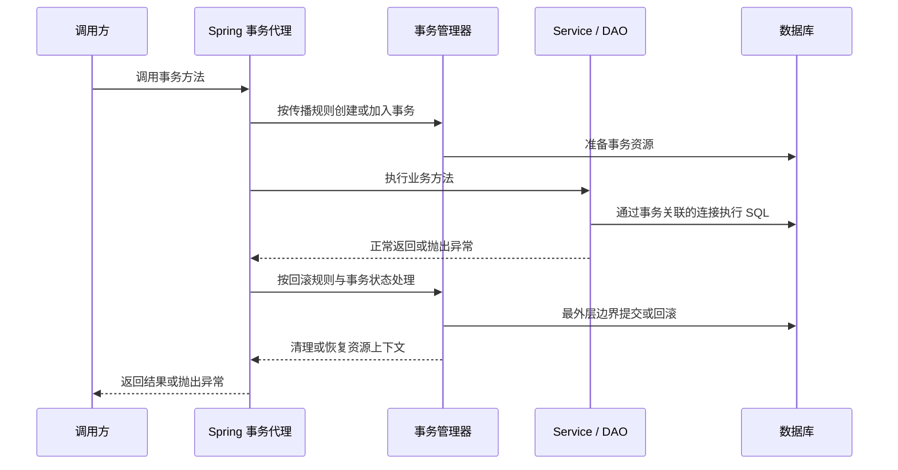
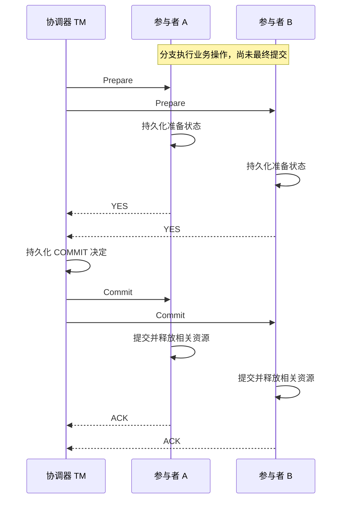
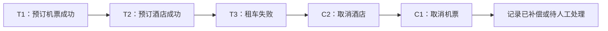

# B7-Distributed-Transactions：分布式事务与微服务一致性控制

> 课程：SE3353（CHP-fa26）。依据本目录 40 页 HTML 主课件、50 页 `04-transaction.pptx` 及两个 Spring 示例工程整理，并用官方文档和原始论文核对易混概念（2026-11-07）。文中区分源码现状、课件演示和工程补充；代码与故障场景用于学习推演，未启动服务、连接数据库或执行转账。

## 1. 本讲主线与材料索引

本讲回答：**一项业务涉及多个方法、数据库或服务时，怎样确定事务边界，并在并发、超时、重试和部分失败后维持业务约束？**

| 层次 | 核心问题 | 主要机制 |
| --- | --- | --- |
| Spring 本地事务 | 多个方法是否共用一次提交与回滚？ | AOP 代理、事务管理器、传播行为、回滚规则 |
| 长业务流程并发 | 用户编辑期间，如何发现或阻止冲突？ | 乐观离线锁、悲观离线锁、粗粒度锁 |
| 分布式理论 | 网络分区时，哪些保证无法同时满足？ | CAP、BASE、一致性模型 |
| 跨资源原子提交 | 多个资源如何达成统一提交决定？ | XA、2PC、3PC、持久化与恢复 |
| 应用层协调 | 如何预留、补偿或异步推进业务？ | TCC、Saga、Outbox、事务消息、幂等 |
| 框架落地 | 如何管理全局事务与各分支？ | Seata TC / TM / RM、AT / TCC / Saga / XA |

与前几讲的联系：B6 解释数据库内部的隔离与恢复；B7 关注应用怎样使用这些能力，以及跨出一个本地事务后如何协调。B5 的“数据库更新 + 消息发送”双写问题，也是本讲分布式一致性问题的一种。

### 1.1 课件阅读路线

| 材料 | 页码 | 阅读重点 |
| --- | --- | --- |
| [HTML 主课件](B7-Distributed-Transactions/1.html) | 1～2 | 本讲目标与整体路线 |
| HTML 主课件 | 3～10 | Spring 事务、传播、回滚、代理限制、隔离与离线锁 |
| HTML 主课件 | 11～15 | 跨库调用、CAP、BASE、一致性模型 |
| HTML 主课件 | 16～20 | XA、2PC、3PC 与故障边界 |
| HTML 主课件 | 21～29 | TCC、Saga、消息表、事务消息、幂等与选型 |
| HTML 主课件 | 30～38 | Seata 架构、四种模式与集成示意 |
| HTML 主课件 | 39～40 | 总结与三道课后思考题 |
| [事务管理补充 PPT](04-transaction.pptx) | 3～15 | JTA、EJB CMT、六种事务属性 |
| 事务管理补充 PPT | 16～25 | Spring Booking 示例、银行转账与传播推演 |
| 事务管理补充 PPT | 26～38 | 隔离级别、数据库锁、跨库更新与 2PC |
| 事务管理补充 PPT | 39～47 | 乐观离线锁、悲观离线锁与粗粒度锁 |
| 事务管理补充 PPT | 48～50 | MySQL 日志延伸阅读、参考资料与结束页 |

### 1.2 本地工程的实际范围

| 目录 | 实际内容 | 本地声明版本 |
| --- | --- | --- |
| [Spring JDBC 事务示例](se3353_4_springtransaction/) | H2、`JdbcTemplate`、批量预订失败后整体回滚 | Spring Boot 3.1.3、Java 20 |
| [JPA 事务传播示例](se3353_4_transactionsample/) | MySQL、银行转账、订单与订单项、传播行为实验 | Spring Boot 3.1.3、Java 20、`jakarta.persistence` |

两个工程均为**本地数据库事务示例**。目录中没有可直接运行的 Seata、XA 多库、TCC、Saga 或 RocketMQ 事务消息系统。HTML 中的 `@GlobalTransactional`、TCC 接口和配置文件属于教学示意。

版本阅读要点：补充 PPT 包含旧 `javax.ejb` 写法；本地 JPA 实体使用 `jakarta.persistence`。Spring 自己的事务注解仍是 `org.springframework.transaction.annotation.Transactional`，不应机械替换包名。

## 2. Java 与 Spring 怎样管理事务

### 2.1 先确定事务边界，再选 API

转账要求扣款和入账一起成功：

```text
开始事务
  检查并扣减付款账户余额
  增加收款账户余额
  写入业务流水
提交事务
```

事务范围应覆盖完整的业务约束。若每个 DAO 各自提交，Service 中途失败时就可能只留下扣款记录。反过来，把用户思考、长时间 RPC 和发送邮件全部包进数据库事务，会延长资源占用，而且邮件并不会因此具备数据库回滚能力。

| 名称 | 所在层次 | 负责什么 |
| --- | --- | --- |
| JTA / Jakarta Transactions | Java 事务 API 规范 | 定义事务边界、状态及资源协调相关接口 |
| `UserTransaction` | 应用使用的接口 | 编程式 `begin()`、`commit()`、`rollback()` |
| EJB CMT | 容器管理机制 | 容器根据事务属性管理方法边界 |
| Spring `PlatformTransactionManager` | Spring 事务策略抽象 | 获取事务、提交、回滚 |
| XA | 事务管理器与资源管理器之间的接口规范 | 关联分支、准备、提交、回滚及恢复 |
| 2PC | 原子提交协议 | 协调多个参与者形成统一提交决定 |

**JTA、XA、2PC 不在同一个抽象层。** JTA 不等于某个应用服务器，也不意味着调用普通 HTTP 接口时会自动传播事务。

### 2.2 Spring 的统一抽象

Spring 提供声明式事务，也可以通过 `TransactionTemplate` 等方式显式划定代码块的事务边界。它们最终仍要委托具体事务管理器。

```text
@Transactional / TransactionTemplate
                  ↓
     PlatformTransactionManager
                  ↓
  JDBC 本地事务 / JPA 本地事务 / JTA 全局事务
```

| 实现 | 常见用途 | 关键边界 |
| --- | --- | --- |
| `DataSourceTransactionManager` / `JdbcTransactionManager` | JDBC、`JdbcTemplate` 等单数据源访问 | 管理相应数据源的本地事务 |
| `JpaTransactionManager` | JPA / Hibernate | 管理相应 `EntityManagerFactory` 的事务 |
| `JtaTransactionManager` | 接入 JTA 事务协调设施 | 需要资源正确加入事务及相应基础设施支持 |

同一个注解可以配合不同事务管理器，但这不表示“切换管理器后，任何数据库与远程 API 都自动获得同一种保证”。多数据源时，必须确认方法选中了哪个管理器，以及哪些资源真正参与。

### 2.3 `@Transactional` 的代理执行过程

下图描述本讲使用的、基于线程绑定资源的普通 Spring 事务路径：



- 代理拦截方法调用，事务管理器处理事务生命周期。
- JDBC 场景通常通过 `TransactionSynchronizationManager` 将连接资源与当前线程关联；`JdbcTemplate` 等组件获取并复用正确的资源。
- JPA 场景还涉及持久化上下文；对象修改、SQL 执行、`flush` 和最终 `commit` 是不同阶段。
- 内层 `REQUIRED` 方法返回，通常不意味着数据库已经提交。物理提交发生在相应外层事务完成时。
- 普通线程绑定事务不会自动传播到新线程或远端服务；响应式事务另有上下文机制，不能直接套用这一模型。

### 2.4 常用注解属性

| 属性 | 作用 | 使用边界 |
| --- | --- | --- |
| `propagation` | 决定加入、新建、挂起或拒绝事务 | 默认 `REQUIRED` |
| `isolation` | 声明隔离级别 | 默认 `DEFAULT`；依赖事务管理器和数据库支持 |
| `timeout` | 声明事务超时 | 依赖底层执行与检查机制，不是任意 Java 代码的强制中断器 |
| `readOnly` | 表达只读意图，供驱动或 ORM 优化 | 不应当作通用的禁止写入权限控制 |
| `rollbackFor` | 指定触发回滚的异常类型 | 按业务契约配置，如 `IOException.class` |
| `noRollbackFor` | 指定不触发回滚的异常类型 | 应明确其业务后果 |
| `transactionManager` | 选择事务管理器 | 多事务管理器场景尤其需要确认 |

加入已有事务时，内层声明的隔离级别、超时等通常不能重新定义外层物理事务。以上属性的契约可参见 [Spring 6.0.11 `Transactional` API](https://docs.spring.io/spring-framework/docs/6.0.11/javadoc-api/org/springframework/transaction/annotation/Transactional.html)。

## 3. 传播行为：方法边界与物理事务

### 3.1 七种传播行为

传播行为回答的是：**进入这个方法时，怎样处理当前事务？**

| 传播行为 | 当前有事务 `T1` | 当前无事务 | 常见用途或限制 |
| --- | --- | --- | --- |
| `REQUIRED` | 加入 `T1` | 新建事务 | 需要共同提交的一组业务操作 |
| `REQUIRES_NEW` | 挂起 `T1`，建立独立 `T2` | 新建事务 | 确实需要独立提交的操作 |
| `NESTED` | 通常在 `T1` 中创建保存点 | 类似 `REQUIRED` | 在同一物理事务内局部回滚，依赖管理器支持 |
| `SUPPORTS` | 加入 `T1` | 不主动创建事务 | 可有可无的事务边界 |
| `NOT_SUPPORTED` | 挂起 `T1`，非事务执行 | 非事务执行 | 明确排除当前事务的操作 |
| `MANDATORY` | 加入 `T1` | 抛出 `IllegalTransactionStateException` | 要求必须由上层提供事务 |
| `NEVER` | 抛出 `IllegalTransactionStateException` | 非事务执行 | 要求调用入口不存在事务 |

这里的“非事务执行”表示不由这个传播属性创建 Spring 事务；数据库单条语句仍可能自动提交，后续调用也可能自行开启新事务。EJB CMT 的六种属性没有 Spring 的 `NESTED`。

### 3.2 `REQUIRED`：多个逻辑范围，共用物理事务

```text
transfer()                    逻辑范围 A ─┐
  ├─ withdraw()               逻辑范围 B ─┼─ 物理事务 T1
  └─ deposit()                逻辑范围 C ─┘
```

每个被代理的方法都有自己的事务拦截范围，但共同参与 `T1`。若内层代理观察到符合回滚规则的异常，它可能把共享事务标记为 `rollback-only`。外层捕获 Java 异常，并不能撤销这个标记；继续尝试提交时通常会得到 `UnexpectedRollbackException`。

### 3.3 `REQUIRES_NEW` 与 `NESTED` 的区别

| 对比 | `REQUIRED` | `REQUIRES_NEW` | `NESTED` |
| --- | --- | --- | --- |
| 物理事务 | 与外层共用 | 独立事务 | 通常与外层共用 |
| 内层成功返回 | 等待外层最终提交 | 可独立提交 | 尚未独立提交 |
| 外层后来回滚 | 内层修改一起撤销 | 已提交的内层修改保留 | 内层修改一起撤销 |
| 内层按规则回滚 | 通常影响整个共享事务 | 回滚内层事务 | 可回到保存点，外层视处理逻辑继续 |
| 资源代价 | 共用事务资源 | 往往需要额外连接 | 需要保存点与对应支持 |

`REQUIRES_NEW` 的“独立”是提交边界独立；若它的异常继续传播出外层方法，外层仍可能因此回滚。

**挂起不等于结束事务或释放原有锁。** 使用 `REQUIRES_NEW` 时，外层资源仍被保留，内层还要获取自己的资源；连接池可能因此耗尽。`NOT_SUPPORTED` 也不能用来自动释放外层已占有的连接与锁。耗时操作应尽量通过调整业务边界移到事务之外。[Spring：事务传播](https://docs.spring.io/spring-framework/reference/data-access/transaction/declarative/tx-propagation.html)

`NESTED` 常见于支持 JDBC Savepoint 的本地事务。不要因为项目使用 JPA，就假设保存点能完整恢复 JPA 持久化上下文中的实体状态。

### 3.4 银行转账示例：先看当前源码

相关入口：[BankServiceImpl.java](se3353_4_transactionsample/src/main/java/org/reins/se3353/se3353_4_transactionsample/BankServiceImpl.java)、[BankDaoImpl.java](se3353_4_transactionsample/src/main/java/org/reins/se3353/se3353_4_transactionsample/BankDaoImpl.java)。当前调用关系为：

```text
GET /transfer
  └─ BankService.transfer("Tom", "Jerry", 80)    REQUIRED
       ├─ BankDao.withdraw(...)                 REQUIRED
       └─ try BankDao.deposit(...)              REQUIRED
          catch Exception：打印异常
```

源码中的 `deposit()` 是：

```java
@Transactional //(propagation = Propagation.REQUIRES_NEW)
public void deposit(String to, int amount) {
    Bank in = bankRepository.findById(to).get();
    in.setBalance(in.getBalance() + amount);
//  int result = 10 / 0;
}
```

因此，`REQUIRES_NEW` 和除零语句都尚未启用。PPT 第 23 页展示的独立存款事务，是需要修改注解后才能进行的对照实验。

以下按“账户存在、数据库支持事务、调用经过代理、无额外并发与提交故障”推演，异常均指实验中的 `ArithmeticException`：

| 场景 | `deposit()` 传播 | Tom / Jerry 最终变化 |
| --- | --- | --- |
| 全链路正常 | `REQUIRED` | `-80 / +80` |
| `withdraw()` 抛异常 | `REQUIRED` | `0 / 0`，外层未捕获该异常 |
| `deposit()` 抛异常，被 Service 捕获 | `REQUIRED` | `0 / 0`，共享事务已被标记回滚，提交时通常报 `UnexpectedRollbackException` |
| `transfer()` 在调用 `deposit()` 前抛异常 | 任一种 | `0 / 0`，存款尚未执行 |
| `deposit()` 正常，之后 `transfer()` 抛异常 | `REQUIRED` | `0 / 0` |
| 全链路正常 | `REQUIRES_NEW` | `-80 / +80`，但分成两次提交 |
| `deposit()` 抛异常，被 Service 捕获 | `REQUIRES_NEW` | `-80 / 0`，扣款事务可以提交 |
| `deposit()` 已提交，之后 `transfer()` 抛异常 | `REQUIRES_NEW` | `0 / +80`，存款不会随外层撤销 |

这说明：**转账两端若必须共同成功，就不能随意把其中一端改成独立提交。**

实体为什么没有显式 `save()`？在此 JPA 事务路径中，读取的实体处于持久化上下文管理之下，修改会通过脏检查在 flush / commit 时同步。它不代表任意一个脱管对象执行 setter 后都会自动写库。

这个示例展示事务传播，没有实现余额不足检查、请求幂等、并发更新保护和完整流水。`@Transactional` 本身不能防止所有丢失更新或超扣问题，金额校验、条件更新或版本控制仍需另外设计。

### 3.5 订单示例：独立事务还会影响数据可见性

当前 [OrderServiceImpl.java](se3353_4_transactionsample/src/main/java/org/reins/se3353/se3353_4_transactionsample/OrderServiceImpl.java) 和 [OrderItemDaoImpl.java](se3353_4_transactionsample/src/main/java/org/reins/se3353/se3353_4_transactionsample/OrderItemDaoImpl.java) 的关系是：

```text
OrderService.placeOrder()             T1，REQUIRED
  ├─ OrderDao.placeOrder()            加入 T1，保存订单
  └─ OrderItemDao.placeOrderItem()    T2，REQUIRES_NEW
       外层捕获订单项操作的异常
```

需要分别判断两个问题：

1. **提交范围**：订单项事务若回滚，外层捕获异常后，订单事务仍可能提交，留下缺少订单项的订单。
2. **依赖可见性**：若订单项引用的是 `T1` 新建但尚未提交的订单，`T2` 不能假定能访问到它。数据库外键、锁以及 SQL flush 时机会影响执行，可能出现等待或约束失败。

所以不能仅凭 `REQUIRES_NEW` 就断言“订单项一定先成功提交”。还要检查实体关联是否正确、父记录是否已存在，以及真实数据库约束。若业务要求订单和订单项同时落库，同一库中通常应让它们参与同一事务。

## 4. 回滚规则、代理限制与隔离级别

### 4.1 异常类型与回滚策略

对于本地示例采用的普通 Spring 声明式事务、未覆盖默认规则时：

| 方法抛出的异常 | 默认处理 |
| --- | --- |
| `RuntimeException` 及子类 | 触发回滚 |
| `Error` | 触发回滚 |
| 受检异常，如 `IOException` | 默认不因该异常触发回滚 |

“默认不触发”不代表数据库必然成功提交：事务也可能早已被标记回滚，或者在提交阶段发生其他错误。

```java
// 教学片段：业务约定任何 Exception 都意味着本次工作不能提交。
@Transactional(rollbackFor = Exception.class)
public void importOrders() throws Exception {
    // 读取、校验、写入；异常应按约定传播到事务边界。
}
```

`rollbackFor = Exception.class` 是一种明确的业务策略，不是每个方法都必须机械添加的规则。应根据哪些失败允许保留修改来决定；优先使用异常类型，避免用宽泛的异常名称字符串匹配。[Spring：声明式事务回滚规则](https://docs.spring.io/spring-framework/reference/data-access/transaction/declarative/rolling-back.html)

### 4.2 `try-catch` 的位置决定代理能看见什么

| 情况 | 事务含义 |
| --- | --- |
| 异常在当前方法内部被捕获，没有经过任何内层事务代理 | 外层代理只看到正常返回；若底层未标记回滚，可能提交 |
| 异常先穿过内层 `REQUIRED` 代理，再被外层捕获 | 共享事务可能已经是 `rollback-only` |
| 异常先穿过内层 `REQUIRES_NEW` 代理，再被外层捕获 | 内层已回滚；外层是否提交另行判断 |

若业务确实要回滚，可以重新抛出符合规则的异常，或在必要时显式调用 `setRollbackOnly()`。不要仅打印异常后返回成功，也不要把“catch 了异常”理解为“事务已经恢复正常”。

### 4.3 代理模式下的常见边界

| 情况 | 准确解释 |
| --- | --- |
| `this.inner()` 自调用 | 绕过代理，`inner()` 的注解不会建立新的事务语义；若外层已有事务，内部代码仍可能在外层事务中执行 |
| 直接 `new Service()` | 没有经过 Spring 管理的事务代理 |
| `private` 方法 | 普通代理无法以重写或接口调用方式拦截它 |
| CGLIB 下的 `final` 类或方法 | 无法通过继承、重写建立相应代理行为 |
| 非 `public` 方法 | 不能一概说都无效，必须看 Spring 版本和代理类型 |
| 新线程、线程池、普通 `@Async` 调用 | 不自动继承调用线程的事务；可独立开启事务，但不是原事务的一部分 |
| 手工获取另一条无关联连接 | 可能绕过 Spring 当前管理的资源 |
| 底层资源不支持事务 | 注解无法补出其没有的事务能力 |

Spring 官方文档说明：自 6.0 起，类代理默认也可支持 `protected` 和包可见方法；接口代理要求方法是接口中声明的 `public` 方法。两类代理都要求调用经过代理。课件第 8 页“非 public 都失效”的说法需要加上版本与代理条件。[Spring：使用 `@Transactional`](https://docs.spring.io/spring-framework/reference/data-access/transaction/declarative/annotations.html)

自调用的常见处理是将需要独立边界的逻辑提取到另一个 Spring Bean，或用 `TransactionTemplate` 显式控制。先检查业务边界，不必为了让注解生效而引入复杂的自我注入。

### 4.4 隔离级别与传播行为不同

- **传播行为**决定多个方法是否参与同一个事务。
- **隔离级别**决定并发事务之间允许看到什么、产生哪些相互影响。

| Spring `Isolation` | 基本语义 |
| --- | --- |
| `DEFAULT` | 使用底层默认隔离级别 |
| `READ_UNCOMMITTED` | 可能读到其他事务未提交的修改 |
| `READ_COMMITTED` | 防止脏读，仍可能不可重复读、幻读 |
| `REPEATABLE_READ` | 按标准异常表防止脏读和不可重复读；幻读行为还需看具体数据库实现 |
| `SERIALIZABLE` | 提供等价于某种串行执行的隔离保证，可能通过阻塞或冲突中止实现 |

Spring 声明隔离要求，数据库及其驱动负责实现。`SERIALIZABLE` 不等于必须让所有事务按一个全局队列逐个执行；MVCC 下“有写锁”也不意味着所有普通查询都会阻塞。锁、快照读、当前读的细节见 B6。

### 4.5 Booking 示例：约束错误如何引起整批回滚

[BookingService.java](se3353_4_springtransaction/src/main/java/org/reins/se3353/se3353_4_springtransaction/BookingService.java) 在 `book(String... persons)` 上声明事务，循环插入所有姓名。[schema.sql](se3353_4_springtransaction/src/main/resources/schema.sql) 将姓名定义为 `varchar(5) NOT NULL`。

| `AppRunner` 调用 | 推演结果 |
| --- | --- |
| `book("Alice", "Bob", "Carol")` | 三条一起提交，总数 3 |
| `book("Chris", "Samuel")` | `Samuel` 超过长度限制，整次调用回滚，`Chris` 也不保留，总数仍为 3 |
| `book("Buddy", null)` | 非空约束失败，`Buddy` 一起回滚，总数仍为 3 |

`AppRunner` 在调用 `bookingService.book()` 的外部捕获异常。异常已经经过 `BookingService` 的事务代理，该次事务已执行回滚，所以外部捕获不妨碍回滚。示例还带有数量断言；这些是源码中的预期，本次笔记整理没有运行该工程。

## 5. 长业务流程与离线锁

### 5.1 业务事务不一定是一个数据库事务

用户打开编辑页、思考数分钟、提交修改，构成一个业务操作，但不宜在这段时间里一直保留数据库事务和行锁。

```text
短事务 1：读取记录与 version → 结束
          用户在浏览器编辑
短事务 2：核验 version 并更新 → 提交或报告冲突
```

“离线”指业务操作跨出了单个数据库事务的生命周期，不要求客户端真的断网。

### 5.2 乐观离线锁

读取时带回版本，保存时将版本检查和修改合在一次原子更新中：

```sql
UPDATE customer
SET name = :new_name,
    version = version + 1
WHERE id = :customer_id
  AND version = :version_seen_by_user;
```

- 影响 1 行：本次版本条件满足，修改成功。
- 影响 0 行：版本已变化或记录不存在，不能当作保存成功。
- 多条关联更新需要放在同一个本地事务中，冲突时按业务要求撤销。
- JPA 可用 `@Version` 支持实体版本检查，但接口仍须传递、核对用户编辑所依据的版本。

乐观锁不表示数据库从不加锁：真正执行更新时仍可能使用行锁。它避免的是在整个用户编辑期间持有数据库长锁。[Fowler：Optimistic Offline Lock](https://martinfowler.com/eaaCatalog/optimisticOfflineLock.html)

### 5.3 悲观离线锁与粗粒度锁

悲观离线锁在业务编辑开始时获取应用层锁，例如锁表中的所有者与租约记录，结束后释放。要考虑用户关闭页面、进程崩溃、租约过期，以及过期持有者继续提交等问题；所有写入入口必须遵守相同协议。[Fowler：Pessimistic Offline Lock](https://martinfowler.com/eaaCatalog/pessimisticOfflineLock.html)

粗粒度锁用一个版本或令牌保护一组关联对象。例如“订单 + 所有订单项”共同使用订单根上的版本，任何成员变化都检查并推进这个共享版本。

| 方法 | 优势 | 代价 |
| --- | --- | --- |
| 乐观离线锁 | 编辑期不用持锁 | 保存时可能冲突，需重载或合并 |
| 悲观离线锁 | 提前阻止竞争编辑 | 需要锁管理、过期与失效处理 |
| 粗粒度锁 | 简化整体约束与锁管理 | 不同子对象之间也可能互相冲突 |

粗粒度乐观锁要求共享**同一个版本记录**；给每个对象各放一个恰好相等的版本数字，并不能保护整个对象组。

## 6. 跨服务后的失败模型与 CAP / BASE

### 6.1 本地事务不能自动覆盖远程调用

```text
Order Service → Order DB：写订单
      ↓ RPC
Stock Service → Stock DB：扣库存
      ↓ RPC
Account Service → Account DB：扣余额
```

在订单方法上加普通本地 `@Transactional`，只会控制相应本地事务管理器参与的资源。库存服务已经提交的修改，不会因为订单服务随后抛异常而自动撤销。

跨服务调用必须区分三种结果：

| 调用结果 | 调用方知道什么 | 后续处理 |
| --- | --- | --- |
| 明确成功 | 按对方接口契约，本次操作成功 | 记录成功并推进流程 |
| 明确失败 | 对方确认没有完成预期操作 | 根据失败原因重试或撤销 |
| 超时、连接中断 | 结果未知，可能已执行但响应丢失 | 按业务 ID 查询、幂等重试或交给恢复流程 |

**超时不是“对方没有执行”的证据。** 即使数据库只有一台，应用与数据库之间也可能发生“提交完成、响应丢失”，仍需要处理提交结果未知的问题。

### 6.2 分清不同语境中的“一致性”

| 名称 | 要保证的内容 | 不自动保证什么 |
| --- | --- | --- |
| ACID 的 Consistency | 正确事务维护业务与数据约束 | 不是副本实时同步的定义 |
| 原子提交 | 参与者最终采用相容的提交 / 中止决定 | 不独立提供所有并发隔离保证 |
| 可串行化 | 并发事务等价于某个串行执行顺序 | 不一定遵守操作的实际先后时间 |
| 线性一致性 | 操作仿佛在调用与返回之间瞬间生效，并尊重实时先后关系 | 不等于各副本内存每一刻都完全相同 |
| 严格可串行化 | 可串行化，并尊重事务间的实时先后关系 | 不由一个提交注解自动获得 |
| 最终一致性 | 在更新停止且传播、恢复机制正常推进等前提下，副本最终收敛 | 定义本身不承诺固定秒数内完成 |

因此，“用了 XA / 2PC，所以一定线性一致”“用了 ACID，所以与 BASE 不能同时出现”都不准确。系统可以在每一步使用本地 ACID，同时在全局采用异步补偿。

### 6.3 CAP 的准确读法

- **C：Consistency**，这里采用线性一致性语义。
- **A：Availability**，原始形式要求每个非故障节点收到的请求最终得到响应；不是月度可用率，也不是固定毫秒延迟的承诺。
- **P：Partition tolerance**，系统的故障模型允许节点组之间的通信被网络分区阻断。

在允许分区的异步网络模型中，无法始终同时保证 C 与 A。它不是让系统在任何时候随意“三选二”。[Gilbert 与 Lynch：CAP 论文](https://groups.csail.mit.edu/tds/papers/Gilbert/Brewer6.pdf)

设两个节点最初都是 `x = 0`，分区后节点 A 确认写入 `x = 1`，随后客户端向无法与 A 通信的 B 读取：

- B 若坚持返回满足线性一致性的结果，可能必须等待或拒绝该操作，从而放弃相应可用性。
- B 若始终提供本地读写服务，就不能保证返回值符合已经确认的全局顺序。

CP / AP 是对分区时行为的概括。具体读写路径、配置、故障转移策略可能不同，不能只凭产品名称永久贴标签；例如异步复制与故障转移可能使已确认写入丢失，需要检查具体保证。

### 6.4 BASE 与业务中间状态

| 缩写 | 含义 | 订单例子 |
| --- | --- | --- |
| BA：Basically Available | 故障时维持约定的基本服务能力 | 接受请求并提供状态查询，部分功能降级 |
| S：Soft State | 允许可管理的过渡状态 | `PENDING`、`RESERVING`、`COMPENSATING` |
| E：Eventually Consistent | 通过可靠推进与修复达到最终状态 | 最终为 `CONFIRMED` 或 `CANCELLED` |

BASE 是工程设计思路，不是自动恢复算法。最终一致要依赖可持久化的状态、重试、幂等、补偿和对账；没有这些机制，“稍后再说”只会形成长期悬挂。

工程上可以设定“多数订单在数秒内完成”的目标，但这是服务目标，不能当作最终一致性定义中的数学上界。网络长期分区、下游持续故障或无法补偿时，应有可见的异常状态与处置流程。

## 7. XA、2PC 与 3PC

### 7.1 XA 与 X/Open DTP 的角色

| 角色 | 全称 | 职责 |
| --- | --- | --- |
| AP | Application Program | 定义业务工作与事务边界 |
| TM | Transaction Manager | 协调参与者，持久化全局决定，推进恢复 |
| RM | Resource Manager | 管理数据库等资源，执行分支与 XA 操作 |

一个全局事务包含多个分支。XA 的 XID 包含格式标识、全局事务标识和分支限定标识。常见操作的概念顺序为：

```text
start → 执行业务 SQL → end → prepare → commit / rollback
                                  ↘ 故障后 recover
```

`prepare` 不是 `commit`，也不是只做一次余额查询：参与者必须形成可恢复的准备状态，保证随后能遵守最终决定。应用 SQL 通常已经在事务分支中执行，不是一定等到协调器发送 Prepare 才开始执行。

### 7.2 2PC：先准备，再作最终决定



第一阶段中，所有必要参与者准备成功，协调器才可以决定提交。若在决定提交之前有拒绝或无法完成准备，协调器可以决定中止。第二阶段传播已经形成的决定，并通过日志与重试推动参与者完成。

参与者投 YES 的意义是：**我已准备好，之后不能仅凭自己超时就随意选择相反结果。** 协调器也不能在持久化 COMMIT 后，因某个 ACK 丢失而把全局结果改成 ROLLBACK。

### 7.3 故障推演：安全性与活性分开看

| 故障位置 | 正确处理要点 |
| --- | --- |
| 参与者尚未作出准备承诺 | 可依协议中止，协调器不能在缺少必要同意时提交 |
| 参与者已 Prepared，但没有最终决定 | 进入 in-doubt 状态，需要查询、恢复或等待可靠决定 |
| 协调器已持久化 COMMIT，尚未通知完所有参与者 | 恢复后继续传播 COMMIT |
| 参与者已提交，但 ACK 丢失 | 重复决议需要按事务标识正确处理，不能再次执行业务扣款 |
| 协调器暂时不可用 | 一些 Prepared 分支可能阻塞，恢复后按日志推进 |

2PC 的核心局限是：某些故障会阻塞进展，Prepared 分支也可能长时间保留锁等资源。它不是“网络丢一个 Commit，就允许一边提交、一边自行回滚”的协议。后者破坏了协议要求，或涉及人为启发式决策、状态丢失等额外故障。[Gray 与 Lamport：Consensus on Transaction Commit](https://lamport.azurewebsites.net/video/consensus-on-transaction-commit.pdf)

需要修正课件第 18 页的几处表述：

- “可能无限期阻塞”不等于“一宕机就永久无法恢复”；持久日志和恢复设施决定能否继续。
- 部分参与者已提交、另一些仍等待，表示完成进度不同，不等于允许最终决定互相冲突。
- 持锁、协调通信、日志写入都产生代价，但不能在没有压测条件时断言吞吐固定下降 90%。
- 2PC 解决提交协调；全局隔离与读取可见性还要看数据库、锁协议和读路径。

### 7.4 2PC 与 2PL 不要混淆

| 名称 | 含义 | 解决的问题 |
| --- | --- | --- |
| 2PC | Two-Phase Commit，两阶段提交 | 多参与者如何达成提交 / 中止结果 |
| 2PL | Two-Phase Locking，两阶段锁 | 并发读写如何满足可串行化条件 |

它们可以配合使用，但“都是两阶段”不表示同一种算法。数据库可能在执行 SQL 时已经获得锁，Prepared 阶段继续保留相关资源。

### 7.5 3PC：增加状态，仍有故障模型限制

课件采用以下教学命名：

```text
CanCommit：收集是否同意提交的投票
     ↓ 全部同意
PreCommit：进入预提交状态，并收集确认
     ↓
DoCommit：通知最终提交
```

增加预提交阶段的目的，是让恢复协议能够利用参与者状态减少不确定性。在适当的同步、故障检测和网络假设下，可以改善非阻塞能力；出现通信分区时，简单依靠超时推断对方状态并不安全。[Cornell：3-Phase Commit 课程讲义](https://www.cs.cornell.edu/courses/cs5414/2023sp/notes/Week9.pdf)

因此不能把 3PC 写成通用规则“等不到消息就提交”，也不能用“默认多数派准备好了”代替正式终止协议。3PC 不是多数派共识协议，额外的一轮通信也没有消除网络分区问题。

同样不能推导出“现代系统不能使用 2PC”。提交协议、复制共识和本地并发控制可以组合；应根据故障恢复、资源支持和延迟要求评估，而不是仅凭“微服务”三个字否定原子提交。

## 8. TCC：资源预留与业务确认

### 8.1 三个接口，两阶段选择

TCC 是 Try、Confirm、Cancel 三类业务操作，但整体通常是两阶段：

1. 第一阶段执行各分支的 Try，检查并预留资源。
2. 第二阶段依据统一决定执行 Confirm 或 Cancel，二者是不同结果分支。

每个操作可使用自己的本地事务。Try 完成后不必一直持有数据库事务锁，但业务预留状态会持续限制资源使用。

以付款账户为例，定义 `available` 为可用余额、`frozen` 为冻结余额，金额 `m > 0`，初始状态为 `(100, 0)`：

| 阶段 | 数据变化 | `m = 30` 的结果 |
| --- | --- | --- |
| Try | `available -= m`，`frozen += m` | `(70, 30)` |
| Confirm | 消费该分支预留的 `m`，`frozen -= m` | `(70, 0)`，付款完成 |
| Cancel | `available += m`，`frozen -= m` | `(100, 0)`，释放预留 |

这只是付款方资源模型，不是完整的跨账户转账。每笔冻结都需要关联分支 ID，不能仅凭账户的总冻结金额识别应该消费或释放哪一笔。

```sql
-- 教学片段：Try 中的一步，必须与分支记录写入处于同一事务。
UPDATE account
SET available = available - :amount,
    frozen = frozen + :amount
WHERE id = :account_id
  AND available >= :amount;
```

应检查影响行数，并预先校验金额为正。只做 `SELECT balance` 不预留资源，会让多个 Try 同时“检查通过”，到 Confirm 时却发现资源已经被其他业务消耗。

Confirm 应围绕已预留资源设计，避免再次出现“余额不足”等可预见的业务拒绝；但网络、数据库、进程仍可能失败，所以不能理解成 Confirm 每次调用都必然成功。需要持久状态与可重复推进的二阶段操作。

### 8.2 空回滚、悬挂与幂等

| 问题 | 发生顺序 | 防护 |
| --- | --- | --- |
| 空回滚 | Try 未成功执行，Cancel 先到了 | 不释放不存在的预留，同时记录该分支已取消 |
| 悬挂 | Cancel 完成后，迟到的 Try 才执行 | Try 发现取消标记后拒绝预留 |
| 重复调用 | Confirm / Cancel 响应丢失，协调器重试 | 根据持久化分支状态返回已有结果，避免重复扣减或解冻 |

**空回滚时只返回成功、什么也不记，并不足以防悬挂。** 系统需要保留能够阻止迟到 Try 的标记。[Seata：TCC 设计原则](https://seata.apache.org/blog/tcc-mode-design-principle/)

可用如下简化状态机理解业务屏障，具体字段与状态值不等同于框架表结构：

```text
不存在 ──Try 成功──> TRIED ──Confirm──> CONFIRMED
   │                   └──Cancel───> CANCELLED
   └──空 Cancel────────────────────> CANCELLED

CANCELLED 后到达 Try：拒绝
CONFIRMED 后重复 Confirm：返回已确认
CANCELLED 后重复 Cancel：返回已取消
相反的终态请求：按协议校验，不再重复修改资源
```

正确实现至少要把“分支唯一性检查、状态迁移、资源修改”放进相应的原子操作或本地事务，并处理并发请求。单独先查状态再更新，仍有竞态。

Seata 的 TCC Fence 提供幂等、空回滚与悬挂防护机制，但需要按使用版本正确启用、建表和集成。本讲 HTML 的简化 `tcc_fence_log` DDL 不能直接当作任意版本的官方建表脚本。[Seata：TCC Fence](https://seata.apache.org/blog/seata-tcc-fence/)

## 9. Saga：本地提交与业务补偿

### 9.1 正向事务与反向补偿

Saga 将长流程拆为一系列可独立提交的本地事务 `T1, T2, …, Tn`。若后续失败，可以执行已完成步骤对应的补偿操作。



顺序依赖链中，通常逆序补偿已成功步骤；复杂并行流程应根据依赖关系制定补偿顺序。若某个失败请求的结果仍未知，先查询或通过幂等协议确定结果，不能一概认定它没有产生业务效果。

### 9.2 补偿不是数据库 `ROLLBACK`

| 数据库回滚 | Saga 补偿 |
| --- | --- |
| 撤销尚未最终提交的事务影响 | 通过新的业务操作修正已经提交的结果 |
| 由数据库恢复机制执行 | 由业务定义取消、退款、冲正等规则 |
| 在事务边界内恢复 | 可能留下审计记录、手续费或不可逆影响 |

例如，发送邮件后不能“撤回数据库修改”来让收件人忘记内容；已经发货的订单可能需要退货流程。补偿应恢复可接受的业务约束，不保证所有物理状态回到最初。

Saga 的步骤已经本地提交，其结果可能被其他流程看到。这里是**全局业务尚未完成时的中间状态可见性**，不应直接等同于数据库脏读——数据库读到的可能正是已提交数据。

常见治理方式包括：用 `PENDING` 状态限制后续动作、语义锁、版本校验、将不可逆操作后置，以及明确最终失败后的人工处置流程。

### 9.3 两种协调方式

| 方式 | 流程驱动 | 优势 | 主要成本 |
| --- | --- | --- | --- |
| Orchestration，集中编排 | 编排器记录状态并发送命令 | 流程与恢复路径集中可见，适合复杂分支 | 编排状态需要持久化，调度器需要恢复与高可用 |
| Choreography，事件协同 | 服务订阅事件并产生后续事件 | 简单流程易于按事件扩展 | 依赖链可能分散，需要追踪关联 ID、事件契约和循环控制 |

集中编排不会自动消除业务耦合，也不能保证流程永远没有环；事件协同也不必然导致混乱。选择依据是流程复杂度、可观测性和团队边界。

恢复可以采用继续重试正向步骤的**向前恢复**，或执行补偿的**向后恢复**。补偿同样可能失败，需要重试、监控、对账和升级处置，不能承诺“永远重试就一定成功”。[Seata：Saga 模式](https://seata.apache.org/docs/dev/mode/saga-mode/)

## 10. 消息一致性与幂等处理

### 10.1 数据库与 MQ 双写的两个窗口

```text
先提交数据库，再发送消息：提交后宕机 → 业务已发生，消息没发出
先发送消息，再提交数据库：提交失败   → 消费者收到未成立的业务事实
```

普通本地 `@Transactional` 无法自动把数据库和消息 Broker 变成同一个事务资源。

### 10.2 本地消息表 / Transactional Outbox

在一个本地事务中，同时写业务数据与待发布事件；另一个 Relay 负责读取并投递。

```sql
-- 教学片段；调用方应校验状态更新影响行数。
BEGIN;

UPDATE order_info
SET status = 'PAID'
WHERE id = :order_id AND status = 'UNPAID';

-- 仅在本次合法状态迁移成功时，写入唯一的事件。
INSERT INTO outbox(event_id, aggregate_id, event_type, payload, status)
VALUES (:event_id, :order_id, 'OrderPaid', :payload, 'PENDING');

COMMIT;
```

上例说明事务边界，不是无需补充逻辑即可执行的完整存储过程：条件更新为 0 时，必须区分重复请求、订单不存在和非法状态，不能仍无条件插入事件。

投递过程：

1. Relay 通过轮询或 CDC 获取已提交事件。
2. 发布到 MQ，收到满足约定持久化语义的 Broker 确认。
3. 更新投递状态或维护投递进度。
4. 消费者幂等执行业务，成功提交后再确认消费。

Relay 在第 2 步成功后、第 3 步前宕机，重启就可能重复发送。因此 Outbox 消除了关键双写缺口，但并不自动提供端到端恰好一次处理。[Transactional Outbox 模式](https://microservices.io/patterns/data/transactional-outbox)

**Broker 已接收不等于消费者业务已完成。** `SENT` 应说明它表示哪一种确认；若生产方还需要知道下游处理结果，要另有结果事件或业务状态查询。还需设计同一聚合内的事件顺序、积压监控、失败重投与归档。

### 10.3 RocketMQ 事务消息

基本流程为：

```text
Producer → Broker：发送 Half Message，消费者暂不可见
Broker → Producer：确认已接收
Producer：执行本地事务，保存可查询的业务结果
Producer → Broker：提交或回滚消息
若最终结果未知：Broker 回查 Producer
```

回查必须基于可靠的持久化结果，并区分：

| 本地状态 | 回查应表达的含义 |
| --- | --- |
| 已确认提交 | Commit |
| 已确认中止 | Rollback |
| 正在执行或尚不能确定 | Unknown |

不能把“暂时查不到成功记录”简单当作已回滚。事务消息协调的是**生产端本地事务与消息发布**，并不把消费者数据库也纳入同一次原子提交。[RocketMQ：事务消息](https://rocketmq.apache.org/docs/featureBehavior/04transactionmessage/)

### 10.4 最大努力通知

适用于外部业务回调：发送通知、按约定退避重试、超过期限后记录失败，并提供主动查询或对账渠道。具体间隔由接口契约决定，不应把课件中的示例时间表当成某个支付平台的固定规则。

有限重试本身不保证对方最终完成业务；接收方应能补查状态并幂等处理重复通知。

### 10.5 消费者幂等：状态与副作用要一起提交

幂等要求同一业务操作重复执行，不会重复产生预期之外的效果。一个常见数据库实现是：

```text
开启本地事务
  插入去重记录 (consumer_id, event_id)，由唯一约束保护
  执行业务更新
  一起提交
然后确认消费

若发现已经成功处理的重复事件：验证后返回已有结果
若执行失败：去重记录与业务修改一起回滚，允许稍后重试
```

这样，事务提交后但消费 ACK 前宕机，重投的事件也不会重复更新业务。[Idempotent Consumer 模式](https://microservices.io/patterns/communication-style/idempotent-consumer.html)

| 方法 | 能解决什么 | 仍需注意 |
| --- | --- | --- |
| 唯一业务键 / 去重表 | 阻止同一业务请求重复生效 | 去重状态与业务副作用必须原子提交 |
| 条件状态迁移 | 如 `UNPAID → PAID` 只能成功一次 | 影响 0 行也可能是记录不存在或状态非法 |
| 版本检查 | 防止旧请求覆盖新状态 | 要处理冲突与重试，不等于所有请求已去重 |
| 分布式锁 | 减少同一时刻的并发执行 | 释放或过期后的重复请求仍会到达，锁不等于持久去重 |

“先在 Redis 写已处理，再更新 DB”或相反顺序，都有跨系统双写窗口。若采用 Redis 锁，应校验所有权后释放，并处理租约失效；最终业务正确性仍应有可验证的持久依据。

幂等键还应关联操作类型与请求参数。同一个键携带不同金额或对象时，不能一律按重复成功返回。

## 11. Apache Seata：框架协调与保证边界

### 11.1 TC、TM、RM 的职责

| 组件 | 位置与职责 |
| --- | --- |
| TM：Transaction Manager | 通常位于业务发起端，定义全局事务边界，请求开始、提交或回滚 |
| TC：Transaction Coordinator | 管理全局与分支状态，协调各分支完成，并管理相应的全局锁 |
| RM：Resource Manager | 接入具体业务资源，注册分支、汇报状态，执行分支提交或回滚 |

```text
入口 TM ──begin──> TC ──返回──> 全局 XID
   │
   └─ 携带 XID 的 RPC ──> 下游服务 / RM
                               │
                               └─ 分支注册与状态报告 ──> TC

入口 TM 请求结束全局事务 → TC 协调分支完成
```

注意两套术语：经典 XA 模型中的 TM 承担事务协调职责；Seata 又明确区分了业务发起端 TM 与协调服务 TC，不能直接逐字对应。

XID 需要沿受支持且正确配置的调用链传播。任意 HTTP 客户端、新线程、消息消费者或第三方接口，不会因为入口有注解就自动加入全局事务。源码目录中尚未接入这些设施。

### 11.2 AT 模式：本地提交 + 撤销镜像

AT 通过数据源代理处理受支持的 SQL，记录修改前后的镜像。

| 阶段 | 主要工作 |
| --- | --- |
| 一阶段 | 解析 SQL、记录 before image、执行业务 SQL、记录 after image；业务修改与 `undo_log` 在同一本地事务中提交 |
| 本地提交前 | 注册分支并获得所需全局锁；未取得锁不能直接提交该分支 |
| 二阶段提交 | 无须重新执行业务 SQL，推进全局完成与 Undo 日志清理 |
| 二阶段回滚 | 开启新的本地事务，读取日志、核对数据、执行恢复操作 |

AT 一阶段就结束本地事务并释放本地连接和锁；全局事务此时可能尚未完成。这与 XA 的 Prepared 分支尚未最终提交不同。[Seata：AT 模式](https://seata.apache.org/docs/dev/mode/at-mode/)

`undo_log` 是 Seata 管理的应用数据库表，**不是** InnoDB 内部的 Undo Log。它要使用匹配版本和数据库的官方脚本，镜像序列化格式也不能一概认定为 JSON。

### 11.3 AT 回滚与数据校验

教学例子：

```text
Before Image：balance = 100
After Image ：balance = 80
```

正常回滚时，需要在本地事务保护下读取当前数据，判断其是否仍符合可撤销条件，再依据 before image 恢复。

| 当前情况 | 应如何理解 |
| --- | --- |
| 当前值仍为 80，符合预期镜像 | 在校验与锁保护下恢复到 100 |
| 其他路径把当前值改为 70 | 不能直接覆盖到 100，否则会抹掉后续修改 |
| 存在重复回滚、数据已恢复或无需撤销等情况 | 由实际 Undo 执行器与事务状态判断，不能只靠一条值比较定义全部分支 |

课件第 32 页写出的 `UPDATE ... WHERE balance = 80` 可帮助理解条件保护，但不应认为框架必然逐字生成这样的 SQL。正式实现会结合查询锁、镜像校验与 Undo 执行逻辑。

发现无法安全恢复的数据差异后，应保留异常与事务记录，按框架状态、重试策略和对账流程处置。不能简单关闭校验强制覆盖，也不能假设任何版本都会自动弹出告警或自动通知管理员。

### 11.4 全局锁解决什么，不解决什么

| 锁 | 主要控制者 | 作用范围 |
| --- | --- | --- |
| 数据库本地锁 | 数据库 | 一个本地事务执行期间的并发访问 |
| Seata AT 全局锁 | TC 与参与检查的客户端 | 全局事务期间，受同一协议约束的数据写入 |

全局锁需要区分资源、表与记录，不应将课件的 `table:pk` 示意理解为可忽略数据库身份。锁状态的存储与恢复也依部署方式而定，不能笼统地说永远只存在一台 TC 的内存里。

AT 中仍有锁竞争：一个分支可能持有本地锁等待全局锁，而另一个分支回滚时需要本地锁。重试、超时与本地回滚用于处理这类冲突；“本地事务短”不等于“无锁、不会等待”。

全局锁也无法拦住完全绕过其协议的普通 SQL。若其他应用或维护脚本修改相同数据，必须纳入一致性设计。

### 11.5 AT 的全局读隔离

AT 一阶段已提交，所以普通查询可能读到**本地已提交、全局尚未提交**的数据。Seata 文档称默认全局读隔离为读未提交，并不是把数据库连接本身改成 `READ_UNCOMMITTED`。

若要按官方方案获得相应的全局读已提交语义，通常需要：

- 数据访问经过正确配置的代理数据源。
- 查询处于相应全局事务上下文，或使用 `@GlobalLock` 配合本地事务。
- 使用被代理处理的 `SELECT ... FOR UPDATE` 等规定路径检查全局锁。

单独给普通 `SELECT` 方法贴上 `@GlobalLock`，不能理解为自动获得线性一致性或全局可串行化。[Seata：事务隔离](https://seata.apache.org/docs/user/appendix/isolation/)

### 11.6 四种模式的对照

| 模式 | 一阶段做什么 | 二阶段 / 恢复做什么 | 主要适用前提 | 主要成本 |
| --- | --- | --- | --- | --- |
| AT | 提交业务数据与 Undo 镜像 | 清理日志或依据镜像恢复 | 支持的关系库、JDBC、SQL 与代理集成 | 镜像、全局锁、全局读隔离与旁路写治理 |
| TCC | 业务检查与资源预留 | Confirm 或 Cancel | 能设计预留、确认和释放语义 | 业务改造、屏障、幂等与资源冻结 |
| Saga | 逐步提交本地事务 | 正向重试或业务补偿 | 长流程，能提供可接受的补偿与状态查询 | 中间状态可见、补偿失败、流程恢复 |
| XA | 执行业务 SQL 后进入 Prepared | 数据库执行 XA commit / rollback | 数据库与驱动支持所需 XA 能力 | 跨阶段资源占用、协调与恢复 |

Seata XA 模式借助数据库原生 XA 机制，通常不需要 AT 的 `undo_log` 表；它仍须评估数据库隔离、Prepared 资源和故障恢复能力。[Seata：XA 模式](https://seata.apache.org/docs/dev/mode/xa-mode/)

表中没有固定的“谁性能最高”：热点分布、事务长度、网络延迟、SQL 支持范围和重试率都会影响结果。TCC 不依赖 AT 的全局行锁，但仍可能在业务账户或库存预留上竞争。

### 11.7 Seata TCC 与 Saga 的接口映射

TCC 中，`@TwoPhaseBusinessAction` 描述 Try 与 Confirm / Cancel 的对应关系，`BusinessActionContext` 用于二阶段所需上下文。应用仍负责资源语义；框架不会自动把任意第三方调用变成可预留、可取消的接口。

Saga 中，状态机将正向服务调用与补偿步骤关联起来。HTML 第 35 页的 JSON 带有省略号，是结构示意；实际状态机还需要完整的输入输出、异常分类、补偿入口与恢复配置，不能直接复制运行。

### 11.8 `@GlobalTransactional` 的教学使用边界

以下是控制关系示意，省略依赖、注入与 RPC 配置：

```java
@GlobalTransactional(name = "create-order", rollbackFor = Exception.class)
public void createOrder(OrderRequest request) {
    orderLocalService.createPending(request); // 本地分支，另有合适的本地事务边界
    stockClient.reserve(request);             // 携带 XID，接入相应分支机制
    accountClient.reserve(request);           // 失败必须转换为可识别的失败结果
}
```

要让这个示意成立，至少需要：

1. 匹配版本的客户端依赖、TC 服务与存储配置。
2. 正确的事务分组和服务发现配置。
3. 正确的数据源代理，避免遗漏或重复代理。
4. AT 对应的 Undo 表及 SQL 支持核对，或其他模式的相应资源配置。
5. XID 在调用链上的传递、绑定与清理。
6. 分支本地事务、超时、重试及失败结果的约定。
7. TC / RM 重启恢复、未完成事务和异常补偿的监控处置。

`@GlobalTransactional` 定义全局协调边界，`@Transactional` 定义相应本地边界；它们不能互相替代。下游若返回 `false` 或 HTTP 200 携带业务错误，入口必须按契约识别失败，不能假定任意失败都会自动转成全局回滚。[Seata：事务 API](https://seata.apache.org/docs/user/api/)

## 12. 如何为业务选择一致性方案

### 12.1 先问业务约束

| 问题 | 对设计的影响 |
| --- | --- |
| 哪些数据必须一起成立？ | 决定事务或协调边界 |
| 这些数据能否留在一个服务与数据库中？ | 可以时优先利用本地事务 |
| 中间状态能否对外可见？ | 决定是否能采用 Saga、AT 默认读取或异步流程 |
| 资源能否被预留？ | 决定 TCC 是否有合适的业务模型 |
| 已执行动作能否补偿？ | 决定 Saga 的恢复路径与不可逆步骤位置 |
| 依赖资源是否支持 XA / 受支持 SQL？ | 约束 XA、AT 的可行性 |
| 延迟、热点与故障恢复要求是什么？ | 决定持锁、排队、重试与异步化的代价是否可接受 |

### 12.2 场景与候选方案

| 场景 | 可考虑的方案 | 判断重点 |
| --- | --- | --- |
| 同库订单与订单项创建 | 本地事务 | 业务聚合边界、并发约束 |
| 多个支持 XA 的资源需要原子提交 | XA / 2PC | 资源支持、持锁时间、恢复与读隔离 |
| 自有关系库短事务，想减少补偿代码 | Seata AT | SQL 限制、全局锁、读路径和旁路写 |
| 库存或余额可以显式冻结 | TCC | 预留模型、分支记录、Confirm / Cancel 可重试性 |
| 跨多个系统的长流程 | Saga | 可补偿性、状态可见性、恢复策略 |
| 订单完成后发积分、通知 | Outbox 或事务消息 | 可靠发布、幂等消费、延迟与补偿要求 |
| 外部系统有限次数回调 | 最大努力通知 + 查询 / 对账 | 重试截止后的业务处置 |

“资金业务必须用某一种协议”“关系库一律选 AT”“TCC 永远吞吐最高”都不是足够的选型理由。应以明确约束和实际测试为依据。

### 12.3 混用 Seata 与 MQ 时的提交窗口

HTML 第 29 页把 AT、TCC 与事务消息放进一个入口方法，适合展示分工，但还需要补上消息与**全局最终结果**的关系。

假设某个 AT 分支已本地提交，消息回查据此返回 Commit，但全局事务随后失败：积分消费者可能已经处理了一笔最终取消的订单。

因此必须明确：

- 发布的是 `OrderRequested`、`OrderPending`，还是代表最终成功的 `OrderConfirmed`。
- 若事件代表最终成功，发布过程怎样可靠地确认全局结果，并在进程崩溃后继续推进。
- 若允许先发布中间事件，下游怎样处理取消、冲正与重复消息。

单纯把发送操作写在 `@GlobalTransactional` 方法内部，不会自动形成 Seata 与 MQ 的共同原子边界。只用一次提交后内存回调发送也有“已提交但回调尚未发送就宕机”的窗口，需要持久化的发布任务或可恢复状态机。

### 12.4 故障验证应覆盖的节点

学习时可以围绕以下节点推演，而不只观察正常路径：

| 故障注入点 | 要验证的业务事实 |
| --- | --- |
| 本地事务执行一半失败 | 同一事务内修改是否整体撤销 |
| 下游提交后丢失响应 | 重试是否重复扣款，能否查明结果 |
| Prepared 后协调器重启 | 是否保持统一决定，恢复后能否推进 |
| Cancel 先于 Try 到达 | 是否出现空解冻或永久冻结 |
| Saga 补偿失败 | 是否保留进度、可重试并可人工处理 |
| MQ 发送成功后 Relay 宕机 | 重发是否被消费者正确去重 |
| AT 一阶段后旁路修改 | 是否阻止不安全覆盖，并暴露待处理状态 |

这些是设计验证思路，不代表本目录已经实现相应测试或故障恢复工程。

## 13. 易混概念速查

| 常见说法 | 更准确的理解 |
| --- | --- |
| catch 异常后事务一定提交 | 还要看异常是否已经穿过内层代理、事务是否 rollback-only |
| 自调用导致整个调用链都没有事务 | 自调用不应用内层注解，但可能仍参与外层事务 |
| `REQUIRES_NEW` 是保存点 | 它是独立物理事务；保存点通常对应 `NESTED` |
| 挂起会释放外层连接和锁 | 外层事务未结束，资源通常仍被保留 |
| `readOnly` 能禁止任意写操作 | 它主要是事务语义提示，强制效果依赖底层 |
| CAP 的 C 就是 ACID 的 C | 前者讨论线性一致性，后者讨论约束保持 |
| 最终一致保证固定时间内成功 | 收敛需要前提，固定时间应另行定义服务目标 |
| 2PC 中 Prepared 超时就回滚 | 已作出准备承诺的参与者不能据此随意决定 |
| 2PC 和 2PL 是同一个“两阶段” | 一个协调提交，一个控制并发 |
| TCC 有三个阶段 | 有三个接口，通常按 Try 与 Confirm / Cancel 两阶段组织 |
| Try 只检查，不必占资源 | 缺少预留就不能保证后续确认的资源基础 |
| Saga 的补偿等同数据库回滚 | 补偿是新的业务操作，可能无法恢复原物理状态 |
| 消息去重表先写成功就够了 | 还要保证去重记录与业务副作用原子提交 |
| 加分布式锁就实现幂等 | 锁控制并发，持久幂等还需识别历史处理结果 |
| AT 一阶段提交代表全局成功 | 只是本地分支已提交，全局仍可能回滚 |
| AT 全局锁能阻止所有 SQL 写入 | 只约束参与相应检查的路径 |
| `@GlobalLock` 等于普通查询强一致 | 需要正确代理、上下文、锁定查询等配套条件 |
| RPC 返回错误自动回滚所有库 | 还需要失败识别、全局协调与正确资源接入 |

## 14. 课后思考题参考答案

### Q1：A 为 `REQUIRED`，调用 B 的 `REQUIRES_NEW`；B 抛异常，A 捕获后能提交吗？

**可以，但有条件。** 假设调用经过代理，B 的独立事务因该异常回滚，A 捕获异常后正常继续，且 A 自身未被标记回滚、没有其他提交错误，则 A 可以提交。

原因是 A 与 B 使用独立事务边界，B 的 rollback-only 不直接等于 A 的 rollback-only。若 A 不捕获，异常继续离开 A，并符合 A 的回滚规则，A 也会回滚。若 B 改成 `REQUIRED`，共享事务则可能因 B 的异常已经无法提交。

### Q2：为什么 TCC 的 Try 不能只执行 `SELECT`？

**检查没有保留资源。** 两个分支都可能读到“余额足够”，随后抢用同一份余额。Try 必须通过原子条件更新、冻结记录等手段，将可用资源转换为该分支专属的预留资源。

Confirm 消费已预留资源，Cancel 释放该笔预留。这样可以消除再次竞争资源导致的业务拒绝，但无法消除网络或存储故障，所以二阶段仍要支持重试与幂等。

### Q3：AT 回滚时发现 Current 与 After Image 不符，为什么不直接恢复 Before Image？

**直接覆盖可能抹掉其他合法修改。** 例如原值 100，本分支改到 80，另一条路径又改到 70；直接恢复为 100 会把后一次修改也撤掉。

框架需判断是否可安全撤销，无法安全处理时记录失败并进入相应恢复或处置路径。工程上要监控异常事务、对账并修复旁路写问题，而不是用盲目覆盖把异常隐藏起来。具体错误码、重试和告警行为以所用版本与运维配置为准。

### Q4：为什么 Outbox 仍要求消费者幂等？

Relay 可能在发布成功后、记录发送状态前宕机。恢复后会再次发布，Broker 也可能重新投递。消费者必须按稳定业务键，在自己的本地事务内同时完成去重与业务更新。

### Q5：为什么不能用本地分支的“已提交”判断全局事务成功？

AT、TCC Try、Saga 步骤都会在全局流程完成前提交本地事务。它们分别还可能执行镜像撤销、Cancel 或业务补偿。对外表示最终成功的事件，应依据相应协调协议的最终业务状态发布。

### 复习自检

- 能画出 `REQUIRED`、`REQUIRES_NEW`、`NESTED` 的物理事务关系。
- 能解释“异常被捕获，但最终仍回滚”的代理时序。
- 能区分业务约束、原子提交、可串行化与线性一致性。
- 能说明 2PC 的阻塞点，以及 Prepared 后为什么不能任意决定。
- 能为 TCC 写出资源预留模型与三类异常的状态处理。
- 能指出 Saga、Outbox、事务消息各自覆盖的边界和剩余故障窗口。
- 能说明 Seata AT 与 XA 一阶段结束时的关键差异。
- 能按源码配置分析本地示例，而不把课件中的对照实验当成当前实现。
