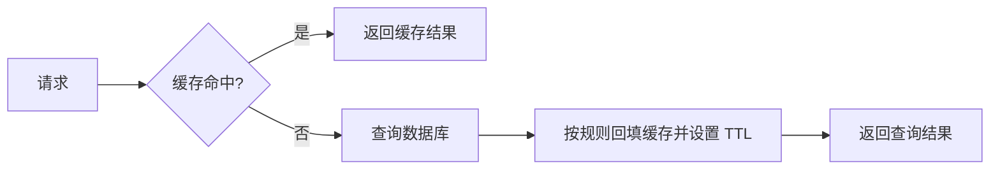
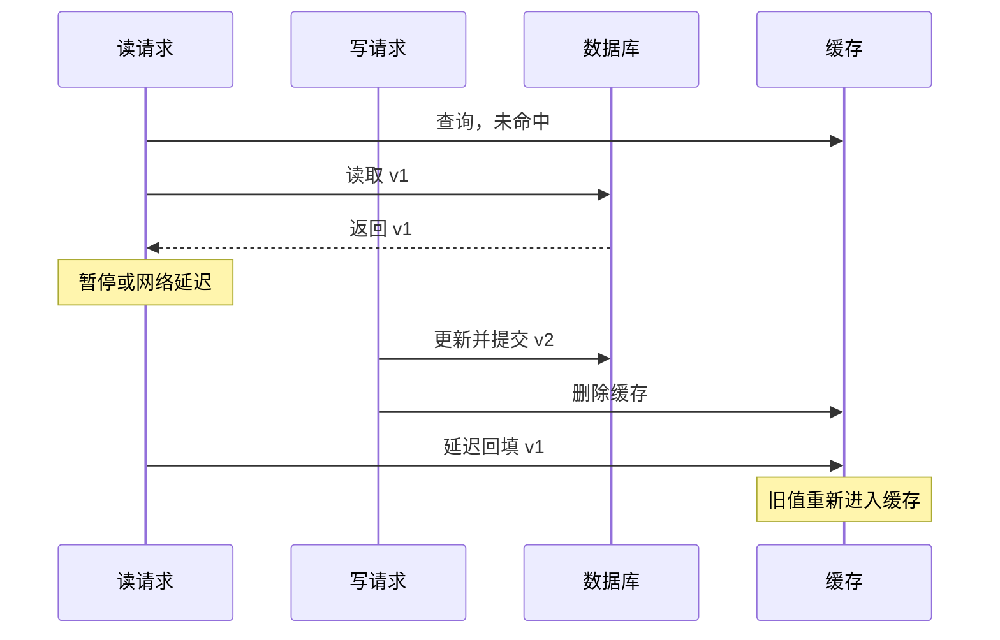

# B8-High-Performance-Cache-Architecture：高性能缓存架构与分布式内存数据库

> 课程：SE3353（CHP-fa26）。依据本目录 40 页 HTML 主课件、41 页缓存补充 PPT 与四个 Java 示例整理，并用官方文档核对易混概念（2026-11-13）。本文区分课件原理、本地源码行为与工程补充；示例行为来自静态阅读，未启动数据库或服务。涉及 Redis 内部编码时主要采用课件的 Redis 6.x／7.0 语境，版本差异单独说明。

## 1. 本讲主线与材料索引

本讲回答的问题是：**如何减少重复查询和计算，在提高吞吐量的同时，控制数据陈旧、内存耗尽和故障回源的风险？**

缓存保存可复用的数据副本或计算结果。设计时首先确定数据的权威来源：商品资料通常以数据库为准，Redis 保存副本；如果计数、消息或业务状态只存在 Redis 中，Redis 就承担了数据存储职责，需要另外设计持久化、恢复和数据丢失边界。

### 1.1 课件阅读路线

| 材料 | 页码 | 阅读重点 |
| --- | --- | --- |
| [HTML 主课件](B8-High-Performance-Cache-Architecture/1.html) | 1～4 | 学习目标、存储层次、四种缓存模式 |
| HTML 主课件 | 5～8 | Memcached、Slab、一致性 Hash、多级缓存 |
| HTML 主课件 | 9～17 | Redis 线程模型、数据结构、淘汰与过期 |
| HTML 主课件 | 18～23 | RDB、AOF、复制、Sentinel、Cluster |
| HTML 主课件 | 24～30 | 穿透／击穿／雪崩、双写一致性、锁、语义缓存 |
| HTML 主课件 | 31～38 | Spring Cache、RedisTemplate、Pub/Sub、二级缓存 |
| HTML 主课件 | 39～40 | 总结与三道思考题 |
| [缓存补充 PPT](07-caching.pptx) | 3～21 | Memcached 基础与两个 Spring Cache 示例 |
| 缓存补充 PPT | 22～33 | Redis 类型、配置与手动缓存 DAO |
| 缓存补充 PPT | 34～38 | Spring Redis 发布订阅示例 |
| 缓存补充 PPT | 39～41 | 参考资料与结束页 |

### 1.2 本地项目的实际范围

四个项目的 `pom.xml` 都声明 **Spring Boot 3.1.3、Java 20**。

| 项目 | 内容 | 当前源码状态 |
| --- | --- | --- |
| [se3353_7_springcache](se3353_7_springcache/) | ISBN 查询，模拟每次查询耗时 3 秒 | 方法有 `@Cacheable`，启动类的 `@EnableCaching` 被注释 |
| [se3353_7_caching](se3353_7_caching/) | MySQL／JPA 查询 Person，模拟慢查询 | 启用了 `@EnableCaching`，但 DAO 的 `@Cacheable` 被注释 |
| [se3353_7_springredissample](se3353_7_springredissample/) | `RedisTemplate` 手动实现 Person 旁路缓存 | 使用 Fastjson2 2.0.40，没有 TTL、空值缓存和写入失效逻辑 |
| [se3353_7_msgredis](se3353_7_msgredis/) | HTTP 触发 Redis Pub/Sub，监听器打印并计数 | 频道为 `chat`，入口为 `GET /msg` |

本目录没有完整的 Memcached 客户端、Caffeine 二级缓存、Canal、Redisson、Redis Cluster 或语义缓存工程。HTML 中相应代码是教学片段，不能直接等同于本地实现。

## 2. 缓存收益与四种访问模式

### 2.1 缓存为什么有效

缓存主要复用热点数据，减少数据库查询、跨服务调用、序列化和复杂计算。其收益依赖访问局部性：同一结果需要被重复使用，而且在复用期间仍满足业务对新鲜度的要求。

课件中的 RAM 纳秒、磁盘毫秒等数字用于说明数量级。一次 Redis 请求还包含网络、排队、协议解析和客户端处理；一次数据库查询也可能命中 Buffer Pool。不能把 RAM 访问时间当成 Redis 接口延迟，也不能把课件的 QPS 数字当成固定产品上限。

设命中率为 `h`，缓存查询耗时为 `Tc`，未命中后访问数据库耗时为 `Td`。忽略回填、排队和异常开销时：

```text
平均读延迟 ≈ Tc + (1 - h) × Td
数据库读 QPS ≈ 入口读 QPS × (1 - h)
```

教学算例：入口 20,000 QPS，命中率 95%，正常回源约 1,000 QPS；缓存整体不可用时，潜在回源会升到 20,000 QPS。因此数据库保护不能只依赖正常时的高命中率。

### 2.2 四种模式

| 模式 | 谁负责加载／写回数据库 | 读写过程 | 主要权衡 |
| --- | --- | --- | --- |
| Cache-Aside，旁路缓存 | 应用 | 读缓存，未命中查库并回填；写库提交后失效缓存 | 灵活，但应用负责一致性与失败补偿 |
| Read-Through，读穿透 | 缓存提供者／加载组件 | 应用读缓存接口，组件在未命中时加载数据库 | 统一加载逻辑，需要相应 Provider |
| Write-Through，同步写穿透 | 缓存提供者／写入组件 | 经统一接口同步更新底层存储与缓存 | 写延迟包含数据库操作，仍需处理部分失败 |
| Write-Behind／Write-Back，异步写回 | 后台组件 | 先接收缓存写入，稍后批量写数据库 | 可合并写入，但需保证未落库数据可恢复、顺序和重试正确 |

Read-Through 与 Write-Through 可以组合使用。“由缓存组件代理访问”描述职责分工，不会自动使两个存储之间的写入成为原子事务。

Cache-Aside 读路径：



适合缓存的例子是商品详情、地区字典、热门榜单和昂贵聚合结果。库存扣减、余额校验等业务判断需要在权威存储中保证约束；缓存中的展示值不能直接承担最终校验职责。

## 3. Memcached：内存分配、CAS 与分片

### 3.1 Slab 分配

Memcached 是内存 Key-Value 缓存，Value 可以是任意字节。对象结构由客户端序列化，服务端不直接提供 Redis 那样的 Hash、Set 等操作语义。

Slab 分配的基本层次是：

```text
内存 Page
  └─ 分配给某个 Slab Class
       └─ 切成同尺寸 Chunk
            └─ 每个 Chunk 容纳一个 Item
```

不同 Class 的 Chunk 尺寸逐级增大。写入时按 **Key、Value 与 Item 元数据的总尺寸**选择能容纳它的 Class。若整个 Item 为 100 B，所选 Chunk 为 112 B，就有 12 B 内部浪费；不能只用 Value 长度计算。

这种设计降低频繁变长分配的成本，但仍有内部碎片、不同 Class 使用不均等问题。“完全没有碎片”“避免操作系统 GC”都不准确：Memcached 使用 C，Slab 主要处理内存分配与复用问题。具体页大小、增长因子和重分配能力应按版本、配置确认。[Memcached 内存分配说明](https://docs.memcached.org/serverguide/performance/)

### 3.2 常用命令与 CAS

| 命令 | 含义 |
| --- | --- |
| `set` | 无条件存储／覆盖 |
| `add` | 仅当 Key 不存在时存储 |
| `replace` | 仅当 Key 已存在时替换 |
| `append`／`prepend` | 在已有 Value 后／前追加字节 |
| `get`／`delete` | 读取／删除 |
| `incr`／`decr` | 对符合格式的已有数值执行原子加减 |
| `gets`／`cas` | 读取 CAS 标识，再进行条件写入 |

CAS 用来避免“读后修改”覆盖其他客户端的更新：

```text
A: gets key → value=v1, token=t1
B: 更新 key → value=v2, token=t2
A: cas key v3 t1 → 失败，因为 token 已变化
```

CAS 保护的是该缓存项的条件更新，不会把 Memcached 与数据库的操作绑定成一个事务。

### 3.3 一致性 Hash 与虚拟节点

简单路由 `hash(key) % N` 把 Key 映射到 N 个节点。节点数改变时，大量 Key 会重新映射。假设 Hash 均匀、节点编号不变，从 N 增至 N+1 时，约 `N/(N+1)` 的 Key 改变路由。

一致性 Hash 把节点和 Key 都映射到环上，Key 顺时针找到的第一个节点负责存储它。新增节点通常只接管一个相邻区间。虚拟节点将每台物理机器映射为多个环上位置，使数据分布更均匀，也便于按机器能力配置权重。

需要区分三件事：

- **路由分布均匀**不代表请求负载均匀，单个热点 Key 仍可能压满一个节点。
- **路由变化较少**不代表旧缓存值会自动搬迁，数据迁移或重新加载由具体系统负责。
- 经典 Memcached 分片通常由客户端或代理处理，缓存节点不会因此自动获得复制与故障恢复能力。

### 3.4 Memcached 与 Redis 对比

| 维度 | Memcached 经典缓存模型 | Redis 本讲模型 |
| --- | --- | --- |
| 数据接口 | 不透明字节 Value、基本 KV 操作 | String、Hash、List、Set、ZSet、Stream 等 |
| 执行模型 | 多个工作线程处理请求 | 常规命令主要串行执行，另有 I/O 与后台工作 |
| 内存管理 | Slab Class／Chunk | 多种对象编码、通用分配器、过期与淘汰 |
| 恢复能力 | 通常按可丢弃、可重建缓存设计 | 可配置 RDB、AOF 与复制 |
| 分布式能力 | 常由客户端／代理组织分片 | Sentinel 故障转移、Cluster 分片 |

选型应围绕数据操作、恢复要求、运维能力和实际压测，不宜用“某产品一定更快”代替工作负载分析。

## 4. Redis 执行模型与原子性

### 4.1 单线程命令与多线程 I/O

按课件采用的 Redis 6.x／7.0 常规命令模型：

```text
Socket 就绪事件
  → 读取请求、解析协议（可配置 I/O 线程参与）
  → 主线程顺序执行常规命令
  → 发送结果（可配置 I/O 线程参与）
```

高性能来自内存数据、I/O 多路复用、适合业务操作的数据结构，以及避免常规命令执行中的复杂并发协调。Redis 进程还可能有异步释放、AOF 刷盘等后台线程，快照／重写还涉及子进程。

单线程执行也意味着昂贵命令会影响其他请求。长 Lua 脚本、大集合遍历、大 Value 的传输与释放都可能成为延迟来源。CPU、内存带宽、网络和磁盘都可能成为瓶颈，不能预设“Redis 只受网络限制”。

### 4.2 命令原子性不等于业务原子性

```text
GET counter → 在客户端加 1 → SET counter
```

这是三步业务过程，其他客户端可以插入操作，存在丢失更新。`INCR` 把加一合并成一条命令，才避免这个问题。

| 机制 | 提供什么 | 不提供什么 |
| --- | --- | --- |
| 单条命令 | 命令语义范围内的原子操作 | 跨请求业务流程的原子性 |
| Pipeline | 批量发送，减少等待往返的开销 | 事务隔离或自动回滚 |
| `MULTI`／`EXEC` | 排队并连续执行一组命令 | SQL 式运行时错误回滚、数据库与 Redis 的共同提交 |
| `WATCH` | Key 变化时使条件事务放弃执行 | 无限重试的活性保证 |
| Lua 脚本 | 服务端组合操作，执行期间不被其他命令穿插 | 脚本报错后的自动撤销、外部数据库原子性 |

这些机制的执行原子性与持久性是不同维度：内存中执行成功，仍要分别考虑刷盘、副本传播和故障切换。

## 5. Redis 数据类型与底层编码

### 5.1 类型、编码和业务用途

**类型定义外部操作语义，编码定义内部存储方式。** 同一个类型可因大小、元素内容、配置和版本采用不同编码。

| 类型 | 课件中的主要实现思路 | 常用命令 | 典型用途 |
| --- | --- | --- | --- |
| String | 整数编码或基于 SDS 的字符串编码 | `GET`、`SET`、`INCR` | 对象 JSON、计数、令牌 |
| Hash | 小对象紧凑编码，大对象哈希表 | `HGET`、`HSET` | 对象字段、局部更新 |
| List | quicklist 连接紧凑存储块 | `LPUSH`、`RPOP`、`LRANGE` | 有序列表、简单队列 |
| Set | intset 或哈希表等 | `SADD`、`SISMEMBER`、`SINTER` | 去重、成员关系、交集 |
| Sorted Set／ZSet | 小集合紧凑编码，大集合 dict + skiplist | `ZADD`、`ZSCORE`、`ZRANGE` | 排行榜、按分值排序 |

课件含旧 `ziplist` 参数。Redis 7.0 的 Hash、ZSet 紧凑编码使用 listpack，quicklist 节点也改用 listpack；Redis 7.2 又增加了小 Set 的 listpack 编码，因此“非整数 Set 一定立即转为 hashtable”不能推广到所有版本。编码阈值应查看对应版本配置，实际对象可用 `OBJECT ENCODING key` 观察。[Redis 内存优化与版本差异](https://redis.io/docs/latest/operate/oss_and_stack/management/optimization/memory-optimization/)

### 5.2 SDS：带长度的动态字节串

SDS（Simple Dynamic String）的概念结构为：

```text
[已用长度 len][容量 alloc][类型 flags][字节内容 buf]
```

它用显式长度支持二进制内容和 O(1) 长度读取，扩容时可预留空间以减少重复分配。SDS API 在修改前检查容量。具体头部有多种布局，不是所有 SDS 都使用同一个固定结构体。

String 还可能把整数值直接编码存储，或采用 `embstr`／`raw` 等布局。SDS 是基础字符串表示，不能直接等同于全部 Redis String 对象。

### 5.3 Hash：紧凑表示与渐进式 Rehash

小 Hash 把字段与值紧凑存放，减少指针和分配开销；规模增大后，哈希表更适合查找。哈希表扩缩容时，把迁移工作分摊到多次操作和后台维护中，避免一次搬迁全部数据。

渐进式 Rehash 的重点是**摊平工作量**。新表分配、单次迁移和编码转换仍有成本，不能理解为完全没有延迟或内存峰值。

### 5.4 List：quicklist 与 listpack

```text
head → [块：a b c] ⇄ [块：d e f] ⇄ [块：g h] ← tail
```

quicklist 将双向链表与紧凑连续块结合，平衡逐元素指针开销和整段连续内存搬移成本。课件的 Redis 7.0 模型中块内使用 listpack。

`list-max-listpack-size` 控制块大小，`list-compress-depth` 控制两端保留多少个不压缩节点。压缩用 CPU 换空间，不会自动提高所有场景的性能。两端操作适合队列，但按位置访问、长范围读取仍与遍历量有关。

### 5.5 Set 与 ZSet

intset 是有序整数数组，适合小整数集合。查找可用二分，插入可能需要移动元素；较大整数可能使存储位宽从 16 位升级到 32／64 位。不要把 intset 的所有操作都记为 O(1)。

大 ZSet 同时保留两种索引：

- `dict`：按成员查询分值，平均 O(1)。
- `skiplist`：按分值与成员顺序组织数据，支持排序、排名和范围访问。

跳表用随机层高建立多层索引，期望查找／插入复杂度为 O(log N)。返回 M 个元素的典型范围查询是 **O(log N + M)**，还需要计算结果传输成本。跳表便于有序遍历，但平衡树同样可以高效做范围查询，不能据此断言红黑树范围查询“复杂度极高”。

### 5.6 高级类型

| 能力 | 关键机制 | 使用边界 |
| --- | --- | --- |
| Bitmap | 对 String 的位进行操作 | 适合稠密编号；大偏移也会扩展存储空间 |
| HyperLogLog | 概率基数估计 | 估计独立元素数，不能列出成员或作精确成员判断 |
| GEO | 将位置编码后支持邻近检索 | 适合位置查询，不等于完整 GIS |
| Stream | 消息 ID、消费组、确认、待处理列表 | 需配置持久化、重试、认领与裁剪，业务仍可能重复执行 |

Bitmap 算例：1 亿个连续编号的布尔状态，位数据本身需要 `100,000,000 / 8 = 12,500,000 B`，约 11.9 MiB，另有 Key 和对象开销。

课件所说 HyperLogLog 的约 12 KiB 是稠密表示的数据部分，稀疏表示和对象开销另计；约 0.81% 是标准误差，不是每次估计的最大误差保证。

## 6. 过期、淘汰与内存预算

### 6.1 Expiration 与 Eviction

| 机制 | 触发原因 | 目标 |
| --- | --- | --- |
| 过期 Expiration | Key 的 TTL 到期 | 让超过有效期的数据不再作为有效缓存返回 |
| 淘汰 Eviction | 受管理内存达到 `maxmemory` 限制 | 按策略移除条目，为后续写入腾出空间 |

Redis 结合访问时检查的被动过期和周期性主动过期清理。过期时间到达，不代表那个时刻立刻完成物理内存回收；未过期的 Key 也可能因淘汰提前消失。[Redis EXPIRE 语义](https://redis.io/docs/latest/commands/expire/)

课件中的“每次抽 20 个、过期比例超过 25% 就继续”适合理解早期抽样算法。不同版本有演进，并受 `hz`、`active-expire-effort` 等影响，不应当作所有版本的固定实现。[Redis 过期算法说明](https://redis.io/faq/doc/1fqjridk8w/what-are-the-impacts-of-the-redis-expiration-algorithm)

### 6.2 课件中的八种淘汰策略

| 策略 | 候选范围 | 选择依据 |
| --- | --- | --- |
| `noeviction` | 不主动淘汰 | 超限时会拒绝需要额外内存的写操作 |
| `allkeys-lru` | 所有 Key | 近似最近最少使用 |
| `allkeys-lfu` | 所有 Key | 近似最不经常使用 |
| `allkeys-random` | 所有 Key | 随机 |
| `volatile-lru` | 设置了过期时间的 Key | 近似 LRU |
| `volatile-lfu` | 设置了过期时间的 Key | 近似 LFU |
| `volatile-random` | 设置了过期时间的 Key | 随机 |
| `volatile-ttl` | 设置了过期时间的 Key | 优先剩余 TTL 较短者 |

LRU 关注最近访问时间，LFU 关注访问频率并考虑随时间衰减。Redis 的实现采用采样、近似计数等方法减少维护成本，效果需要用实际访问分布衡量。

`volatile-*` 没有足够候选 Key 时无法继续腾出空间。`noeviction` 也不意味着所有写命令都失败，例如释放内存的删除操作仍有意义。

### 6.3 内存与 TTL 的设计原则

- 为缓存设置容量预算，给复制缓冲、客户端缓冲、分配器碎片和持久化 COW 留出余量；`maxmemory` 不能视为进程 RSS 的绝对上限。
- 对可重建数据设置适合业务的 TTL，必要时加入随机抖动，避免成批到期。
- 缓存与不可随意丢弃的业务数据共用实例时，淘汰策略可能互相冲突，应明确隔离和恢复方案。
- 区分 **Big Key**（Value 大或集合成员多）与 **Hot Key**（访问频率高）。前者影响操作、网络和迁移成本，后者可能造成单分片过载。

## 7. 持久化：RDB、AOF 与 COW

### 7.1 RDB 快照

RDB 保存某一时刻的数据状态。`SAVE` 阻塞执行快照，`BGSAVE` 创建子进程生成快照，父进程继续处理请求。

`fork()` 后，父子进程最初共享物理页；写时复制 COW 在父进程修改页时复制相关页面，使子进程仍能读取快照时的内容。

必须保留两个工程边界：`fork()` 本身可能暂停主进程，COW 按内存页而非按 Key 复制。修改 5% 的 Key，并不意味着只多占用 5% 的内存。高写入速率、大数据集和内存余量不足会放大影响。

### 7.2 AOF 日志与重写

AOF 记录用于重建数据的写操作。重写根据当前内存状态生成紧凑表示，省去不再影响最终状态的历史操作。

| `appendfsync` | 含义 | 权衡 |
| --- | --- | --- |
| `always` | 高频执行同步刷盘，再确认相应写入 | 更强持久性，代价依赖设备与批量提交 |
| `everysec` | 通常每秒同步刷盘 | 常用折中，典型故障窗口约为一秒量级 |
| `no` | Redis 不主动执行这类同步刷盘 | 由操作系统决定落盘时机，丢失窗口更不确定 |

这些策略描述正常工作与故障模型下的取舍，不是磁盘故障、文件损坏等所有情形下的零丢失保证。

### 7.3 混合持久化与版本

混合持久化用 RDB 格式表示基线状态，再保留增量 AOF。课件的“一个文件中 RDB 头 + AOF 尾”对应早期布局；Redis 7.0 起采用多段 AOF，由基线文件、增量文件和 manifest 管理恢复集合。

**持久化、复制、备份分别解决不同问题。** 同步到副本的误删除仍是误删除，持久化也不会自动提供跨存储事务。[Redis 持久化文档](https://redis.io/docs/latest/operate/oss_and_stack/management/persistence/)

## 8. 复制、Sentinel 与 Cluster

### 8.1 主从复制与 PSYNC

主节点处理写入，副本跟随复制流。正常复制是异步的，读副本可能读到旧数据，主节点故障切换也可能丢失尚未复制的写入。

| 同步方式 | 适用条件 | 过程 |
| --- | --- | --- |
| 全量同步 | 初次同步，或复制历史／积压范围不满足要求 | 传输快照，再接续增量复制流 |
| 部分同步 | 复制历史可识别，缺失内容仍在 backlog 中 | 补发缺失的复制流 |

PSYNC 关注 **replication ID + offset**。复制 ID 标识数据历史，不应直接等同于进程 RunID。PSYNC 2.0 保留上一段复制历史信息，使部分切主后的副本仍有机会增量同步；仅仅偏移差足够小还不够，历史 ID 也要匹配。

Backlog 容量可按“复制流字节速率 × 希望覆盖的断连时长 + 余量”估算。全量同步可走磁盘文件，也有无盘复制路径。`WAIT` 可以等待副本确认以降低丢写概率，但不会把整个系统变成强一致 CP 存储。[Redis 复制机制](https://redis.io/docs/latest/operate/oss_and_stack/management/replication/)

### 8.2 Sentinel：自动故障转移

```text
监控主从状态
  → 单个哨兵判定主观下线 SDOWN
  → 达到 quorum，判定客观下线 ODOWN
  → 获得多数哨兵授权，由选出的哨兵执行故障转移
  → 提升合适副本，调整复制关系，客户端发现新主
```

`quorum` 是确认主节点故障所需的判断数；执行故障转移还需要多数派授权。两者应分开理解，不能只达到一个较小 quorum 就认为任意网络分区都能切主。

Sentinel 管理主从高可用，不分片存储数据，也不转发普通数据请求。它的选举机制不能理解成对每条业务写入执行完整 Raft 日志共识。故障恢复要经过超时检测、选举、提升与客户端重连，课件中的“微秒级切主、业务完全无感”不应作为保证。[Redis Sentinel 文档](https://redis.io/docs/latest/management/sentinel/)

### 8.3 Cluster：固定槽位与请求路由

Redis Cluster 把 Key 映射到 **16,384 个槽**，再把槽分配给主节点：

```text
slot = CRC16(key) mod 16384
Key → Slot → 当前负责该槽的节点
```

扩缩容改变槽的归属，无需改变槽总数。它与 Memcached 常见的一致性 Hash 环是不同的路由方案。

| 重定向 | 含义 | 客户端处理 |
| --- | --- | --- |
| `MOVED` | 槽的当前归属在另一个节点 | 重试并更新路由信息 |
| `ASK` | 槽迁移中的一次临时重定向 | 向目标发送 `ASKING` 后重试本次请求，不据此永久修改槽归属 |

Hash Tag 让关联 Key 使用相同的 Hash 输入，例如 `{user:42}:profile` 与 `{user:42}:orders` 会落入同一槽。同槽是很多多 Key 操作、事务和 Lua 脚本在 Cluster 中的必要条件，但不能滥用一个共同 Tag，把全部流量重新挤到一个槽。

Pipeline 是批量传输手段；支持 Cluster 的客户端可以按节点拆分批次。不能把“只有同槽才能使用任何 Pipeline”当成普遍规则。

### 8.4 扩容与故障边界

槽迁移经历源端迁出、目标端导入、数据搬迁和归属更新。Gossip／Cluster Bus 交换节点与槽状态；Cluster 自己完成故障检测与副本选举，不需要另加 Sentinel 来管理同一集群的分片切换。

本讲相关约束包括：仅使用数据库 0；多 Key 操作受槽位限制；迁移可能带来重定向、重试和延迟；异步复制仍有丢写窗口。增加节点可以分摊不同 Key，不能自动拆开一个 Hot Key。[Redis Cluster 规范](https://redis.io/docs/latest/operate/oss_and_stack/reference/cluster-spec/)

## 9. 缓存穿透、击穿与雪崩

### 9.1 三类故障的区别

| 问题 | 触发条件 | 主要防护 |
| --- | --- | --- |
| 穿透 | 查询的数据不存在，重复未命中后查库 | 参数校验、短 TTL 空值缓存、Bloom Filter、限流 |
| 击穿 | 单个热点 Key 失效，大量并发一起重建 | 请求合并、互斥重建、提前刷新、逻辑过期 |
| 雪崩 | 大批 Key 同时失效，或缓存整体不可用 | 随机 TTL、分批预热、高可用、回源限流、熔断与降级 |

### 9.2 空值缓存与 Bloom Filter

空值缓存要区分“没有缓存”和“缓存了不存在”：

```text
Redis 返回 nil → Cache Miss，需要进一步查询
Redis 返回约定的空值标记 → 已知不存在，直接返回
```

空值使用较短 TTL，新增实体后应主动失效对应空值。大量随机无效 Key 会降低这种办法的效果，还需控制入口和缓存容量。

Bloom Filter 用 m 位数组和 k 个 Hash 函数记录 n 个元素，理想条件下的误判率近似为：

```text
p ≈ (1 - e^(-kn/m))^k
k_opt ≈ (m/n) × ln 2
m ≈ -n × ln p / (ln 2)^2
```

教学算例：n=1,000,000、目标误判率 p=1%，约需 9.59×10⁶ bit，即 1.14 MiB 位数组，取约 7 个 Hash 函数，实际实现还有额外开销。

“可能存在”仍需查缓存／数据库；“一定不存在”只对**已经正确加入且未被错误修改的集合**成立。新数据尚未同步到过滤器时，系统仍可能错误拒绝合法请求。因此必须设计初始化、新增同步、重建与切换过程；普通 Bloom Filter 也不能直接清除共享 bit 来删除单个元素。

### 9.3 互斥重建：锁内再次检查

```text
查缓存 → 命中则返回
未命中 → 尝试取得该 Key 的重建锁
  成功 → 再查一次缓存
           仍未命中 → 查库 → 回填（包含空值策略和 TTL）
         校验锁所有者后释放锁
  失败 → 有界等待／退避重试，或按业务降级
```

第二次检查避免排队请求在前一个请求已经回填后再次查库。等待必须有超时和容量约束，不能用无限递归加 `sleep` 让请求持续占用线程。

重建锁减少并发回源，**不会自动协调数据库写事务，也不保证返回值绝对最新**。进程内 single-flight 只合并本实例的请求，跨实例合并还需相应协调机制。

### 9.4 逻辑过期与雪崩防护

逻辑过期在 Value 中保存 `refreshAfter`。超过时间后可先返回旧值，由一个重建任务异步刷新。应另设可接受的最大陈旧时间或硬过期，并处理首次加载、淘汰后丢失和刷新长期失败。逻辑过期并不要求缓存永久保留。

雪崩防护需要组合措施：TTL 抖动缓解集中到期；分批预热缓解冷启动；限流和并发预算限制真实回源；熔断减少持续等待故障缓存；本地旧值或简化结果承担允许范围内的降级。Redis Sentinel 负责高可用，课件中用于流量治理的 Alibaba Sentinel 是另一个产品。

## 10. 数据库与缓存一致性

### 10.1 为什么常用“提交数据库，再删除缓存”

| 写入策略 | 典型问题 |
| --- | --- |
| 先更新缓存，再更新数据库 | 数据库失败或回滚，缓存却已暴露新值 |
| 先更新数据库，再更新缓存 | 并发写入的缓存更新乱序，旧值覆盖新值 |
| 先删除缓存，再更新数据库 | 读请求在间隙读到旧数据库值并回填 |
| 数据库提交后删除缓存 | 减少主动双写的乱序问题，但仍有删除失败和旧查询晚回填窗口 |

并发更新缓存的反例：

```text
W1: 数据库提交 v1
W2: 数据库提交 v2
W2: 缓存写 v2
W1: 缓存写 v1       ← 缓存倒退，数据库仍为 v2
```

删除缓存使后续查询按需重新加载，避免每次写入都构造缓存结果，尤其适合派生数据和读多写少场景。

### 10.2 先提交再删仍有并发窗口



该时序不要求数据库写入本身比读取更快，只需要读请求在回填前延迟。GC、线程调度、网络抖动、旧事务快照和滞后副本都可能延长窗口，不能以“物理上几乎不可能”排除它。

**TTL 限制单次缓存副本的存活时间，不自动证明系统具有严格的新鲜度上界。** 如果不断从滞后副本或旧快照重填，陈旧数据仍可能持续出现。

### 10.3 数据库提交点很重要

```java
@Transactional
public void update(...) {
    repository.save(...);
    redis.delete(key);
} // 数据库事务可能到这里才提交
```

`save()`、SQL 已执行、`flush()` 与 `commit()` 是不同阶段。上面代码可能先删缓存，另一个请求读到尚未提交前的旧数据并回填。

可以在提交成功后触发缓存失效，或使用支持事务同步的缓存管理器；但数据库提交后进程立刻退出，失效动作仍可能丢失。提交后回调处理顺序问题，可靠事件／重试处理交付问题，两者都需要考虑。

### 10.4 延迟双删、Outbox 与 CDC

| 方案 | 帮助解决什么 | 剩余条件 |
| --- | --- | --- |
| 延迟双删 | 在较晚时刻再清一次，覆盖部分旧值回填 | 固定延迟不能覆盖任意停顿；任务要可恢复、可重试 |
| 数据库 Outbox | 同一事务记录业务变更与待处理事件 | 后台投递、幂等消费、积压和失败处理 |
| Canal／Debezium 等 CDC | 从数据库日志捕获已提交变更 | 正确过滤提交事件、位点管理、恢复、Key 映射与消费重试 |
| 版本／世代校验 | 阻止过时读取重新写入缓存 | 版本比较本身要原子，失效后仍需保留可比较的版本信息 |

```text
数据库事务提交
  → Outbox 事件或 CDC 变更
  → 可恢复的消息通道
  → 幂等删除 Redis，并通知各实例失效 L1
```

删除通常容易重复执行，但不能把“事件重试成功”直接等同于所有并发下缓存都正确：失效事件处理后，早先的读取仍可能晚到回填。严格需求还需协调读取与写入、校验版本或直接读取权威数据，并用修复机制处理漏失事件。

延迟双删和 CDC 都提供有条件的一致性改进，不是无条件的“100% 最终一致性”。

## 11. 分布式锁、租约与 Redlock

### 11.1 单实例锁的基本写法

用一条命令原子完成“仅不存在时设置”与“附带租约”：

```redis
SET lock:product:42 <unique-token> NX PX 30000
```

不能先 `SETNX` 成功再单独 `EXPIRE`，因为客户端可能在两条命令之间退出。每次获取锁生成唯一 token，释放时需要原子校验所有者：

```lua
if redis.call('get', KEYS[1]) == ARGV[1] then
    return redis.call('del', KEYS[1])
end
return 0
```

直接 `DEL` 的风险是：A 的锁已到期，B 已获得新锁，A 恢复后把 B 的锁删掉。校验 token 可以防误删，却不能阻止 A 在锁到期后继续修改外部资源。

### 11.2 Redisson Watchdog

Redisson 在相应获取方式下自动续租，常见默认 watchdog 超时为 30 秒；显式指定 `leaseTime` 时按该租期释放。Watchdog 降低正常长任务执行期间租约提前到期的风险，但网络隔离、进程暂停仍可能导致续期失败。业务还必须正常释放锁，续租机制不会判断业务是否卡死。[Redisson 锁与同步器](https://redisson.pro/docs/data-and-services/locks-and-synchronizers/)

### 11.3 主从切换与 Redlock 的边界

原生主从锁可能出现：A 在主节点加锁成功，但锁尚未复制，主节点故障后副本被提升，B 又能获得同名锁。

Redlock 使用多个独立 Redis 主节点，要求在多数节点成功获取租约，且剩余有效时间为正：

```text
成功节点数 ≥ floor(N / 2) + 1
有效时间 = 初始 TTL - 获取锁总耗时 - 时钟漂移余量
```

失败或超过有效时间后需释放可能已取得的锁。它依赖租约、时间和故障假设，不能因为用了多数节点就视为通用强一致共识协议。

墙上时钟向前跳变可能使某个节点上的锁提前过期；单个节点提前过期不必然立即破坏多数派互斥，但叠加获取时序和其他故障后，算法安全前提可能被破坏。客户端长时间暂停后，也可能拿着过期租约继续工作。

对外部存储的关键写入，可使用由可靠机制产生的单调递增 **fencing token**，让资源端拒绝旧 token 的写入。它与用于解锁的随机 token 作用不同。库存、订单等还应依靠数据库条件更新、唯一约束与幂等规则维护业务不变量。[Redis 分布式锁与一致性边界](https://redis.io/docs/latest/develop/clients/patterns/distributed-locks/)

## 12. Spring Cache：抽象、注解与代理

### 12.1 接口关系

```text
调用方
  → Spring 缓存代理（根据注解拦截方法）
  → CacheManager 获取命名 Cache
  → Cache 读写缓存项
  → 具体存储：ConcurrentMap / Caffeine / Redis
```

Spring Cache 提供统一访问抽象，存储能力仍取决于实现。`spring-boot-starter-cache` 本身不会安装 Redis，也不会自动使缓存跨进程共享。

### 12.2 注解与 Key

| 注解／属性 | 行为 | 注意点 |
| --- | --- | --- |
| `@EnableCaching` | 启用注解缓存基础设施 | 还需匹配的缓存实现和代理调用 |
| `@Cacheable` | 命中可直接返回，否则执行方法并缓存结果 | 仅适合允许跳过方法体的调用 |
| `@CachePut` | 执行方法，再将返回值写入缓存 | 不解决并发更新乱序 |
| `@CacheEvict` | 失效缓存 | 更新和删除数据库后都可使用 |
| `@Caching` | 组合多个缓存操作 | 注意多个缓存之间的失败边界 |
| `condition` | 调用前决定是否应用相应缓存操作 | 可检查参数 |
| `unless` | 结果返回后决定是否禁止存入 | `#result == null` 会使空结果继续回源 |
| `allEntries = true` | 清空命名缓存 | 注意影响范围和实现成本 |
| `beforeInvocation = true` | 方法执行前失效 | 方法失败也已失效，不能消除所有竞态 |

默认 Key：无参数为 `SimpleKey.EMPTY`，单参数通常使用参数本身，多参数使用组合 `SimpleKey`。Key 还应包含影响结果的租户、语言、权限范围等维度，避免不同业务上下文共享结果。

以下是教学片段，省略类和依赖声明：

```java
@Cacheable(cacheNames = "persons", key = "#p0", unless = "#result == null")
public Person findById(Integer id) {
    return personRepository.findById(id).orElse(null);
}
```

该片段未缓存不存在的 Person，因而不具有空值缓存的防穿透效果。若需要负缓存，应使用支持空值的配置或明确的结果包装与短 TTL。

### 12.3 代理与事务限制

默认代理模式下，外部调用经过代理才会拦截；同一个对象中 `this.findById(...)` 的自调用绕过代理，`new` 出的普通对象也不会自动获得缓存能力。

`@Cacheable(sync = true)` 是否以及怎样同步加载取决于缓存提供者，不能仅凭注解推断获得跨 JVM 的分布式互斥。`@CacheEvict` 默认在方法成功完成后执行，也不等于数据库已经提交，需结合事务代理顺序与缓存管理器的事务支持分析。[Spring 注解缓存说明](https://docs.spring.io/spring-framework/reference/integration/cache/annotations.html)

## 13. RedisTemplate、序列化与 Pub/Sub

### 13.1 Spring Boot 与连接配置

本地 Redis 示例依赖 `spring-boot-starter-data-redis`，使用 Boot 默认集成的 Lettuce。其异步网络实现允许复用连接，但同步调用方仍可能等待结果，事务／阻塞命令也需要合适的独立连接管理。

Boot 3.1 风格的本地教学配置如下，具体超时应按调用预算调整：

```properties
spring.data.redis.host=localhost
spring.data.redis.port=6379
spring.data.redis.database=0
spring.data.redis.connect-timeout=1s
spring.data.redis.timeout=500ms
```

本地源码的 `timeout=300` 使用未显式写出的时间单位，笔记示例用 `ms`／`s` 提高可读性。Cluster 场景仅支持数据库 0；示例中的数据库登录配置需按自己的实验环境设置。

### 13.2 序列化决定实际存储的字节

| 组件 | 本讲版本的常见默认行为 | 影响 |
| --- | --- | --- |
| `RedisTemplate` | 使用 JDK 序列化器作为默认序列化器 | Java String 也可能以 Java 序列化字节存储 |
| `StringRedisTemplate` | Key、Value 及 Hash 对应序列化器采用字符串编码 | 适合文本 Key 与显式 JSON 字符串 |
| `RedisCacheManager` | 由自己的 `RedisCacheConfiguration` 定义 | 不会自动继承自定义 `RedisTemplate` 的序列化设置 |

如果先 `JSON.toJSONString(person)`，再交给默认 `RedisTemplate`，实际过程可能是“对象 → JSON String → Java 序列化字节”。因此客户端代码中的 `user1` 不一定对应 `redis-cli GET user1` 使用的相同字节 Key。

手动 JSON 字符串可以配合 `StringRedisTemplate`；直接存对象则需明确类型、JSON 序列化配置和版本兼容规则。带 `@class` 的 JSON 仍依赖 Java 类型信息，不能仅凭 JSON 格式就视为完全跨语言解耦。

`RedisCacheConfiguration` 默认不会自动给 Key 设置 TTL，可通过 `entryTtl(...)` 等配置。事务感知的缓存管理器可将相关修改协调到提交后，但仍不提供数据库与 Redis 的原子双提交。[Spring Data Redis 3.1.3](https://docs.spring.io/spring-data-redis/docs/3.1.3/reference/html/)、[RedisCacheConfiguration 3.1 API](https://docs.spring.io/spring-data-redis/docs/3.1.x/api/org/springframework/data/redis/cache/RedisCacheConfiguration.html)

### 13.3 Pub/Sub 与 Stream

| 维度 | Redis Pub/Sub | Redis Stream |
| --- | --- | --- |
| 核心模型 | 在线订阅者接收广播 | 记录消息并按 ID／消费组读取 |
| 离线读取 | 不补发离线期间消息 | 消息尚未裁剪时可重新读取 |
| 确认机制 | 没有业务消费 ACK | 消费组有 `XACK`、PEL 等机制 |
| 持久性 | 发布消息不会因开启 AOF 就变成可靠消息日志 | 数据可靠性依赖持久化与复制配置 |
| 适合用途 | 允许漏通知的实时广播 | 需要跟踪消费进度、重试的流程 |

Spring 的 `RedisMessageListenerContainer` 管理订阅，`MessageListenerAdapter` 把消息分派到普通 Java 方法。`ChannelTopic` 是精确频道，`PatternTopic` 使用 glob 风格匹配，不是一般意义上的正则表达式。

Pub/Sub 是至多一次交付：订阅方断开、来不及处理等情况下消息可丢失。用于 L1 缓存失效时，需要短 TTL、重连清理或其他修复机制。[Redis Pub/Sub 交付语义](https://redis.io/docs/latest/develop/pubsub/)

## 14. 四个本地示例的阅读与实验预期

### 14.1 ISBN 查询：注解存在，但缓存尚未启用

入口：[启动类](se3353_7_springcache/src/main/java/org/reins/se3353/se3353_7_springcache/Se33537SpringcacheApplication.java)、[SimpleBookRepository](se3353_7_springcache/src/main/java/org/reins/se3353/se3353_7_springcache/SimpleBookRepository.java)、[AppRunner](se3353_7_springcache/src/main/java/org/reins/se3353/se3353_7_springcache/AppRunner.java)。

```text
AppRunner 连续查询 6 次，涉及两个 ISBN
  → getByIsbn(isbn)，标有 @Cacheable("books")
  → simulateSlowService()，每次 sleep 3000 ms
  → 返回 Book
```

当前启动类写着 `//@EnableCaching`。按源码推演，6 次调用都会进入慢方法，模拟等待合计约 18 秒，不含启动开销。

若在实验中启用 `@EnableCaching`，且保持默认简单缓存、顺序执行与无淘汰，两个不同 ISBN 各首次等待 3 秒，之后命中，模拟等待合计约 6 秒。这些是理论预期，不能当成实测性能数据。

### 14.2 JPA Person 查询：全局启用，但方法注解被关闭

入口：[启动类](se3353_7_caching/src/main/java/org/reins/se3353/se3353_7_caching/Se33537CachingApplication.java)、[PersonDaoImpl](se3353_7_caching/src/main/java/org/reins/se3353/se3353_7_caching/daoimpl/PersonDaoImpl.java)。

当前调用链是 `GET /findPerson/{id}` → Service → DAO。启动类启用了 `@EnableCaching`，但 DAO 中 `@Cacheable("books")` 被注释，所以重复访问仍会执行模拟等待和仓储调用。

它与前一个示例分别说明两个条件：既要启用缓存机制，也要有有效的缓存操作声明。该工程没有 Redis 依赖，启用注解也不会自动变成分布式缓存。

### 14.3 手动 Redis DAO：最小 Cache-Aside

入口：[PersonDaoImpl](se3353_7_springredissample/src/main/java/org/reins/se3353/se3353_7_springredissample/daoimpl/PersonDaoImpl.java)。当前关键逻辑为：

```java
String p = (String) redisTemplate.opsForValue().get("user" + id);
if (p == null) {
    person = personRepository.getOne(id);
    redisTemplate.opsForValue().set("user" + id, JSON.toJSONString(person));
} else {
    person = JSON.parseObject(p, Person.class);
}
```

此处展示命中／未命中的控制流，但还有这些实际边界：

- 没有 TTL 和容量层面的应用策略，缓存可能一直保留到被显式删除或淘汰。
- 没有不存在数据的处理、热点重建合并和 Redis 故障降级。
- 没有数据库更新后的缓存失效，无法演示完整读写一致性。
- 使用原始类型 `RedisTemplate`，Key 为 `user` 拼接 ID，且没有自定义序列化 Bean。
- `getOne()` 返回 JPA 引用，可能延迟加载；不存在 ID 也不是简单返回 `null`。缓存查询应明确处理实体不存在的情形，通常更适合加载后转换为稳定 DTO。
- 当前 `EventDaoImpl` 直接访问仓储，不经过这套 Person 缓存。

HTML 第 35 页包含短 TTL 空值缓存、随机过期和更新示意，这些增强**不在当前本地 DAO 中**。

### 14.4 Redis 消息：打印并计数

入口：[MsgController](se3353_7_msgredis/src/main/java/org/reins/se3353/se3353_7_msgredis/MsgController.java)、[监听配置](se3353_7_msgredis/src/main/java/org/reins/se3353/se3353_7_msgredis/Se33537MsgredisApplication.java)、[Receiver](se3353_7_msgredis/src/main/java/org/reins/se3353/se3353_7_msgredis/Receiver.java)。

```text
GET /msg
  → StringRedisTemplate.convertAndSend("chat", "Hello from Redis in HTTP!")
  → Redis 广播
  → PatternTopic("chat") 对应的监听适配器
  → Receiver.receiveMessage(String)
  → 打印日志，并递增 AtomicInteger
```

代码日志里的 “Sending an email message” 只是沿用的文字，项目并没有发送邮件。接收器也没有清理 Caffeine；HTML 第 37 页的缓存失效广播是扩展示意。

实验时先准备项目声明的 Java／Maven 环境，以及各示例需要的 MySQL／Redis；对照注解开关、重复查询日志、缓存中的实际字节和消息计数观察行为。四个工程可分别运行，使用默认 Web 端口时需避免端口冲突。

## 15. Caffeine + Redis 多级缓存

### 15.1 读路径与容量

```text
L1：JVM 内的 Caffeine
  命中 → 返回
  未命中 → L2：共享 Redis
               命中 → 回填 L1 → 返回
               未命中 → 数据库 → 回填 L2、L1 → 返回
```

L1 避免网络与反序列化，适合高度集中的热点；L2 在多个应用实例之间共享结果。L1 通常容量较小、TTL 较短，L2 容量更大。Caffeine 的 W-TinyLFU 结合近期窗口和频率信息做准入／淘汰，具体收益取决于负载分布。

若 L1 命中率为 `h1`，L2 对**到达 L2 的请求**的条件命中率为 `h2`：

```text
数据库请求比例 = (1 - h1) × (1 - h2)
```

课件的 95% L1 命中、4.9% 总请求在 L2 命中，可理解为 `h1=95%`、`h2=98%`，最终 0.1% 回源。它是教学算例，不是部署后自然获得的比例。

### 15.2 `CompositeCacheManager` 不会自动实现两级读取

```java
new CompositeCacheManager(caffeineCacheManager, redisCacheManager);
```

它依次调用各管理器的 `getCache(cacheName)`，使用第一个返回非 null 的 **Cache 对象**。这与“对同一个 Key 先查 L1，未命中再查 L2”是两个不同层次。

如果第一个 Caffeine 管理器可以动态创建任何名称的缓存，就会始终返回 Cache 对象，后面的 Redis 管理器不会因为某个 Key 未命中而自动接管。因此 HTML 第 31、38 页的这段组合代码不能直接得到所画的二级缓存。[CompositeCacheManager API](https://docs.spring.io/spring-framework/docs/current/javadoc-api/org/springframework/cache/support/CompositeCacheManager.html)

真正的两级缓存可在业务访问层明确编排，或实现一个同时操作 L1／L2 的 `Cache`：定义查询顺序、命中回填、空值表示、写入／失效顺序与失败策略，并使读取和删除使用同一套 Key 规则。

### 15.3 L1 一致性需要单独设计

数据库提交后失效 L2，并向每个实例广播 L1 失效，能缩短陈旧窗口；仍需处理广播漏收、重连、事件先到而旧查询后回填等情况。

可组合短 TTL、版本校验、重连清理和可靠事件。若使用消息队列，需要确保每个持有 L1 的实例都能接到所需通知；把所有实例放进一个竞争消费组，只会让部分实例收到每条事件，不能直接替代广播。

## 16. AI 语义缓存

### 16.1 精确缓存与语义缓存

精确缓存按完整请求上下文构造 Key，适合完全相同或可规范化的请求。语义缓存则用 Embedding 找近邻，尝试复用表达不同但答案可共享的结果：

```text
请求 + 业务上下文
  → 生成向量
  → 在正确租户／模型／数据版本范围内检索候选
  → 检查距离阈值及结果可复用条件
       满足 → 返回缓存答案
       不满足 → 调用模型，并按策略缓存结果
```

Redis Search 的 HNSW 是近似近邻索引，搜索速度、召回率、索引内存之间需要权衡。课件的 `FT.CREATE`／`FT.SEARCH` 依赖相应搜索能力；不能仅从本地存在普通 Redis starter 就推断环境可执行这些命令。[Redis 向量检索](https://redis.io/docs/latest/develop/ai/search-and-query/vectors/)

### 16.2 相似度与正确性

余弦距离为：

```text
d_cosine(u, v) = 1 - (u · v) / (||u|| × ||v||)
候选命中条件：d_cosine ≤ δ
```

阈值 δ 需要用业务数据评估。课件中的 0.05、1536 维、5 ms 和费用下降比例都只是示例参数／效果描述，不能直接用作正确性或收益保证。

语义相近也可能要求不同答案，例如“如何重置自己的密码”与“如何重置管理员密码”。缓存上下文应包含租户与权限、模型和系统提示版本、知识库版本、语言、会话中的关键事实及有效期。仅查询文本相似还不够。[Redis 语义缓存设计](https://redis.io/docs/latest/develop/use-cases/semantic-cache/)

即使命中，也可能有 Embedding、检索和网络成本；适合用“减少生成调用”描述收益。应同时观察命中率与错误复用率，对高风险或个性化请求采用更严格的匹配与失效规则。

## 17. 工程观察指标与复习思考题

### 17.1 需要观察什么

| 维度 | 观察内容 | 诊断方向 |
| --- | --- | --- |
| 访问效果 | 各层命中率、回源 QPS、重建并发 | 区分低命中、热点失效和整体故障 |
| 延迟 | 客户端与服务端 p95／p99、超时、慢命令 | 区分网络、排队、阻塞与计算 |
| 内存 | 数据内存、RSS、碎片、淘汰数、过期数 | 检查容量、Big Key 和 TTL 设计 |
| 复制与恢复 | 复制延迟、全量同步次数、持久化状态 | 检查副本滞后、backlog 与磁盘 |
| 一致性链路 | 失效失败、消息积压、CDC 延迟、旧值回填 | 判断新鲜度承诺能否满足 |
| 语义缓存 | 错误命中、实际节约、版本失效效果 | 防止只提高命中率却降低答案质量 |

常见观察入口包括 `INFO`、`SLOWLOG`、`MEMORY USAGE`、`TTL`／`PTTL`、`OBJECT ENCODING`。大 Key 空间遍历应控制批次和频率，避免把全量 `KEYS *` 当成常规在线检查。

### 17.2 思考题一：为什么先提交数据库，再删除缓存

删除避免并发缓存更新的旧值覆盖，也允许按需重建派生结果；先提交再失效，减少读请求在写事务未提交时回填旧值的窗口。但删除可能失败，早先读取也可能晚回填，因此答案应包含事务提交点、重试、TTL 和版本机制，不能用读写 I/O 的平均耗时证明安全。

### 17.3 思考题二：Redis 多线程 I/O 与 Reactor 模型

共同点是事件驱动、非阻塞 I/O 和把不同工作分配到不同执行单元。课件的 Redis 模型让 I/O 线程承担部分收发／解析，常规数据命令在主线程串行执行，简化共享数据操作的协调。

Netty 可让不同 Channel 的事件循环在不同线程运行，业务也可以另行调度；Node.js 的 JavaScript 回调通常由事件循环执行，同时有底层 I/O 和工作线程。三者不能仅凭“单线程”或“多线程 Reactor”标签就视为相同架构。

### 17.4 思考题三：Redlock 的时钟与暂停风险

有效租期需要扣除获取锁耗时和漂移余量。节点时钟向前跳变可能导致锁提前过期，长暂停会让客户端错过租约有效期。校验解锁 token 只能防止误删他人的锁，不能撤销旧持有者发给数据库的写入。关键资源应检查可靠的 fencing token，并由事务、条件更新和幂等约束维持业务规则。

### 17.5 考前速记

- **命中率**决定回源规模，**尾延迟和故障时回源**决定系统能否扛住异常。
- **Cache-Aside**：读未命中才加载，数据库提交后失效，补齐失败与并发处理。
- **类型与编码**分开记；**单条命令原子**与**跨系统事务**分开记。
- **过期**按时间处理，**淘汰**按内存压力处理。
- **RDB**保存快照，**AOF**保存可恢复写入历史，**复制**保留副本，**备份**提供独立恢复点。
- **Sentinel**解决主从故障转移，**Cluster**再加入分片和槽路由。
- **穿透**关注不存在数据，**击穿**关注一个热点失效，**雪崩**关注大范围失效。
- **随机 token**用于锁所有者校验，**fencing token**用于资源端拒绝过期持有者。
- **Spring Cache**是抽象，**CompositeCacheManager**按名称选择缓存管理器。
- **多级缓存**需要明确的回填和失效协议，**语义缓存**还需要验证答案可复用性。
