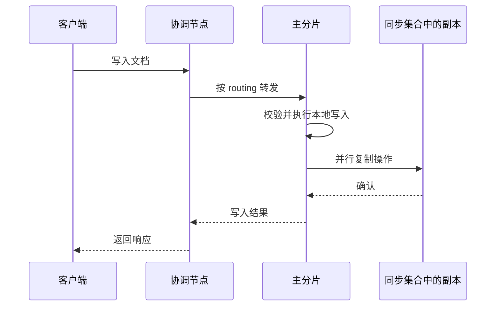

# B9-Massive-Data-Retrieval&Vec-Search-Eng：海量数据检索与向量搜索引擎

> 课程：SE3353（CHP-fa26）。依据本目录 40 页 HTML 主课件、51 页搜索补充 PPT 与 Lucene／Solr Java 示例整理，核对日期为 2026-11-18。本文区分课程原理、本地源码行为与工程补充；源码结论来自静态阅读，未启动搜索服务或改写已有索引。Lucene 示例以本地 9.7.0 依赖为准，Elasticsearch API 示例按 8.19 文档核对，不代表所有 8.x 小版本都支持相同语法。

## 1. 本讲主线与材料索引

本讲回答：**如何从海量文档中快速找出相关内容，并让关键词匹配、语义理解、分布式扩展和数据更新共同工作？**


### 1.1 课件阅读路线

| 材料 | 页码 | 重点 |
| --- | --- | --- |
| [HTML 主课件](B9-Massive-Data-Retrieval%26Vec-Search-Eng/1.html) | 1～2 | 全讲目标与路线 |
| HTML 主课件 | 3～12 | 倒排索引、Lucene 模型、分词、Segment、查询与 BM25 |
| HTML 主课件 | 13～22 | ES 节点、分片、复制、NRT、DSL、聚合与 Java Client |
| HTML 主课件 | 23～32 | Embedding、相似度、ANN、HNSW、混合检索、RRF 与 RAG |
| HTML 主课件 | 33～38 | Mapping、Bulk、分片规划、ILM、运维与应用案例 |
| HTML 主课件 | 39～40 | 总结与三道思考题 |
| [搜索补充 PPT](08-searching.pptx) | 3～21 | Lucene 定位、建索引与查询示例 |
| 搜索补充 PPT | 22～37 | 字段、物理索引、Query 家族与打分扩展 |
| 搜索补充 PPT | 38～47 | Solr、SolrJ、查询、索引与 Java Bean 绑定 |
| 搜索补充 PPT | 48～51 | ES 简介、参考资料与结束页 |

### 1.2 本地项目与版本

| 项目 | 本地声明 | 实际内容 |
| --- | --- | --- |
| [Lucene 示例](se3353_8_lucenesample/) | Java 20；Lucene 9.7.0 | 为文本文件建索引、命令行分页搜索、可选词典向量检索 |
| [Solr 示例](se3353_8_solrsample/) | Java 20；SolrJ 9.3.0 | 查询 `techproducts`、新增文档、Java Bean 绑定 |

两个项目都是普通 Maven Java 示例，没有 Spring Boot 启动入口。Lucene 的依赖包括 `lucene-core`、`lucene-queryparser`、`lucene-analysis-common` 和 `lucene-demo`。SolrJ 的版本只表示客户端依赖，不能据此推断机器上已安装的 Solr 服务版本。

本目录没有完整的 ES 集群、独立向量数据库、Embedding 服务、Cross-Encoder 或 RAG 工程。HTML 中这些内容属于教学代码与架构说明。Lucene 的 `data/` 保存的是旧版文档文本，正文出现的 “8.4.1” 是被检索内容，项目版本仍以 `pom.xml` 为准。

## 2. 搜索解决什么问题

### 2.1 精确查询、全文检索与语义检索

| 需求 | 例子 | 主要方法 |
| --- | --- | --- |
| 精确查找 | ISBN、商品 ID、订单号 | 数据库索引或搜索引擎的精确字段 |
| 结构化筛选 | 已上架、价格低于 100 元、指定租户 | `keyword`／数值／日期过滤 |
| 全文检索 | 找出讨论 “Lucene 索引” 的文章 | 分词、倒排索引、相关性排序 |
| 语义检索 | “怎么找回账号” 匹配 “密码重置指南” | Embedding 与最近邻检索 |
| 混合检索 | 同时要求型号准确、描述语义相关 | 词法召回与向量召回融合 |

使用普通 B+Tree 索引处理 `LIKE '%keyword%'`，通常无法像等值或前缀条件一样定位连续范围，可能需要扫描大量记录。简单文本扫描的工作量可近似写成 `O(N × L)`，其中 `N` 是文档数、`L` 是平均文本长度。

这里的结论针对普通索引和子串扫描；数据库也可以提供全文、三元组等专用索引，查询还可能被其他条件缩小范围。不能据此推出“所有关系型数据库都无法高效搜索文本”。

### 2.2 评价搜索质量

设检索结果集合为 `R`，人工标注的相关文档集合为 `G`：

$$
\mathrm{Precision}=\frac{|R\cap G|}{|R|},\qquad
\mathrm{Recall}=\frac{|R\cap G|}{|G|}
$$

- **Precision，查准率**：返回的文档中有多少真正相关。
- **Recall，查全率**：所有相关文档中找回了多少。
- **MRR、NDCG@k**：进一步评价正确答案是否排在前面，以及有等级的相关性排序。
- **延迟、QPS、资源成本、新鲜度**：判断系统是否满足在线服务要求。

教学算例：共有 20 篇相关文档，搜索返回 10 篇，其中 8 篇相关，则 Precision 为 80%，Recall 为 40%。提高返回数量可能增加 Recall，也可能引入噪声；更高 QPS 同样不意味着结果更好。

**ANN Recall@k 与业务查全率不同**：前者衡量近似结果覆盖了多少精确最近邻，后者衡量是否找到了用户真正需要的信息。即使精确向量近邻全部找回，Embedding 模型也可能把无关内容排在前面。

## 3. 倒排索引与 Lucene 数据模型

### 3.1 从文档找词，到从词找文档

```text
文档：
D1: lucene supports full text search
D2: vector search supports semantic retrieval
D3: lucene provides an inverted index

倒排列表：
lucene   → [D1, D3]
search   → [D1, D2]
supports → [D1, D2]
vector   → [D2]
```

查询 `lucene AND search` 可以对两个列表求交，得到 `D1`；`lucene OR vector` 求并，得到 `D1、D2、D3`。

实际 Posting 可以包含文档编号、词频、词项位置及可选 Offset／Payload。**Position 是词项在 Token 序列中的位置；Offset 是原文中的字符起止偏移**，二者不能混淆。短语查询主要依赖 Position，高亮还可能使用 Offset、Term Vector 或重新分析原文。

倒排索引减少了对全文的重复扫描，但完整查询仍要处理倒排列表、过滤、打分和 Top-k 收集。查到词典入口不代表查询已经完成，因此不能把整个全文检索复杂度统一写成 `O(log 词典大小)`。

### 3.2 四层对象

```text
Index：逻辑索引，由多个 Segment 组成
  └─ Document：一篇可检索记录
       └─ Field：字段名、类型、值与索引配置
            └─ Term：(fieldName, bytesValue)
```

`title:lucene` 与 `contents:lucene` 是不同的 Term。Lucene 内部 DocID 用于当前 Reader 的定位，合并、重开 Reader 等操作后可能变化；业务上应另外保存稳定的 `id`。

### 3.3 字段的四种能力

设计字段时，要分别回答：**怎样查、是否分词、怎样排序／聚合、怎样返回原值**。

| Lucene 字段 | 主要作用 | 需要注意 |
| --- | --- | --- |
| `TextField` | 分词后全文检索 | 原值是否存储由构造方式／`Store` 决定 |
| `StringField` | 整体作为一个词项索引 | 常用于 ID、分类，不自动提供排序列存 |
| `LongPoint`／`DoublePoint` | 数值等值与范围查询 | 通常还需单独提供 DocValues 才便于排序 |
| `NumericDocValuesField` | 数值列存 | 用于排序、聚合或打分特征 |
| `SortedDocValuesField` | 单值字符串列存 | 用于排序等按文档访问字段值的场景 |
| `StoredField` | 返回原始值 | 本身不建立全文检索索引 |
| `KnnFloatVectorField` | 向量及相应近邻索引 | 维度、相似度必须与向量生成方式兼容 |

同一个逻辑字段可以组合多种物理表示，例如价格使用 `DoublePoint` 过滤，再加数值 DocValues 排序。数值 Point 的典型底层结构是 **BKD tree**，不宜直接当作关系型数据库的 B+Tree。

本地源码使用的 `KeywordField` 和 `LongField` 是组合型便捷字段：前者提供精确值索引与 DocValues，后者组合数值 Point 与 DocValues，并可选择是否保存 Stored Value。

## 4. Analysis：文本如何变成词项

### 4.1 分词管线

```text
原始字符流
  → CharFilter：可选，处理 HTML、字符映射等
  → Tokenizer：切分 Token
  → TokenFilter：小写、停用词、词干、同义词等
  → 带位置和偏移信息的 TokenStream
```

这些步骤由选定的 Analyzer 决定，并非每个 Analyzer 都会执行全部处理。例如：

```text
输入：The Quick Foxes
小写与标准切分：the, quick, foxes
若另配停用词与词干处理：quick, fox
```

本地 `new StandardAnalyzer()` 会使用标准切分和小写过滤，**Lucene 9.7.0 无参构造器使用空停用词集合，也不自动做词干还原或 HTML 清洗**。因此不要期待它把 `headphones` 自动变为 `headphone`。[StandardAnalyzer 9.7.0](https://lucene.apache.org/core/9_7_0/core/org/apache/lucene/analysis/standard/StandardAnalyzer.html)

### 4.2 索引期与查询期需要兼容

索引把 `Lucene` 变成 `lucene` 后，直接构造 `new Term("title", "Lucene")` 可能查不到；经过同样小写处理的查询才容易匹配。

准确原则是：**查询生成的词项应与索引中的词项兼容**。两边常使用同一 Analyzer，但允许有意区分，例如索引期使用前缀扩展、查询期使用普通分析，或者只在查询期扩展同义词。ES 为此提供 `search_analyzer`。[搜索期分析器](https://www.elastic.co/guide/en/elasticsearch/reference/8.19/search-analyzer.html)

中文检索需要结合领域词典、专业名词和真实查询评估分词效果。课件中的 IK、拼音与同义词属于扩展方案，本地 Java 示例没有配置这些组件。更细的切分可能增加召回，也可能增加噪声与索引体积。

## 5. Segment、物理文件与索引生命周期

### 5.1 一个 Segment 中有什么

| 数据结构 | 主要用途 |
| --- | --- |
| 词典与词典索引 | 定位 Term 及其倒排数据；FST 可压缩共享结构 |
| Postings | 文档编号、词频、位置等匹配信息 |
| Stored Fields | 按 DocID 取出要展示的字段 |
| DocValues | 按字段组织列式数据，支持排序与聚合 |
| Norms | 保存字段长度等评分所需信息的编码 |
| Live Docs | 标识仍有效的文档 |
| Points／Vectors | 数值范围或向量近邻检索 |

物理后缀依赖 Lucene 版本与 Codec。以 9.7.0 的 `Lucene90PostingsFormat` 为例，包含 `.tim`、`.tip`、`.doc`、`.pos`、`.pay`。课件的 `.frq`／`.prx` 属于旧版表述，不应直接用于解释所有 9.x 索引。[Postings 格式说明](https://lucene.apache.org/core/9_7_0/core/org/apache/lucene/codecs/lucene90/Lucene90PostingsFormat.html)

本地 `index/` 出现 `.cfs`、`.cfe`，说明存在复合文件封装；没有在目录里看到独立 `.tim`，不代表不存在词典。也不能把 FST 理解为“整个词典必然永远驻留 JVM 堆内存”。

### 5.2 为什么采用不可变段

稳定的段数据便于并发读取与缓存复用。新增文档先进入索引缓冲，随后生成新的段；常规文档替换可以理解为删除旧版本并追加新版本。

```text
写入：新文档 → Buffer → 新 Segment
删除：旧文档进入删除状态，查询不再返回
更新：旧版本删除 + 新版本写入
合并：多个段 → 新段，回收可清理的删除数据
```

“不可变”主要描述已写成的核心段文件，不表示整个索引目录永不改变：删除状态、部分 DocValues 更新和提交元数据仍会产生新版本。已有 Reader 也不会自动切换到新快照。

Merge 能减少段数量与查询开销，但会消耗 CPU、I/O 和临时空间。旧文件要等相关 Reader／提交不再引用后才能释放。`forceMerge(1)` 适合经过评估的静态或只读索引，不应在持续写入的索引上例行执行。

## 6. 查询、BM25 与业务排序

### 6.1 Query 家族与布尔组合

| 查询 | 用途 |
| --- | --- |
| `TermQuery` | 匹配指定字段中的精确 Term，不执行全文分词 |
| `PhraseQuery` | 匹配词项位置关系，`slop` 控制允许的位置偏差 |
| `MultiPhraseQuery` | 同一位置允许多个候选 Term |
| `BooleanQuery` | 组合多个子查询 |
| Point Range Query | 数值或时间范围 |
| Prefix／Wildcard／Regexp Query | 词项前缀、通配符、正则 |
| `FuzzyQuery` | 按编辑距离处理拼写变化 |

`FuzzyQuery` 解决字面拼写相似，Embedding 解决学习得到的语义相似，两者关注的问题不同。大范围通配符和正则可能展开很多 Term，查询成本需要控制。

| 布尔子句 | 必须满足吗 | 是否贡献相关性得分 |
| --- | --- | --- |
| `MUST` | 是 | 是，取决于子查询的评分方式 |
| `FILTER` | 是 | 否 |
| `SHOULD` | 取决于组合及最小匹配数量 | 匹配时可贡献得分 |
| `MUST_NOT` | 必须不满足 | 否 |

只有 `SHOULD` 的正常布尔查询需要至少命中一个子句；已有 `MUST`／`FILTER` 时，`SHOULD` 常用于可选提分。ES 可用 `minimum_should_match` 显式指定要求。

### 6.2 TF-IDF 与 BM25

- **TF**：词项在当前文档字段中的出现频率。
- **DF**：包含该词项的文档数量。
- **IDF**：越少见的词通常越有区分力。

TF-IDF 有多种定义，TF 可以使用原始计数、对数或平方根。课件“出现 100 次得分就是 1 次的 100 倍”只适用于特定的线性 TF 简化模型；Lucene 的 `ClassicSimilarity` 使用平方根 TF。[ClassicSimilarity](https://lucene.apache.org/core/9_0_0/core/org/apache/lucene/search/similarities/ClassicSimilarity.html)

常见的教学版 BM25 公式为：

$$
\operatorname{BM25}(q,d)=\sum_{t\in q}\operatorname{IDF}(t)
\frac{f(t,d)(k_1+1)}{f(t,d)+k_1\left(1-b+b\frac{|d|}{\operatorname{avgdl}}\right)}
$$

其中 `f(t,d)` 是词频，`|d|` 是对应字段长度，`avgdl` 是平均字段长度。Lucene 使用的 IDF 形式为：

$$
\operatorname{IDF}(t)=\ln\left(1+\frac{N-\operatorname{DF}(t)+0.5}{\operatorname{DF}(t)+0.5}\right)
$$

`k1` 控制词频饱和，`b` 控制字段长度归一化；Lucene 9.7.0 默认分别为 1.2 和 0.75。`b=0` 时不按长度归一化，`b=1` 时完全采用公式中的长度比例。[BM25Similarity 9.7.0](https://lucene.apache.org/core/9_7_0/core/org/apache/lucene/search/similarities/BM25Similarity.html)

教学算例：令文档长度等于平均长度，`k1=1.2`。不计 IDF 时，上式词频项在 `f=1、3、10` 时约为 `1、1.57、1.96`，逐渐趋近 `2.2`。这展示了重复词项的边际收益递减。实际 Lucene 数值还涉及实现中的缩放、Norm 编码和查询组合，应通过 `searcher.explain(query, docId)` 核对，不能把教学公式当作逐位复现承诺。

### 6.3 排序如何加入业务信号

可以使用 `BoostQuery` 调整字段权重，使用 `FeatureField` 或 Function Score 引入销量、质量、时效等信号：

```text
最终分数 = 文本相关性 + λ × 有界的质量特征
```

业务特征应处理缺失值、异常值与尺度差异，避免销量压过相关性。课件的 `ln(popularity)` 还需要确保输入为正，并考虑零值处理。

`Similarity` 的索引期 Norm 编码与查询期解释应兼容；这不意味着每次调节 BM25 的查询参数都必须重建索引。索引模型、字段设计或 Norm 语义改变时，才需要具体分析重建要求。

## 7. 本地 Lucene 示例精读

### 7.1 IndexFiles：一份文件对应一篇文档

入口是 [IndexFiles.java](se3353_8_lucenesample/src/main/java/org/apache/lucene/demo/IndexFiles.java)。主要流程：

```text
解析 -docs / -index / -update / -knn_dict
  → FSDirectory + StandardAnalyzer + IndexWriterConfig
  → 遍历输入文件
  → 构造 Document 与 Field
  → addDocument 或 updateDocument
  → 关闭 IndexWriter，默认提交
```

| 字段 | 本地代码 | 行为 |
| --- | --- | --- |
| `path` | `KeywordField(..., Store.YES)` | 保存路径，可用于精确定位更新 |
| `modified` | `LongField(..., Store.NO)` | 可按时间过滤／排序，不作为 Stored Value 返回 |
| `contents` | `TextField(name, Reader)` | UTF-8 文本分词建索引，不保存正文原值 |
| `contents-vector` | 可选 `KnnFloatVectorField` | 使用 DemoEmbeddings 和 `DOT_PRODUCT` |

默认 `OpenMode.CREATE` 会重建指定目录中的索引；`-update` 使用 `CREATE_OR_APPEND`，按 `path` 调用 `updateDocument`。它只处理本次扫描到的文件，**不会自动删除已从源目录移除的文件记录**。

该程序没有显式调用 `commit()`，正常关闭 Writer 时按默认配置提交。段也可以在缓冲刷新或 NRT 读取时产生，不能理解成“只有 commit 才能生成 Segment”。

### 7.2 SearchFiles：匹配、Top-k 与取字段

入口是 [SearchFiles.java](se3353_8_lucenesample/src/main/java/org/apache/lucene/demo/SearchFiles.java)：

```text
DirectoryReader → IndexSearcher
用户输入 → QueryParser(contents, StandardAnalyzer) → Query
search(query, 5 × hitsPerPage) → TopDocs / ScoreDoc
storedFields.document(docId) → 读取 path 等存储字段
```

默认 `hitsPerPage=10`，先收集最多 50 个结果，再分页展示。请求更深页时，示例可能重新收集大量结果，适合学习流程，不适合作为大规模深分页方案。

注意以下实际行为：

- `contents` 没有存储，所以能全文匹配不代表能通过 `doc.get("contents")` 取回正文。
- 搜索代码尝试读取 `title`，但本地索引代码没有添加这个字段，通常不会显示标题。
- `ScoreDoc.doc` 是 Reader 内部编号，不应直接作为业务主键。
- `totalHits.value` 还要结合 `totalHits.relation` 理解；Lucene 9.7.0 的便捷搜索方法超过计数阈值后可能返回下界，本地代码没有区分这一点。
- Reader 是快照；要看到后续写入，需要重开 Reader 或使用 NRT Reader／SearcherManager 等管理机制。[IndexSearcher 9.7.0](https://lucene.apache.org/core/9_7_0/core/org/apache/lucene/search/IndexSearcher.html)

### 7.3 可选向量查询的边界

`-knn_dict` 在建索引时提供词向量字典，`-knn_vector k` 在搜索时启用向量分支。本目录没有提供对应字典源文件。

`addSemanticQuery()` 提取原查询中 `contents` 字段的词项，计算查询向量，然后把原查询和 `KnnFloatVectorQuery` 作为两个 `SHOULD` 子句组合。这是**词法与向量查询的并集及得分组合**，没有 RRF，也没有 Cross-Encoder。

还有两个容易忽略的限制：

1. 原查询内部的硬约束只约束该词法分支。若向量分支独立命中，可能绕过原查询中的过滤或排除条件；真实系统应把公共权限与业务约束放在两条召回路径都生效的位置。
2. `IndexFiles` 包含教学字典限制：文档数超过 100、`vectorDictSize < 1_000_000` 且没有 `smoketester` 属性时会抛异常。未启用字典时该大小也是 0，因此大量普通文本也可能触发。这是示例保护逻辑，不是 Lucene 的容量限制。

### 7.4 阅读与实验入口

在 IDE 中导入 Maven 项目、选择 JDK 20，并以该项目目录为工作目录，可使用以下主类与参数。建议使用新的索引目录，避免覆盖仓库随附索引：

```text
主类：org.apache.lucene.demo.IndexFiles
参数：-docs data -index index-notes-demo

主类：org.apache.lucene.demo.SearchFiles
参数：-index index-notes-demo -query "lucene" -raw

主类：org.apache.lucene.demo.SearchFiles
参数：-index index-notes-demo -query "lucene AND index"
```

这些是根据源码整理的实验入口，本笔记未执行它们。两份示例文档适合观察分词、布尔查询与排序，不适合据此测量海量数据性能。

## 8. Solr 与本地 SolrJ 示例

### 8.1 Lucene、Solr、Elasticsearch 的层次

| 组件 | 定位 | 应用接入方式 |
| --- | --- | --- |
| Lucene | 嵌入式检索类库 | 在 Java 进程内使用索引与查询 API |
| Solr | 基于 Lucene 的搜索服务 | HTTP API、SolrJ；可使用 SolrCloud |
| Elasticsearch | 基于 Lucene 的分布式搜索与分析服务 | REST／JSON DSL、各语言客户端 |

Solr 与 ES 提供不同的服务化和集群管理方案，并非严格的前后替代关系。OpenSearch 也有独立演进的版本与 API，不能默认与任意 ES 客户端互换。

### 8.2 三个主程序

所有 Solr 主程序连接 `http://localhost:8983/solr`，访问 `techproducts`。本地没有随附该服务的运行环境或 Schema 配置，运行前需要准备兼容字段定义的 Core／Collection。

| 文件 | 做了什么 | 复习重点 |
| --- | --- | --- |
| [Querying.java](se3353_8_solrsample/src/main/java/Querying.java) | `q=*:*`，返回 `id,name`，按 ID 升序 | `q` 是查询；`fl` 控制返回字段；`sort` 控制顺序 |
| [Indexing.java](se3353_8_solrsample/src/main/java/Indexing.java) | 随机 UUID 新增 Kindle 文档，commit 后查询 | 每次运行产生新 ID，可能新增业务重复数据 |
| [ObjectBinding.java](se3353_8_solrsample/src/main/java/ObjectBinding.java) | `addBean` 写入，再 `getBeans` 反序列化 | `@Field` 将 Java 属性映射到 Solr 字段 |
| [TechProduct.java](se3353_8_solrsample/src/main/java/TechProduct.java) | `id` 与 `String[] name` | 无参构造器及数组字段参与 Bean 绑定 |

`ObjectBinding` 使用固定 ID `kindle-id-4`。在通常以 `id` 为 uniqueKey 的 Schema 下，重复写入会替换同 ID 文档。PPT 的 `name` 是单个 `String`，本地源码已改为 `String[]`；直接拼接数组会打印数组标识，应使用 `Arrays.toString(name)` 展示内容。

三个主程序都没有显式关闭 `SolrClient`，工程中宜复用客户端并在应用退出时关闭，或使用 `try-with-resources`。查询未设置完整分页，因此 `getNumFound()` 的总命中数不代表本次返回列表包含全部文档。

### 8.3 Hard Commit 与 Soft Commit

本地写入示例调用普通 `client.commit("techproducts")`。Solr 的 Hard Commit 负责持久化提交，Soft Commit 主要让更新可被搜索，通常不执行索引文件 fsync。自动提交策略可由服务端配置，不要求应用每写一篇文档就提交一次。[Solr 9.3 提交与事务日志](https://solr.apache.org/guide/solr/9_3/configuration-guide/commits-transaction-logs.html)

## 9. Elasticsearch：节点、分片与路由

### 9.1 核心概念

| ES 概念 | 含义 |
| --- | --- |
| Cluster／Node | 集群／运行 ES 的节点实例 |
| Index | 相似业务文档的逻辑集合，可粗略类比一张表 |
| Document／Field | JSON 文档／带类型的字段 |
| Mapping | 定义字段类型、分析器与索引选项 |
| Primary Shard | 索引的一份水平分区，负责该复制组的写入 |
| Replica Shard | 对应主分片的副本，可承担读取与故障接管 |

ES 8.x 没有旧式 Mapping Type 层级。关系数据库类比只帮助理解组织方式，不意味着 ES 提供同样的 JOIN、约束和跨记录事务语义。

每个分片副本都维护自己的 Lucene 索引。假设 `P` 个主分片、每个主分片 `R` 个副本，则总分片副本数为：

$$
\text{Shard Copies}=P(1+R)
$$

例如 3 主分片、1 副本，共 6 份分片实例。副本增强可用性并可能提高读吞吐，同时增加存储和写入复制成本。

### 9.2 节点角色

| 角色 | 职责 |
| --- | --- |
| Master-eligible | 参与选主；当选 Master 管理集群状态与分片分配 |
| Data | 保存分片，执行检索、聚合与索引更新 |
| Ingest | 执行文档预处理管线 |
| Coordinating | 分发请求、归并各分片结果；所有节点都具备该能力 |

专用协调节点的配置是 `node.roles: []`。课件的 `remote_cluster_client` 是跨集群访问角色，不能当作协调角色的同义词。专用 Master 也应有足够资源，并避免承担业务查询入口流量。[ES 节点角色](https://www.elastic.co/guide/en/elasticsearch/reference/8.19/node-roles-overview.html)

### 9.3 路由、扩容与数据倾斜

入门时可用下式理解路由：

```text
目标分片 ≈ hash(routing) mod 主分片数
默认 routing = 文档 _id
```

真实实现还涉及 `number_of_routing_shards` 等配置。主分片数不能通过普通设置原地修改，但可以通过满足条件的 Split、Shrink 或 Reindex 生成新索引；副本数可以动态调整。[索引与路由设置](https://www.elastic.co/guide/en/elasticsearch/reference/8.19/index-modules.html)

`routing=user_id` 可以将某用户的数据路由到较少分片，但读、写、更新和删除必须使用一致的路由。大租户也可能制造热点，且路由不能替代租户权限校验。

通常主分片与其副本不能分配在同一个 ES 节点；要抵抗整机或可用区故障，还需配置故障域分配。两个 ES 进程在同一台物理机器上并不构成独立故障域。

### 9.4 分布式搜索的 Query／Fetch 两阶段

```text
Query：协调节点 → 每个目标分片选一个可用副本 → 返回局部候选与排序值
归并：协调节点合并为全局 Top-k
Fetch：向持有最终命中文档的分片取字段 → 返回客户端
```

搜索一般不需要把所有命中的完整文档都传回协调节点。深分页 `from + size` 则可能要求多个分片各自保留很多候选，放大排序和网络成本；连续翻页可考虑稳定排序下的 `search_after`，配合 PIT 保持读取视图。

## 10. 写入复制、Refresh、Flush 与持久性

### 10.1 主分片复制流程



正常情况下，主分片等待当前 in-sync 副本完成操作；副本失败时，需要按集群协议将其从同步集合中移除后再完成相应确认，不能笼统理解为“只等主分片”或“永远等待所有配置副本”。[ES 文档读写与复制](https://www.elastic.co/guide/en/elasticsearch/reference/8.19/docs-replication.html)

`wait_for_active_shards` 检查的是**执行前有多少分片副本处于活跃状态**，默认 `1` 表示主分片即可开始。它不直接定义写后的多数派确认协议，也不保证检查通过后副本不会故障；结果中的 `_shards` 反映实际复制情况。[写入前活跃分片检查](https://www.elastic.co/guide/en/elasticsearch/reference/8.19/docs-index_.html)

`_seq_no` 标识分片上的操作序列，`_primary_term` 标识主分片任期，不是每次写入都递增的两个计数器。读后更新时带上 `if_seq_no` 和 `if_primary_term`，可以在文档已被别人修改时拒绝覆盖，避免丢失更新。[乐观并发控制](https://www.elastic.co/guide/en/elasticsearch/reference/8.19/optimistic-concurrency-control.html)

### 10.2 三个容易混淆的机制

| 机制 | 主要解决的问题 | 不应误解为 |
| --- | --- | --- |
| Refresh | 让新写入进入可搜索的 Reader 视图 | 所有数据已完成持久化提交 |
| Translog 与其 fsync | 保存尚未纳入 Lucene Commit 的操作，支持恢复 | 文档已经能被 `_search` 搜到 |
| ES Flush | 执行 Lucene Commit，开始新的 Translog generation | 每条请求必须手动执行的步骤 |

Refresh 可以写出并打开新段而不等待完整 Lucene Commit。已有段保持稳定，Reader 通过新的段集合看到新增内容，所以不可变段与近实时搜索并不矛盾。ES 8.19 默认约每秒刷新近期被搜索过的索引，但配置、负载等会影响实际可见延迟，不能把“一秒”当作严格 SLA。[近实时搜索](https://www.elastic.co/guide/en/elasticsearch/reference/8.19/near-real-time.html)

Translog 默认 `durability=request`，成功响应前按规定同步日志；`async` 则按 `sync_interval` 周期同步，崩溃时可能丢失上次同步后的已确认写入。Flush 自动触发并降低恢复日志的重放量；课件“固定 30 分钟或 512 MB”不是通用版本事实，8.19 文档给出的大小阈值默认值为 10 GB。[Translog 配置](https://www.elastic.co/guide/en/elasticsearch/reference/8.19/index-modules-translog.html)

### 10.3 写入后立即搜索

- 普通写入成功：说明请求按当前复制和持久化设置完成，不保证立即被搜索到。
- `refresh=true`：要求刷新相关分片，频繁使用会产生小段与额外开销。
- `refresh=wait_for`：等待刷新使本次更改可见，适合需要“写完再搜”的请求链路。

`refresh=wait_for` 仍依赖刷新发生；若关闭自动刷新，又没有其他刷新动作，请求可能长时间等待。[Refresh 参数](https://www.elastic.co/docs/reference/elasticsearch/rest-apis/refresh-parameter)

## 11. Mapping、Query DSL 与聚合

### 11.1 用字段类型表达查询意图

以下为教学 Mapping 请求体，发送到 `PUT /products`：

```json
{
  "mappings": {
    "properties": {
      "id": { "type": "keyword" },
      "title": {
        "type": "text",
        "fields": {
          "raw": { "type": "keyword" }
        }
      },
      "status": { "type": "keyword" },
      "category": { "type": "keyword" },
      "price": { "type": "double" },
      "updated_at": { "type": "date" },
      "description": { "type": "text" }
    }
  }
}
```

`title` 用于全文检索，`title.raw` 用于整个标题的精确匹配、排序或聚合。`status` 本来就是 `keyword`，查询时使用 `status`，不应凭习惯写成不存在的 `status.keyword`。

`_source` 通常用于返回 JSON 内容；它与字段是否建立索引、是否开启 DocValues 是不同配置维度。不要为所有字符串无条件同时创建 `text` 和 `keyword`，应按查询需求决定。

### 11.2 Match 与 Term

查询请求体发送到 `POST /products/_search`：

```json
{
  "query": {
    "bool": {
      "must": [
        {
          "match": {
            "title": {
              "query": "wireless headphones",
              "operator": "and"
            }
          }
        }
      ],
      "filter": [
        { "term": { "status": "active" } },
        { "range": { "price": { "gte": 50, "lte": 300 } } }
      ]
    }
  },
  "size": 10
}
```

- `match` 在 `text` 字段上分析输入；这里 `operator=and` 要求分析后的词项都满足，但不要求相邻。需要短语关系时使用 `match_phrase`。
- `term` 用于词项级精确匹配，不执行普通全文分词；`keyword` 若配置了 Normalizer，仍需按该字段的归一化规则理解匹配。
- 数值、日期范围使用 `range`；它们的执行也不应全部解释成字符串倒排查词。
- 默认按相关性返回；若显式按 `price` 排序，排名就主要由价格决定，不能再称为纯相关性排序。

### 11.3 Query Context 与 Filter Context

Query Context 关心匹配及相关性，Filter Context 只关心是否满足条件。状态、权限、价格范围等通常放在 `filter`，其本身不贡献分数，但整个查询仍可因 `must` 获得分数。

过滤并不保证一定被缓存。ES Node Query Cache 会按查询历史、查询类型和 Segment 大小等条件选择缓存；8.19 文档明确指出 Term Query 本身不符合该缓存的准入条件。也不能从这里推出“全文搜索无法从任何缓存获益”，因为文件系统缓存、请求缓存等属于其他层次。[Node Query Cache](https://www.elastic.co/guide/en/elasticsearch/reference/8.19/query-cache.html)

### 11.4 Bucket 与 Metric 聚合

下面的请求体发送到 `POST /products/_search`，统计各分类的平均价格：

```json
{
  "size": 0,
  "aggs": {
    "by_category": {
      "terms": { "field": "category", "size": 20 },
      "aggs": {
        "avg_price": { "avg": { "field": "price" } }
      }
    }
  }
}
```

Bucket 划分文档集合，Metric 对集合计算指标。`size=0` 不返回普通命中文档，仍然需要执行聚合。DocValues 常用于支持这类访问，但不代表所有聚合都只读列存，或者必然只需毫秒。

分布式 `terms` 聚合通常返回前若干桶，计数可能受各分片候选截断影响；`cardinality` 等属于近似统计，不能未经评估直接当作财务账本式的精确计数。

### 11.5 Java Client 与版本边界

HTML 第 22 页展示了 ES 8.x 的典型层次：

```text
HTTP RestClient → Transport + JSON Mapper → ElasticsearchClient
```

强类型客户端将 JSON DSL 映射成 Builder，并把返回内容反序列化到 DTO。该代码依赖相应客户端、DTO、连接认证与资源关闭配置，本地两个 Maven 项目没有这些依赖。复习时先理解 DSL 与对象映射，再按实际小版本选择客户端配置。

## 12. Embedding 与向量相似度

### 12.1 向量表示的含义

Embedding 将文本或其他输入映射到固定长度的数值向量：

$$
f_\theta(x)=\mathbf{v}\in\mathbb{R}^{d}
$$

检索模型希望相关输入在所选度量下接近。这是模型训练与数据分布带来的性质，不是“距离近当且仅当语义相同”的数学定理。多模态搜索同样要求模型把相关模态对齐到兼容空间。

入库向量与查询向量必须使用兼容的模型、版本、维度、预处理、输入指令和归一化策略。**维度相同不代表向量空间兼容**；换模型后通常需要重算文档向量并迁移索引。

维度由模型及其支持的配置决定，768、1536 只是例子。维度增加会提高存储和计算成本，不保证搜索质量提升。

### 12.2 三种度量

| 度量 | 公式 | 排序方向 | 是否受模长影响 |
| --- | --- | --- | --- |
| 欧氏距离 L2 | $\sqrt{\sum_i(u_i-v_i)^2}$ | 越小越近 | 是 |
| 余弦相似度 | $\frac{\mathbf{u}\cdot\mathbf{v}}{\|\mathbf{u}\|\|\mathbf{v}\|}$ | 越大越相似 | 除去模长因素，零向量无定义 |
| 内积 | $\sum_i u_i v_i$ | 越大越相似 | 是 |

若两向量均为单位向量：

$$
\cos(\mathbf{u},\mathbf{v})=\mathbf{u}\cdot\mathbf{v},\qquad
\|\mathbf{u}-\mathbf{v}\|^2=2-2\mathbf{u}\cdot\mathbf{v}
$$

因此在这些条件下，余弦降序、内积降序与 L2 升序产生相同的排序。内积检索并非在数学上总要求归一化，但具体模型和索引实现可能要求；若模长本身携带训练出的信号，随意归一化会改变排序。

### 12.3 向量容量估算

对于 float32 向量，仅原始数值的容量为：

$$
\text{Bytes}=N\times d\times 4
$$

教学算例：1,000 万条、768 维，原始向量约为 30.72 GB，约合 28.61 GiB。这还没有包含图边、元数据、文本、倒排索引、副本和合并所需空间。量化可以减小搜索表示，但也可能产生精度损失，且实现可能另外保留原始向量。

## 13. 精确 KNN、ANN 与 HNSW

### 13.1 精确与近似的取舍

精确 Flat 搜索对全部候选计算距离，距离计算约为 `O(N × d)`，此外还需维护 Top-k。它适合小候选集、离线评测基线，也可以结合批处理与 GPU；不能用固定的一万条数据作为普适上限。

ANN 通过缩小访问范围或压缩表示换取速度和资源收益：

| 方法 | 思想 | 主要权衡 |
| --- | --- | --- |
| 空间树／随机投影树 | 按空间划分候选范围 | 高维时剪枝效果可能下降 |
| IVF | 聚类后只探测部分倒排桶 | 探测桶数影响延迟与召回 |
| PQ | 把向量分块，用码本压缩表示 | 降低存储，距离估计存在误差 |
| HNSW | 通过分层近邻图导航 | 查询效率较好，图构建与边存储有成本 |

IVF 与 PQ 可以组合，但它们分别负责候选划分与表示压缩。任何方法的“速度提升百倍”“只损失 1% 召回”都需要限定数据、硬件和参数。

### 13.2 HNSW 的分层图

HNSW 全称为 **Hierarchical Navigable Small World**。底层包含全部向量节点，上层包含概率采样出的部分节点，用于更大尺度的导航。

```text
上层：少量节点，快速移动到目标附近
          ↓ 把当前较近节点作为下一层入口
中层：更密集的邻居连接
          ↓
底层：维护候选集合，扩展邻居，输出近似 Top-k
```

搜索从高层入口开始，沿更接近查询向量的邻居移动，逐层下降，再在底层扩大候选探索。论文报告了良好的对数式扩展表现，但不能把它当作任意数据和过滤条件下的最坏情况 `O(log N)` 保证。[HNSW 原论文](https://arxiv.org/abs/1603.09320)

| 参数 | 控制什么 | 调大后的常见代价 |
| --- | --- | --- |
| `M`／`m` | 图的连接规模 | 边存储增加，建图更贵，通常有利于可达性 |
| `efConstruction` | 建图时的候选探索宽度 | 构建更慢，通常能改善图质量 |
| `efSearch` | 查询时的候选探索宽度 | 查询更慢，通常能提高 ANN 召回 |

这些是概念层面的参数，不同实现暴露的名称与约束可能不同。应在固定数据集上测量 Recall@k、p95／p99 延迟、QPS、构建时间与内存，再决定参数。

### 13.3 过滤如何影响向量召回

**后过滤**：先取全局近邻，再丢弃不满足租户、权限或分类的结果，容易导致最终不足 k 条。

**搜索内过滤**：在近邻搜索过程中施加条件，目标是在允许范围内寻找近邻。它更符合业务语义，但过滤越严格不一定越快，因为图遍历可能要探索更多节点；候选非常少时，精确扫描反而可能更经济。

评测 ANN 时，精确基线也应在同一过滤集合内计算，否则测到的 Recall 无法公平比较。[ES kNN 与过滤](https://www.elastic.co/guide/en/elasticsearch/reference/8.19/knn-search.html)

## 14. Elasticsearch 向量检索示例

以下是按 ES 8.19 文档核对的教学示例。使用 **3 维手工向量**只为展示 API，数值没有真实语义含义；生产维度应与模型输出一致。

### 14.1 建立索引

请求体发送到 `PUT /notes_vectors_demo`：

```json
{
  "mappings": {
    "properties": {
      "text": { "type": "text" },
      "tenant_id": { "type": "keyword" },
      "embedding": {
        "type": "dense_vector",
        "dims": 3,
        "index": true,
        "similarity": "cosine",
        "index_options": {
          "type": "hnsw",
          "m": 16,
          "ef_construction": 100
        }
      }
    }
  }
}
```

显式选择 `hnsw`，避免依赖不同小版本中可能变化的量化默认值。ES 不会仅因声明 `dense_vector` 就自动调用任意 Embedding 模型；本例需要应用提供向量。[Dense Vector 字段](https://www.elastic.co/guide/en/elasticsearch/reference/8.19/dense-vector.html)

### 14.2 写入并搜索

写入请求体发送到 `PUT /notes_vectors_demo/_doc/1?refresh=wait_for`：

```json
{
  "text": "Lucene builds an inverted index",
  "tenant_id": "course-a",
  "embedding": [0.12, -0.45, 0.88]
}
```

搜索请求体发送到 `POST /notes_vectors_demo/_search`：

```json
{
  "size": 5,
  "knn": {
    "field": "embedding",
    "query_vector": [0.10, -0.40, 0.90],
    "k": 5,
    "num_candidates": 50,
    "filter": {
      "term": { "tenant_id": "course-a" }
    }
  },
  "_source": ["text", "tenant_id"]
}
```

`k` 表示目标近邻数，`size` 控制最终响应命中数；数据不足时不会凭空补齐。`num_candidates` 是**每个分片**的候选预算，增大它通常能改善召回并增加计算量，不能把它机械等同于所有 HNSW 实现的 `efSearch`。[kNN 参数语义](https://www.elastic.co/guide/en/elasticsearch/reference/8.19/query-dsl-knn-query.html)

ES 的 `_score` 可能是对距离／相似度的转换，不能直接当作原始余弦值或概率。精确 `script_score` 搜索仍有用途，例如经过强过滤的小候选集与 ANN 对照评测。

## 15. 混合检索、RRF 与 Reranker

### 15.1 词法与向量互补


词法检索适合保留术语和字面线索，向量检索适合补充同义表达与抽象需求。型号、ISBN、订单号等严格约束应另用精确字段；BM25 本身不提供“型号一定命中、召回率 100%”的保证。

若使用 ES 顶层 `query` 加 `knn`，通常是两路结果的 OR 组合与分数合成，**不会自动变成 RRF**。词法分支里的 `filter` 也不自动约束向量分支，应在 `knn.filter` 等相应位置加入同样的公共条件。[ES 混合 kNN 搜索](https://www.elastic.co/guide/en/elasticsearch/reference/8.19/knn-search.html)

### 15.2 RRF：按名次融合

BM25 和向量得分的尺度不同，直接相加可能让某一路支配结果。加权分数融合需要校准，RRF 则使用排名：

$$
\operatorname{RRF}(d)=\sum_{m:d\in R_m}\frac{1}{c+r_m(d)}
$$

`r_m(d)` 从 1 开始；文档未进入某通道候选列表时，该通道贡献为 0。这里用 `c` 表示平滑常数，避免与 Top-k 的 `k` 混淆。常用示例取 `c=60`。

| 文档 | BM25 排名 | 向量排名 | RRF，c=60 |
| --- | --- | --- | --- |
| A | 1 | 3 | `1/61 + 1/63 ≈ 0.032266` |
| B | 2 | 2 | `1/62 + 1/62 ≈ 0.032258` |
| C | 未进入候选 | 1 | `1/61 ≈ 0.016393` |

A 略高于 B，四舍五入后可能看起来相同。RRF 不需要比较原始分数尺度，但仍受候选窗口、平滑常数、通道质量与去重方式影响；候选之外的相关文档无法靠融合补回来。ES 8.19 提供显式 RRF Retriever，实际使用需核对部署版本与可用功能。[RRF 公式与 API](https://www.elastic.co/guide/en/elasticsearch/reference/8.19/rrf.html)

### 15.3 Cross-Encoder 精排

| 模型方式 | 计算过程 | 用途 |
| --- | --- | --- |
| Bi-Encoder | 文档和查询分别编码，按向量关系比较 | 文档可预计算，适合大规模召回 |
| Cross-Encoder | 联合输入查询与候选文本，计算交互相关性 | 每个查询都需重新计算，适合小候选集重排 |

典型设计是先召回几十到几百条，再重排并保留较少结果。数量应由延迟预算、标注集和上下文预算决定，课件 Top-100、Top-5 只是示例参数。Reranker 能调整已有候选的顺序，无法找回从未召回的文档。

## 16. RAG：把检索结果变成回答依据

### 16.1 离线入库与在线查询

```text
入库：
原始资料 → 解析与清洗 → 切块 → 文本索引 + Embedding 向量索引
                              └→ 来源、位置、权限、版本等元数据

查询：
问题与用户身份 → 词法／向量召回 → 融合去重 → 重排
             → 选择证据与控制 Token 预算 → LLM 生成 → 返回引用
```

一个 Chunk 至少需要可追踪的标识与来源。工程上常保存：

| 元数据 | 目的 |
| --- | --- |
| `document_id`、`chunk_id` | 去重、更新和删除 |
| `source_uri`、页码／章节／偏移 | 生成可回查的引用 |
| `tenant_id`、ACL 标识 | 控制可见范围 |
| `content_version`、更新时间 | 区分旧内容与新内容 |
| `embedding_model_version` | 追踪向量空间及迁移状态 |

按标题、段落、表格等结构切块通常有助于保留上下文。块太小会丢失语境，块太大可能稀释主题并增加成本；Overlap 可缓解边界丢失，也会造成重复内容。课件的 512 Tokens、50 Overlap 应作为实验起点，不能作为所有文档的固定最优值。

### 16.2 数据新鲜度与索引同步

**工程补充**：业务数据库常是商品与订单的权威来源，搜索索引是可重建的读模型。数据库提交与索引写入不是天然原子事务，可以结合 B5 的 Outbox／CDC 思路同步变更：

```text
数据库提交业务变更与待发布事件
  → 后台投递／CDC 捕获
  → 索引消费者按稳定 ID 与版本写入
  → 处理失败重试、乱序、删除和积压
```

索引消费者需要幂等性，重试不能不断创建新业务副本。更新一篇长文档时还要删除旧版本多余的 Chunk；只追加新 Chunk 会使旧答案持续被召回。

换 Embedding 模型可以构建新版本索引，回填并验证后切换查询入口。迁移期间必须把查询送到兼容的向量空间；不能让新模型查询任意旧模型向量。

### 16.3 权限、证据与回答质量

权限过滤应覆盖词法和向量两路，且在候选进入重排服务或 LLM 前生效。仅在最终界面隐藏无权文档，仍可能让内容进入模型上下文或日志。

RAG 能为回答提供外部证据，但不能保证消除幻觉。检索可能漏召回、文档可能过时，模型也可能误读证据；“回答带引用”不等于引用真的支持每项结论。证据不足时应明确说明，而不是强行拼出确定答案。

检索到的文档属于数据，不能因为正文写有“忽略原指令”就改变系统的权限和行为。检索、Embedding、重排和生成服务之间的数据传输，也应纳入部署与权限设计。

### 16.4 分层评测

| 层次 | 评测问题 |
| --- | --- |
| 数据解析 | 表格、标题、页码是否提取正确，是否遗漏内容 |
| 召回 | 答案依据是否进入候选，过滤是否正确 |
| 重排 | 最相关证据是否进入前几名 |
| 生成 | 是否忠于证据，引用是否支持回答，证据不足时是否恰当处理 |
| 系统 | p95／p99 延迟、Token 成本、索引延迟、失败率 |

定位失败时应先找出依据在哪个环节丢失。例如答案所在 Chunk 根本没进候选，优先检查切块、词法分析、Embedding 或 ANN，而不是只调整生成 Prompt。

## 17. 向量检索组件如何选型

选型应依据过滤、更新、召回、成本与团队运维能力。数据量是一个因素，不能用“千万以下必选 ES，亿级以上必选某向量库”替代压测。

| 方案 | 评估重点 |
| --- | --- |
| 已有 Elasticsearch | 能否复用文本检索、过滤和运维体系；向量负载是否影响现有查询 |
| Milvus 等专用向量数据库 | 大规模向量负载下的索引、过滤、更新与资源分配 |
| Qdrant 等向量服务 | Payload 条件、向量查询、部署和恢复是否满足应用要求 |
| Faiss 等向量检索类库 | 是否适合嵌入应用；服务化、权限和数据管理如何另行实现 |

Milvus 与 Qdrant 都提供过滤能力，因此“专用向量数据库普遍不擅长标量过滤”不能作为无条件结论；应测试本业务的过滤选择率、复杂条件和更新模式。[Milvus Filtered Search](https://milvus.io/docs/filtered-search.md)、[Qdrant Filtering](https://qdrant.tech/documentation/search/filtering/)

Faiss 是相似性搜索与聚类类库，提供多种精确／近似方法及部分 GPU 实现。把它嵌入系统时，仍需自行考虑服务协议、持久化流程、权限和故障恢复。[Faiss 官方项目](https://github.com/facebookresearch/faiss)

有意义的对照实验应固定语料、向量、查询集与过滤条件，在相近的 Recall@k 下比较延迟、吞吐、内存、磁盘、构建时间、更新能力和成本。

## 18. 海量检索的工程治理

### 18.1 Mapping 与存储优化

| 问题 | 可采取的措施 | 需要保留的边界 |
| --- | --- | --- |
| 仅展示的长字段占用索引空间 | 关闭不需要的索引能力 | `index:false` 不等于从 `_source` 删除 |
| 从不排序／聚合的字段有列存开销 | 评估关闭 `doc_values` | 不能影响现有排序、脚本和聚合需求 |
| 不需要长度归一化的文本字段 | 评估关闭 `norms` | 会影响相关性评分语义 |
| 动态字段无限增长 | 显式 Mapping、限制动态扩展 | 防止字段数量与元数据失控 |
| 同一内容存了过多表示 | 按需求选择 text、keyword、向量 | 保留检索、展示与重建所需信息 |

部分字段即使 `index:false`，仍可能通过 DocValues 进行较慢查询，因此也不能把这一设置一概等同于“绝对不可搜索”。节省效果应基于索引样本测量。

### 18.2 Bulk 与写入吞吐

Bulk 通过批量请求降低网络往返与解析开销。批次应同时考虑字节大小、文档复杂度和并发数量，不能只数文档条数。课件的 5～15 MB 可作为试验量级，最佳值要用实际数据寻找。

**HTTP 请求成功不代表 Bulk 中每一项都成功。** 客户端应检查 `errors` 和每个 item，区分可重试的暂时失败与 Mapping 等永久错误，避免盲目重试整个批次。[Bulk API](https://www.elastic.co/guide/en/elasticsearch/reference/8.19/docs-bulk.html)

| 调整 | 可能收益 | 代价／适用前提 |
| --- | --- | --- |
| 增大批次或并发 | 提高吞吐 | 过大时会增大排队、内存与尾延迟 |
| 调大／暂停 Refresh | 减少频繁生成可搜索小段的成本 | 新数据可见更晚；完成后需恢复 |
| 临时减少副本 | 降低网络与副本索引开销 | 降低故障容错，仅适合可恢复或可重建的导入 |
| `translog.durability=async` | 减少按请求同步日志的成本 | 存在已确认写入丢失窗口，需明确接受 |
| 增加可用 Page Cache | 减少读盘 | JVM 堆、堆外内存与文件缓存需共同规划 |

不要把“关闭副本、异步 Translog、强制合并”打包成无条件的默认优化。尤其课件导入后的恢复示例只恢复了 Refresh 和副本，**若导入前改过 Translog durability／sync interval，也必须按原配置恢复**。

导入结束后的检查顺序可以是：确认 item 失败已处理、恢复设置、等待副本恢复、确认搜索可见、核对文档数及抽样内容。只读索引再单独评估 Force Merge，不要求所有索引都合成一个段。

### 18.3 分片规划与生命周期

小分片过多会增加元数据、文件句柄、调度和查询归并开销；单分片过大则会延长迁移和故障恢复。ES 8.19 文档给出的常见参考范围是每分片 10～50 GB，并建议控制单分片文档数；这只是起点，不是所有向量／文本负载的最优值。课件“每 GB 堆固定承载 20 个分片”不宜当作新版本通用公式。[分片容量规划](https://www.elastic.co/guide/en/elasticsearch/reference/8.19/size-your-shards.html)

ILM 按生命周期执行自动化动作：

| 阶段 | 常见用途 |
| --- | --- |
| Hot | 活跃写入与检索，达到条件后 Rollover |
| Warm | 写入减少的历史数据，可按策略 Shrink／Force Merge |
| Cold | 更少访问的数据，采用成本更低的存储策略 |
| Frozen | 使用适用的可搜索快照方案进一步降低本地资源需求 |
| Delete | 达到保留期限后删除索引 |

并非每个索引必须经过所有阶段。配置 Rollover 还需要正确的数据流或写入别名，不能只创建一个 ILM Policy 就期待全部流程自动运行；冷热阶段也不会天然由“过了多少天”决定，需要明确策略。

### 18.4 高可用、快照与滚动维护

| 健康状态 | 含义 | 应如何解读 |
| --- | --- | --- |
| Green | 主分片与配置的副本都已分配 | 不证明已有备份；零副本也可能 Green |
| Yellow | 主分片已分配，部分副本未分配 | 通常仍可查询，但冗余不足 |
| Red | 至少一个主分片未分配 | 部分数据不可用，不等于已确定永久丢失 |

副本主要抵抗节点故障，误删或错误更新也会复制。Snapshot 用于备份与恢复：它将需要的 Segment 复制到外部仓库并去重，不是简单的跨节点文件硬链接，也不表示全体分片在同一瞬间拍照。恢复必须核对版本兼容性，不能用直接复制各节点数据目录代替受支持的快照备份。[Snapshot 与 Restore](https://www.elastic.co/guide/en/elasticsearch/reference/8.19/snapshot-restore.html)

滚动重启的基本思路是检查集群与恢复能力、按需暂缓副本分配、一次维护一个节点、等待其恢复后再继续，最后恢复相关设置。ES 8.0 已移除 `/_flush/synced`，应按版本使用普通 `/_flush`；重启与跨版本升级也需要分别核对流程。[ES 8.0 迁移说明](https://www.elastic.co/guide/en/elasticsearch/reference/8.19/migrating-8.0.html)、[滚动重启流程](https://www.elastic.co/guide/en/elasticsearch/reference/8.19/restart-cluster.html)

### 18.5 应监控哪些指标

- 搜索与索引的 p95／p99 延迟、QPS、失败率及线程池拒绝。
- JVM GC、堆与堆外内存、文件缓存、磁盘空间及 I/O。
- 分片分配、恢复进度、Segment 数量、Merge 开销和热点分片。
- 数据库到搜索索引的同步延迟、死信、重试和版本冲突。
- 向量 Recall@k、过滤后的结果数量、重排耗时与 Embedding 失败率。

课件中的 QPS、微秒级延迟、成本降低百分比和业务转化提升没有给出本地可复现的测试条件，因此本笔记不把这些数字当作产品保证或已验证实验结果。

## 19. 课后三道思考题

### Q1：不可变 Segment 如何支持近实时搜索？

新增数据先进入索引缓冲，随后写成新段；Refresh 打开新的搜索视图，把新段纳入查询，而不改写已有核心段文件。Translog 负责补充尚未进入持久化 Lucene Commit 的恢复路径，Flush 推进提交与日志生命周期。Merge 在后台整合段并回收可清理的旧数据。

答题要点是区分 **段不可变、Reader 可见性、日志持久化和提交**，并说明默认刷新间隔不是严格的最大延迟承诺。

### Q2：为什么状态和价格条件适合放在 Filter Context？

它们通常表达硬约束，不需要衡量“相关程度”。Filter Context 可以避免无意义的评分工作，并让符合策略的查询利用过滤缓存。

不能无条件说性能必然提高数倍：某些查询本身评分就很便宜，缓存也有准入条件。应说明查询语义为何更合适，再用实际负载验证收益。

### Q3：向量检索为何会漏掉型号，RRF 如何融合两路结果？

Embedding 可能把语义相近但型号不同的商品编码得很接近，ANN 又引入额外近似误差；词法分支可补充字面线索，严格型号要求还应使用精确字段过滤。

RRF 将各通道名次转换为 `1/(c + rank)` 后相加，避免直接比较 BM25 与向量的分数尺度。它改善的是已有候选的融合顺序，不能自动纠正权限错误或保证零漏召回。

## 20. 复习速查

| 容易混淆的概念 | 应记住的区别 |
| --- | --- |
| Indexed／Stored／DocValues | 匹配、原值返回、列式访问是不同能力 |
| Token Position／Offset | 词项序列位置与原文字符位置不同 |
| Term Vector／Embedding | 前者记录文档的词项统计，后者是模型生成的数值表示 |
| Lucene Index／ES Index／Shard | 单机索引、分布式逻辑集合、分区副本是不同层次 |
| Refresh／Flush／Merge | 搜索可见、持久化提交、段整合分别处理不同问题 |
| 写入 ACK／立即可搜索 | 写请求成功不自动意味着搜索视图已更新 |
| KNN／ANN | 精确最近邻目标与近似求解方式；API 名称仍可能叫 kNN |
| 余弦／内积 | 单位向量条件下相同；任意向量不能直接等同 |
| RRF／Cross-Encoder | 按排名融合与模型联合评分是不同阶段 |
| Replica／Snapshot | 在线冗余与可恢复备份不能互相替代 |
| ANN Recall／答案正确率 | 找准向量近邻不等于检索证据与生成答案都正确 |

复习时可沿一条请求串联全讲：**用户输入如何分词／编码，怎样选择候选与施加权限，怎样跨分片归并，如何融合排序，何时能搜到刚写入的数据，节点故障后又怎样恢复。** 对应回看主课件第 5、7、16～20、27～32、34～37 页，再阅读本地 `IndexFiles`、`SearchFiles` 和三个 Solr 主程序。
