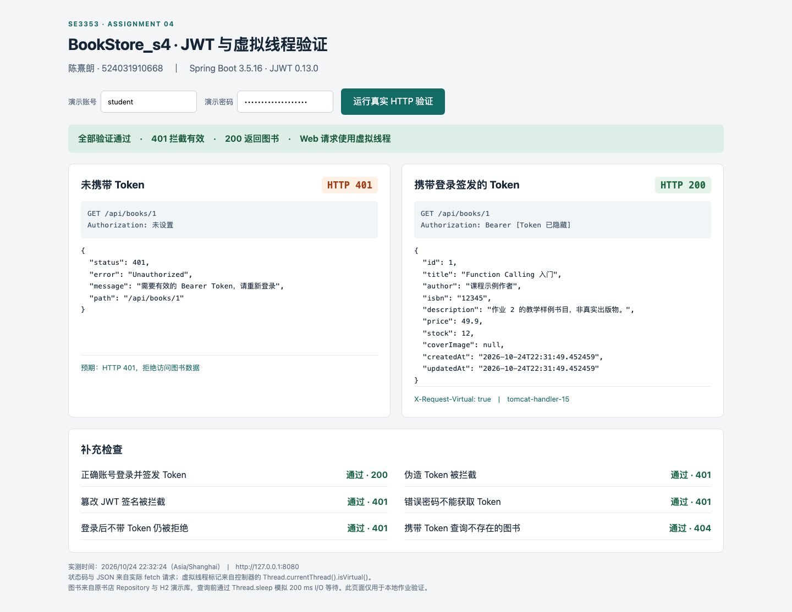
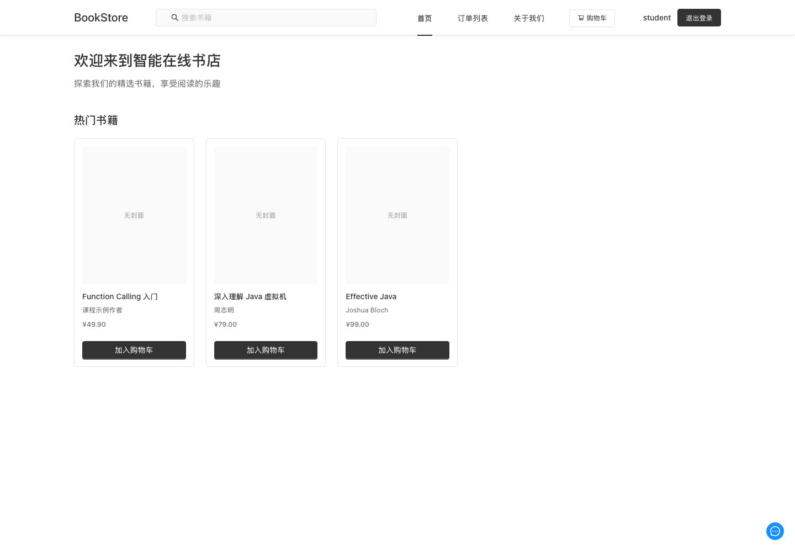
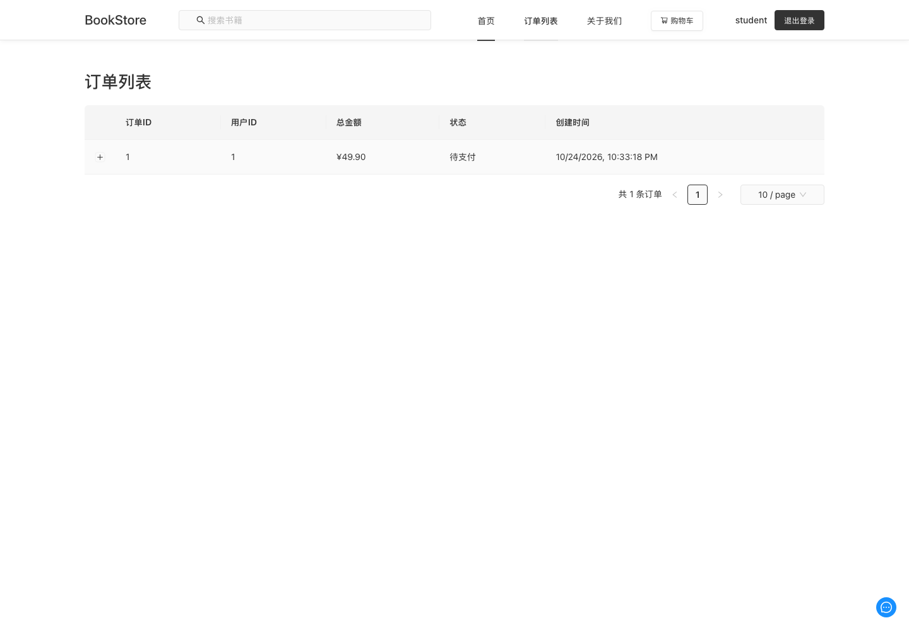

# 作业 4 在原书店中实现无状态认证与虚拟线程

陈熹朗　524031910668　2026 年 10 月 24 日

本次把独立验证版的 JWT 和 Java 21 虚拟线程能力整合到原 `BookStore_s4`，由原 `BookStoreApplication` 启动。查询复用 `BookController → BookService → BookRepository`，登录复用数据库中的用户及 BCrypt 密码，订单与管理员 API 使用同一个 JWT 认证链。前端请求、登录恢复与退出也已同步改造。

## 五项评分点

| 评分标准 | 整合后的实现 | 验证 |
| --- | --- | --- |
| RESTful 图书接口 | `controller/BookController.java`、`service/BookService.java` | `GET /api/books` 和 `GET /api/books/{id}`；有效资源 200、不存在 404、非法 ID 400 |
| Java 21 虚拟线程 | `backend/pom.xml` 使用 Java 21、Spring Boot 3.5.16；`application-jwt.properties` 启用虚拟线程 | 实际请求线程调用 `Thread.currentThread().isVirtual()`，通过响应头返回；并发测试全部为 true |
| JWT 库与签发 | JJWT 0.13.0；`security/JwtService.java`、`UserController.login` | 正确数据库账号登录返回签名 Token，集成测试独立校验签名与声明 |
| 无状态 Filter | `JwtAuthenticationFilter`、`SecurityConfig` | 缺失、伪造、过期 Token 均为 401；不创建 Session；每次读取账号状态与权限 |
| 测试截图 | `evidence-jwt/authentication-401-200.png` | 浏览器调用真实整合后端，同屏展示 401、200、原书店数据和虚拟线程标记 |

## 后端整合

`UserService.login` 通过原有 AuthenticationManager 和数据库账号验证密码。`UserController` 返回 `LoginResponseDTO`，保留原前端需要的 `message`、`user`，新增 `accessToken`、`tokenType`、`expiresIn`；不再执行 Session ID 轮换或保存 SecurityContext。原 `/api/auth/csrf` 入口已移除。

JWT 使用 HS256，包含 `sub`、`iss`、`aud`、`iat`、`exp`、`jti`，默认有效期 900 秒。`JWT_SECRET` 从环境注入且至少为 32 个随机字节的 Base64。解析器只允许 HS256，检查签名、发行者、受众、有效期及可选 `nbf`，并要求到期时间与非空主体存在。运行密钥不进入源码、证据和提交包。

`JwtAuthenticationFilter` 要求单个 `Authorization: Bearer <token>`，校验后通过原 `UserDetailsServiceImpl` 读取当前数据库账号。由数据库提供 CUSTOMER/ADMIN 权限；被禁用或已删除的账号无法继续使用先前 Token，角色变更也立即作用于后续请求。数据库中的业务用户数据不是登录 Session，服务端不保存已签发 Token 列表。

安全链使用 `SessionCreationPolicy.STATELESS`、`NullSecurityContextRepository`，禁用 RequestCache、表单登录、Basic、CSRF 和默认 Session 注销；过滤器仅注册在 Spring Security 链内一次。错误响应保持原始 400/404，Servlet ERROR 分派不会再次把它改成 401。CORS 允许显式 Authorization，关闭凭据 Cookie，并向前端暴露线程响应头。

原订单归属检查、管理员接口限制和账号禁用规则继续生效。AI 公共查询入口保持原来的匿名查询策略，但涉及订单和用户的业务仍从当前认证身份解析，不能相信请求中伪造的用户 ID 或角色。

`POST /api/auth/logout` 返回 204，前端清除本地 Token。此实现不维护撤销列表，因此已复制的合法 Token 在到期或密钥轮换前仍可能有效；禁用账号会通过每次请求的数据库检查阻止继续访问。

## 原前端适配

`services/api.js` 自动发送 Bearer，设置 `credentials: 'omit'`，取消先行 CSRF 请求。登录、注册、退出使用匿名请求选项，避免过期 Token 阻塞重新登录。Token 保存在标签页 `sessionStorage` 中以支持刷新，用户身份仍通过 `/api/user/me` 向服务端验证。

有效 Token 收到 401 时清除凭据并打开登录框；旧请求的迟到 401 不会清除新登录的 Token。退出即使遇到网络失败也会清除本地凭据。`AuthContext`、`BooksContext` 和 `App` 同步处理身份切换：游客显示登录入口，成功登录后加载数据库图书，退出或切换账号清除书目、购物车和订单页面状态。图书请求带 AbortSignal，卸载时取消未完成请求。

原注册、查看图书、购物车下单、订单列表、管理员菜单均继续使用原组件。浏览器端真实完成了顾客登录、页面刷新、下单、订单列表、退出、管理员登录和无效凭据处理。

## 虚拟线程和数据访问

项目实际使用 Temurin 21.0.13+9 与 Spring Boot 3.5.16。共同配置启用：

```properties
spring.threads.virtual.enabled=true
spring.main.keep-alive=true
```

所有数据库模式（包括 MySQL 和 `assignment4` 演示 profile）的额外模拟延迟均默认为 200 ms，通过 `app.books.delay-ms` 配置。`BookService` 在执行真实 Repository 查询之前调用 `Thread.sleep`，位置在实际请求线程上。响应头 `X-Request-Virtual` 和 `X-Request-Thread` 在原 `BookController` 中生成，没有另造一个虚拟线程来伪装请求线程。

整合工程仍支持原 MySQL 配置；演示使用隔离 H2，数据来自原 `data-demo.sql`。`Assignment4DemoData` 只在演示 profile 创建公开 student/admin 账号。演示启动脚本不会连接或修改用户的 MySQL 数据库。

## 验证结果

| 验证范围 | 结果 | 证据 |
| --- | --- | --- |
| 完整后端测试 | 85 通过，0 失败/错误/跳过 | `evidence-jwt/backend-tests.log`、`test-summary.txt` |
| 其中真实 HTTP/JWT/数据库集成 | 35 通过 | `BookstoreJwtHttpTest` |
| 精简提交构建 | 同一份后端源码，35 通过 | `evidence-jwt/submission-tests.log` |
| 前端单元和组件测试 | 19 通过 | `evidence-jwt/frontend-tests.log` |
| 前端 lint 和生产构建 | 通过 | `frontend-lint.log`、`frontend-build.log` |
| 独立 HTTP 验证 | 11/11 | `http-verification.json`、`http-verification.txt` |
| 原书店真实浏览器流程 | 9/9，无页面异常或 Cookie | `bookstore-ui-verification.json` |

35 项真实 HTTP 测试覆盖缺失、畸形、重复、篡改、过期、未来生效、错误发行者/受众、未签名、缺失声明的 Token，以及登录、注册、角色变化、账号禁用、数据库身份、资源状态码、40 并发请求的虚拟线程。完整测试还覆盖原订单权限、库存并发和事务回滚、取消订单恢复库存、AI 调用和 RAG 检索模块。

原前端构建存在大于 500 KB 的 JS chunk 提示，构建成功；此提示来自现有前端依赖打包体积。本次没有进行与认证整合无关的拆包改造。大模型生成内容未重新在线调用，AI/RAG 兼容性由回归测试验证；完整 RAG 运行模式仍需原模型与向量服务配置。

### 实际截图







### 并发对照

同一份整合后端、每次查询前等待 200 ms、实际 H2 数据库与 JWT 账号查询、Python 100 个客户端线程发送 100 次请求。每种模式预热 20 次，再各运行 3 轮；平台线程对照显式限制为 10 个 Tomcat 工作线程。

| 模式 | 第 1 轮 | 第 2 轮 | 第 3 轮 | 中位耗时 | HTTP 200 |
| --- | ---: | ---: | ---: | ---: | ---: |
| 平台线程 上限 10 | 2.1372 s | 2.1751 s | 2.1507 s | 2.1507 s | 300/300 |
| Java 21 虚拟线程 | 0.3137 s | 0.3747 s | 0.3022 s | 0.3137 s | 300/300 |

当前条件下耗时比约 6.86，虚拟线程组 300 个响应的标记均为 true，平台线程组均为 false。此实验展示较小线程池面对阻塞 I/O 的排队现象，不代表相对默认 Tomcat 配置或生产数据库的普遍加速倍数。真实数据库连接数、CPU 和客户端开销仍会影响吞吐。逐轮延迟、吞吐和环境见 `evidence-jwt/benchmark.json`。

## 构建与提交

仓库中的完整书店使用 `scripts/run-assignment4.sh`，原 `start.sh` 已转到这一入口。需要原 RAG 服务时设置 `WITH_RAG=1`。相关旧演示客户端已移除 Session/CSRF 依赖，作业 3 的独立查询入口也同步为无状态公开查询。

题目要求不压缩整个工程，因此 `scripts/package_assignment4.py` 收录本题修改的源码、前端文件及必要的数据库用户/图书基础类，附带 `assignment4/pom.xml` 精简构建入口。它用 Maven includes 直接编译同一份整合代码，没有再维护另一个实现。提交包的 `scripts/run-assignment4-submission.sh` 能独立运行全部五项评分功能；完整 React 页面及订单验证可在仓库原工程中复现。

完整命令、演示账号和端口说明见上级 `README.md`。原独立目录 `bookstore-api` 保留为初始实现参考，新的提交包从 `BookStore_s4` 生成。

## 参考资料

- [Spring Boot 虚拟线程配置](https://docs.spring.io/spring-boot/3.5/reference/features/spring-application.html#features.spring-application.virtual-threads)
- [JJWT 官方项目与签名校验 API](https://github.com/jwtk/jjwt)
