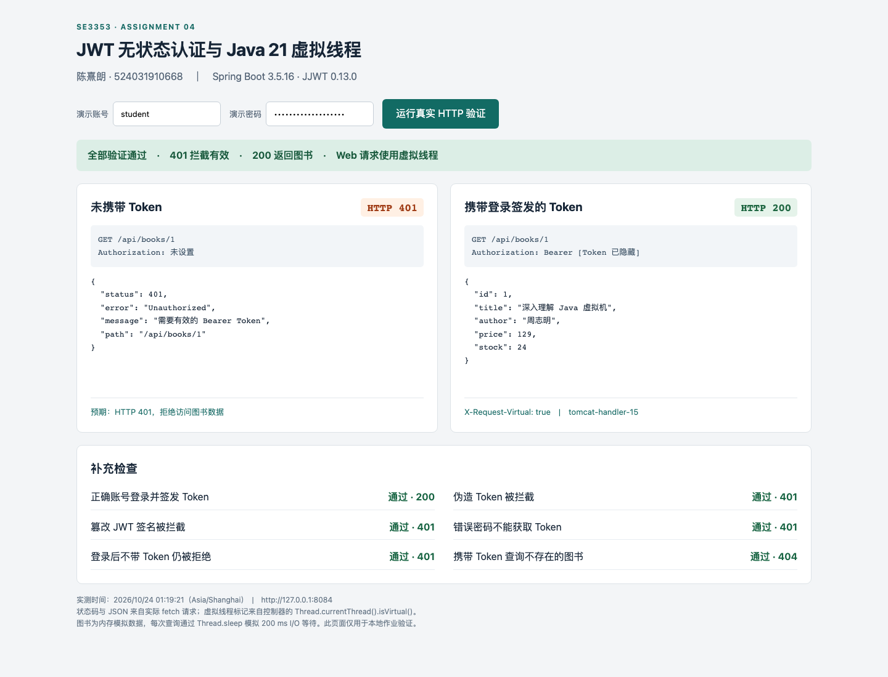

# 作业 4 实现与验证说明

陈熹朗　524031910668　实测日期：2026 年 10 月 24 日（Asia/Shanghai）

本次实现独立的书店查询后端：请求通过 JWT 认证后，在 Tomcat 的 Java 21 虚拟线程上执行同步图书查询。认证不依赖 HttpSession 或 Cookie；每次访问都需要提交有效的 Bearer Token。为便于直接运行和评分，书目使用只读内存数据，通过 `Thread.sleep(200)` 模拟慢速数据库 I/O，符合题目允许的模拟方式。

## 五项评分标准对应

| 评分项 | 实现位置 | 实测证据 |
| --- | --- | --- |
| RESTful 接口 | `BookController.java`，`GET /api/books`、`GET /api/books/{id}` | 正确 ID 返回 200；不存在返回 404；非正 ID 返回 400 |
| Java 21 虚拟线程 | `pom.xml` 的 Java 21；`application.properties` 中 `spring.threads.virtual.enabled=true` | 控制器直接读取 `Thread.currentThread().isVirtual()`；40 个并发集成测试请求和 300 个并发实验请求均为 `true` |
| JWT 库及生成 | JJWT 0.13.0；`AuthController.java`、`JwtService.java` | 登录返回 `accessToken`、`tokenType=Bearer`、`expiresIn=900`；集成测试独立验签并核对声明 |
| 无状态鉴权 Filter | `JwtAuthenticationFilter.java`、`SecurityConfig.java` | 缺失、伪造、篡改、过期 Token 返回 401；登录后不带 Token 仍为 401；Cookie 不能代替 Token |
| 401 与 200 截图 | `evidence/authentication-401-200.png` | 本地 Chromium 中实际执行 fetch；同屏展示拒绝、成功、JSON 数据与虚拟线程标记 |

## 接口与认证流程

| 请求 | 认证要求 | 返回 |
| --- | --- | --- |
| `POST /api/auth/login` | JSON 用户名、密码 | 200 和 JWT；错误凭据为 401；非法参数为 400 |
| `GET /api/books` | `Authorization: Bearer <token>` | 200 和图书数组 |
| `GET /api/books/1` | 同上 | 200 和图书对象 |
| `GET /api/books/999` | 同上 | 404，图书不存在 |
| `GET /api/books/0` | 同上 | 400，ID 必须为正整数 |

登录请求示例：

```json
{"username":"student","password":"bookstore-demo-2026"}
```

`AuthController` 用 BCrypt 检查密码，成功后调用 `JwtService.issue`。JWT 使用 HS256 签名，携带 `sub`、`iss`、`aud`、`iat`、`exp`、`jti`，有效期为 15 分钟。签名密钥从 `JWT_SECRET` 读取，为 Base64 编码的至少 32 个随机字节。源码中没有固定的可用于运行环境的签名密钥。

客户端将 Token 放入 Authorization 头。`JwtAuthenticationFilter` 在 `UsernamePasswordAuthenticationFilter` 前运行，要求仅有一个 Bearer 头，并通过 JJWT 校验签名、算法、发行者、受众、有效期及可选的 `nbf`。另行要求 `exp` 和非空 `sub` 必须存在。只有认证通过才建立当前请求的 `SecurityContext`；解析异常返回 JSON 401 和 `WWW-Authenticate: Bearer`。

签名算法白名单仅包含 HS256，未签名 Token 不可通过。Token 校验的异常处理与控制器执行分开，避免把下游业务异常误报为 Token 失效。Filter 的 Servlet 自动注册被关闭，确保它只在 Spring Security 链中执行一次。

## 无状态设计

`SecurityConfig` 使用 `SessionCreationPolicy.STATELESS`、`NullSecurityContextRepository`，并关闭 RequestCache、表单登录、HTTP Basic 和默认 Session 注销。系统既不从 Session 恢复认证，也不把认证写回 Session。CSRF 关闭的前提是此 API 仅通过显式 Authorization 头认证，不接受浏览器自动附带的 Cookie 作为凭据。

参数校验可能触发 Servlet ERROR 分派，因此仅放行 `DispatcherType.ERROR`，保留原始 400 等错误；普通外部请求仍受认证规则约束。28 项测试包含这一路径，避免参数错误被错误地改成 401。

演示账号保存在 `InMemoryUserDetailsManager` 中，它是账号数据，而非按用户登录创建的 Session。验证脚本确认登录、查询、错误响应均没有 `Set-Cookie`，且成功登录后不带 Token、仅提交假的 JSESSIONID，都返回 401。应用不维护已签发 Token 列表；短期 Token 在到期或更换签名密钥前有效，此演示未实现即时撤销。多实例部署需共享环境配置中的签名密钥；运行脚本默认的临时密钥用于单机演示。

## 虚拟线程与并发 I/O

项目编译目标为 Java 21，实际使用 Temurin 21.0.13+9 运行。Spring Boot 版本为 3.5.16，配置如下：

```properties
spring.threads.virtual.enabled=true
spring.main.keep-alive=true
app.books.delay-ms=200
```

Spring Boot 为嵌入式 Tomcat 配置虚拟线程执行器。图书控制器直接在 Web 请求线程执行 `Thread.sleep`，没有另建线程后提前返回的包装；成功响应包含实际请求线程的 `X-Request-Virtual` 和 `X-Request-Thread`。因此证据验证的是处理 HTTP 请求的线程，不能仅靠线程名称推断。

虚拟线程等待模拟 I/O 时可让出承载它的平台线程，减少固定平台线程池被等待占满的情况。这里的实现没有在 `synchronized` 区域内执行阻塞操作。此机制改善大量等待任务的并发能力，并不让 CPU 密集计算自动变快；真实数据库连接池仍可能成为吞吐瓶颈。

## 测试结果

### 自动集成测试

`BookstoreHttpTest` 使用 `@SpringBootTest(webEnvironment=RANDOM_PORT)` 启动真实 Tomcat，以 Java HttpClient 发送请求，没有用 MockMvc 代替线程验证。

运行结果：**28 项测试，0 失败，0 错误，0 跳过**。覆盖登录签发、密码错误、未知用户、空参数、非法 JSON、多字节长密码、缺失/畸形/重复 Authorization、签名篡改、过期、未来生效、缺失到期时间、缺失主体、错误发行者/受众、未签名 Token、Cookie 无法认证、REST 状态码、40 个并发请求全部使用虚拟线程等行为。

记录见 `evidence/test-summary.txt` 和 `evidence/maven-test.log`。

### 独立 HTTP 与截图验证

`scripts/verify.py` 完成 **11/11** 项检查，记录完整的状态、响应头和 JSON，Token 值已隐藏；脚本同时检查每个响应均不设置 Cookie。原始记录为 `evidence/http-verification.json`、`evidence/http-verification.txt`。

`verify.html` 是本地测试页面，点击按钮后逐个请求真实 API。`capture_evidence.cjs` 在页面报告全部检查通过后截屏；没有将预期结果写成静态截图。截图对应的结构化记录为 `evidence/browser-verification.json`。



### 并发对照实验

同一个构建产物、同一个 JWT 流程、每次模拟 I/O 200 ms。客户端使用 Python 标准库、100 个线程并发发送 100 次请求；每种模式预热 20 次，再各运行 3 轮。平台线程对照组显式限制 Tomcat 最大线程数为 10；虚拟线程模式开启 Boot 配置。客户端与服务端在同一台 Mac 上运行，使用新建 HTTP 连接。

| 模式 | 第 1 轮耗时 | 第 2 轮耗时 | 第 3 轮耗时 | 三轮中位耗时 | 三轮 HTTP 200 |
| --- | ---: | ---: | ---: | ---: | ---: |
| 平台线程池 上限 10 | 2.0795 s | 2.1522 s | 2.1227 s | 2.1227 s | 300/300 |
| Java 21 虚拟线程 | 0.3186 s | 0.3814 s | 0.3065 s | 0.3186 s | 300/300 |

这一固定条件下，完成时间之比约为 6.66。全部平台线程响应标记为 `false`，全部虚拟线程响应标记为 `true`。较小的平台线程池是为了清楚演示阻塞排队；此结果不代表相对默认 Tomcat 线程池或真实数据库的普遍提升倍数，也不是生产容量结论。原始逐轮耗时、吞吐、延迟及环境信息见 `evidence/benchmark.json`。

运行 `python3 scripts/benchmark.py` 可复验。脚本检查 18084/18085 端口可用性，只停止自己启动的两个服务。结果受机器负载、连接开销和客户端调度影响。

## 构建与交付边界

完整启动步骤见上级 `README.md`。此独立项目只包含本题必要的 Spring Web、Security、Validation 和 JJWT 依赖，不需要原书店项目、MySQL、前端工程或 RAG 服务。`scripts/package_submission.py` 使用源码与证据白名单打包，并写入 SHA-256 清单；运行生成的 JAR、第三方依赖、缓存和密钥均不在提交包中。

启动脚本显式启用 `demo` profile。若直接运行 JAR 且不启用 demo，必须配置 `JWT_SECRET`、`BOOKSTORE_USERNAME`、`BOOKSTORE_PASSWORD`。默认只监听本机 `127.0.0.1:8084`。演示书目和库存为模拟值。

## 参考资料

- [Spring Boot 3.5 虚拟线程配置](https://docs.spring.io/spring-boot/3.5/reference/features/spring-application.html#features.spring-application.virtual-threads)：Java 21 起支持 `spring.threads.virtual.enabled`，以及 `spring.main.keep-alive` 的作用。
- [JJWT 官方项目](https://github.com/jwtk/jjwt)：0.13.0 Maven 模块、签名生成与 `verifyWith(...).parseSignedClaims(...)` 验证方式。
